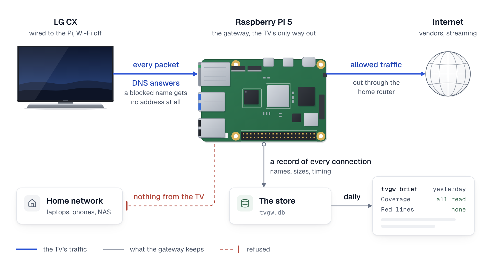

# tvgw

**A small computer between your smart TV and the internet. It blocks the TV's tracking, keeps it away from your other devices, and tells you every day what the TV tried to do.**

<!-- badges:start -->

<!-- badges:end -->

**Status:** in daily use on one LG CX (webOS 5) behind a Raspberry Pi 5. Other TVs and other computers use the same design but are not yet tested on hardware: see [what works with what](#works-with).

<picture>
  <source media="(prefers-color-scheme: dark)" srcset="docs/diagrams/fig-1-gateway.dark.png">
  
</picture>

*The TV's only way out is the gateway, which stops what it should, keeps the TV away from your other devices, and writes a brief every day.*

## Get started

You need:

- a small computer with an Ethernet port for the TV and a second connection to your router, by Wi-Fi or a second port. A Raspberry Pi 5 is the reference;
- an Ethernet cable from that computer to the TV;
- a TV with its own network port, since the cable becomes its only way out;
- your own computer, to type the gateway's commands from.

The gateway stays on, like your router. When it is off, the TV has no internet, never an unfiltered one.

You need no networking knowledge. You copy each command as it is written, and setup finds the TV, asks a few questions and checks its own work.

tvgw is installed today from its source code, on a Raspberry Pi 5 with Raspberry Pi OS (64-bit). The [install guide](docs/install/README.md) walks through it, including how to open a terminal on the gateway from your own computer.

Since 0.3.0, each release also carries a one-line installer. It has not yet been run on a real gateway, and it stops when the filter is not installed first. This page shows it once someone who is not an engineer has installed tvgw with it.

## What you get

Every day the gateway writes a short brief: whether the protection held, what the TV tried to reach, what was refused, and anything you should do. You read it in a terminal on the gateway with `tvgw brief`.

In one measured day on the LG CX the project was built on, the TV asked for known advertising, tracking and fingerprinting services 3,983 times. Every one was refused, and none led to a connection. What went through was the streaming itself (59 GB), LG's own services, and 28 names the profile does not classify, which carried 2.7 GB ([the measurements](docs/tv/lg-cx-measured.md)).

## What it stops, and what it cannot

tvgw controls only the traffic that passes through the gateway, so it rests on one assumption: the cable to the gateway is the TV's only connection. The TV's Wi-Fi is off, its saved networks are forgotten, and Wi-Fi Direct is off.

- **It stops** the TV's known advertising, tracking and screen-recognition services, the known ways around the filter, and every connection from the TV to your other devices.
- **It cannot stop** a TV that turns its Wi-Fi back on, or radios such as Bluetooth: the LG CX advertises itself over Bluetooth, and webOS 5 has no switch to stop it. It cannot remove ads inside the video stream, and your internet provider still sees which services the TV connects to.
- **It costs** casting from a phone and phone remote apps, because nothing on your home network can reach the TV.

tvgw installs nothing on the TV. It does not root the TV or change its software, so it avoids the warranty risk that rooting carries.

The record of what the TV did stays on the gateway. Only the optional analyst sends anything from it, a scrubbed daily summary, and only when you add its key. tvgw is open source under the MIT license, so anyone can read its code ([your household's privacy](docs/use/privacy.md)).

It works today on the project's LG CX, measured for a week. Because it works at the network and not on the TV, the same approach should apply to newer sets and other brands, but how much it stops depends on the TV. [What it stops, and what it cannot](docs/what-it-stops.md) says what is known for each.

## Works with

<!-- generated:support-table -->
| TV | Status | What tvgw does | What you check on the TV yourself |
|---|---|---|---|
| LG, webOS 5 (2020 sets) | **Tested** on an LG CX (OLED55CX), software 04.64.00 | Blocks, reports every day, and once paired reads the TV's privacy settings and Wi-Fi state every hour | Nothing after setup |
| LG, webOS 6 and later (2021 on) | **Not yet tested** on these versions | Blocks and reports every day; once paired, reads the privacy settings, and the Wi-Fi state where the TV reports it | That the TV's Wi-Fi is off, until tvgw shows it can read it on your TV |
| LG, webOS 3 and 4 (2016 to 2019 sets) | **Not yet tested** on these versions | Blocks and reports every day; once paired, reads the privacy settings, and the Wi-Fi state where the TV reports it | That the TV's Wi-Fi is off, until tvgw shows it can read it on your TV |
| Samsung (Tizen) | **Not yet tested**, built from published research | Blocks and reports every day | That the TV's Wi-Fi is off, and its privacy and viewing-data settings, in the TV's own menus |
| Roku TV | **Not yet tested**, built from published research | Blocks and reports every day | That the TV's Wi-Fi is off, and its privacy and viewing-data settings, in the TV's own menus |
| Vizio (SmartCast) | **Not yet tested**, built from published research | Blocks and reports every day | That the TV's Wi-Fi is off, and its privacy and viewing-data settings, in the TV's own menus |
| Other TVs (Google TV, Fire TV, Sony, TCL, Hisense and more) | **Not yet tested**, with the general profile | Keeps the TV away from your other devices, reports every day, and blocks known trackers from shared lists | That the TV's Wi-Fi is off, and its privacy and viewing-data settings, in the TV's own menus |
<!-- /generated:support-table -->

| Gateway computer | Status |
|---|---|
| Raspberry Pi 5 with Raspberry Pi OS (64-bit) | **In daily use** on the project's own gateway, installed from source; a fresh install is not yet tested |
| Debian 13 with a desktop, or Ubuntu 24.04 or 26.04 Desktop | **Checked automatically**: every change is checked against its programs; no gateway runs it yet |

[Choose a gateway computer](docs/install/choosing-a-gateway.md) says what each status word means, for every system.

If you have another TV, a report of what it does behind a gateway is the most useful contribution: [Your TV](docs/tv/README.md) says how to send one.

## Learn more

- [Install guide](docs/install/README.md)
- [Read your daily brief](docs/use/daily-brief.md)
- [Your TV: what to switch off, brand by brand](docs/tv/README.md)
- [What it stops, and what it cannot](docs/what-it-stops.md)
- [How it works, and everything else](docs/README.md)
- [Contributing](CONTRIBUTING.md)
- [Report a security problem privately](SECURITY.md)
- MIT [license](LICENSE)
