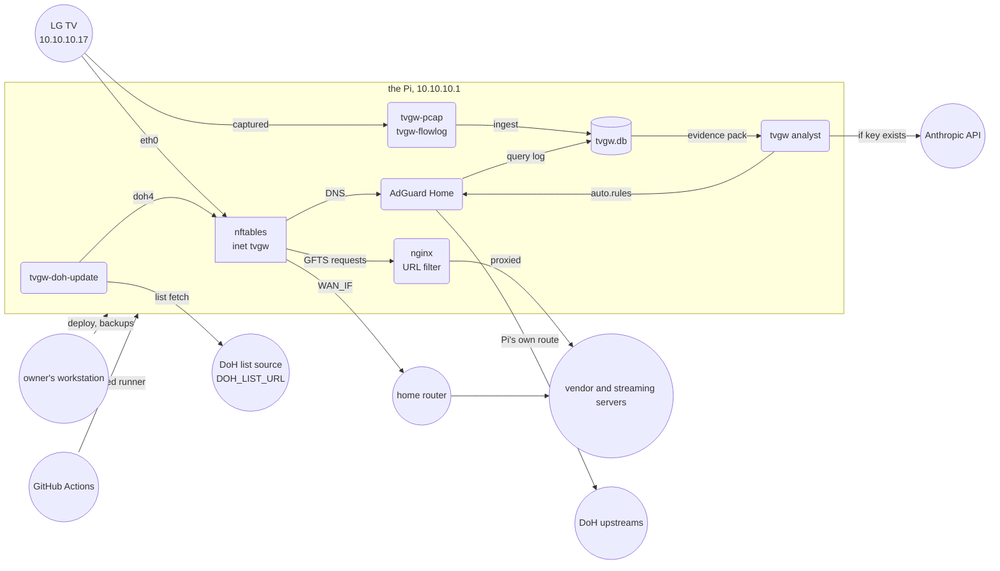

# tvgw: a Raspberry Pi between a smart TV and the internet

tvgw makes a Raspberry Pi the only way a smart TV reaches the internet: the Pi forces the TV's DNS through a filter, blocks the ways around it, records what the TV does in a SQLite store and, with `ANALYST_APPLY=auto`, blocks telemetry on its own under [design decision 20](docs/design-decisions.md#20-the-gateway-blocks-on-its-own-under-three-watches). This page is for a technical reader who has never seen the project and for the owner setting up a new gateway. It covers what tvgw does and does not do, what it defends against, what it found on an LG CX, how the parts fit, and the quick start.

## What it does

- **Isolation.** The TV's only route out is the Pi, whose firewall forces its DNS to AdGuard Home, rejects DoT, DoQ, QUIC and known DoH resolvers, keeps it off the home LAN and drops IPv6 ([the firewall](deploy/nftables/README.md)).
- **Filtering.** AdGuard Home is configured as code from the profile and the settings file, and an nginx URL filter splits LG's plain-HTTP file service by URL ([changing policy](docs/operations.md#changing-policy)).
- **Observation.** tcpdump keeps the parts of the TV's traffic the analysis needs, conntrack logs every finished connection, AdGuard Home logs every query, and the hourly ingest loads them into one SQLite file ([what the capture keeps](docs/privacy-and-retention.md#what-the-capture-keeps)).
- **Reporting.** `tvgw brief` is a one-screen daily summary with red lines at the top ([the brief's sections](docs/reading-the-brief.md#sections)), and `tvgw verify` checks on a timer that the firewall, routing, resolver and services still hold ([what tvgw verify checks](docs/troubleshooting.md#what-tvgw-verify-checks)).
- **The analyst and autonomous blocks.** With an API key, a Claude model reads a minimized evidence pack each day and proposes rules, and with `ANALYST_APPLY=auto` a block that passes the code's gates, a second model and a live canary is applied on probation ([the analyst and autonomy](docs/analyst-and-autonomy.md)).
- **Profiles.** What is vendor-specific lives in a TOML profile and its `.rules` file, not in code, and the bundled profile is `lg-webos` ([the profile format](docs/adding-a-profile.md#the-profile-format)).

## What it is not

- It does not decrypt TLS. It sees names, sizes and timing, so it cannot remove ads stitched into a video stream ([design decision 3](docs/design-decisions.md#3-no-tls-interception)).
- It does not root the TV or change its settings. On the CX's firmware the LAN API refuses writes, so settings change only with the remote ([design decision 4](docs/design-decisions.md#4-no-rooting-of-the-tv)).
- It does not hide the home's public address from LG, the CDNs or the streaming services, and the ISP sees the destination addresses and TLS server names of the TV's connections ([design decision 1](docs/design-decisions.md#1-the-tv-uses-the-direct-uplink-not-the-vpn)).
- It does not let devices on the home network reach the TV, so casting and remote apps that need a LAN connection do not work across the gateway ([design decision 2](docs/design-decisions.md#2-isolate-first-then-filter)).
- It does not page anyone. The owner reads the brief, and a failed check shows in `systemctl --failed` ([design decision 14](docs/design-decisions.md#14-red-lines-are-the-alarm-model)).

## What it defends against

A DNS filter alone fails against a device that ignores the resolver DHCP hands it, so tvgw isolates the TV first and filters second ([design decision 2](docs/design-decisions.md#2-isolate-first-then-filter)). It targets:

- ACR: fingerprints of what is on screen, sent to the vendor or an ad partner;
- telemetry and ad measurement from the vendor and from preinstalled apps;
- device fingerprinting by remote-control and smart-home vendors;
- sweeps of the home LAN and probes of networks the TV remembers;
- voice back-ends, blocked so that a declined consent is a wall and not a checkbox;
- DNS bypass: hardcoded resolvers, DoH, DoT, DoQ and QUIC, plus connections to addresses no lookup returned, which the gate counts ([design decision 18](docs/design-decisions.md#18-dns-gated-egress-starts-as-a-count-in-its-own-table)).

One dependency runs the other way. webOS has no battery clock and takes its time from LG's SDP reply, so a blocked [clock host](docs/glossary.md#clock-host) resets the clock, and then TLS fails everywhere. The profile's must-allow list holds the clock hosts, and the brief raises a [red line](docs/operations.md#red-lines) when one is blocked or when the TV was on for a day without looking one up.

## What it found on an LG CX

The bundled profile was built on an LG CX running webOS 5 in October 2026. Each finding here is a dated comment in [lg-webos.rules](src/tvgw/profiles/lg-webos.rules).

- LG's file service (GFTS) carries app packages and icons, and also the ACR config file, the telemetry schedule, LG Shopping data and promo thumbnails. Blocking its hosts broke a Prime Video update on 2026-10-25, so since 2026-10-26 a URL filter splits it by URL.
- The Content Store fails outright without its landing-page feed, `us.lgrecommends.lgappstv.com` (found 2026-10-26).
- Prime Video's client telemetry host, `unagi-na.amazon.com`, was the TV's biggest non-video uploader on 2026-10-25. It is blocked.
- Peacock played normally with its telemetry ingest blocked: playback, CDN switching, token refresh, pause and resume (verified 2026-10-25).
- Blocking Prime Video's ad-pod service did not remove its ads, which come stitched into the stream from the same CDNs as the show (tried 2026-10-25).
- The TV opened an MQTT push channel to an AWS IoT host for LG ThinQ. It is blocked with LG's IoT back-ends (2026-10-25).
- The CX has no built-in microphone. With the Voice Information agreement declined, a press of the remote's mic button produced a consent prompt and no network activity (verified 2026-10-26).

## How it fits together

The TV is cabled to the Pi's `eth0` and gets a fixed address from dnsmasq (`TV_IP` and `GW_IP` in [the settings file](deploy/README.md#the-settings-file)). Every packet it sends meets the firewall, table `inet tvgw` ([the firewall](deploy/nftables/README.md)). DNS goes to AdGuard Home, requests for LG's file service go to the nginx URL filter, and the rest leaves through `WAN_IF` to the home router (`UPLINK=direct`, [design decision 1](docs/design-decisions.md#1-the-tv-uses-the-direct-uplink-not-the-vpn)). Nothing from the TV reaches the home LAN.

AdGuard Home forwards the lookups it allows to its DoH upstreams as the Pi's own traffic, which takes the VPN tunnel `tun0` when one runs. nginx proxies the downloads it allows. `tvgw-pcap` and `tvgw-flowlog` record the TV's traffic, and the hourly ingest loads their files and AdGuard's query log into the store, `tvgw.db`. `tvgw analyst` builds its evidence pack from the store and sends it to the Anthropic API only when the key file exists. With `ANALYST_APPLY=auto` it writes `auto.rules` and re-applies AdGuard Home. `tvgw-doh-update` fetches the DoH resolver list from `DOH_LIST_URL` and reloads the `doh4` set. The owner's workstation deploys and pulls backups over ssh, and GitHub Actions deploys through a self-hosted runner on the Pi ([how a change reaches the gateway](deploy/README.md#how-a-change-reaches-the-gateway)).



*The system in context: the TV's only path out is through the Pi, and the TV never reaches the home LAN.*

## Quick start

You need a Pi with Raspberry Pi OS on Debian 12 or 13 (the reference gateway runs 13, trixie), NetworkManager, Python 3.11 or newer, `eth0` for the TV, an uplink (`WAN_IF`) and AdGuard Home installed natively in `/opt/AdGuardHome`.

1. On the Pi, install the packages that `deploy/install.sh` names in its header:
   ```sh
   sudo apt install tcpdump conntrack dnsmasq tshark nginx libnginx-mod-stream python3-venv
   ```
2. Install [AdGuard Home](https://github.com/AdguardTeam/AdGuardHome#getting-started) and finish its first-run wizard through an ssh port-forward to port 3000.
3. On the Pi, clone the repository to `/opt/tvgw/src`:
   ```sh
   sudo install -d -o "$USER" /opt/tvgw
   git clone <repo-url> /opt/tvgw/src
   ```
4. On the Pi, install the settings template and set only `WAN_IF` and `WAN_GW` in it:
   ```sh
   sudo install -D -m 640 -g adm /opt/tvgw/src/deploy/tvgw.conf.example /etc/tvgw/tvgw.conf
   sudoedit /etc/tvgw/tvgw.conf
   ```
5. Cable the TV to the Pi's `eth0` and make it forget its Wi-Fi networks, so it has no unfiltered way out.
6. On the Pi, run the installer, which finds the TV with `tvgw discover` and ends with `tvgw verify`:
   ```sh
   cd /opt/tvgw/src/deploy
   sudo ./install.sh
   ```
7. On the Pi, check the gateway at any time; every line must start with `OK`:
   ```sh
   sudo tvgw verify
   ```
8. On the Pi, pair an LG's LAN API once and accept the TV's prompt; the key controls the TV, so make it root-only:
   ```sh
   sudo /opt/tvgw-venv/bin/bscpylgtvcommand -p /var/lib/tvgw/lgtv-keys.sqlite <TV_IP> get_software_info
   sudo chmod 600 /var/lib/tvgw/lgtv-keys.sqlite
   ```
9. On the Pi, optionally put an Anthropic API key in a root-only `/etc/tvgw/claude.key` for [the analyst](docs/analyst-and-autonomy.md):
   ```sh
   sudo install -m 600 /dev/null /etc/tvgw/claude.key
   sudoedit /etc/tvgw/claude.key
   ```
10. The next day, on the Pi, read the brief for the day before ([the brief's sections](docs/reading-the-brief.md#sections)):
    ```sh
    tvgw brief
    ```
11. From your workstation, deploy changes with `make deploy PI=<ssh-host>` ([how a change reaches the gateway](deploy/README.md#how-a-change-reaches-the-gateway)).

## Where to go next

A new reader continues the 20-minute path with [the architecture](docs/architecture.md), then [reading the brief](docs/reading-the-brief.md). [The documentation index](docs/README.md) has a reading path for every role, and [the operations runbook](docs/operations.md) covers running the gateway day to day.

What this page used to hold now has one home each:

| Looking for | Now in |
|---|---|
| Brief sections | [the brief's sections](docs/reading-the-brief.md#sections) |
| Changing policy | [changing policy](docs/operations.md#changing-policy) |
| Command reference | [the commands](src/tvgw/README.md#commands) |
| Documentation map | [the page map](docs/README.md#pages) |
| Repository layout | [the repository map](docs/README.md#repository-map) |
| Testing | [the tests](tests/README.md) |

## License

MIT. The terms are in [LICENSE](LICENSE).
