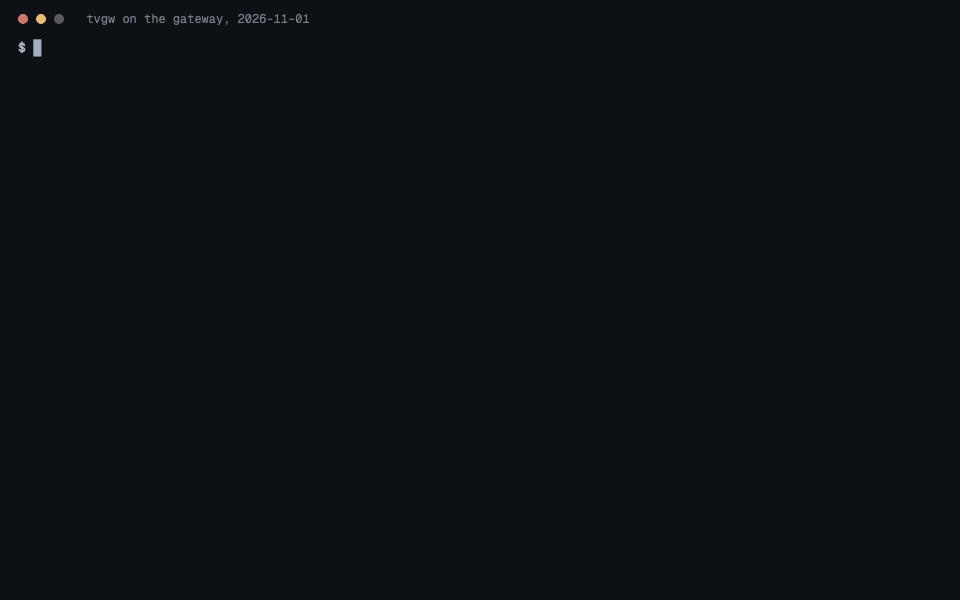

# tvgw: a Raspberry Pi between a smart TV and the internet

tvgw makes a Raspberry Pi the only way a smart TV reaches the internet: the Pi forces the TV's DNS through a filter, blocks the ways around it, records what the TV does in a SQLite store and, with `ANALYST_APPLY=auto`, blocks telemetry on its own under [design decision 20](docs/design-decisions.md#20-the-gateway-blocks-on-its-own-under-three-watches). This page is for a technical reader who has never seen the project and for the owner setting up a new gateway. It covers what tvgw does and does not do, what it defends against, what it found on an LG CX, how the parts fit, and the quick start, and [the glossary](docs/glossary.md) defines each term it uses.



*A 14-second recording of `tvgw verify` and the daily brief on the live gateway. The same session as an asciicast, and how to play it, is in [the demo](docs/demo/README.md).*

## What it does

- **Isolation.** The TV's only route out is the Pi, whose firewall, table `inet tvgw`, forces its DNS to AdGuard Home, rejects DoT, DoQ, QUIC and known DoH resolvers, resets LG's ad-tech ports, keeps it off the home LAN and drops IPv6 ([the firewall](deploy/nftables/README.md)). A second table, the [guard](docs/glossary.md#guard), is loaded at boot and never unloaded: from the TV it lets through to the Pi only DHCP, DNS, nginx and pings to the gateway's address, so the Pi's own services stay closed to the TV at boot, while the firewall is stopped and after an apply that failed. The Pi's other services also refuse the TV subnet by their own cgroup filter ([design decision 42](docs/design-decisions.md#42-the-pi-is-closed-to-the-tv-whatever-nftables-holds)).
- **Filtering.** AdGuard Home is configured as code from the profile and the settings file, and an nginx URL filter splits LG's plain-HTTP file service by URL ([changing policy](docs/operations.md#changing-policy)). The blocklists AdGuard subscribes to update themselves, so `tvgw verify` checks that each list is in force and the brief's List changes says what an update changed for the TV; AdGuard's own binary changes only through `tvgw adguard upgrade` ([AdGuard Home](docs/adguard.md)).
- **Observation.** dumpcap keeps the parts of the TV's traffic the analysis needs ([the capture](docs/capture.md)), conntrack logs every finished TV connection (the firewall marks the TV's connections, so the kernel reports no others), AdGuard Home logs every query, and the hourly ingest loads them into one SQLite file ([what the capture keeps](docs/privacy-and-retention.md#what-the-capture-keeps)).
- **A short record.** The gateway keeps the least of its own record that the detectors need: two weekly copies of the flow and URL-filter logs, a journal of `JOURNAL_DAYS` days, kernel log lines without the Pi's host name or MAC headers, and `tvgw forget` deletes the whole viewing record on request ([privacy and retention](docs/privacy-and-retention.md)).
- **Reporting.** `tvgw brief` is a one-screen daily summary with red lines at the top and "Changes in effect", the change ledger's account of what changed on the gateway, after them ([the brief's sections](docs/reading-the-brief.md#sections)). `tvgw verify` checks on a timer that the firewall, the guard, routing, the resolver, the lists and the services still hold ([what tvgw verify checks](docs/troubleshooting.md#what-tvgw-verify-checks)).
- **The analyst and autonomous blocks.** With an API key, a Claude model reads a minimized [evidence pack](docs/glossary.md#evidence-pack) each day and proposes rules ([the analyst and autonomy](docs/analyst-and-autonomy.md)). With `ANALYST_APPLY=auto`, a block that passes the code's gates and a [second model](docs/glossary.md#second-model) is applied, watched live for 10 minutes by the [canary](docs/glossary.md#canary), and kept on [probation](docs/glossary.md#probation) for at least a day, one rule at a time: the [three watches](docs/glossary.md#three-watches). The gates refuse a block that rests on no observed traffic, a trial without enough watched hours ends [untested](docs/glossary.md#untested) rather than passed, every step is a row in the append-only [decisions table](docs/glossary.md#decisions-table), and a second judge runs in [shadow](docs/glossary.md#judge-v2-and-shadow) beside the hourly one and decides nothing ([design decisions 41](docs/design-decisions.md#41-the-autonomy-refuses-what-it-cannot-see-and-keeps-what-it-decided) and [48](docs/design-decisions.md#48-one-ledger-of-changes-one-hour-classifier-and-a-second-judge-that-only-watches)). `sudo tvgw undo` takes the newest one out ([taking a rule out](docs/analyst-and-autonomy.md#taking-a-rule-out)).
- **Profiles.** What is vendor-specific lives in a TOML profile and its `.rules` file, not in code, and the bundled profiles are `lg-webos`, verified on an LG CX, and the DNS-only `samsung-tizen`, `roku` and `vizio-smartcast`, built from maintained lists and measurement papers and unverified ([the profile format](docs/adding-a-profile.md#the-profile-format), [the bundled profiles](src/tvgw/profiles/README.md)).

## What it is not

- It does not decrypt TLS. It sees names, sizes and timing, so it cannot remove ads stitched into a video stream ([design decision 3](docs/design-decisions.md#3-no-tls-interception)).
- It does not root the TV or change its settings. On the CX's firmware the LAN API refuses writes, so settings change only with the remote ([design decision 4](docs/design-decisions.md#4-no-rooting-of-the-tv)).
- It does not hide the home's public address from LG, the CDNs or the streaming services, and the ISP sees the destination addresses and TLS server names of the TV's connections ([design decision 1](docs/design-decisions.md#1-the-tv-uses-the-direct-uplink-not-the-vpn)).
- It does not let devices on the home network reach the TV, so casting and remote apps that need a LAN connection do not work across the gateway ([design decision 2](docs/design-decisions.md#2-isolate-first-then-filter)).
- It does not page anyone. The owner reads the brief, and a failed check shows in `systemctl --failed` ([design decision 14](docs/design-decisions.md#14-red-lines-are-the-alarm-model)).
- It does not see the TV's radios. It filters only the cable, so the TV's Wi-Fi and Wi-Fi Direct must be off and its saved networks forgotten, or the TV can go around it; an LG TV on webOS 5 whose LAN API is paired has its Wi-Fi state checked every hour ([design decision 40](docs/design-decisions.md#40-the-tvs-radios-are-checked-not-assumed)). Bluetooth is outside its reach: the LG CX advertises its presence over Bluetooth, and webOS 5 has no switch to stop it ([BLE advertises with no switch](docs/findings.md#ble-advertises-with-no-switch)).

<picture>
  <source media="(prefers-color-scheme: dark)" srcset="docs/diagrams/fig-19-what-it-stops.dark.png">
  
</picture>

*The gateway filters only the cable, so the TV's Wi-Fi must be off with its networks forgotten, Bluetooth stays outside its reach, and nothing is installed on the TV.*

## What it defends against

A DNS filter alone fails against a device that ignores the resolver DHCP hands it, so tvgw isolates the TV first and filters second ([design decision 2](docs/design-decisions.md#2-isolate-first-then-filter)). It targets:

- ACR: fingerprints of what is on screen, sent to the vendor or an ad partner, which the brief looks for as an upload shape and the firewall's port wall as an attempt on LG's ad-tech ports ([design decision 45](docs/design-decisions.md#45-the-acr-red-line-is-an-upload-test-and-a-port-wall));
- telemetry and ad measurement from the vendor and from preinstalled apps;
- device fingerprinting by remote-control and smart-home vendors;
- sweeps of the home LAN and probes of networks the TV remembers, and of the Pi's own services;
- voice back-ends, blocked so that a declined consent is a wall and not a checkbox;
- DNS bypass: hardcoded resolvers, DoH, DoT, DoQ and QUIC, plus connections to addresses no lookup returned, which [the gate](docs/glossary.md#dns-gated-egress-gate-and-gate-sample) counts ([design decision 18](docs/design-decisions.md#18-dns-gated-egress-starts-as-a-count-in-its-own-table)).

One dependency runs the other way. webOS has no battery clock and takes its time from LG's [SDP](docs/glossary.md#sdp) reply, so a blocked [clock host](docs/glossary.md#clock-host) resets the clock, and then TLS fails everywhere. The profile's must-allow list holds the clock hosts, and the brief raises a [red line](docs/operations.md#red-lines) when one is blocked or when the TV was on for a day without looking one up.

## What it found on an LG CX

The `lg-webos` profile was built on an LG CX running webOS 5 in October 2026. Each finding here is a dated comment in [lg-webos.rules](src/tvgw/profiles/lg-webos.rules).

- LG's file service (GFTS) carries app packages and icons, and also the ACR config file, the telemetry schedule, LG Shopping data and promo thumbnails. Blocking its hosts broke a Prime Video update on 2026-10-25, so since 2026-10-26 a URL filter splits it by URL.
- The Content Store fails outright without its landing-page feed, `us.lgrecommends.lgappstv.com` (found 2026-10-26).
- Prime Video's client telemetry host, `unagi-na.amazon.com`, was the TV's biggest non-video uploader on 2026-10-25. It is blocked.
- Peacock played normally with its telemetry ingest blocked: playback, CDN switching, token refresh, pause and resume (verified 2026-10-25).
- Blocking Prime Video's ad-pod service did not remove its ads, which come stitched into the stream from the same CDNs as the show (tried 2026-10-25).
- The TV opened an MQTT push channel to an AWS IoT host for LG ThinQ. It is blocked with LG's IoT back-ends (2026-10-25).
- The CX has no built-in microphone. With the Voice Information agreement declined, a press of the remote's mic button produced a consent prompt and no network activity (verified 2026-10-26).

The week behind these findings, measured day by day with the numbers, is in [what an LG CX does on the network](docs/findings.md).

## How it fits together

The TV is cabled to the Pi's `eth0` and gets a fixed address from dnsmasq (`TV_IP` and `GW_IP` in [the settings file](deploy/README.md#the-settings-file)). Every packet it sends meets the firewall, table `inet tvgw`, and after it the guard, `inet tvgw_guard`, which can only narrow what the firewall allows ([the firewall](deploy/nftables/README.md)). DNS goes to AdGuard Home, which answers the names of LG's file service with the gateway's address (`GW_IP`), so the TV's requests to that service reach the nginx URL filter on the Pi, and the rest leaves through `WAN_IF` to the home router (`UPLINK=direct`, [design decision 1](docs/design-decisions.md#1-the-tv-uses-the-direct-uplink-not-the-vpn)). Nothing from the TV reaches the home LAN.

AdGuard Home forwards the lookups it allows to its DoH upstreams as the Pi's own traffic, which takes the VPN tunnel when one runs: the `VPN_IF` setting names it, and its default, `auto`, finds `tun0`, else `wgpia0` (PIA's OpenVPN and WireGuard interfaces). nginx proxies the downloads it allows. `tvgw-pcap` and `tvgw-flowlog` record the TV's traffic, and the hourly ingest loads their files and AdGuard's query log into the store, `tvgw.db`. `tvgw analyst` builds its evidence pack from the store and sends it to the Anthropic API only when the key file exists. With `ANALYST_APPLY=auto` it writes `auto.rules` and re-applies AdGuard Home. `tvgw-doh-update` fetches the DoH resolver list from `DOH_LIST_URL` and reloads the `doh4` set. The owner's workstation deploys and pulls backups over ssh, and GitHub Actions deploys through a self-hosted runner on the Pi ([how a change reaches the gateway](deploy/README.md#how-a-change-reaches-the-gateway)).

The card in the picture below is one measured day of the LG CX ([a day in numbers](docs/findings.md#a-day-in-numbers)): every one of its 3,983 lookups of known tracking services was refused, and none led to a connection. What went through was the streaming, the TV's own services, and 28 names the profile does not classify, which carried 2.7 GB.

<picture>
  <source media="(prefers-color-scheme: dark)" srcset="docs/diagrams/fig-1-gateway.dark.png">
  
</picture>

*The TV's only way out is the gateway, which stops known tracking, keeps the TV away from your other devices and writes a brief every day; the card is one measured day of the project's LG CX, the 24 hours to 2026-11-01.*

## Quick start

You need a Pi with Raspberry Pi OS on Debian 12 or 13 (the reference gateway runs 13, trixie), NetworkManager, Python 3.11 or newer, a port for the TV (`TV_IF`, `eth0` by default), an uplink (`WAN_IF`) and AdGuard Home installed natively in `/opt/AdGuardHome`. These steps install from a checkout; to install the arm64 .deb instead, see [installing from the .deb](docs/packaging.md#installing-from-the-deb).

**The guided way.** Do steps 1 to 3 and 5 below, then run the guided installer on the Pi. It finds the TV, asks which device it is, writes the settings file, runs `install.sh`, offers to pair the LAN API and ends with `tvgw verify` in plain words ([tvgw setup](docs/setup.md)):

```sh
cd /opt/tvgw/src
sudo apt install python3-yaml                 # the system Python runs tvgw from the checkout
sudo PYTHONPATH=src python3 -m tvgw setup     # once installed: sudo tvgw setup
```

`--dry-run` shows every change and makes none, and `--answers FILE --yes` installs unattended ([the unattended path](docs/setup.md#the-unattended-path)). The steps below are the same install by hand.

1. On the Pi, install the packages that `deploy/install.sh` names in its header. The first line answers No, before the package asks, to letting non-superusers capture, so dumpcap stays executable by the capture user ([what dumpcap needs](docs/capture.md#what-dumpcap-needs)):
   ```sh
   echo 'wireshark-common wireshark-common/install-setuid boolean false' | sudo debconf-set-selections
   sudo apt install tcpdump conntrack dnsmasq tshark wireshark-common nginx libnginx-mod-stream python3-venv
   ```
2. Install [AdGuard Home](https://github.com/AdguardTeam/AdGuardHome#getting-started) and finish its first-run wizard, which listens on port 3000. On your workstation, forward that port and open `http://127.0.0.1:3000`:
   ```sh
   ssh -L 3000:127.0.0.1:3000 <ssh-host>
   ```
   In the wizard, give the DNS server a listen address that covers both `10.10.10.1` and `127.0.0.1` on port 53: `tvgw verify` asks the resolver at `10.10.10.1`, and `tvgw adguard apply` waits for an answer at `127.0.0.1`. `eth0` has no `10.10.10.1` until `install.sh` brings `tv-lan` up, so the wizard cannot offer it by name; all interfaces covers both. With `ADGUARD_LISTEN=gateway`, which the template of step 4 sets, `tvgw adguard apply` then narrows it to those two addresses ([the listen setting](docs/adguard.md#the-listen-setting)). Any web-interface address does for the wizard: `tvgw adguard apply` sets it to `127.0.0.1:3000` ([the AdGuard web UI](docs/operations.md#the-adguard-web-ui)).
3. On the Pi, clone the repository to `/opt/tvgw/src`:
   ```sh
   sudo install -d -o "$USER" /opt/tvgw
   git clone <repo-url> /opt/tvgw/src
   ```
4. On the Pi, install the settings template and set `WAN_IF` and `WAN_GW` in it, and `VPN_IF=none` when the Pi runs no VPN client ([the settings file](deploy/README.md#the-settings-file)):
   ```sh
   sudo install -D -m 640 -g adm /opt/tvgw/src/deploy/tvgw.conf.example /etc/tvgw/tvgw.conf
   sudoedit /etc/tvgw/tvgw.conf
   ```
5. Cable the TV to the Pi's `eth0` and make it forget its Wi-Fi networks, so it has no unfiltered way out.
6. On the Pi, run the installer, which finds the TV with `tvgw discover` and ends with `tvgw verify`:
   ```sh
   cd /opt/tvgw/src/deploy
   sudo ./install.sh
   ```
7. On the Pi, check the gateway at any time; every line must start with `OK`:
   ```sh
   sudo tvgw verify
   ```
8. On the Pi, with the TV on, pair an LG's LAN API once and accept the TV's prompt with the remote. The prompt is not one of the TV's user agreements: leave those declined. The key it creates controls the TV and is root's alone ([pairing](docs/setup.md#pairing)):
   ```sh
   sudo tvgw tv pair
   ```
9. On the Pi, optionally put an Anthropic API key in a root-only `/etc/tvgw/claude.key` for [the analyst](docs/analyst-and-autonomy.md):
   ```sh
   sudo install -m 600 /dev/null /etc/tvgw/claude.key
   sudoedit /etc/tvgw/claude.key
   ```
10. The next day, on the Pi, read the brief for the day before ([the brief's sections](docs/reading-the-brief.md#sections)):
    ```sh
    tvgw brief
    ```
11. From your workstation, deploy changes with `make deploy PI=<ssh-host>` ([how a change reaches the gateway](deploy/README.md#how-a-change-reaches-the-gateway)).

## Where to go next

A new reader continues, in about half an hour in all, with [the architecture](docs/architecture.md), then [how to read the brief](docs/reading-the-brief.md#how-to-read-it), [what the store holds](docs/privacy-and-retention.md#what-the-store-holds) and [what the analyst does](docs/analyst-and-autonomy.md#what-it-does), with [the glossary](docs/glossary.md) for the terms. [The documentation index](docs/README.md) has a reading path for every role, and [the operations runbook](docs/operations.md) covers running the gateway day to day.

What this page used to hold now has one home each:

| Looking for | Now in |
|---|---|
| Brief sections | [the brief's sections](docs/reading-the-brief.md#sections) |
| Changing policy | [changing policy](docs/operations.md#changing-policy) |
| Command reference | [the commands](src/tvgw/README.md#commands) |
| Documentation map | [the page map](docs/README.md#pages) |
| Repository layout | [the repository map](docs/README.md#repository-map) |
| Testing | [the tests](tests/README.md) |

## Contributing

[CONTRIBUTING.md](CONTRIBUTING.md) gives the setup, the gate CI runs, the house rules and how a change lands. The most useful contribution is a report of what another TV does behind a gateway, which the issue forms ask for. A security problem goes to the owner privately, as [SECURITY.md](SECURITY.md) says, never in a public issue.

## License

MIT. The terms are in [LICENSE](LICENSE).
