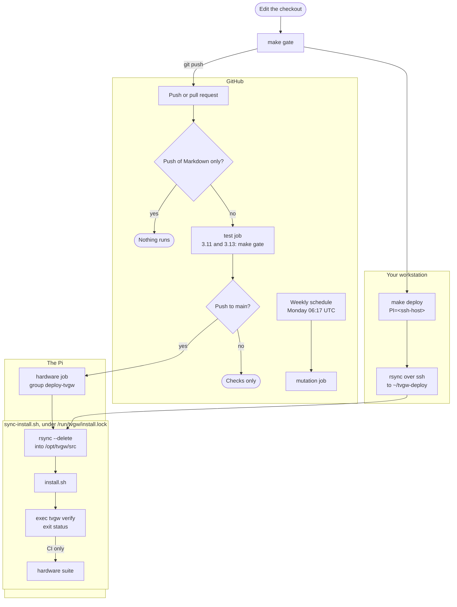
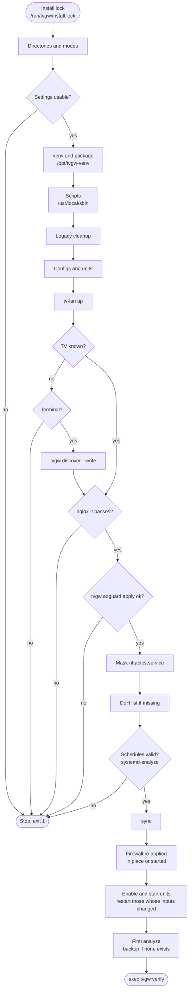

# Deployment

This folder holds everything that runs on the Pi outside the Python package: the installer, the settings template, and the configs, units and scripts in the folders below. This page owns how a change reaches the gateway, what `install.sh` does, and the settings file; it is for whoever installs the gateway, deploys a change, or edits anything here. How the pieces fit together is in [the architecture page](../docs/architecture.md).

## Files

| Path | What it is | Installed as or used by |
|---|---|---|
| `install.sh` | The installer, run as root from `deploy/`. | `sync-install.sh`, or by hand |
| `sync-install.sh` | Takes the install lock, replaces `/opt/tvgw/src` with the tree it sits in (`rsync --delete`), runs `install.sh` with the lock handed down, then an optional command (the CI hardware suite) from `/opt/tvgw/src`, all under `/run/tvgw/install.lock`. | `make deploy` from the staging copy, and CI's hardware job from its checkout |
| `tvgw.conf.example` | The settings template. | `/etc/tvgw/tvgw.conf`, only when that file is missing |
| `rsync.exclude` | The paths left out of every copy to the Pi: `.git` and everything `.gitignore` lists (databases, `build`, `dist`, `*.egg-info`, `__pycache__` and `*.py[cod]`, the test, lint and mutation caches, `.venv` and `venv`, `*.pcap`, `*.tsv`, `*.log`, `*.swp`, the site settings in `deploy/local/`, `.pi` and `backups/`). `test_deploy_lint.py` keeps it in step with `.gitignore`. | `make deploy` and `sync-install.sh` |
| [`bin/`](bin/README.md) | `tvgw-analyze` and `tvgw-doh-update`. | `/usr/local/sbin/` |
| [`dnsmasq/`](dnsmasq/README.md) | The DHCP template. | `/etc/dnsmasq.d/tvgw.conf` |
| [`logrotate/`](logrotate/README.md) | Rotation of the gateway's logs. | `/etc/logrotate.d/tvgw` |
| [`networkmanager/`](networkmanager/README.md) | The `eth0` config and the dispatcher that re-applies the firewall. | `/etc/NetworkManager/conf.d/`, `/etc/NetworkManager/dispatcher.d/` |
| [`nftables/`](nftables/README.md) | `tvgw-apply` and the two address lists it reads. | `/usr/local/sbin/tvgw-apply`, `/etc/tvgw/` |
| [`nginx/`](nginx/README.md) | The URL filter and the TLS passthrough. | `/etc/nginx/conf.d/tvgw-gfts.conf`, `/etc/nginx/tvgw/stream.conf` |
| [`systemd/`](systemd/README.md) | Twelve services and eight timers. | `/etc/systemd/system/` |

## How a change reaches the gateway

A change reaches the Pi one of two ways, and both end in the same installer. Run `make gate` first either way: it is ruff check, ruff format check and the unit tests, exactly what CI's test job runs.

**From your workstation.** `make deploy PI=<ssh-host>` copies the working tree to a staging copy in the ssh user's home on the Pi, `~/tvgw-deploy/`, with `rsync -a --delete --exclude-from=deploy/rsync.exclude`, then runs `sudo tvgw-deploy/deploy/sync-install.sh` over ssh. That script takes `/run/tvgw/install.lock` (waiting up to 600 seconds), copies the staging tree to `/opt/tvgw/src` with the same `rsync` options, and runs `install.sh` there with the lock handed down on descriptor 8 (`TVGW_INSTALL_LOCKED=1`). The copy includes uncommitted changes, and `--delete` removes files on the Pi that the tree no longer has. Because the lock covers the copy into `/opt/tvgw/src` as well as the install, a `make deploy` can never replace the tree under a running CI install or suite, nor a CI run under it. `PI` defaults to the contents of `.pi` in the checkout, a file git ignores. `make hardware` runs the suite under the same lock (`flock -w 600 /run/tvgw/install.lock`).

**From GitHub.** `.github/workflows/ci.yml` runs on four events:

| Event | Jobs that run |
|---|---|
| A push to `main` that changes a file outside `**/*.md` and `docs/**` | `test`, then `hardware` |
| A push to `main` that changes only files matching `**/*.md` or `docs/**` | none (`paths-ignore`) |
| A pull request | `test` |
| A manual run (`workflow_dispatch`) | `test` and `mutation` |
| The schedule, Monday 06:17 UTC | `mutation` |

The jobs:

- **`test`** runs on `ubuntu-latest` for Python 3.11, the floor (Debian 12), and 3.13, the gateway's interpreter (Debian 13). It installs the checkout with `pip install -e ".[dev]"` and runs `make gate`. Its concurrency group is per ref and per Python version with `cancel-in-progress: true`, so a newer push replaces an older unit run.
- **`hardware`** needs `test` and runs only for push events in the upstream repository, never a fork's. It runs on the self-hosted runner on the Pi (labels `self-hosted` and `tvgw`). One step runs `sudo deploy/sync-install.sh env PYTHONDONTWRITEBYTECODE=1 /opt/tvgw-venv/bin/python -m pytest -m hardware tests/hardware ...` from the checkout, as root because earlier suite runs leave root-owned `__pycache__` directories in `/opt/tvgw/src`: under the install lock it copies the checkout there with the same `rsync` options, runs `install.sh`, then the hardware suite, with `PYTHONDONTWRITEBYTECODE=1` as the only variable handed to root ([hardware tests](../tests/hardware/README.md)).
- **`mutation`** runs `mutmut run` and `mutmut results` on Python 3.13 ([mutation testing](../tests/unit/README.md#mutation-testing)).

The deploy is never cut short, because `install.sh` is a linear `set -e` script with no rollback:

- The workflow has no top-level `concurrency` key, since a cancel there would reach the deploy.
- The `hardware` job's group is `deploy-tvgw` with `cancel-in-progress: false`: a running deploy is never cancelled, and a newer push waits for it.
- The job's timeout is 90 minutes: the first analyze run can use its whole start timeout ([the units](systemd/README.md#units)), and the suite runs ingest twice.

The workflow's permissions are `contents: read`. Every action is pinned by commit hash with its version in a comment, and `.github/dependabot.yml` proposes the bumps weekly. `tests/unit/test_deploy_lint.py` fails `make gate` when the workflow gains a top-level `concurrency` key, when the deploy group may cancel or the timeout drops under 90 minutes, when the Markdown filter or an action's pin goes, when a step hands root the runner's whole environment with `sudo -E`, when `make deploy` and CI stop sharing `rsync.exclude`, or when a write of `/opt/tvgw/src`, an install or a suite run does not hold the install lock.

A push to `main` is therefore a deploy. `install.sh` ends with `exec tvgw verify`, so verify's verdict is the exit status of `make deploy` and of the CI deploy step.

*The two deploy paths go through the same locked copy, installer and verify, so a push to main is a deploy. The CI suite runs inside the lock too.*

## What install.sh does

`install.sh` runs with `set -euo pipefail`, so a failing command stops it with nothing after it done. A deliberate stop prints `tvgw: <reason>` and exits 1. The steps, in order:

1. **Lock.** Creates `/run/tvgw` and takes `/run/tvgw/install.lock`, waiting up to 600 seconds (10 minutes). It stops with `another install is running` after that. Under `sync-install.sh` the lock is already held, from before the copy that replaced the tree, and handed down on descriptor 8 (`TVGW_INSTALL_LOCKED=1`), so `make deploy` and a CI deploy never interleave: neither can copy into `/opt/tvgw/src` while the other installs or runs the suite.
2. **Directories, user and modes.** Creates `/etc/tvgw`, `/var/log/tvgw`, `/var/lib/tvgw` and `/var/lib/tvgw/pcap`, and the system user `tvgw-pcap` (group `nogroup`, no home, no login shell) when it is missing. It sets owners and modes on the directories and on the logs, pcaps, store, pairing key, TV readings, DoH list and reports that exist, as listed in [where it lives and who can read it](../docs/privacy-and-retention.md#where-it-lives-and-who-can-read-it).
3. **Settings files.** Copies `tvgw.conf.example` to `/etc/tvgw/tvgw.conf` and `nftables/block4.txt` to `/etc/tvgw/block4.txt`, each only when missing. It sets the settings file's group and mode on every run, and copies `nftables/doh-exclude.txt` to `/etc/tvgw/` on every run.
4. **Settings check.** Sources the settings file and fills the defaults `install.sh` itself uses ([the settings file](#the-settings-file)). It stops unless `TV_IP` is an address in `10.10.10.0/24`, `TV_NAME` is 1 to 63 letters, digits, `-` and `_`, and `URL_FILTER_RESOLVER` is an IPv4 address. These values go into the dnsmasq and nginx files through `sed`, so they are refused before anything is written. A `TV_MAC` that is missing, malformed or the template's `00:00:00:00:00:00` is not a stop: it means the TV is unknown (step 10).
5. **Package.** Creates the virtualenv `/opt/tvgw-venv` when it has no Python, upgrades pip, removes the checkout's `build/` (setuptools never prunes `build/lib` and the rsync exclude list protects it from `--delete`, so a module deleted from `src/` would keep shipping), installs the checkout with the `lgwebos` and `analyst` extras plus `pytest` (the hardware suite runs on the Pi), and links `/usr/local/bin/tvgw`. The install is not editable, so the gateway runs the profile inside the package, not the files in `/opt/tvgw/src`.
6. **Scripts.** Installs `tvgw-apply`, `tvgw-doh-update` and `tvgw-analyze` into `/usr/local/sbin/`.
7. **Legacy cleanup.** Removes the retired text-report pipeline (`/usr/local/sbin/tvgw-extract`, the TSV files, the copied query log, `/var/lib/tvgw/archive`, the old brief files) and the retired `/usr/local/sbin/tvgw-prune`. Once, marked by `reports/.from-the-store`, it moves the reports written before the store into `reports/legacy/`.
8. **Configs and units.** Writes `/etc/dnsmasq.d/tvgw.conf` from the template, leaving out the pin line while the TV is unknown ([DHCP for the TV](dnsmasq/README.md)). Installs the NetworkManager files, the logrotate config, and every unit and timer.
9. **The TV interface.** Reloads NetworkManager's config, creates the `tv-lan` connection when it does not exist, and brings it up only when it is not already active ([the TV interface](networkmanager/README.md)).
10. **Finding the TV.** When the TV is unknown, restarts dnsmasq so the TV gets a pool address. With a terminal, it runs `tvgw discover --write` until it succeeds, and stops if you decline to retry. Without a terminal, it stops and prints the two commands to run: `sudo tvgw discover --write`, then `sudo ./install.sh`. After discovery it reads the settings again, stops unless `TV_MAC`, `TV_IP` and `TV_NAME` now pass, and writes the dnsmasq file with the pin.
11. **nginx**, when installed. Writes both nginx files with `__RESOLVER__` replaced by `URL_FILTER_RESOLVER`, adds `include /etc/nginx/tvgw/stream.conf;` to `/etc/nginx/nginx.conf` once, removes `/etc/nginx/sites-enabled/default`, and writes the drop-in `nginx.service.d/tvgw.conf`. Then it runs `systemctl daemon-reload` and `nginx -t`, and stops when nginx rejects the config, with the old one still live. Then it enables nginx and runs `systemctl reload-or-restart nginx`; a reload keeps the TLS passthrough and downloads in progress. Without nginx it prints a note and skips the step.
12. **AdGuard Home**, when `/opt/AdGuardHome/AdGuardHome.yaml` exists. Writes the drop-in `AdGuardHome.service.d/workdir.conf`, reloads systemd and runs `tvgw adguard apply`; a failed apply stops the install. Before AdGuard's first-run wizard has run, it prints a reminder instead.
13. **nftables.service.** Masks the stock unit unless it is enabled, because its `flush ruleset` would wipe the VPN client's tables and the gateway's. A failure to mask does not stop the install.
14. **The DoH list.** When `/var/lib/tvgw/doh4.txt` is missing or empty, starts `tvgw-doh-update.service` once, which fetches the list and runs `tvgw-apply`. When that fails, as it does offline, it prints a note and goes on.
15. **Enable the firewall unit.** Enables `tvgw.service`; a failure stops the install.
16. **Analyst schedules.** Renders `ANALYST_SCHEDULE` and `ANALYST_WEEKLY_SCHEDULE` into the drop-ins `tvgw-analyst.timer.d/schedule.conf` and `tvgw-analyst-weekly.timer.d/schedule.conf`. `HH:MM` becomes `*-*-* HH:MM:00`, `Day HH:MM` becomes `Day *-*-* HH:MM:00`, `hourly` stays `hourly`, and any other value is passed as written. `systemd-analyze calendar` must accept each, or the install stops. Then it runs `sync`: everything the next boot reads is on disk, so a power cut right after a deploy cannot leave `tvgw-apply` or a unit empty (`install` writes each as a new file, which ext4 may hold in memory for half a minute).
17. **The firewall.** When `tvgw.service` is active, runs `tvgw-apply` in place instead of restarting the unit, because a restart runs the stop path first and turns forwarding off ([stopping](nftables/README.md#stopping)). Otherwise it starts the unit with `systemctl restart`.
18. **Services.** Restarts dnsmasq and runs `systemctl enable --now` for `tvgw-flowlog`, `tvgw-pcap`, `tvgw-dnsgate` and the eight timers. `enable --now` does not restart a running unit, so it then restarts each of `tvgw-pcap`, `tvgw-flowlog` and `tvgw-dnsgate` whose inputs changed since its last restart here: its unit file, for the flow log also `TV_IP`, for the DNS-gate feeder also the settings file and the package it runs. A hash of those inputs is kept per unit in `/var/lib/tvgw/.unit-stamps/` and written after the restart, so a restart an earlier run did not reach (it stopped on the way) happens on the next. Every restart is a short hole in the evidence, so an unchanged unit is left alone.
19. **First runs.** Starts `tvgw-analyze.service` once, and `tvgw-backup.service` only when `/var/lib/tvgw/backup/` holds no `tvgw-*.db` yet: the timer makes the daily copies, and a copy on every deploy would crowd them out. A failure prints a message and does not stop the install.
20. **Verdict.** Prints the installed version, then runs `exec tvgw verify`. Its exit status is the installer's, so any `FAIL` fails the deploy ([what tvgw verify checks](../docs/troubleshooting.md#what-tvgw-verify-checks)).

*The installer in order: a failing step stops the install with nothing after it done, and verify's verdict is the exit status.*

### What is idempotent

Run `install.sh` as often as you like. It keeps `/etc/tvgw/tvgw.conf` and `/etc/tvgw/block4.txt`, reuses the virtualenv, creates `tv-lan` and the nginx include only once, and moves the legacy reports only once. It re-applies the firewall without a restart. `tvgw adguard apply` changes nothing, and does not restart AdGuard, when the config already matches. The DoH list is fetched, and the first backup taken, only when missing.

A re-run does disturb these:

- nginx reloads; downloads in progress continue.
- dnsmasq restarts.
- AdGuard Home restarts when its config changed, and the TV's lookups fail for those seconds.
- The firewall re-apply resets every rule's counters; `tvgw-apply`'s listings either side of the reload, stored by the next `tvgw verify --record`, keep the brief's counts whole ([design decision 13](../docs/design-decisions.md#13-counters-not-logs-prove-the-firewall-held)).
- A long-running unit restarts when its file, or what it read at start, changed. What ends or passes in that moment is not recorded, and that hour's pcap is split in two.
- `/etc/tvgw/doh-exclude.txt` and the two analyst timer drop-ins are written again. Make local edits in the repository.
- `tvgw-analyze` runs once more.

## The settings file

`/etc/tvgw/tvgw.conf` holds the gateway's site settings, one `KEY=value` per line. It is site-specific: never commit a real one.

Two kinds of reader see it, and they read it differently:

- **Python** reads it with `config.parse_conf` in src/tvgw/config.py. It takes `KEY=value`, `KEY="value"` and `KEY='value'`, drops a trailing `# comment`, and ignores any other line. It refuses an unquoted value with a space in it, which the shell would run as a command, so both readers see the same file. It reads only the keys in `config.CONF_KEYS`, so a misspelt key is ignored. An empty value keeps the default, a missing file means every default, and a file that exists but cannot be read is an error. `config.load` checks the values; a bad one makes every `tvgw` command print `tvgw: <KEY>=<value> in tvgw.conf: <reason>` and exit 1.
- **The shell scripts** source the file with `.`, so it must also be valid shell. Quote a value that contains a space: unquoted, its second word runs as a command, and under `set -e` that stops `install.sh`, `tvgw-apply` and `tvgw-doh-update`. `tvgw-apply` and `install.sh` fill their own defaults with `${KEY:=value}`; `tests/unit/test_deploy_lint.py` keeps `tvgw-apply`'s defaults and accepted values equal to `config.Settings` and `config.CHOICES`.

Every key, in the order of `config.CONF_KEYS`, then the three keys only the shell side reads:

| Key | Default | Read by | Meaning | After a change |
|---|---|---|---|---|
| `TV_IP` | `10.10.10.17` | `install.sh`, `tvgw-flowlog.service`, Python | The TV's fixed address, pinned by DHCP. Every source keeps only the rows from it. `install.sh` requires an address in `10.10.10.0/24`. | Re-run `install.sh`: `tvgw-flowlog` and `tvgw-dnsgate` read it when they start, and the installer restarts both when it changed (step 18). |
| `TV_MAC` | empty; the template holds `00:00:00:00:00:00` | `install.sh`, Python | The TV's wired MAC, for the DHCP pin and AdGuard's client entry. Missing, malformed or the placeholder means the TV is unknown, and `tvgw discover --write` fills it in. | Re-run `install.sh`. |
| `TV_NAME` | `tv` | `install.sh`, Python | The DHCP host name and AdGuard's client name: 1 to 63 letters, digits, `-` and `_`. | Re-run `install.sh`. |
| `GW_IP` | `10.10.10.1` | Python | The gateway's address for the generated `$dnsrewrite` rules, `tvgw verify`'s resolver checks, `tvgw discover` and the DNS gate feeder. The shell side and the nginx and dnsmasq files hardcode `10.10.10.1`. | Do not change it. |
| `WAN_IF` | `wlan0` | `tvgw-apply`, the dispatcher, Python | The uplink interface toward the home router. | `sudo tvgw-apply` |
| `UPLINK` | `direct` | `tvgw-apply`, Python | `direct` sends the TV's traffic out `WAN_IF` through table 100; `vpn` sends it out `tun0` and drops it while the tunnel is down. [Design decision 1](../docs/design-decisions.md#1-the-tv-uses-the-direct-uplink-not-the-vpn) keeps `direct`. | `sudo tvgw-apply` |
| `BLOCK_QUIC` | `yes` | `tvgw-apply`, Python | `yes` rejects UDP 443, so apps fall back to TCP and their server names stay visible. Exactly `yes` or `no`. | `sudo tvgw-apply` |
| `STRICT_PORTS` | `no` | `tvgw-apply`; Python checks it | `yes` rejects TV traffic to ports other than 80, 123 and 443; `no` logs and counts it ([STRICT_PORTS](../docs/operations.md#strict_ports)). Exactly `yes` or `no`. | `sudo tvgw-apply` |
| `DNSGATE` | `count` | `tvgw-apply`, Python | `count` keeps the DNS gate table and its feeder; `off` removes the table, and the feeder exits when it next starts ([design decision 18](../docs/design-decisions.md#18-dns-gated-egress-starts-as-a-count-in-its-own-table)). | `sudo tvgw-apply`, then `sudo systemctl restart tvgw-dnsgate` |
| `PROFILE` | `lg-webos` | Python, `tvgw-analyze` | The bundled profile ([the profile format](../docs/adding-a-profile.md#the-profile-format)). `tvgw-analyze` reads the TV over its LAN API only for `lg-webos`. | `sudo tvgw adguard apply` |
| `DNS_UPSTREAMS` | `https://1.1.1.1/dns-query,https://1.0.0.1/dns-query` | Python | AdGuard's DoH upstreams by address, comma-separated ([design decision 9](../docs/design-decisions.md#9-doh-upstreams-by-ip-address)). An empty list is refused. | `sudo tvgw adguard apply` |
| `DNS_BOOTSTRAP` | `1.1.1.1,1.0.0.1` | Python | AdGuard's bootstrap resolvers, comma-separated. | `sudo tvgw adguard apply` |
| `DB_DAYS` | `365` | Python | Days of rows the store keeps ([how long it is kept](../docs/privacy-and-retention.md#how-long-it-is-kept)). A whole number of at least 1. | Nothing; the next hourly ingest prunes. |
| `PCAP_DAYS` | `7` | Python | Days an ingested pcap is kept. A whole number of at least 1. | Nothing |
| `PCAP_MAX_GB` | `1.5` | Python | The pcap directory's size cap in GB. A number above 0. | Nothing |
| `STATE_DIR` | `/var/lib/tvgw` | Python | The state directory. The shell scripts and units hardcode `/var/lib/tvgw`. | Do not change it. |
| `DB_PATH` | `/var/lib/tvgw/tvgw.db` | Python | The store; `--db` overrides it for one command. | Do not change it on the Pi. |
| `REPORTS_DIR` | `/var/lib/tvgw/reports` | Python | Where the analyst writes `proposals/`. `tvgw-analyze` hardcodes `/var/lib/tvgw/reports`. | Do not change it. |
| `ANALYST_MODEL` | `claude-opus-5-5` | Python | The daily pass's model ([the analyst](../docs/analyst-and-autonomy.md)): lower-case letters, digits, `.` and `-`. | Nothing; the next run reads it. |
| `ANALYST_EFFORT` | `high` | Python | The daily pass's reasoning depth: `low`, `medium`, `high`, `xhigh` or `max`. | Nothing |
| `ANALYST_WINDOW` | `day` | Python | What each daily run reads: `day`, the previous calendar day, or `1h` to `168h`. | Nothing |
| `ANALYST_SCHEDULE` | `03:50` | `install.sh`, Python | When the daily pass runs: `HH:MM`, `hourly` or a systemd calendar expression. Refused when empty, over 80 characters, or holding a newline, `;`, `&` or `\|`. | Re-run `install.sh`. |
| `ANALYST_WEEKLY_MODEL` | `claude-fable-5-1` | Python | The weekly pass's model, or `off` to disable the pass. | Nothing |
| `ANALYST_WEEKLY_EFFORT` | `high` | Python | The weekly pass's reasoning depth, as for `ANALYST_EFFORT`. | Nothing |
| `ANALYST_WEEKLY_SCHEDULE` | `Mon 04:10` | `install.sh`, Python | When the weekly pass runs: `Day HH:MM` or a systemd calendar expression, with the same checks as `ANALYST_SCHEDULE`. Write it quoted, as the template does: `ANALYST_WEEKLY_SCHEDULE="Mon 04:10"`. | Re-run `install.sh`. |
| `ANALYST_APPLY` | `off` | Python | `off` writes proposals only; `auto` applies vetted blocks under three watches ([design decision 20](../docs/design-decisions.md#20-the-gateway-blocks-on-its-own-under-three-watches)). | Nothing; the next analyst run reads it. |
| `ANALYST_VERIFIER_MODEL` | `claude-fable-5-1` | Python | The second model, asked to refute each block. | Nothing |
| `ANALYST_VERIFIER_EFFORT` | `xhigh` | Python | The second model's reasoning depth. | Nothing |
| `AUTO_RULES` | `/var/lib/tvgw/auto.rules` | Python | The rules file the gateway owns. The analyst and autoblock units may write only under `/var/lib/tvgw` and `/opt/AdGuardHome`. | Keep it under `/var/lib/tvgw`. |
| `WAN_GW` | none | `tvgw-apply` | The router's address, table 100's default route. Required with `UPLINK=direct`: without it `tvgw-apply` stops before it loads anything. | `sudo tvgw-apply` |
| `URL_FILTER_RESOLVER` | `1.1.1.1`, filled by `install.sh` | `install.sh` | The resolver nginx uses for the real file-service names; never AdGuard, which answers those names with the gateway. Use the VPN provider's resolver when the VPN client blocks other DNS. An IPv4 address. | Re-run `install.sh`. |
| `DOH_LIST_URL` | none; the template names a HaGeZi list | `tvgw-doh-update` | The list of DoH resolver addresses, fetched over HTTPS only. Unset, the daily update does nothing. | `sudo systemctl start tvgw-doh-update` |

## Gotchas

- The template's `WAN_GW` line is an example. Replace it with the router's address.
- The TV side is fixed: `eth0`, `10.10.10.1` and `10.10.10.0/24` are written into `tvgw-apply`, `tvgw.service`, `tvgw-pcap.service`, the dnsmasq template, the nginx files, the NetworkManager files and `install.sh`. `GW_IP` and `STATE_DIR` move only the Python side.
- `install.sh` stops at the first failing step, and nothing after it runs: a failed `tvgw adguard apply` leaves the firewall un-reapplied and the units unrestarted. A unit restart it did not reach is made by the next run, since the record of what each long-running unit started with is written only after its restart. It exits non-zero after a complete run too, when the final `tvgw verify` has a `FAIL`.
- `tvgw adguard apply` run by hand uses the profile inside the installed package, not the files in `/opt/tvgw/src`. A policy change needs a deploy.
- `make deploy` copies uncommitted changes, and `--delete` removes files on the Pi that your tree lacks.
- The NetworkManager dispatcher and `tvgw-doh-update` both run `tvgw-apply`, so either can bring the TV back online after you stop `tvgw.service` by hand.
- `install.sh` skips `tvgw adguard apply` until AdGuard's first-run wizard has written `/opt/AdGuardHome/AdGuardHome.yaml`; run it by hand afterwards.
