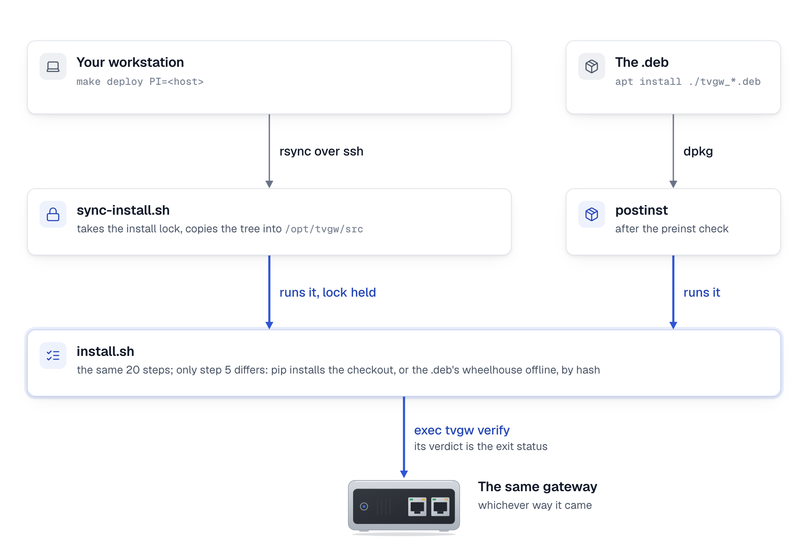

# Deployment

This folder holds everything that runs on the gateway outside the Python package: the installer, the settings template, and the configs, units and scripts in the folders below. This page owns how a change reaches the gateway and what `install.sh` does; it is for whoever installs the gateway, deploys a change, or edits anything here. Every key of the settings file is in [the settings](../docs/reference/settings.md). How the pieces fit together is in [the architecture page](../docs/how-it-works/architecture.md). The .deb carries this folder as `/usr/lib/tvgw/deploy` and its postinst runs the same `install.sh` ([packaging](../docs/project/packaging.md)).

## Files

| Path | What it is | Installed as or used by |
|---|---|---|
| `install.sh` | The installer, run as root from `deploy/`. | `sync-install.sh`, by hand, or the .deb's postinst ([packaging](../docs/project/packaging.md)) |
| `sync-install.sh` | Takes the install lock, replaces `/opt/tvgw/src` with the tree it sits in (`rsync --delete`), runs `install.sh` with the lock handed down, then an optional command (the CI hardware suite) from `/opt/tvgw/src`, all under `/run/tvgw/install.lock`. | `make deploy` from the staging copy, and CI's hardware job from its checkout |
| `tvgw.conf.example` | The settings template; every key, its default and what to run after changing it is in [the settings](../docs/reference/settings.md). | `/etc/tvgw/tvgw.conf`, only when that file is missing |
| `rsync.exclude` | The paths left out of every copy to the gateway: `.git` and everything `.gitignore` lists (databases, `build`, `dist`, `*.egg-info`, `__pycache__` and `*.py[cod]`, the test, lint and mutation caches, the docs site generator's `.cache`, `.venv` and `venv`, `*.pcap`, `*.tsv`, `*.log`, `*.swp`, the site settings in `deploy/local/`, `.pi` and `backups/`). `test_deploy_lint.py` keeps it in step with `.gitignore`. | `make deploy` and `sync-install.sh` |
| [`bin/`](bin/README.md) | `tvgw-analyze` and `tvgw-doh-update`. | `/usr/local/sbin/` |
| [`dnsmasq/`](dnsmasq/README.md) | The DHCP template and dnsmasq's hardening drop-in. | `/etc/dnsmasq.d/tvgw.conf`, `/etc/systemd/system/dnsmasq.service.d/20-tvgw-hardening.conf` |
| [`journald/`](journald/README.md) | The journal's span (`JOURNAL_DAYS`). | `/etc/systemd/journald.conf.d/60-tvgw.conf` |
| [`logrotate/`](logrotate/README.md) | Rotation of the gateway's logs. | `/etc/logrotate.d/tvgw` |
| [`networkmanager/`](networkmanager/README.md) | The TV interface's config and the dispatcher that re-applies the firewall. | `/etc/NetworkManager/conf.d/`, `/etc/NetworkManager/dispatcher.d/` |
| [`nftables/`](nftables/README.md) | `tvgw-apply`, the two address lists it reads, and the guard's template. | `/usr/local/sbin/tvgw-apply`, `/etc/tvgw/`, `/etc/tvgw/guard.nft` |
| [`nginx/`](nginx/README.md) | The URL filter, the TLS passthrough, and nginx's sandbox lines. | `/etc/nginx/conf.d/tvgw-gfts.conf`, `/etc/nginx/tvgw/stream.conf`, `/etc/systemd/system/nginx.service.d/tvgw.conf` |
| [`sysctl/`](sysctl/README.md) | The conntrack switches the flow log needs from boot. | `/etc/sysctl.d/60-tvgw.conf` |
| [`systemd/`](systemd/README.md) | Fourteen services and eight timers. | `/etc/systemd/system/` |

## How a change reaches the gateway

A change reaches the gateway one of two ways, and both end in the same installer. Run `make gate` first either way: it is ruff check, ruff format check, shellcheck over the POSIX scripts when it is installed, the deploy-window check of `tools/check_deploy_window.py`, the link check of `tools/check_docs_links.py` and the unit tests, exactly what CI's test job runs.

**From your workstation.** `make deploy PI=<ssh-host>` copies the working tree to a staging copy in the ssh user's home on the gateway, `~/tvgw-deploy/`, with `rsync -a --delete --exclude-from=deploy/rsync.exclude`, then runs `sudo tvgw-deploy/deploy/sync-install.sh` over ssh. That script takes `/run/tvgw/install.lock` (waiting up to 600 seconds), copies the staging tree to `/opt/tvgw/src` with the same `rsync` options, and runs `install.sh` there with the lock handed down on descriptor 8 (`TVGW_INSTALL_LOCKED=1`). The copy includes uncommitted changes, and `--delete` removes files on the gateway that the tree no longer has. Because the lock covers the copy into `/opt/tvgw/src` as well as the install, a `make deploy` can never replace the tree under a running CI install or suite, nor a CI run under it. `PI` defaults to the contents of `.pi` in the checkout, a file git ignores. `make hardware` runs the suite under the same lock (`flock -w 600 /run/tvgw/install.lock`).

**From GitHub.** `.github/workflows/ci.yml` runs on these events:

| Event | Jobs that run |
|---|---|
| A push to `main` that changes a file outside `**/*.md`, `docs/**` and `mkdocs.yml` | `test`, then `hardware` |
| A push to `main` that changes only files matching `**/*.md`, `docs/**` or `mkdocs.yml` | none (`paths-ignore`) |
| A pull request | `test` and `deb-build`, which builds the package only when the pull request changes what it is built from |
| A manual run (`workflow_dispatch`) | `test` and `mutation` |
| The schedule, Monday 06:17 UTC | `mutation` |
| The schedule, every 30 minutes (at :13 and :43), when GitHub starts it | `hardware`, which stops at its first step unless a deferred deploy's marker is there, and otherwise takes up a wait that was lost ([the quiet window](#the-quiet-window)) |

The jobs:

- **`test`** runs on `ubuntu-latest` for Python 3.11, the floor (Debian 12), and 3.13, the gateway's interpreter (Debian 13). It checks out the whole history, so `make gate` can compare a pull request's commits with `origin/main`, installs the checkout with `pip install -e ".[dev]"` and runs `make gate`. Its concurrency group is per ref and per Python version with `cancel-in-progress: true`, so a newer push replaces an older unit run.
- **`deb-build`** runs for a pull request on `ubuntu-latest` and builds the .deb for amd64 with `packaging/build-deb.sh`, as the release job does for arm64 on a tag ([releases](../docs/project/packaging.md#releases)), then lists it and keeps nothing. It first compares the pull request with its base commit, each moved file under its old path and its new one, and builds only when a file under `packaging/`, `deploy/` or `src/`, `pyproject.toml`, this workflow, or a file of the checkout that `packaging/nfpm.yaml` copies by name (the docs page and the licence) changed; when the base cannot be read it builds. So a page moved away from the path `nfpm.yaml` names fails the pull request, not the next release. It takes release.yml's nfpm, at the same version and SHA-256, and its concurrency group is per ref with `cancel-in-progress: true`.
- **`hardware`** runs for a push to `main` in the upstream repository, never a fork's, once `test` passed, and for the 30-minute schedule; never for a pull request or a manual run. It runs on the self-hosted runner on the gateway (labels `self-hosted` and `tvgw`), every step under `bash -e -o pipefail` with all it prints piped through the checkout's scrubber ([what the hardware job prints](#what-the-hardware-job-prints)). Its steps, in order:
  1. The checkout, with the whole history.
  2. On the schedule only: it stops here unless `/var/lib/tvgw/deploy-deferred` exists.
  3. The deploy window, which decides `plain`, `now`, `deferred` or, on the schedule, `skip` ([the quiet window](#the-quiet-window)).
  4. With `deferred`: a push writes its commit to `/var/lib/tvgw/deploy-deferred`, and a scheduled run leaves that file as it is. Either prints a notice.
  5. With `deferred`: the wait. `python3 -I tools/wait_deploy_window.py --wait <commit>` stays on the gateway until the window lets the deploy through (`now`), a newer push takes the wait (`handed-over`) or its limit passes (`deferred`).
  6. With `plain`, or with `now` from step 3 or step 5: `sudo deploy/sync-install.sh env PYTHONDONTWRITEBYTECODE=1 PYTHONUTF8=1 /opt/tvgw-venv/bin/python -m pytest -m hardware tests/hardware ...` from the checkout, as root because earlier suite runs leave root-owned `__pycache__` directories in `/opt/tvgw/src`: under the install lock it copies the checkout there with the same `rsync` options, runs `install.sh`, then the hardware suite, with those two variables the only ones handed to root ([hardware tests](../tests/hardware/README.md)).
  7. With `now` from step 3 or step 5: it removes `/var/lib/tvgw/deploy-deferred`, whether the deploy passed or failed.
- **`mutation`** runs `mutmut run` and `mutmut results` on Python 3.13 ([mutation testing](../tests/unit/README.md#mutation-testing)).

`.github/workflows/virtual.yml` is a second workflow, on every pull request and on the same pushes to `main`: as root on `ubuntu-latest`, it loads `tvgw-apply` into a network-namespace copy of the gateway, checks every ruleset variant with `nft -c` and probes the result against the reachability matrix ([the virtual gateway](../tests/virtual/README.md)). Its `virtual` job runs the suite twice, with the default interface names and with others ([other interface names](../tests/virtual/README.md#other-interface-names)), and `virtual-arm64` runs it on `ubuntu-24.04-arm` with AdGuard Home's arm64 release. On a pull request it runs before anything is merged; on a push to `main` it runs beside the `hardware` job, which does not wait for it.

`.github/workflows/distro.yml` is a third, on pull requests and on the same pushes to `main`, both skipping a change to Markdown or `docs/` alone: `packaging/check-platform.sh --source` in `debian:12`, `debian:13`, `ubuntu:24.04` and `ubuntu:26.04` containers, each pinned by digest, on `ubuntu-latest` and on `ubuntu-24.04-arm` ([the platform check](../docs/project/packaging.md#the-platform-check)). It runs on hosted runners only, and the `hardware` job does not wait for it either.

`.github/workflows/pages.yml` is a third, on GitHub's runners alone: it builds the documentation site for a pull request or a push that touches `docs/**`, `README.md` or `mkdocs.yml`, and publishes it from `main` or a release once the owner turns it on ([when it publishes](../docs/site/README.md#when-it-publishes)). It never reaches the gateway, and both workflows above ignore the paths it builds from, so a change to the docs or the site's configuration deploys nothing.

The deploy is never cut short, because `install.sh` is a linear `set -e` script with no rollback:

- The workflow has no top-level `concurrency` key, since a cancel there would reach the deploy.
- The `hardware` job's group is `deploy-tvgw` with `cancel-in-progress: false`: a running deploy is never cancelled, and a newer push waits for it. The 30-minute run waits in `deploy-tvgw-retry` instead, because a run waiting in a group replaces the one that waited before it, and a scheduled run must never take a waiting push's place. The two groups do not hold each other back, but the gateway's one runner takes one job at a time, so a scheduled run and a push still run one after the other, and whichever runs second sees `main` and the marker as the first left them. Do not register a second runner for the job: the install lock alone would keep two deploys apart for only 600 seconds.
- The deploy step's own timeout is 90 minutes: the first analyze run can use its whole start timeout ([the units](systemd/README.md#units)), and the suite runs ingest twice. The job's timeout is 1440 minutes, the 24 hours its token lives. It holds the wait, whose step has 1345 minutes, a little over the tool's own limit, and the deploy after it.

The workflow's permissions are `contents: read`. Every action is pinned by commit hash with its version in a comment, and `.github/dependabot.yml` proposes the bumps weekly. `tests/unit/test_deploy_lint.py` fails `make gate` when the workflow gains a top-level `concurrency` key, when the deploy group may cancel, when the deploy step's timeout drops under 90 minutes or the job's stops covering the wait and the deploy, when the Markdown filter or an action's pin goes, when a step hands root the runner's whole environment with `sudo -E`, when `make deploy` and CI stop sharing `rsync.exclude`, or when a write of `/opt/tvgw/src`, an install or a suite run does not hold the install lock. `tests/unit/test_packaging.py` runs the `deb-build` job's first step against throwaway repositories and fails when it builds for a change it should not or skips one it should, when the job uploads anything, or when its nfpm differs from release.yml's. `tests/unit/test_supply_chain.py` reads every job's condition and fails when an event in the table above runs a job it does not name, when a hardware step stops ending in the scrubber or the job's shell drops `pipefail`, or when the window step, the marker, the wait or the scheduled run's first step goes; it also runs each of those steps under the job's shell, with `sudo`, `python3` and `git` stood in for.

A push to `main` is therefore a deploy, at once or in the next quiet window. `install.sh` ends with `exec tvgw verify`, so verify's verdict is the exit status of `make deploy` and of the CI deploy step.

<picture>
  <source media="(prefers-color-scheme: dark)" srcset="../docs/diagrams/fig-11-install-paths.dark.png">
  
</picture>

*The routes go through the same installer under the same lock, so a push to main is a deploy, and verify's verdict is the exit status of each.*

### The quiet window

A deploy restarts what any deploy restarts (nginx, dnsmasq, the firewall's counters), and one in the middle of an evening has cut the TV off before. So the CI deploy of a commit that changes how the gateway treats the TV runs only in a fixed window of the gateway's local time, with the TV quiet ([design decision 63](../docs/design-decisions.md#63-behavior-changing-deploys-to-the-reference-wait-for-a-quiet-window-decided-on-the-gateway-nothing-the-gateway-prints-where-others-can-read-it-carries-a-home-identifier-acceptance-that-needs-systemd-runs-in-a-container-tier)).

**Which commits wait.** A commit that changes a file under `deploy/nftables/`, `deploy/networkmanager/`, `deploy/dnsmasq/`, `deploy/nginx/` or `src/tvgw/tvapi/` (a `.md` file aside), a profile's `[firewall]` or `[url_filter]` table, or the routing and dnsmasq parts of `deploy/install.sh` ends its message with this trailer line:

```text
Deploy-window: tv-off
```

The parts of `install.sh` are the changed lines, and the function each sits in, that name dnsmasq, NetworkManager, `nmcli`, `tv-lan`, the TV side block (`tvgw-net`, `tv_side`), `ip route` or `ip rule`, `sysctl` or `tvgw-apply`. `make gate` runs `tools/check_deploy_window.py`, which fails naming each commit since `origin/main` that changes such a path without the trailer ([the tools](../tools/README.md)). A squash merge keeps the line at the end of the squashed message.

**What the hardware job does with it.** For a push, `python3 -I tools/check_deploy_window.py --deploy <before>` reads every commit of the push. It answers `tv-off` when one carries the trailer, and also when the push changes such a path without it or its range cannot be read here; a push waits as well while a deferred deploy waits. For `tv-off` the job runs `tvgw tv quiet --wait 0` from its checkout as root, so the command works before the gateway's own tvgw has it. That answers `deploy: now` only inside `DEPLOY_WINDOW` (`03:30-05:30` when the settings file does not set it), with the TV's last hourly reading not `Active` and the TV port under 1 MB over the last 20 minutes ([tvgw tv quiet](../docs/reference/commands.md)). Otherwise it answers `deploy: deferred`, and never says why, so the public log shows no viewing hours. A push without the trailer and without such a change deploys at once, as before.

**Deferred, then waiting on the gateway.** A run that gets `deploy: deferred` does not end. A push writes its commit to `/var/lib/tvgw/deploy-deferred`, the marker, and the run stays on the gateway's runner in `tools/wait_deploy_window.py` ([how the wait decides](../tools/README.md#how-the-wait-decides)). GitHub starts a scheduled run late or not at all, and the gateway's own clock is reliable, so nothing but the gateway brings a deploy into the window (the note of 2026-11-05 on [design decision 63](../docs/design-decisions.md#63-behavior-changing-deploys-to-the-reference-wait-for-a-quiet-window-decided-on-the-gateway-nothing-the-gateway-prints-where-others-can-read-it-carries-a-home-identifier-acceptance-that-needs-systemd-runs-in-a-container-tier)). The wait asks `tvgw tv quiet --wait 0` only on the gateway's local half hours, at :00 and :30, the same times every day, and prints nothing before its last line. A deploy the wait lets through therefore runs at a half hour inside the window, and the public log says no more than that the TV was quiet then. The wait ends in one of three ways:

- **`deploy: now`.** A half hour answered `deploy: now`. The wait reads `main`'s head once more and makes the checkout that head. The job then deploys it, never an older commit, runs the hardware suite and removes the marker, whether the deploy passed or failed. A failed deploy is a failed job like any other, and re-running the job retries it.
- **`main moved on: the newer push's run takes the wait`.** Every 5 minutes the wait reads `main`'s head from GitHub. When `main` has a newer push with a CI run of its own, the wait ends without a deploy, which frees the gateway's one runner for that run's `hardware` job. That job finds the marker, writes its own commit to it and waits in its turn. A push that changes only paths the workflow ignores (`**/*.md`, `docs/**`, `mkdocs.yml`) has no run, so the wait goes on, and the deploy takes `main`'s head with that push in it. A head that does not descend from the commit that waits ends the wait too. A read that fails changes nothing, and a half hour at which `main` cannot be read deploys nothing.
- **`deploy: deferred`.** After 22 hours 15 minutes the wait gives up, so that the job, with the deploy after it, ends inside the 24 hours its token lives. The marker stays.

**The schedule is the backstop.** The 30-minute schedule runs the `hardware` job alone, whenever GitHub starts it. Without the marker the run stops at its first step. With it, the run goes on only when its commit is still `main`'s head and the marker's commit vouches for that head: the head is that commit, or ahead of it only by paths the workflow ignores (`tools/wait_deploy_window.py --vouches`). Only a push writes the marker, and a push's `hardware` job runs only once `test` passed, so the marker names the newest commit a tested push deferred, and the schedule never deploys a head whose tests did not pass. A marker that does not hold a commit id vouches for nothing. A run that goes on asks `tvgw tv quiet` once, as a push's run does, deploys on `deploy: now`, and on `deploy: deferred` takes the wait up itself, with the marker's commit and the marker left as it is. That is how a wait lost to a reboot, a runner restart or its own limit goes on.

**What it costs.**

- A commit that waits deploys at the first half hour of a window that finds the TV quiet. That can be a day away, and one day more for each window in which no half hour does.
- The run of a commit that waits shows as running until the window, and its `hardware` job holds the gateway's one runner meanwhile. The waiting run hands over at most 5 minutes after a newer push, and that push's `hardware` job starts once its tests have passed.
- A scheduled run that starts while a run waits queues for the runner. When the waiting deploy has run by the time it starts, it stops at its first step. A second one that queues behind it takes its place in the `deploy-tvgw-retry` group, and GitHub shows the replaced one as cancelled.
- After a hand-over to a push whose tests then fail, nothing waits, and the schedule skips, because the marker's commit does not vouch for that head. The deploy goes on with the next push whose tests pass, or with a re-run of the failed job that passes.
- A push whose message skips CI and that changes code is handed over to a run that never comes. Do not skip CI on `main`.
- A run cancelled by hand while it waits has installed nothing. The marker stays, and the schedule takes the wait up. Never cancel a run in its deploy step.
- From 05:00, the last half hour of the default window, to 03:30, the first of the next, is 22 hours 30 minutes, which the wait's limit does not reach. A wait that begins between 05:00 and 05:15 gives up before 03:30, and the schedule takes it up.
- The 20 idle minutes are measured against the gateway samples `tvgw verify --record` stores every 10 minutes while `LEDGER` is `on`, its default. With `LEDGER=off` there are none, `tvgw tv quiet --wait 0` measures nothing and answers `deploy: deferred`, and such a commit waits until you deploy it with `make deploy`.
- Deploy no second such commit into a window before the first has had its hardware run.

To deploy at once, at a moment you choose, run `make deploy PI=<ssh-host>` ([deploying](../docs/project/deploying.md#deploying)): it does not look at the window, and a marker it leaves behind goes with the next windowed deploy.

On the gateway:

```sh
sudo cat /var/lib/tvgw/deploy-deferred      # the newest commit a tested push deferred, while a deploy waits
sudo tvgw tv quiet --wait 0                 # what the wait would be told if its next half hour were now
```

### What the hardware job prints

The job's log is public on a public repository. Every step pipes all it prints through `python3 -B -P -s -m tvgw.scrub --stdin` from the checkout, under `bash -o pipefail`, so a failure anywhere in the pipe fails the step. The scrubber replaces every address outside `TV_NET` (`<lan address>`, `<public address>`, `<router>`) except the ones tvgw ships, every MAC (`<mac>`), a USB adapter's name that embeds its MAC (`usb-ethernet-<n>`), the gateway's host name, a TV name that is not the vendor's default, the Wi-Fi names and the user in a home directory's path ([the module map](../src/tvgw/README.md#module-map)). `tvgw verify` scrubs its own details as well. `-P` keeps the working directory off Python's path and `-s` the user's site packages; `-I` would also drop `PYTHONPATH`, and the system Python has no tvgw of its own. `-B` writes no bytecode, here and for `tvgw tv quiet`: these run as root in the runner's workspace, and a root-owned `__pycache__` there would fail the next job's checkout, which cleans the workspace as the runner's user. Two parts of the log come from GitHub, outside any pipe: the runner's header before the first step names the runner and the computer it runs on, and the checkout step prints the workspace's path, which holds the runner user's name when the runner is installed in a home directory. Give the runner, the computer and that user names that say nothing about the household, or install the runner outside `/home`.

## What install.sh does

`install.sh` runs with `set -euo pipefail`, so a failing command stops it with nothing after it done. A deliberate stop prints `tvgw: <reason>` and exits 1, and an `ERR` trap makes any other failing command exit 1 too, whatever its own status: nmcli's 3 and 4, for one, would otherwise read as the exits kept for the .deb's postinst. Those are 75, the TV is not identified and there is no terminal to ask on (step 10); 76, under the postinst or in the apply pass ([the setup passes](#the-setup-passes)) only, the install completed and `tvgw verify` reported a `FAIL` (step 20); and 77, (adguard) AdGuard Home was not set up by tvgw and serves other devices, so `tvgw adguard apply` refused to take it over (step 12). The steps, in order:

1. **Lock and AdGuard Home.** Creates `/run/tvgw` and takes `/run/tvgw/install.lock`, waiting up to 600 seconds (10 minutes). It stops with `another install is running` after that. Under `sync-install.sh` the lock is already held, from before the copy that replaced the tree, and handed down on descriptor 8 (`TVGW_INSTALL_LOCKED=1`), so `make deploy` and a CI deploy never interleave: neither can copy into `/opt/tvgw/src` while the other installs or runs the suite. Then, before it writes anything else, it stops unless AdGuard Home is installed at `/opt/AdGuardHome/AdGuardHome` and reports at least `v0.107.79`, `tvgw verify`'s floor, and prints the command that installs it ([design decision 25](../docs/design-decisions.md#25-adguard-home-is-a-checked-dependency-never-bundled)). The bring-up pass skips this check ([the setup passes](#the-setup-passes)).
2. **Directories, user and modes.** Creates `/etc/tvgw`, `/var/log/tvgw`, `/var/lib/tvgw` and `/var/lib/tvgw/pcap`, and the system user `tvgw-pcap` (group `nogroup`, no home, no login shell) when it is missing. It then stops, before any unit is installed, unless `/usr/bin/dumpcap` exists and `tvgw-pcap` can execute it (`runuser -u tvgw-pcap -- test -x`), with `/usr/bin/dumpcap is missing or not executable by tvgw-pcap: ...` ([what dumpcap needs](../docs/how-it-works/capture.md#what-dumpcap-needs)). It creates the change ledger's spool, `/var/lib/tvgw/changes.spool`, with mode 640 when it is missing, before `tvgw-apply` or the dispatcher could create it readable by others, and closes up an older spool and its `.1`. It sets owners and modes on the directories and on the logs, pcaps, store, pairing key, TV readings, DoH list and reports that exist, as listed in [where it lives and who can read it](../docs/how-it-works/privacy-and-retention.md#where-it-lives-and-who-can-read-it).
3. **Settings files.** Copies `tvgw.conf.example` to `/etc/tvgw/tvgw.conf` and `nftables/block4.txt` to `/etc/tvgw/block4.txt`, each only when missing. It sets the settings file's group and mode on every run, and copies `nftables/doh-exclude.txt` to `/etc/tvgw/` on every run.
4. **Settings check.** Sources the settings file and fills the defaults `install.sh` itself uses ([the settings file](../docs/reference/settings.md)). It stops unless the TV side passes the `tvgw-net` checks it shares with `tvgw-apply` ([the TV side](../docs/reference/settings.md#the-tv-side)): `TV_IF` is an interface name other than `WAN_IF`, `lo`, `tun0` and `wgpia0`, and `WAN_IF` is neither of the two tunnel names; `TV_NET` is a private IPv4 network from `/16` to `/27`; `GW_IP` is a host address in it outside the DHCP pool; `TV_IP` is a host address in it other than `GW_IP`. It also stops unless `TV_NAME` is 1 to 63 letters, digits, `-` and `_`, `URL_FILTER_RESOLVER` is an IPv4 address, `ADGUARD_LISTEN` is `keep` or `gateway`, `JOURNAL_DAYS` is 1 to 3650 or `off`, and no address of `WAN_IF` lies in a network that overlaps `TV_NET`. These values go into the dnsmasq, nginx and NetworkManager files through `sed`, so they are refused before those files are written. A `TV_MAC` that is missing, malformed or the template's `00:00:00:00:00:00` is not a stop: it means the TV is unknown (step 10).
5. **Package.** Creates the virtualenv `/opt/tvgw-venv` when it has no Python. From a checkout, it upgrades pip, removes the checkout's `build/` (setuptools never prunes `build/lib` and the rsync exclude list protects it from `--delete`, so a module deleted from `src/` would keep shipping), and installs the checkout with the `lgwebos` and `analyst` extras plus `pytest` (the hardware suite runs on the gateway). From the .deb, which it recognizes by `requirements.lock` and `wheels/` beside its tree, it checks the wheelhouse against `SHA256SUMS`, then installs offline: the dependencies with `pip install --no-index --require-hashes -r requirements.lock` and the tvgw wheel itself. Either way it links `/usr/local/bin/tvgw`. The install is not editable, so the gateway runs the profile inside the package, not the files in `/opt/tvgw/src`.
6. **Scripts.** Installs `tvgw-apply`, `tvgw-doh-update` and `tvgw-analyze` into `/usr/local/sbin/`.
7. **Legacy cleanup.** Removes the retired text-report pipeline (`/usr/local/sbin/tvgw-extract`, the TSV files, the copied query log, `/var/lib/tvgw/archive`, the old brief files) and the retired `/usr/local/sbin/tvgw-prune`. Once, marked by `reports/.from-the-store`, it moves the reports written before the store into `reports/legacy/`.
8. **Configs and units.** Writes `/etc/dnsmasq.d/tvgw.conf` from the template, with the TV side filled in and the pin line left out while the TV is unknown ([DHCP for the TV](dnsmasq/README.md)). Writes the NetworkManager config with `TV_IF` filled in, installs the dispatcher and the logrotate config, removes the rotated logs past each log's count, writes the journal drop-in when `JOURNAL_DAYS` changed it (restarting `systemd-journald` once, which keeps every service's log stream) and prints a note naming any other file that sets another journal span ([the journal drop-in](journald/README.md)), installs the kernel switches (`/etc/sysctl.d/60-tvgw.conf`, [the kernel switches](sysctl/README.md)) and every unit and timer, and writes the capture's drop-in `tvgw-pcap.service.d/tv-side.conf` with `TV_IF`, `TV_NET` and `GW_IP`. Then the guard ([design decision 42](../docs/design-decisions.md#42-the-pi-is-closed-to-the-tv-whatever-nftables-holds)): it renders `nftables/guard.nft.template` with `TV_IF`, `TV_NET` and `GW_IP` into `/etc/tvgw/guard.nft`, stops if `nft -c` rejects it, enables `tvgw-guard.service`, and reloads it (or starts it, when it is not active) only when the file changed, the table is missing, or the live table differs from the listing the unit left in `/run/tvgw/guard.applied` (a hole a killed `tvgw discover` left behind, or a hand edit), so a deploy keeps the guard's counters. Then `tvgw guard cotenants` writes `IPAddressDeny=TV_NET` drop-ins for the units `CO_TENANT_UNITS` names that are installed and removes the ones no longer wanted, followed by `systemctl daemon-reload` and no restart. systemd is expected to attach a running unit's new filter on that reload (the reading in [design decision 42](../docs/design-decisions.md#42-the-pi-is-closed-to-the-tv-whatever-nftables-holds)); the hardware suite checks it with `bpftool`, and otherwise the filter takes effect at the unit's next restart. `tvgw guard avahi` adds `TV_IF` to avahi's `deny-interfaces`, keeping a one-time backup, and restarts avahi when it changed; the line it adds under its own comment follows `TV_IF` and comes out again when `avahi-daemon` leaves `CO_TENANT_UNITS`, while a name appended to a list you wrote stays. All of this comes before `tv-lan` is brought up, so the gateway is closed to the TV before the TV side exists.
9. **The TV interface.** Reloads NetworkManager's config and creates the `tv-lan` connection on `TV_IF` with `GW_IP/<prefix>` when it does not exist. When it exists with another interface or address (`TV_IF`, `TV_NET` or `GW_IP` changed), it prints `tvgw: tv-lan moves to ...`, turns off autoconnect on the other profiles of the new port as a first install does, modifies `tv-lan` and brings it up again; otherwise it brings it up only when it is not already active ([the TV interface](networkmanager/README.md)).
10. **Finding the TV.** When the TV is unknown, restarts dnsmasq (with its hardening and health check, step 18) so the TV gets a pool address. With a terminal, it runs `tvgw discover --write` until it succeeds, and stops if you decline to retry. Without a terminal, or under the .deb's postinst (`TVGW_POSTINST=1`), it prints the two commands to run, `sudo tvgw discover --write` and then the installer again, and exits 75. After discovery it reads the settings again, stops unless `TV_MAC`, `TV_IP` and `TV_NAME` now pass, and writes the dnsmasq file with the pin.
11. **nginx**, when installed. Writes both nginx files with `__RESOLVER__` replaced by `URL_FILTER_RESOLVER` and `__GW_IP__` by `GW_IP`, adds `include /etc/nginx/tvgw/stream.conf;` to `/etc/nginx/nginx.conf` once, and removes `/etc/nginx/sites-enabled/default`. Then it runs `nginx -t`, and stops when nginx rejects the config, with the old one still live. Then it writes the drop-in `nginx.service.d/tvgw.conf`: the start order and `Restart=on-failure`, then the sandbox in `nginx/tvgw-hardening.conf`, with `MemoryDenyWriteExecute=yes` only when `nginx -T` shows no `pcre_jit on` and `AF_INET6` only when it shows a `listen [` address. When the drop-in is unchanged and nginx is running it reloads nginx, which keeps the TLS passthrough and downloads in progress. When the drop-in changed, it restarts nginx once, since a sandbox applies only at a start, and checks that nginx is active and listening on `GW_IP:80` and `GW_IP:443`. If not, it prints a `WARNING`, writes the drop-in again without the sandbox and restarts nginx. Once nginx serves that way it records the refused sandbox in `/var/lib/tvgw/.unit-stamps/nginx-refused`, so the next deploy does not try it again; if nginx still does not serve, the fault is not the sandbox, the install stops, and no stamp is left. Without nginx it prints a note and skips the step.
12. **AdGuard Home**, when `/opt/AdGuardHome/AdGuardHome.yaml` exists. Writes the drop-in `AdGuardHome.service.d/workdir.conf` and reloads systemd. The drop-in sets the working directory; with `ADGUARD_LISTEN=gateway` it also orders AdGuard after `network-online.target` and restarts it every 5 seconds with no start limit (`Restart=always`, `RestartSec=5`, `StartLimitIntervalSec=0`), because AdGuard then binds `GW_IP` and fails to start until the TV port has it ([the listen setting](../docs/how-it-works/adguard.md#the-listen-setting)); with `keep` it is the working directory alone, as before. Then it runs `tvgw adguard service`, which writes `AdGuardHome.service.d/20-tvgw-no-update.conf` (AdGuard's own `ExecStart` with `--no-check-update`, after the empty `ExecStart=` that resets it) only when that file differs, restarts AdGuard, and puts the previous unit back unless the resolver answers ([the service runs with --no-check-update](../docs/how-it-works/adguard.md#the-service-never-updates-itself)); a failure there prints a line and does not stop the install. Then it runs `tvgw adguard apply`; a failed apply stops the install. (adguard) An apply that refuses to take over an AdGuard Home tvgw did not set up, because its query log answered other devices ([taking over one that is not tvgw's](../docs/how-it-works/adguard.md#taking-over-one-that-is-not-tvgws)), exits 4; one that only listens on every address is taken over with one line, and the install goes on. A refusal stops the install there with 77 and one line that names `ADGUARD_TAKE_OVER=yes` and the command to run again for where it ran (`sudo dpkg --configure -a` under the postinst, `sudo tvgw setup` in the apply pass). Either one exits 3 when the restart guard holds it back because the upstreams are down ([the restart guard](../docs/how-it-works/adguard.md#the-restart-guard)): the install prints `deferred: upstream down` and goes on with AdGuard as it was. When AdGuard Home has no YAML yet, it prints `sudo tvgw adguard install` instead, which sets it up without its wizard ([installing it without the wizard](../docs/how-it-works/adguard.md#installing-it-without-the-wizard)).
13. **nftables.service.** Masks the stock unit unless it is enabled, because its `flush ruleset` would wipe the VPN client's tables and the gateway's. A failure to mask does not stop the install.
14. **The DoH list.** When `/var/lib/tvgw/doh4.txt` is missing or empty, starts `tvgw-doh-update.service` once, which fetches the list and runs `tvgw-apply`. When that fails, as it does offline, it prints a note and goes on.
15. **Enable the firewall unit.** Enables `tvgw.service`; a failure stops the install.
16. **Analyst schedules.** Renders `ANALYST_SCHEDULE` and `ANALYST_WEEKLY_SCHEDULE` into the drop-ins `tvgw-analyst.timer.d/schedule.conf` and `tvgw-analyst-weekly.timer.d/schedule.conf`. `HH:MM` becomes `*-*-* HH:MM:00`, `Day HH:MM` becomes `Day *-*-* HH:MM:00`, `hourly` stays `hourly`, and any other value is passed as written. `systemd-analyze calendar` must accept each, or the install stops. Then it runs `sync`: everything the next boot reads is on disk, so a power cut right after a deploy cannot leave `tvgw-apply` or a unit empty (`install` writes each as a new file, which ext4 may hold in memory for half a minute).
17. **The firewall.** When `tvgw.service` is active, runs `tvgw-apply` in place instead of restarting the unit, because a restart runs the stop path first and turns forwarding off ([stopping](nftables/README.md#stopping)). Otherwise it starts the unit with `systemctl restart`.
18. **Services.** Restarts dnsmasq with the hardening drop-in `dnsmasq.service.d/20-tvgw-hardening.conf` (no `CAP_NET_ADMIN` or `CAP_NET_RAW` in its bounding set, which the template's `dhcp-broadcast` and `no-ping` make possible; [DHCP for the TV](dnsmasq/README.md#the-hardening-drop-in)), then checks that dnsmasq is active and holds UDP 67. If not, it prints a `WARNING`, removes the drop-in and restarts dnsmasq without it; the TV never loses DHCP to a hardening line. Once dnsmasq serves that way the drop-in is recorded as refused in `/var/lib/tvgw/.unit-stamps/dnsmasq-refused`. If dnsmasq still does not serve, the install stops, as a failed restart did before, and leaves no stamp, so the drop-in is tried again once the other fault is fixed. Then it runs `systemctl enable --now` for `tvgw-flowlog`, `tvgw-pcap`, `tvgw-dnsgate` and the eight timers. `enable --now` does not restart a running unit, so it then restarts each of `tvgw-pcap`, `tvgw-flowlog` and `tvgw-dnsgate` whose inputs changed since its last restart here: its unit file, for the capture also `TV_IF`, `TV_NET` and `GW_IP`, `tvgw-pcap-headers.service` and the `CAPTURE_MODE` line, for the flow log also `TV_IP`, for the DNS-gate feeder also the settings file and the package it runs. A hash of those inputs is kept per unit in `/var/lib/tvgw/.unit-stamps/` and written after the restart, so a restart an earlier run did not reach (it stopped on the way) happens on the next. Every restart is a short hole in the evidence, so an unchanged unit is left alone. (ledger) Then `tvgw changes --note-deploy` appends one deploy line to `/var/lib/tvgw/changes.spool` with the version and two fingerprints of the installed package, all of it and the modules that define the judged metric, so the change ledger records the deploy and whether it changed the code or the metric ([design decision 48](../docs/design-decisions.md#48-one-ledger-of-changes-one-hour-classifier-and-a-second-judge-that-only-watches)); a failure prints a note and does not stop the install.
19. **First runs.** Starts `tvgw-analyze.service` once, and `tvgw-backup.service` only when `/var/lib/tvgw/backup/` holds no `tvgw-*.db` yet: the timer makes the daily copies, and a copy on every deploy would crowd them out. A failure prints a message and does not stop the install.
20. **Verdict.** Prints the installed version, then runs `exec tvgw verify`. Its exit status is the installer's, so any `FAIL` fails the deploy ([what tvgw verify checks](../docs/reference/verify-checks.md)). Under the .deb's postinst it runs `tvgw verify` and exits 76 on a `FAIL`, which the postinst reports without failing the package ([design decision 23](../docs/design-decisions.md#23-the-deb-runs-installsh)); the apply pass ends the same way.

### The setup passes

`TVGW_SETUP_PASS` splits a first install into two halves: the TV side first, before AdGuard Home is set up or the TV is known, then everything once both are. Unset or empty, the installer runs the steps above. Any other value than `bringup` or `apply` stops it before step 1 with `tvgw: TVGW_SETUP_PASS=<value>: the passes are bringup and apply`.

| Pass | Runs | Ends |
|---|---|---|
| `bringup` | Step 1 without its AdGuard Home check, steps 2 to 9, then the restart of dnsmasq with its health check (as in step 18), so the TV gets an address from the pool, or its pinned one when it is known. | Prints `tvgw: TV side up on <TV_IF> (<GW_IP>)` and exits 0, whether the TV is known or not. Steps 10 to 20 never run: no discovery, nginx, AdGuard Home configuration, `tvgw.service` or other units. |
| `apply` | Every step. A `TV_MAC` that is missing, malformed or the placeholder stops it at step 4 with `setup's apply pass needs TV_MAC`, since this pass comes after the TV is found. | Runs `tvgw verify` and exits 76 on a `FAIL`, 0 otherwise, as under the postinst; never `exec tvgw verify`. A `FAIL` right after a first install is often AdGuard Home still loading its lists. |

No tvgw command sets the variable; `tvgw setup` runs the installer without it ([tvgw setup](../docs/install/README.md)). `tests/unit/test_install_passes.py` runs the whole installer for each pass against stub commands, with every path moved under a temporary directory, and checks that with no pass it runs the apply pass's steps in the same order and ends in `exec tvgw verify`.

### What is idempotent

Run `install.sh` as often as you like. It keeps `/etc/tvgw/tvgw.conf` and `/etc/tvgw/block4.txt`, reuses the virtualenv, creates `tv-lan` and the nginx include only once, and moves the legacy reports only once. It re-applies the firewall without a restart. `tvgw adguard apply` changes nothing, and does not restart AdGuard, when the config already matches. The DoH list is fetched, and the first backup taken, only when missing.

A re-run does disturb these:

- nginx reloads; downloads in progress continue. It restarts once instead when its drop-in changed (a new sandbox).
- dnsmasq restarts.
- The guard reloads only when `/etc/tvgw/guard.nft` changed or the table is missing; then its counters start again from zero.
- AdGuard Home restarts when its config changed, and the TV's lookups fail for those seconds. The first deploy with the `--no-check-update` drop-in restarts it once more.
- The firewall re-apply resets every rule's counters; `tvgw-apply`'s listings either side of the reload, stored by the next `tvgw verify --record`, keep the brief's counts whole ([design decision 13](../docs/design-decisions.md#13-counters-not-logs-prove-the-firewall-held)).
- A long-running unit restarts when its file, or what it read at start, changed. What ends or passes in that moment is not recorded, and that hour's pcap is split in two.
- `/etc/tvgw/doh-exclude.txt` and the two analyst timer drop-ins are written again. Make local edits in the repository.
- `tvgw-analyze` runs once more.

## Gotchas

- `install.sh` stops at the first failing step, and nothing after it runs: a failed `tvgw adguard apply` leaves the firewall un-reapplied and the units unrestarted. A unit restart it did not reach is made by the next run, since the record of what each long-running unit started with is written only after its restart. It exits non-zero after a complete run too, when the final `tvgw verify` has a `FAIL`. A stop exits 1 whatever the failing command returned (an `ERR` trap), so the deliberate statuses, 75, 76 and 77, always mean what [the package's postinst](../docs/project/packaging.md#how-installsh-tells-the-two-apart) reads them as.
- `tvgw adguard apply` run by hand uses the profile inside the installed package, not the files in `/opt/tvgw/src`. A policy change needs a deploy.
- `make deploy` copies uncommitted changes, and `--delete` removes files on the gateway that your tree lacks.
- The NetworkManager dispatcher and `tvgw-doh-update` both run `tvgw-apply`, so either can bring the TV back online after you stop `tvgw.service` by hand.
- `install.sh` skips `tvgw adguard apply` until AdGuard's first run has written `/opt/AdGuardHome/AdGuardHome.yaml`, through `sudo tvgw adguard install` or its wizard by hand; run the apply by hand afterwards.
