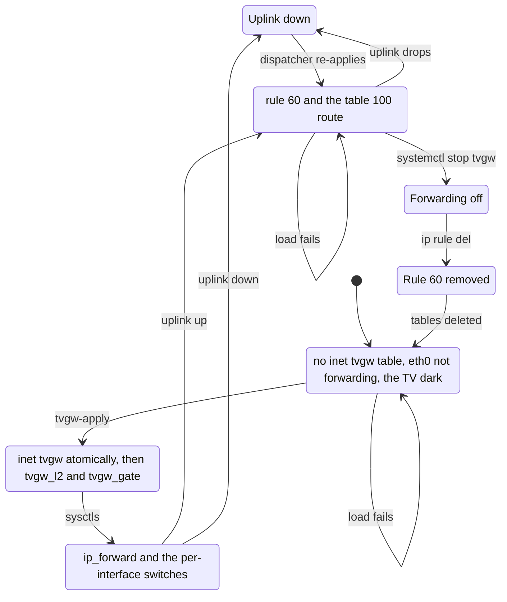

# The firewall

This folder holds `tvgw-apply`, the one script that decides what the TV can reach, and the two address lists it reads. It runs at boot from `tvgw.service`, when a link comes up, after the daily DoH list refresh, from `install.sh`, and by hand as `sudo tvgw-apply`. Why the TV is isolated first and why a failure leaves it dark is in design decisions [2](../../docs/design-decisions.md#2-isolate-first-then-filter) and [5](../../docs/design-decisions.md#5-fail-closed).

## Files

| File | What it is | Installed as |
|---|---|---|
| `tvgw-apply` | The ruleset, the sysctls and the policy routing, as one bash script. | `/usr/local/sbin/tvgw-apply` |
| `block4.txt` | A template for manual IPv4 blocks: one address or CIDR per line, `#` comments. | `/etc/tvgw/block4.txt`, installed only when missing; edit that copy |
| `doh-exclude.txt` | AWS CloudFront and Cloudflare CIDRs that are never put in the DoH block set, because they also serve ordinary sites. | `/etc/tvgw/doh-exclude.txt`, replaced on every install; read by [`tvgw-doh-update`](../bin/README.md) |

`tvgw-apply` reads three inputs: the settings `UPLINK`, `WAN_IF`, `WAN_GW`, `BLOCK_QUIC`, `STRICT_PORTS` and `DNSGATE` from `/etc/tvgw/tvgw.conf` ([the settings file](../README.md#the-settings-file)); `/etc/tvgw/block4.txt`; and `/var/lib/tvgw/doh4.txt`, the DoH resolver list `tvgw-doh-update` writes. The TV side is fixed in the script: `TV_IF=eth0`, `TV_ADDR=10.10.10.1`, `TV_NET=10.10.10.0/24`, `TV_BCAST=10.10.10.255`, `RT_TABLE=100` and `LG_UPDATE_IP=156.147.69.32`.

## Order of operations

The script runs with `set -euo pipefail`, so it stops at the first command that fails, and the order below is what keeps a failure from leaving the TV forwarded without a filter.

1. **Settings.** Sources the settings file and fills a missing `UPLINK`, `WAN_IF`, `BLOCK_QUIC`, `STRICT_PORTS` or `DNSGATE` with the same default as `config.Settings`. It exits 1 unless `BLOCK_QUIC` and `STRICT_PORTS` are exactly `yes` or `no` and `DNSGATE` is exactly `off` or `count`, because a near miss such as `BLOCK_QUIC=Yes` once dropped the QUIC rule silently.
2. **Lock.** Takes `/run/lock/tvgw-apply.lock` with `flock`, so two applies never interleave. It waits for the lock; `tvgw.service`'s start timeout bounds a hang at boot ([timeouts](../systemd/README.md#timeouts)).
3. **Uplink.** `UPLINK=direct` sends the TV out `WAN_IF` and requires `WAN_GW`, or the script exits 1 before it loads anything. `UPLINK=vpn` sends it out `tun0`. Any other value exits 1.
4. **Kernel settings.** Loads `nf_conntrack`, turns on per-connection byte counts and timestamps (`nf_conntrack_acct`, `nf_conntrack_timestamp`), which the flow log needs, and sets `nf_conntrack_tcp_timeout_established=7440`: 7440 s (2 h 04 min), so an idle connection is reported within hours instead of days. It disables IPv6 on `eth0`.
5. **Address lists.** `ip_elements` keeps the leading `a.b.c.d` or `a.b.c.d/n` of each line of `doh4.txt` and `block4.txt`, drops duplicates, and ignores the rest of the line.
6. **`inet tvgw`, atomically.** First every counter of the three tables is listed to `/run/tvgw/counters.before-apply.tmp` (`nft -j -t list table`, one line per table). Then one `nft -f` transaction declares the table, deletes it, creates the new one and adds the set elements. When it fails, nothing changes, and the script stops before forwarding, with the listing unpublished.
7. **`netdev tvgw_l2`.** Loaded the same way. A failure prints `tvgw: netdev IPv6 guard not loaded (eth0 down?)` and the script goes on, because the ingress hook cannot load while `eth0` is down.
8. **`inet tvgw_gate`.** With `DNSGATE=count`, adds the gate table and its sets and chain and replaces the chain's rule ([the DNS gate table](#the-dns-gate-table)); a failure prints a warning and the script goes on, since the gate only counts. With `DNSGATE=off`, deletes the table.
9. **Counters after.** Lists every counter again, to `counters.after-apply.tmp`, and renames both listings into place together as `/run/tvgw/counters.before-apply` and `/run/tvgw/counters.after-apply`. The next `tvgw verify --record` stores them as snapshots, so the brief sees the reset this apply caused instead of losing what the counters gained since the last snapshot ([design decision 13](../../docs/design-decisions.md#13-counters-not-logs-prove-the-firewall-held)).
10. **Forwarding, last.** Writes `net.ipv4.ip_forward=1` and the per-interface `forwarding=1` for `eth0`, and for the uplink once `/proc/sys/net/ipv4/conf/<uplink>` exists: in vpn mode `tun0` appears when the VPN connects, after the boot apply, and `sysctl` fails on a key it cannot find, which would stop the script half done. Until then `tv_out` drops what cannot leave by the uplink, the script prints `tvgw: <uplink> not there yet; the dispatcher switches it on when it comes up`, and the dispatcher re-runs it when it does. The per-interface switches are written explicitly because the kernel copies the global value to the interfaces only when the global value changes, and a stop turns `eth0` off ([incidents](../../docs/incidents.md)).
11. **Baseline.** Writes `nft -s list table inet tvgw` to `/run/tvgw/ruleset.applied`, the listing `tvgw verify` compares the live table against, and the six settings it used, defaults filled in, to `/run/tvgw/settings.applied`, which `verify`'s `applied_current` compares the settings file with ([what tvgw verify checks](../../docs/troubleshooting.md#what-tvgw-verify-checks)).
12. **Policy routing.** Deletes `ip rule` priority 60. In direct mode it adds it back as `from 10.10.10.0/24 lookup 100` and sets table 100's default route via `WAN_GW` on `WAN_IF`. When the uplink is down that route fails with `tvgw: <WAN_IF> not up yet; dispatcher will add the route`, and the NetworkManager dispatcher runs the script again when the link comes up ([the dispatcher](../networkmanager/README.md)).
13. **Summary.** Prints `tvgw: applied (uplink=<mode> via <interface>, quic_block=..., strict_ports=..., dnsgate=..., doh4=<n> entries)`.



*The firewall's states in direct mode: a load that fails leaves the previous state, and forwarding is the last thing switched on and the first thing switched off.*

## Stopping

`systemctl stop tvgw` runs the four `ExecStop` lines of `tvgw.service`, in order:

1. `sysctl -q -w net.ipv4.conf.eth0.forwarding=0`. The TV is dark before any rule goes.
2. `ip rule del priority 60`, with errors ignored.
3. `nft delete table netdev tvgw_l2`, with errors ignored.
4. `nft delete table inet tvgw`.

A stopped service leaves the TV dark, never unfiltered ([design decision 5](../../docs/design-decisions.md#5-fail-closed)). The stop leaves `inet tvgw_gate` in place; that table only counts. `tvgw-flowlog`, `tvgw-pcap` and `tvgw-dnsgate` start after `tvgw.service` (`After=`, `Wants=`) but are not bound to it, so they keep recording while it is stopped, and the store holds what the dark TV tries.

While the service is stopped, the input chain is gone with its table, so the Pi's own services that listen on every interface can be reached from the TV subnet. Anything that runs `tvgw-apply` brings the TV back online: the NetworkManager dispatcher on a link change, `tvgw-doh-update` once a day, and `install.sh`.

To reload the firewall, run `sudo tvgw-apply`, not `systemctl restart tvgw`. The script is idempotent and atomic, so a re-run opens no gap; a restart runs the stop path first and blacks the TV out for a moment.

## The ruleset, chain by chain

The rules are listed in the order `tvgw-apply` writes them. A rule's comment is part of an interface ([design decision 13](../../docs/design-decisions.md#13-counters-not-logs-prove-the-firewall-held)): `tvgw verify --record` snapshots every rule that has a `counter` and a `comment`, and the brief's "Firewall held" line matches the comments by prefix (`queries.FW_LINES` in src/tvgw/queries.py; [brief sections](../../docs/reading-the-brief.md#sections)).

### Sets

| Set | Holds | Filled from |
|---|---|---|
| `lan4` | The three RFC 1918 private ranges, CGNAT `100.64.0.0/10` and link-local `169.254.0.0/16`. | The script itself |
| `doh4` | Known DoH resolver addresses; interval set with `auto-merge`. | `/var/lib/tvgw/doh4.txt` |
| `block4` | Manual IPv4 blocks; interval set with `auto-merge`. | `/etc/tvgw/block4.txt` |

### Hooks and priorities

| Chain | Hook | Priority |
|---|---|---|
| `pre_mangle` | prerouting | `mangle + 10` |
| `pre_nat` | prerouting | `dstnat - 10` |
| `input` | input | `filter - 10` |
| `forward` | forward | `filter - 10` |
| `output` | output | `filter - 10` |
| `post_nat` | postrouting | `srcnat - 10` |

`pre_mangle` runs 10 after the standard mangle priority. The other chains run 10 before their standard priority, so they come ahead of other chains at the same hook: `pre_nat` runs before the VPN client's NAT chain, which would otherwise send the TV's DNS to the VPN's resolver.

### `pre_mangle`

| Rule | Comment | Why |
|---|---|---|
| Direct mode only: `iifname "eth0" meta mark set 0 counter` | `undo PIA routed-packet tag` | The VPN client marks every forwarded packet to route it into the tunnel. Clearing the mark lets table 100 send the TV's packets out the uplink. |

In vpn mode the chain is empty.

### `pre_nat`

| Rule | Comment | Why |
|---|---|---|
| `iifname "eth0" ip daddr != 10.10.10.1 udp dport 53 counter dnat ip to 10.10.10.1:53` | `TV DNS aimed elsewhere -> AdGuard` | DNS the TV aims at any other resolver, such as a hardcoded `8.8.8.8`, lands on AdGuard Home. |
| The same for `tcp dport 53` | `TV DNS aimed elsewhere -> AdGuard` | The same, over TCP. |

A nat chain sees only the first packet of each connection, so these counters count redirected flows, not packets.

### `input`

What may reach the Pi itself from the TV.

| Rule | Comment | Why |
|---|---|---|
| `iifname "tun0" ct state new counter drop` | `nothing unsolicited from the VPN side` | Nothing may open a connection to the Pi from the tunnel. |
| `iifname != "eth0" accept` | none | This table polices the TV side only. |
| `meta l4proto { tcp, udp } th dport 53 counter` | `TV DNS to the gateway` | Counts the TV's DNS before the established shortcut, because webOS keeps one UDP source port for its resolver all day. |
| `ct state established,related accept` | none | Replies. |
| `udp sport 68 udp dport 67 accept` | `DHCP` | DHCP requests go to the broadcast address, which the next rule would drop. |
| `ip daddr != 10.10.10.1 counter drop` | `TV talks to the gateway address only` | The TV may use the gateway's address and no other address of the Pi. |
| `meta l4proto { tcp, udp } th dport 53 accept` | `DNS -> AdGuard` | AdGuard Home. |
| `tcp dport { 80, 443 } accept` | `GFTS URL filter / TLS passthrough (nginx)` | The [URL filter](../nginx/README.md). |
| `icmp type echo-request limit rate 5/second accept` | none | Reachability checks, at up to 5 a second. |
| `counter drop` | `TV may not reach other Pi services` | Everything else on the Pi stays out of the TV's reach. |

### `forward`

| Rule | Comment | Why |
|---|---|---|
| `iifname != "eth0" oifname != "eth0" accept` | none | Not TV traffic; left to the rest of the system. |
| `ct state invalid counter drop` | `invalid: would leave un-NATed` | An invalid packet would leave without NAT, carrying the TV's own address. |
| `iifname "eth0" ip saddr != 10.10.10.0/24 counter drop` | `TV source outside its subnet` | Masquerade covers only the TV subnet, and the capture, the flow log and the gate all key on its addresses, so a packet from another source would leave un-NATed and unrecorded. The brief's label is `foreign source`. |
| Vpn mode only: `oifname "tun0" tcp flags syn tcp option maxseg size set rt mtu` | `tunnel MTU` | The tunnel's MTU is smaller. |
| `ct state established,related accept` | none | Replies, and connections that were allowed when they started. |
| `iifname "eth0" meta nfproto ipv4 jump tv_out` | none | The TV's new connections. |
| `counter drop` | `nothing else into or out of the TV subnet` | Devices on the home network cannot open connections to the TV. |

### `tv_out`

The TV's new outbound connections. `<uplink>` is `WAN_IF` in direct mode and `tun0` in vpn mode.

| Rule | Comment | Why |
|---|---|---|
| `oifname != "<uplink>" counter drop` | `only via the chosen uplink` | In vpn mode this is what drops the TV's traffic while the tunnel is down. |
| `ip daddr @lan4 counter drop` | `TV may not reach the home LAN` | Isolation ([design decision 2](../../docs/design-decisions.md#2-isolate-first-then-filter)). |
| `meta l4proto != { tcp, udp, icmp } limit rate 6/minute log prefix "tvgw-proto: "` | none | A sample of the packets the next rule drops, at most 6 log lines a minute. Every such packet reaches this rule (a dropped packet never confirms its conntrack entry), and the kernel log is the journal ingest reads its samples from, so an unlimited log could flood it. The limit is a rule of its own because on the drop it would let the packets over the rate through. |
| `meta l4proto != { tcp, udp, icmp } counter drop` | `no GRE/ESP/6in4 tunnels` | No tunnel protocols. The counter keeps the full number. |
| `icmp type echo-request ip length <= 128 limit rate 2/second counter accept` | `small pings only` | Pings of at most 128 bytes, at 2 a second. |
| `meta l4proto icmp counter drop` | `no ICMP tunnels` | Any other ICMP could carry a tunnel. |
| `meta l4proto { tcp, udp } th dport { 784, 853, 8853 } counter reject` | `DoT/DoQ` | DNS over TLS and QUIC. A reject, not a drop, so the TV falls back at once. |
| With `BLOCK_QUIC=yes`: `udp dport 443 counter reject` | `QUIC: force TCP+TLS so SNI is visible` | Apps fall back to TCP and TLS, and the server name stays visible ([design decision 3](../../docs/design-decisions.md#3-no-tls-interception)). |
| `tcp dport 443 ip daddr @doh4 counter reject with tcp reset` | `DoH resolvers` | Known DNS-over-HTTPS resolvers. |
| `ip daddr @block4 counter reject` | `manual IP blocks` | Endpoints the TV reaches by hardcoded address, which DNS cannot stop. |
| `ip daddr 156.147.69.32 tcp dport 8080 counter log prefix "tvgw-lg8080: " accept` | `LG firmware fallback path` | LG's hardcoded firmware-update fallback: allowed so updates work, logged so it shows. |
| `meta l4proto { tcp, udp } th dport != { 80, 123, 443 } limit rate 6/minute log prefix "tvgw-oddport: "` | `unexpected port` | Evidence for the brief, at most 6 log lines a minute; the rule has no counter. |
| With `STRICT_PORTS=no`: the same match, `counter accept` | `STRICT_PORTS=no: count only` | Other ports are counted and allowed. |
| With `STRICT_PORTS=yes`: the same match, `counter reject with icmpx admin-prohibited` | `STRICT_PORTS: only web, NTP and DNS` | Apps fail fast instead of hanging ([STRICT_PORTS](../../docs/operations.md#strict_ports), [design decision 17](../../docs/design-decisions.md#17-strict_ports-stays-off-until-two-clean-weeks)). |
| `accept` | none | Everything else. |

NTP on UDP 123 stays open in both modes in case a firmware uses it; webOS takes its clock from LG's SDP reply over 443.

### `output`

| Rule | Comment | Why |
|---|---|---|
| `oifname "eth0" ip daddr { 10.10.10.255, 255.255.255.255, 224.0.0.0/4 } udp dport != { 67, 68 } counter drop` | `no NetBIOS/SSDP chatter from the Pi into the TV subnet` | The Pi's own broadcast and multicast stay off the TV subnet; DHCP is the exception. |

`tvgw discover` opens two holes for the length of its SSDP search, each commented `tvgw-discover`, and deletes both again whatever happens (src/tvgw/discover.py): at the top of this chain `oifname "eth0" udp dport 1900 counter accept`, for the search, and, once its socket is bound, at the top of `input` `iifname "eth0" ip daddr 10.10.10.1 udp dport <the socket's port> counter accept`, for the TV's unicast answer, which conntrack sees as a new flow and `TV may not reach other Pi services` would otherwise drop.

### `post_nat`

| Rule | Comment | Why |
|---|---|---|
| `oifname "<uplink>" ip saddr 10.10.10.0/24 masquerade` | none | The TV's traffic leaves with the uplink's address. |

### `netdev tvgw_l2`

| Rule | Comment | Why |
|---|---|---|
| Chain `in`, ingress hook on `eth0` at priority `-500`: `ether type ip6 counter drop` | `no IPv6 from the TV` | IPv6 is dropped at the wire as well as disabled on the interface. The counter ticks with neighbor-discovery noise; that is not a breach. |

## The DNS gate table

With `DNSGATE=count`, `tvgw-apply` keeps the table `inet tvgw_gate` ([design decision 18](../../docs/design-decisions.md#18-dns-gated-egress-starts-as-a-count-in-its-own-table)):

| Object | Definition | Why |
|---|---|---|
| Set `resolved4` | `type ipv4_addr; flags timeout; size 65536;` | The addresses the TV's lookups returned. `tvgw-dnsgate` adds each with a one-day timeout ([the units](../systemd/README.md#units)). |
| Set `seen4` | `type ipv4_addr . ipv4_addr . inet_proto . inet_service . inet_service; flags dynamic, timeout; timeout 2m; size 65536;` | Each counted flow's tuple, for two minutes. conntrack calls every packet of a flow new until a reply is seen, so without it each retransmitted SYN to a server that is down, or each datagram of an unanswered UDP flow, would count again. |
| Chain `forward` | `type filter hook forward priority filter - 5; policy accept;` | It runs after `inet tvgw`'s forward chain, so it sees only what the filter accepted. |
| Its one rule | `iifname "eth0" ip saddr 10.10.10.0/24 ct state new ip daddr != 10.10.10.1 ip daddr != @resolved4 ip saddr . ip daddr . meta l4proto . th sport . th dport != @seen4 add @seen4 { ip saddr . ip daddr . meta l4proto . th sport . th dport } counter limit rate 6/minute log prefix "tvgw-gate: "`, comment `TV to an address DNS never returned` | Counts each new connection to an address no lookup returned, once per tuple (it adds the tuple to `seen4` as it counts it), and logs a sample of at most 6 a minute. It never drops. |

The table is separate from `inet tvgw` so its changing set does not disturb the baseline `tvgw verify` compares. It is written with `add` statements, so a re-apply keeps the addresses already collected and the tuples seen; only the chain is flushed and its rule written again. A failure to load it prints `tvgw: DNS gate table not loaded` and leaves the TV forwarded, because the gate only counts. With `DNSGATE=off` the script deletes the table.

## Checking it

On the Pi:

```sh
sudo nft list table inet tvgw                 # the live ruleset with its counters
sudo nft list table inet tvgw_gate            # the DNS gate, with DNSGATE=count
sudo nft list table netdev tvgw_l2            # the IPv6 wire drop
sudo nft -c -f /run/tvgw/ruleset.applied      # the last applied listing still parses
ip rule show priority 60                      # direct mode: from 10.10.10.0/24 lookup 100
ip route show table 100                       # the default route via the router on WAN_IF
journalctl -u tvgw -n 20                      # the applies and their summary lines
journalctl -k -g 'tvgw-oddport|tvgw-proto|tvgw-lg8080|tvgw-gate'   # the logged rules
sudo tvgw verify                              # the checks against this ruleset
```

## Changing it

1. Edit `deploy/nftables/tvgw-apply` in the repository.
2. When you add, rename or remove a counted rule's comment, update `queries.FW_LINES` in src/tvgw/queries.py. When you change the text of a key rule, update `KEY_RULES` in src/tvgw/verify.py and `KEY_RULES` in tests/hardware/test_gateway.py.
3. When you add a setting, give it the same default in the script's `${KEY:=value}` line as in `config.Settings`, and the same accepted values in its `case` as in `config.CHOICES`.
4. Run `make gate`. These tests guard the script:
   - `tests/unit/test_fw_lines.py` fails when a counted drop or reject has no line in the brief, or a line in `FW_LINES` matches no rule. A counted accept that is not evidence goes in its `ACCEPT_COUNTERS`.
   - `tests/unit/test_deploy_lint.py` runs `bash -n` on the script, checks that every needle in `verify.KEY_RULES` and in the hardware suite's `KEY_RULES` is in its text, and checks its defaults and `case` arms against `config.Settings` and `config.CHOICES`.
5. Deploy, then test the change on the Pi (next section).

## Testing a change

`nft -c` checks a ruleset against the running kernel without loading it.

1. Copy the `table inet tvgw { ... }` block from the script into a file on the Pi.
2. Replace the shell variables (`$TV_IF`, `$TV_ADDR`, `$OUT_IF`, `$ZERO_MARK`, `$QUIC` and the others) with their values.
3. Check it, then load it for real:

   On the Pi:

   ```sh
   sudo nft -c -f <file>
   sudo tvgw-apply
   sudo tvgw verify
   ```

A ruleset that fails to load leaves the previous one in place. A new block stops only new connections, because established traffic is accepted first; `sudo conntrack -D -d <ip>` cuts an existing one, and the TV's next connection meets the new rule.

## Gotchas

- Every apply resets the counters, because the table is created again. The script lists them just before and just after the reload (`/run/tvgw/counters.before-apply` and `counters.after-apply`, published only when `inet tvgw` loaded) and the next `tvgw verify --record` stores both ([the units](../systemd/README.md#units)), so a reset costs the brief nothing unless a second apply follows within the same 10 minutes and overwrites the first one's listings.
- `eth0`, `10.10.10.1`, `10.10.10.0/24` and the firmware-fallback address are fixed in the script.
- `ip_elements` reads only a leading `a.b.c.d` or `a.b.c.d/n` from each line of `block4.txt`, so anything after it is a comment. A line `nft` refuses leaves the old set loaded, and only `tvgw verify`'s `applied_current` check notices it ([what tvgw verify checks](../../docs/troubleshooting.md#what-tvgw-verify-checks)).
- While `tvgw.service` is stopped, the dispatcher and `tvgw-doh-update` can still run the script and switch forwarding back on.
- The QUIC rule's text, `udp dport 443`, is a key rule for `tvgw verify` only with `BLOCK_QUIC=yes`, but the hardware suite looks for it whatever `BLOCK_QUIC` says.
