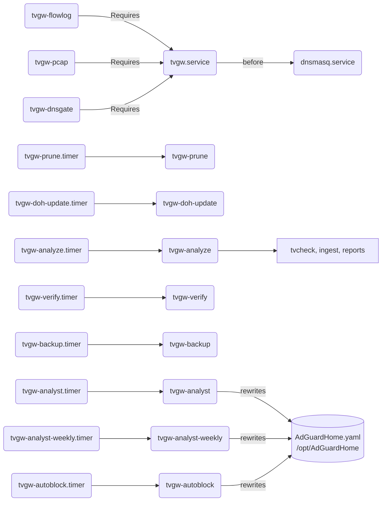

# The systemd units

This folder holds the twelve services and eight timers that run the gateway; `install.sh` copies every `*.service` and `*.timer` here to `/etc/systemd/system/`, enables them and starts them. This page owns each unit's schedule, user, sandbox and timeout. What each job means for the system as a whole is in [the architecture page](../../docs/architecture.md).

## Units

The units in the order `install.sh` enables them. Every unit runs as root unless the table says otherwise. Every timer has `Persistent=true`, so a run missed while the Pi was off is made up at boot, except `tvgw-verify.timer`, which counts from boot.

| Unit | Type | Schedule | What it runs | User and sandbox | Start timeout |
|---|---|---|---|---|---|
| `tvgw.service` | oneshot, `RemainAfterExit=yes` | at boot, `After=NetworkManager.service`, `Before=dnsmasq.service` | `/usr/local/sbin/tvgw-apply`; four `ExecStop` lines ([stopping](../nftables/README.md#stopping)) | root, no sandbox | 2 min |
| `tvgw-flowlog.service` | long-running, `Restart=always` after 5 s | always; `Requires=tvgw.service` | `sh -c` that sources the settings, then `conntrack -E -e DESTROY -o timestamp,extended -b 8388608 --orig-src <TV_IP>` appended to `/var/log/tvgw/flows.log` | root, `UMask=0027` | none |
| `tvgw-pcap.service` | long-running, `Restart=always` after 5 s | always; `Requires=tvgw.service` | `/usr/bin/tcpdump -i eth0 -n -s 0 -G 3600 -w /var/lib/tvgw/pcap/tv-%Y%m%dT%H%M%SZ.pcap` with the capture filter, `TZ=UTC` | `tvgw-pcap:nogroup`; `CAP_NET_RAW` and `CAP_NET_ADMIN` only; read-only system; only `/var/lib/tvgw/pcap` writable; `UMask=0027` | none |
| `tvgw-dnsgate.service` | long-running, `Restart=on-failure` | always; `Requires=tvgw.service` | `tvgw dnsgate-feed` | root bounded to `CAP_NET_RAW` and `CAP_NET_ADMIN`; read-only system; `MemoryMax=128M` | none |
| `tvgw-prune.service` and `.timer` | oneshot | hourly (`OnCalendar=hourly`) | `tvgw prune-pcaps` | root, no sandbox | 10 min |
| `tvgw-doh-update.service` and `.timer` | oneshot | daily (`OnCalendar=daily`), up to 1 h random delay; after `network-online.target` | `/usr/local/sbin/tvgw-doh-update` | root, no sandbox | 5 min |
| `tvgw-analyze.service` and `.timer` | oneshot | hourly at :20 | `/usr/local/sbin/tvgw-analyze` | root, sandboxed; writable `/var/lib/tvgw`, `/var/log/tvgw`, `/run/lock` | 45 min |
| `tvgw-verify.service` and `.timer` | oneshot | 3 min after boot, then 10 min after each run ends | `tvgw verify --record` | root, no sandbox, `Nice=10` | 5 min |
| `tvgw-backup.service` and `.timer` | oneshot | daily at 03:40 | `tvgw backup` | root, sandboxed; writable `/var/lib/tvgw` | 10 min |
| `tvgw-analyst.service` and `.timer` | oneshot | daily at 03:50, overridden by `ANALYST_SCHEDULE` | `tvgw analyst` | root, sandboxed; writable `/var/lib/tvgw`, `/opt/AdGuardHome`; network | 20 min |
| `tvgw-analyst-weekly.service` and `.timer` | oneshot | Monday at 04:10, overridden by `ANALYST_WEEKLY_SCHEDULE` | `tvgw analyst --weekly` | as `tvgw-analyst` | 20 min |
| `tvgw-autoblock.service` and `.timer` | oneshot | hourly at :25 | `tvgw autoblock check` | root, sandboxed; writable `/var/lib/tvgw`, `/opt/AdGuardHome`; network | 10 min |

What the jobs do:

- `tvgw.service` builds the firewall ([the firewall](../nftables/README.md)). It is ordered before dnsmasq, so the filter is in place before the TV gets a lease.
- `tvgw-flowlog` logs every finished TV connection with byte counts. The 8 MB netlink buffer (`-b 8388608`) keeps a burst of expiring flows from being dropped. It reads `TV_IP` from the settings each time it starts and falls back to `10.10.10.17`.
- `tvgw-pcap` captures the frames the TV sends into one file an hour, named in UTC with seconds, because local-time names repeat in the fall-back hour and tcpdump truncates a file whose name it has used before. What the filter keeps is in [what the capture keeps](../../docs/privacy-and-retention.md#what-the-capture-keeps).
- `tvgw-dnsgate` adds every IPv4 address AdGuard hands the TV to the DNS gate set ([the DNS gate table](../nftables/README.md#the-dns-gate-table)). With `DNSGATE=off` it exits 0 and stays down. Its restarts start at 5 seconds and back off to 5 minutes (`RestartSec=5`, `RestartSteps=6`, `RestartMaxDelaySec=5min`), since a feeder that restarted every 5 seconds logged 167 restarts in a quarter hour on 2026-10-28.
- `tvgw-prune` deletes old pcaps ([how long it is kept](../../docs/privacy-and-retention.md#how-long-it-is-kept)). It shows in `systemctl --failed` whenever it had to keep a file it should have deleted or could not tell which file is live ([commands](../../src/tvgw/README.md#commands)).
- `tvgw-doh-update` refreshes the DoH resolver list and runs `tvgw-apply` ([the shell jobs](../bin/README.md)).
- `tvgw-analyze` reads the TV (LG only), runs the hourly ingest and writes the reports ([the shell jobs](../bin/README.md)).
- `tvgw-verify` runs the checks and stores the verdict and every firewall counter ([what tvgw verify checks](../../docs/troubleshooting.md#what-tvgw-verify-checks)); it fails, and shows in `systemctl --failed`, when a check fails.
- `tvgw-backup` writes a checked copy of the store ([privacy and retention](../../docs/privacy-and-retention.md)).
- `tvgw-analyst` and `tvgw-analyst-weekly` run the daily and weekly passes of the analyst ([the analyst](../../docs/analyst-and-autonomy.md)). With `ANALYST_APPLY=auto` a pass may apply a block, which rewrites AdGuard's config.
- `tvgw-autoblock` re-judges every rule the gateway added on its own; a revert takes the rule out of the machine's file and re-applies AdGuard ([design decision 20](../../docs/design-decisions.md#20-the-gateway-blocks-on-its-own-under-three-watches)).

`install.sh` also writes four drop-ins that are not files here: `nginx.service.d/tvgw.conf` (start after `network-online.target`, `Restart=on-failure` after 5 s), `AdGuardHome.service.d/workdir.conf` (`WorkingDirectory=/opt/AdGuardHome`), and `tvgw-analyst.timer.d/schedule.conf` and `tvgw-analyst-weekly.timer.d/schedule.conf`, which replace the two timers' `OnCalendar` with the rendered schedule ([what install.sh does](../README.md#what-installsh-does)). It masks `nftables.service`, whose `flush ruleset` would wipe the VPN client's tables and the gateway's.



*The units and how they depend on each other: stopping the firewall stops capture, and only the analyst and autoblock units may rewrite AdGuard's config.*

## Hardening

`tvgw-analyze` parses untrusted input, packets from the TV and the internet and the log lines about them, so it is the most tightly bound of the units:

- `ProtectSystem=strict` with `ReadWritePaths=/var/lib/tvgw /var/log/tvgw /run/lock`: nothing else is writable.
- `NoNewPrivileges=yes`, `PrivateTmp=yes`, `ProtectHome=yes`, `ProtectKernelTunables=yes`, `ProtectKernelModules=yes`, `ProtectControlGroups=yes`, `RestrictRealtime=yes`.
- `Nice=10`, `IOSchedulingClass=best-effort` and `IOSchedulingPriority=7`, so the hourly job yields to the resolver.
- `OOMScoreAdjust=500`, so when memory runs out this job dies before the resolver does.

Inside it, tshark runs in a transient unit of its own as `nobody:nogroup`, with no network and no capabilities (`sandbox()` in src/tvgw/tshark.py).

The other sandboxes, and why each unit has the one it has:

- **`tvgw-pcap`** starts as the system user `tvgw-pcap` with `CAP_NET_RAW` and `CAP_NET_ADMIN` as its whole capability set (`AmbientCapabilities` and `CapabilityBoundingSet`), `NoNewPrivileges=yes`, `ProtectSystem=strict`, only its own directory writable, `RestrictAddressFamilies=AF_PACKET AF_NETLINK AF_UNIX AF_INET` and `SystemCallArchitectures=native`. tcpdump never runs as root, so a bug in the dissector of a frame the TV sent cannot become root.
- **`tvgw-dnsgate`** runs as root for the two capabilities the capture and the set updates need, with the same bounds as `tvgw-pcap` but nothing writable, and `MemoryMax=128M`. Its tcpdump keeps root (`-Z root` in src/tvgw/dnsgate.py), since Debian's default drop to the `tcpdump` user needs a capability the unit does not grant.
- **`tvgw-backup`** has the `tvgw-analyze` sandbox with only `/var/lib/tvgw` writable.
- **`tvgw-analyst`, `tvgw-analyst-weekly` and `tvgw-autoblock`** have the same sandbox with `/var/lib/tvgw` and `/opt/AdGuardHome` writable and `RestrictAddressFamilies=AF_UNIX AF_INET AF_INET6`. A block or a revert re-applies AdGuard's config, so its directory must be writable. The hourly check has its own unit rather than a line in `tvgw-analyze`, whose read-only view of `/opt` would make a revert's re-apply fail.
- **`tvgw`, `tvgw-flowlog`, `tvgw-verify`, `tvgw-prune` and `tvgw-doh-update`** run as root without a sandbox: they need the kernel's firewall, conntrack events or root-only files.

## Timeouts

Every `Type=oneshot` unit sets `TimeoutStartSec`, because a oneshot has no start timeout by default:

- A hung `tvgw-apply` at boot would hold `multi-user.target`, and dnsmasq, which is ordered after it, for ever. With the 2-minute timeout the unit fails instead, and the TV stays unforwarded, which is the fail-closed state ([design decision 5](../../docs/design-decisions.md#5-fail-closed)).
- A hung verify would end the checks and the counter snapshots, because `OnUnitActiveSec=10min` re-arms only when the unit finishes. Each command inside it has a 30-second timeout of its own.
- `tvgw-analyze`'s 45 minutes keep a TV that answers and then stalls, or a tshark that never returns, from blocking the next hour; the timer fires again only after the unit finishes.
- `tvgw-doh-update`'s `curl` gives up after 60 seconds inside the unit's 5 minutes.

`tests/unit/test_deploy_lint.py` fails when a oneshot unit lacks `TimeoutStartSec`, and when the list of oneshot units in this folder changes without the test. The long-running units have no start timeout; their `Restart=` lines bring them back. CI's hardware job allows time for a deploy with a first analyze run ([how a change reaches the gateway](../README.md#how-a-change-reaches-the-gateway)).

## Reading the journals

On the Pi:

```sh
systemctl list-timers 'tvgw-*'                # next and last run of each timer
systemctl --failed                            # a failed tvgw-verify means a FAIL in the last check
journalctl -u tvgw -n 20                      # firewall applies: "tvgw: applied (uplink=direct ...)"
journalctl -u tvgw-analyze -n 50              # the hourly TV reading, ingest and reports
journalctl -u tvgw-verify -n 20               # one line per check, OK or FAIL
journalctl -u tvgw-doh-update -n 20           # "tvgw: N DoH IPs loaded", or why the old list was kept
journalctl -u tvgw-prune -n 5                 # "tvgw prune-pcaps: deleted N, kept M (X MB)" and its warnings
journalctl -u tvgw-backup -n 7                # one line per daily copy: path, size, quick_check ok
journalctl -u tvgw-dnsgate -n 20              # the feeder's start line, tcpdump's own errors
journalctl -u tvgw-analyst -u tvgw-autoblock  # analyst runs and the hourly judgements
journalctl -u tvgw-pcap -u tvgw-flowlog       # capture restarts and errors
```

`tvgw-analyze` prints `tvgw-analyze: WARNING: ...` when the TV reports Live Plus on, when ingest reports problems and when a report fails to render, and ends with `tvgw-analyze: latest refreshed; new reports: ...`. `tvgw ingest` writes its own warnings to stderr, and the brief repeats them under Coverage. The dnsgate feeder lets tcpdump's stderr reach the journal, so a feeder that dies at once says why.

## Changing a unit

1. Edit the file in this folder. Write `%%` for a literal `%` and `$$` for a literal `$` in an `Exec` line: systemd expands `%` specifiers and `$VAR` itself, quoted or not, which is why `tvgw-flowlog` writes `$${TV_IP:-10.10.10.17}`.
2. A new oneshot needs a `TimeoutStartSec`, and the oneshot list in `tests/unit/test_deploy_lint.py`.
3. A new unit that must run also goes in the `systemctl enable --now` line in `install.sh`, in `verify.SERVICES` in src/tvgw/verify.py, and in `ENABLED` in tests/hardware/test_gateway.py, with `test_service_active` for a service and `test_timer_scheduled` for a timer.
4. Run `make gate`. `tests/unit/test_deploy_units.py` checks the `Exec` escapes, the UTC pcap names and the analyze unit's OOM score; `tests/unit/test_capture_filter.py` runs the capture filter through tcpdump.
5. Deploy. `install.sh` copies every unit and timer and reloads systemd, and restarts `tvgw-pcap`, `tvgw-flowlog` or `tvgw-dnsgate` only when its file changed, since every restart is a short hole in the evidence. The hardware suite then checks that each installed file equals the checkout and that each unit is enabled.

Keep `eth0`, `/var/lib/tvgw` and `/var/log/tvgw` in step with the scripts, which hardcode them too. A timer's cadence is a promise the brief makes: the verify interval bounds how many counted packets a re-apply can lose, and analyze at :20 sets how late TLS names arrive ([the architecture page](../../docs/architecture.md)).

## Gotchas

- Stopping `tvgw.service` also stops `tvgw-flowlog`, `tvgw-pcap` and `tvgw-dnsgate`, which require it, so the store has a gap for that time.
- `tvgw-dnsgate` stays down after it exits 0 with `DNSGATE=off`; after switching back to `count`, start it again.
- The analyst timers' schedules come from the drop-ins `install.sh` writes, so editing `OnCalendar` in the shipped timer files changes nothing while a drop-in exists.
- `tvgw-analyze` exits 0 when ingest reports problems; those show in the brief's Coverage, not in `systemctl --failed`.
