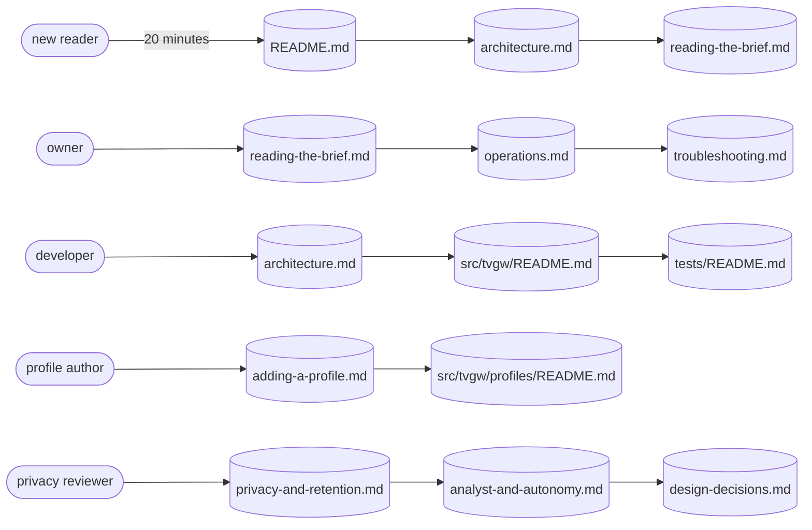

# Documentation index

This page is the map of the tvgw documentation: a reading path for each role, a one-line entry for every page and folder README, the layout of the repository, the records and how to add to them, and the style every page follows. It is for every reader looking for the right page, and for anyone who edits these pages later.

## Reading paths

Read the pages in this order for your role:

- A new technical reader, in about 20 minutes: [the front page](../README.md), then [the architecture](architecture.md), then [reading the brief](reading-the-brief.md).
- The owner running the gateway: [reading the brief](reading-the-brief.md), then [the operations runbook](operations.md), then [troubleshooting](troubleshooting.md).
- A developer changing code: [the architecture](architecture.md), then [the package](../src/tvgw/README.md), then [the tests](../tests/README.md).
- A profile author: [adding a profile](adding-a-profile.md), then [the bundled profiles](../src/tvgw/profiles/README.md).
- A privacy reviewer: [privacy and retention](privacy-and-retention.md), then [the analyst and autonomy](analyst-and-autonomy.md), then [the design decisions](design-decisions.md).



*Each role's first pages in reading order; the 20-minute path for a new reader is README.md, architecture.md, then reading-the-brief.md.*

## Pages

This is the only full list of the documentation. Each fact has one owning page, and the other pages link to it.

### Pages in docs

| Page | What it owns |
|---|---|
| [README.md](README.md) | This index: reading paths, the page map, the repository map, the records and the writing conventions. |
| [adding-a-profile.md](adding-a-profile.md) | The profile format and how to write and test a profile for another TV vendor. |
| [analyst-and-autonomy.md](analyst-and-autonomy.md) | The daily and weekly analyst, the evidence pack, autonomous blocks under design decision 20, and their constants. |
| [architecture.md](architecture.md) | How the parts fit: the data path, the control plane, the data plane and how a connection gets its name. |
| [data-model.md](data-model.md) | The store as built: every table and its columns, and the known limits the code still shows. |
| [design-decisions.md](design-decisions.md) | The 20 design decisions, each with its context, decision and consequences. |
| [glossary.md](glossary.md) | A short definition of every project term, with a link to the page that owns its details. |
| [incidents.md](incidents.md) | What broke on a running gateway, why, and what changed. |
| [operations.md](operations.md) | The runbook: the daily routine, the red lines and what to do about each, changing policy and `STRICT_PORTS`. |
| [privacy-and-retention.md](privacy-and-retention.md) | What the capture keeps, what the store holds and for how long, where each file lives and who can read it. |
| [reading-the-brief.md](reading-the-brief.md) | Every section of the brief and how to read it. |
| [research/README.md](research/README.md) | The folder of dated proposals, none of which is a decision. |
| [research/data-architecture-2026-10.md](research/data-architecture-2026-10.md) | The 2026-10-27 proposal for the data layer. |
| [research/state-of-the-art-2026-10.md](research/state-of-the-art-2026-10.md) | The 2026-10-27 survey of every tool tvgw uses and what could replace it. |
| [troubleshooting.md](troubleshooting.md) | What `tvgw verify` checks and what each failure means. |

### Folder READMEs

| README | What it owns |
|---|---|
| [README.md](../README.md) | The front page: what tvgw is, what it found on an LG CX, and the quick start. |
| [deploy/README.md](../deploy/README.md) | The installer, the settings file and its defaults, and how a change reaches the gateway. |
| [deploy/bin/README.md](../deploy/bin/README.md) | The shell jobs the timers run. |
| [deploy/dnsmasq/README.md](../deploy/dnsmasq/README.md) | DHCP for the TV. |
| [deploy/logrotate/README.md](../deploy/logrotate/README.md) | Rotation of the gateway's logs. |
| [deploy/networkmanager/README.md](../deploy/networkmanager/README.md) | The TV interface and the dispatcher that re-applies the firewall when a link changes. |
| [deploy/nftables/README.md](../deploy/nftables/README.md) | The firewall, rule by rule. |
| [deploy/nginx/README.md](../deploy/nginx/README.md) | The URL filter and the TLS passthrough. |
| [deploy/systemd/README.md](../deploy/systemd/README.md) | Every unit with its schedule, user and timeout. |
| [src/tvgw/README.md](../src/tvgw/README.md) | The Python package, module by module, and the command reference. |
| [src/tvgw/profiles/README.md](../src/tvgw/profiles/README.md) | The bundled `lg-webos` profile and where its evidence came from. |
| [tests/README.md](../tests/README.md) | The kinds of tests and when each runs. |
| [tests/hardware/README.md](../tests/hardware/README.md) | The hardware suite that runs on the gateway. |
| [tests/unit/README.md](../tests/unit/README.md) | The unit tests and their fixtures. |

## Repository map

| Folder | What it holds | README |
|---|---|---|
| repository root | The front page, `CHANGELOG.md`, `LICENSE`, the `Makefile` and `pyproject.toml`. | [README.md](../README.md) |
| `.github/` | `dependabot.yml`, which proposes weekly bumps of the GitHub Actions that `ci.yml` pins by commit. | none |
| `.github/workflows/` | `ci.yml`, the CI workflow. | none; the wiring is in [how a change reaches the gateway](../deploy/README.md#how-a-change-reaches-the-gateway) |
| `deploy/` | `install.sh`, the settings template `tvgw.conf.example` and `rsync.exclude`. | [deploy/README.md](../deploy/README.md) |
| `deploy/bin/` | `tvgw-analyze` and `tvgw-doh-update`. | [deploy/bin/README.md](../deploy/bin/README.md) |
| `deploy/dnsmasq/` | The DHCP template. | [deploy/dnsmasq/README.md](../deploy/dnsmasq/README.md) |
| `deploy/logrotate/` | The rotation config for the gateway's logs. | [deploy/logrotate/README.md](../deploy/logrotate/README.md) |
| `deploy/networkmanager/` | The NetworkManager config and dispatcher script. | [deploy/networkmanager/README.md](../deploy/networkmanager/README.md) |
| `deploy/nftables/` | `tvgw-apply`, `block4.txt` and `doh-exclude.txt`. | [deploy/nftables/README.md](../deploy/nftables/README.md) |
| `deploy/nginx/` | The URL filter and the TLS passthrough config. | [deploy/nginx/README.md](../deploy/nginx/README.md) |
| `deploy/systemd/` | Twelve services and eight timers. | [deploy/systemd/README.md](../deploy/systemd/README.md) |
| `docs/` | The pages in the page map and the two records. | this page |
| `docs/research/` | The dated proposals. | [docs/research/README.md](research/README.md) |
| `src/tvgw/` | The Python package. | [src/tvgw/README.md](../src/tvgw/README.md) |
| `src/tvgw/profiles/` | `lg-webos.toml` and `lg-webos.rules`. | [src/tvgw/profiles/README.md](../src/tvgw/profiles/README.md) |
| `tests/` | The test suites. | [tests/README.md](../tests/README.md) |
| `tests/hardware/` | `test_gateway.py`, run on the gateway. | [tests/hardware/README.md](../tests/hardware/README.md) |
| `tests/unit/` | The unit tests and `conftest.py`. | [tests/unit/README.md](../tests/unit/README.md) |

## Records

Four kinds of text are records rather than pages. Pages describe the code now; records keep what was decided, what broke, what changed and what was proposed.

- [design-decisions.md](design-decisions.md) is append-only. To record a choice that someone would otherwise undo by accident, add a numbered entry with its context, decision and consequences. To reverse a decision, keep the old entry and add a new one that says so.
- [incidents.md](incidents.md) lists what broke on a running gateway, newest first. Add an entry for any outage and for any near miss, using the template at its top: date and title, impact, detection, root cause, fix, lesson.
- [CHANGELOG.md](../CHANGELOG.md) lists the changes since each release. Add a line under the matching dated section of "Unreleased".
- [research/](research/README.md) holds dated proposals, which are not decisions. Add one as a new file named for its topic and month, with its date and status at the top, and list it in [the research folder's README](research/README.md).

## How these pages are written

**A1. Sources of truth**

Every statement of fact comes from one of four sources, as they stand at the commit you start from:

- the code: src/, deploy/, .github/workflows/ci.yml, Makefile and pyproject.toml;
- the tests: tests/;
- docs/design-decisions.md;
- CHANGELOG.md.

Existing pages, docs/research/ and the incident log are leads to check, never sources. If you cannot find a fact in those four sources, leave it out. The first time a page uses a constant or threshold, give its name and file so a reader can check it, for example `MAX_PER_DAY = 3` in src/tvgw/autoblock.py.

**A2. One fact, one place**

Each fact has exactly one owning page. Other pages may name it in passing ("the hourly ingest"), but they link to the owner. They never restate its value, its table, its steps or its reasoning. A page's own diagram may show facts that are in its own text; a diagram never carries a fact the page's text and links lack. The fixed owners:

- setting defaults: deploy/README.md#the-settings-file
- unit schedules, users and timeouts: deploy/systemd/README.md#units
- paths, owners and modes: docs/privacy-and-retention.md#where-it-lives-and-who-can-read-it
- command syntax, privileges and exit codes: src/tvgw/README.md#commands
- verify checks: docs/troubleshooting.md#what-tvgw-verify-checks
- red lines and their actions: docs/operations.md#red-lines
- brief sections: docs/reading-the-brief.md#sections
- table columns: docs/data-model.md#tables
- firewall rules: deploy/nftables/README.md
- the capture filter: docs/privacy-and-retention.md#what-the-capture-keeps
- analyst and autonomy constants: docs/analyst-and-autonomy.md
- the CI wiring: deploy/README.md#how-a-change-reaches-the-gateway
- the profile format: docs/adding-a-profile.md#the-profile-format
- term definitions: docs/glossary.md
- the operator's bring-up steps: README.md#quick-start

**A3. Page shape**

- One H1, the page title, in sentence case.
- Directly under the H1, one paragraph of at most three sentences: what the page owns and who it is for. No table of contents, no "Overview" heading, no "See also" list at the end.
- Sections are H2 and subsections H3; nothing deeper. Headings use sentence case, with no trailing punctuation and no numbers. The glossary is the only exception: an H2 for each letter and an H3 for each term.
- Keep every fixed H2 heading word for word, because other pages link to it. You may add H2 and H3 headings. Use code spans in headings only for literal names, and never in a fixed heading.
- Folder READMEs follow A11.

**A4. Tone**

- Write plain, direct sentences in the present tense, in the active voice, with American spelling.
- Describe what the code does now. No plans, no "will". Add history only where a design decision or the changelog gives it as a reason ("since 2026-10-27").
- Procedures are numbered steps in the imperative ("Run", "Edit").
- Call the project tvgw, the Raspberry Pi "the Pi" or "the gateway", and the person who runs it "the owner". In procedures, address the reader as "you". Never use "we".
- No exclamation marks, emoji, rhetorical questions or filler (simply, just, easily, obviously, note that, please). No marketing words (powerful, seamless, robust, best-in-class, enterprise-grade, cutting-edge).
- Give the reason next to the rule, in one clause. Use short sentences, one idea per sentence.

**A5. Numbers, units, dates**

- Use digits for every number that has a unit and for every setting value, constant, threshold, percentage, port and address. Use digits for every number in tables and diagrams. In running prose, write counts from one to nine without a unit as words ("three watches", "seven copies").
- Put a space between a number and its unit. In prose, write duration units as words: "30 seconds", "10 minutes", "2 hours", "7 days". In tables and diagrams, use s, min, h and d. You may give a code value in the code's own unit with the conversion: "7440 s (2 h 04 min)".
- Write sizes as B, KB, MB or GB with a space ("16 KB", "1.5 GB"). They mean powers of 1024, as the code computes and prints them.
- Write percentages without a space ("20%"). Quote ratios from code as the code writes them (`0.2`) and give the percentage in prose.
- Separate thousands with commas in prose ("10,000 lines"). Write code literals as the code does (`10_000`).
- Dates are ISO 8601 (2026-10-28). ISO weeks look like 2026-W43. Times of day use the 24-hour clock (03:50) and are the Pi's local time, which the timers use. Say "UTC" where a value is UTC, as in pcap and backup file names.
- Give money in US dollars with two decimals ("$0.07"), with the date of the price.
- Do not state counts that ordinary commits change: numbers of tests, rules in a list, lines of code. Counts fixed by the design are fine once you check them against the tree: twelve services and eight timers in deploy/systemd, 19 tables and one view in src/tvgw/db.py, 20 design decisions.

**A6. Commands and code**

- Put commands in fenced blocks tagged `sh`, one command per line, with no prompt characters. Show root as `sudo`. A `#` comment at the end of a line may say what the command shows. Before the block, say where it runs: "On the Pi:" or "On your workstation:".
- Put output in a separate block tagged `text`, trimmed, with nothing site-specific.
- Write placeholders in angle brackets: `<ssh-host>`, `<TV_IP>`, `<day>`, `<stamp>`. CLI arguments use the names cli.py gives them (DAY, SINCE, NAME, QUERY).
- Use inline code for command names, file paths, settings keys, table and column names, unit names, rule text, nftables comments and literal values. Write settings as `KEY=value`.
- Paths on the Pi are absolute (`/var/lib/tvgw/tvgw.db`). Repository paths are relative to the repository root (`deploy/nftables/tvgw-apply`), and are links where the reader should open the file.
- Never show `ssh`, `scp` or `rsync` with a real host. Write `make deploy PI=<ssh-host>`.

**A7. Links**

- Use relative links only, written from the linking file's folder (`../deploy/README.md#the-settings-file`), so they work on any clone. No bare URLs. External links go only to the primary source of something a procedure needs, such as AdGuard Home's install instructions.
- When one section owns a fact, link to that section, not to the page. Anchors follow GitHub's rules: lowercase, spaces become hyphens, and punctuation other than hyphens and underscores is removed (`#what-installsh-does`, `#the-machines-rules-file`).
- Link text names the target ("the settings file", "design decision 20"), never "here" or "this page".
- Link the first mention of an owned fact in each section, not every mention.
- Records that are never edited link to these targets, so they must keep resolving: docs/architecture.md, docs/architecture.md#naming-a-connection, docs/operations.md, docs/operations.md#red-lines, docs/operations.md#strict_ports, docs/privacy-and-retention.md, docs/incidents.md, docs/design-decisions.md and src/tvgw/profiles/README.md.

**A8. Citing a design decision**

- Write "design decision N", in lowercase, and link it to its heading in docs/design-decisions.md on first mention in a section: `[design decision 20](design-decisions.md#20-the-gateway-blocks-on-its-own-under-three-watches)`. For several, write `design decisions [19](...) and [20](...)`. Never write "DD20", "ADR 20" or "decision #20".
- Give the consequence the reader needs in one clause and link for the reasoning. Do not restate the context or quote the record.
- Where the code and a decision differ, describe the code and cite the decision that matches it. For example, decision 19 says nothing is applied, while decision 20 and the code apply blocks when `ANALYST_APPLY=auto`.
- The anchors:
  - `#1-the-tv-uses-the-direct-uplink-not-the-vpn`
  - `#2-isolate-first-then-filter`
  - `#3-no-tls-interception`
  - `#4-no-rooting-of-the-tv`
  - `#5-fail-closed`
  - `#6-adguard-home-is-configured-as-code`
  - `#7-must-allow-exceptions-are-generated-from-the-toml`
  - `#8-a-url-filter-for-lgs-file-service-instead-of-a-dns-block`
  - `#9-doh-upstreams-by-ip-address`
  - `#10-a-rollback-journal-not-wal`
  - `#11-row-id-watermarks-for-the-hosts-counters`
  - `#12-each-flow-is-named-by-its-own-tls-hello`
  - `#13-counters-not-logs-prove-the-firewall-held`
  - `#14-red-lines-are-the-alarm-model`
  - `#15-blocklist-entries-come-from-evidence-with-grades`
  - `#16-quickset-and-hue-stay-blocked-with-the-cost-written-down`
  - `#17-strict_ports-stays-off-until-two-clean-weeks`
  - `#18-dns-gated-egress-starts-as-a-count-in-its-own-table`
  - `#19-a-daily-analyst-that-only-proposes`
  - `#20-the-gateway-blocks-on-its-own-under-three-watches`

**A9. Diagrams**

- Use Mermaid only, in a block fenced `` ```mermaid ``, and only these types: flowchart, sequenceDiagram, stateDiagram-v2, erDiagram, classDiagram.
- No front matter, no `title`, no `%%{init}%%`, no `style`, `classDef`, `linkStyle` or `click`, no colors and no icons. A diagram must read in light and dark themes as plain shapes.
- A diagram has at most about 25 nodes, counting boxes, decisions, states, participants and entities. Subgraph frames do not count. Split anything bigger into two diagrams.
- Each shape in a flowchart has one meaning everywhere:
  - `([...])` a start or end;
  - `[...]` a step or component;
  - `(...)` a running service or unit;
  - `[(...)]` a file or the store;
  - `{...}` a decision;
  - `((...))` something outside the Pi (the TV, the router, an internet service).

  Subgraphs mark a boundary (the Pi, the TV subnet, GitHub).
- Labels use the names in the code (unit, chain, table, file and constant names). Keep them short: up to five words, plus an optional second line after `<br/>` for a path or a value. Quote any label that has characters other than letters, digits, spaces and hyphens: `apply["tvgw-apply<br/>/usr/local/sbin"]`. Node ids are short lowerCamel words, and never `end`. Edge labels are one to three words: `-->|DNAT|`.
- In stateDiagram-v2, write a state with spaces in its name as `state "On probation" as OnProbation`.
- In erDiagram, use SQLite's types for attributes (text, integer, real, blob) and mark `PK`. Give each relationship a quoted label naming the join it stands for. SQLite enforces no foreign keys here; the caption says the relationships are logical joins.
- Caption: directly under the closing fence and after one blank line, write exactly one line in italics (`*...*`). It is one sentence ending with a period, saying what the diagram shows and the one thing to notice. Nothing goes above the diagram, and there are no "Figure N" labels.
- Every fact a diagram shows is also in the page's text or in a linked owner, so the page reads without the diagram rendering.
- A diagram shows only things that exist in the code. No planned components.

**A10. Tables**

- Each table has a header row in sentence case and one fact per cell, with literal values in code font.
- Use at most five columns. Reference tables for settings, commands, units and checks may use seven.
- Order rows the way the code does (chain order, render order, run order); otherwise, alphabetically.

**A11. Folder READMEs**

Every folder with tracked files has a README. It is the reference for the files in that folder and for nothing else. The shape:

1. An H1 naming the folder's role, for example "The firewall".
2. One paragraph: what the folder holds, when its files run, and which docs page explains the concept.
3. An H2 "Files" with a table of each file, what it is, and where it is installed or who uses it. In deploy/systemd/README.md this table is "Units".
4. The sections specific to the folder: how it works, rule by rule or line by line, each with its reason.
5. Where they apply: "Checking it" (read-only commands), "Changing it" (where to edit, what to run, which test guards it) and "Gotchas".

Facts about the files in the folder live in its README. Concepts and procedures that span folders live in docs/ and are linked from there.

**A12. Site identifiers**

Never write a site identifier. That means:

- no real MAC address; the only allowed MAC values are the placeholders b4:b2:91:aa:bb:cc and 00:00:00:00:00:00;
- no 192.168.x.x address or other home-LAN address;
- no host name or user name of the owner's machines or of the gateway;
- no router or VPN account detail, no Wi-Fi network name, no ZIP code, no location.

Allowed addresses: the TV subnet 10.10.10.0/24, the gateway 10.10.10.1, the TV 10.10.10.17, the documentation ranges 192.0.2.0/24, 198.51.100.0/24 and 203.0.113.0/24, and public addresses that appear in the code (1.1.1.1, 1.0.0.1, 8.8.8.8, 8.8.4.4, 9.9.9.9, 156.147.69.32). Write "the home router", "the router's address" and "your ssh host". Public vendor host names that appear in the profile are code facts and are allowed. Check any text copied from a log, a brief or a template line by line before it goes in.
