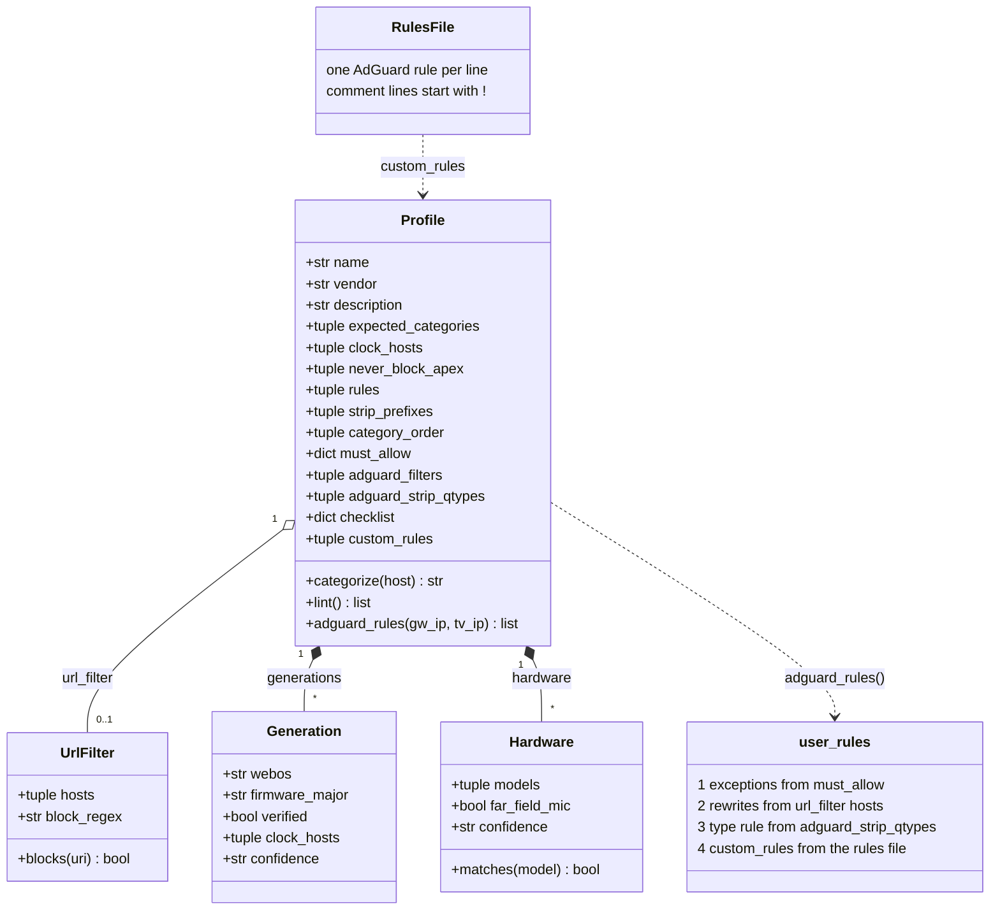

# Adding a profile for another TV vendor

This page owns the profile format and the procedure for putting a TV other than the bundled LG one behind the gateway. It is for a developer who writes that profile and its tests. What the bundled `lg-webos` profile holds, and where its evidence came from, is in [the profiles README](../src/tvgw/profiles/README.md).

## How a profile is used

Isolation, the DNS redirect, capture, the store, the hourly ingest, `tvgw verify` and the brief are vendor-neutral. A profile supplies what is not:

- which category each name falls in, and which categories are the TV doing its job;
- the clock hosts, the zones that must never be blocked at the apex, and the must-allow hosts with their reasons;
- the AdGuard Home blocklists, the record types withheld from the TV, and a URL filter for a plain-HTTP file service that mixes wanted and unwanted files;
- reference tables (webOS generations, hardware, a checklist) that `tvgw profile` prints;
- the companion `.rules` file of AdGuard rules.

A profile is two files with one stem in `src/tvgw/profiles/`: `<name>.toml` and `<name>.rules`. `pyproject.toml` ships both as package data (`profiles/*.toml`, `profiles/*.rules`), so the gateway runs the profile inside the installed package, and a profile change reaches the Pi only through a deploy. The `PROFILE` setting names the bundled profile the gateway uses ([the settings file](../deploy/README.md#the-settings-file)). `tvgw profile --profile` also takes the path of a `.toml` file, which is how you lint a profile on a workstation.

Every `tvgw` command loads the configured profile before it runs. A profile that does not load makes every command print one line, `tvgw: profile <name>: <reason>`, and exit 1 (`_load_profile` in [src/tvgw/cli.py](../src/tvgw/cli.py)).

The code reads the profile in these places:

- `tvgw adguard apply` turns it into AdGuard's blocklists and custom rules ([the rules file](#the-rules-file)).
- The hourly ingest categorizes every name it stores, and recomputes the categories whenever the patterns change.
- The brief uses the categories, the expected categories and the clock hosts ([brief sections](reading-the-brief.md#sections)).
- `tvgw verify` resolves the must-allow and URL-filter hosts ([what tvgw verify checks](troubleshooting.md#what-tvgw-verify-checks)).
- The analyst's evidence pack carries the profile's name, vendor, expected categories, apex zones and must-allow hosts ([the analyst](analyst-and-autonomy.md)).

Write a profile in two phases: capture with nothing blocked, then write the policy from what the TV did.

```mermaid
flowchart LR
  start(["New vendor"]) --> skeleton["Skeleton profile<br/>empty .rules file"]
  skeleton --> deploy1["make deploy"]
  deploy1 --> observe["Observe for 48 h<br/>boot, store, apps, standby, settings"]
  observe --> clock["Find the clock hosts"]
  clock --> write["Write the tables<br/>[profile] [categories] [must_allow] [adguard] [url_filter]"]
  write --> lint["tvgw profile<br/>lint clean"]
  lint --> gate["make gate"]
  gate --> deploy2["make deploy"]
  deploy2 --> diff["tvgw adguard diff<br/>exits 0"]
  diff --> batches(["Block in small batches"])
```



*The two phases of a new profile: capture first with nothing blocked, then write the policy from what the TV did.*

## Phase 1: capture first

### Write a skeleton profile

1. On your workstation, create `src/tvgw/profiles/acme-tv.toml`. Use your vendor's name in lower case in place of `acme-tv`; the file name is what selects the profile.

   ```toml
   [profile]
   name = "acme-tv"
   vendor = "Acme"
   description = "Acme smart TVs (capture phase)"
   expected_categories = ["Streaming", "Infra"]
   clock_hosts = []
   never_block_apex = []

   [categories]
   strip_prefixes = []
   Streaming = ["netflix.*", "googlevideo.com"]
   Infra = ["ocsp.*", "digicert.com"]

   [must_allow]

   [adguard]
   filters = []
   ```

2. Create an empty `src/tvgw/profiles/acme-tv.rules` beside it. The file must exist; an empty one is the capture-phase profile.
3. Run the gate and deploy. The package on the Pi then carries the new profile, and the gateway still runs the old one.

   On your workstation:

   ```sh
   make gate
   make deploy PI=<ssh-host>
   ```

4. On the Pi, edit `/etc/tvgw/tvgw.conf` and set `PROFILE=acme-tv`. On a first install, `tvgw discover --write` leaves `PROFILE` as it was for a vendor that has no bundled profile, so set it here too.
5. Apply the profile to AdGuard Home and check the gateway.

   On the Pi:

   ```sh
   sudo tvgw adguard apply
   sudo tvgw adguard diff      # no drift
   sudo tvgw verify            # every line OK
   ```

6. Turn off, in AdGuard's web UI, every blocklist a previous profile or AdGuard's first-run wizard enabled. `tvgw adguard apply` replaces AdGuard's custom rules with the profile's, so no custom rule blocks anything now, but it never disables a list the profile does not name.

The firewall still redirects every DNS packet to AdGuard and rejects the bypasses, because none of that depends on the profile ([the firewall](../deploy/nftables/README.md)).

### Observe for 48 hours

Use the TV as the household does, and do each of these on purpose. Write down the time of each one: without a LAN-API reader the store has no power readings ([what else is LG-specific](#what-else-is-lg-specific)), so your notes are the timeline.

- Cold-boot the TV with the power pulled, not from standby, and read what it looks up before you touch the remote. The `lg-webos` clock host is looked up at boot.
- Open the app store, install an app and update one. Note which names carry the downloads and which carry the store's pages.
- Launch each app the household uses and play something for a few minutes. Note the video CDN names and the telemetry that starts with each app.
- Leave the TV in standby overnight.
- Change a setting that should matter, such as a privacy toggle, and look for new names.

`sudo tvgw ingest` loads new data on demand. TLS names arrive only once tcpdump has closed the hour's pcap, because ingest reads finished pcaps only.

On the Pi:

```sh
tvgw new-hosts 2h                                   # names first seen since the last step
tvgw new-hosts 2d                                   # everything first seen, with category and counts
tvgw allowed 2d                                     # allowed names outside the expected categories
tvgw top-upload 2d                                  # destinations by bytes the TV sent
tvgw host NAME                                      # one name in depth
tvgw report --since SINCE --until UNTIL             # the brief over a stretch you noted
tvgw sql "select datetime(t,'unixepoch','localtime'), qname, blocked from dns where t >= strftime('%s','<start>','utc') order by t limit 200"
```

The last command lists the lookups from a local time you noted, such as the minute of a cold boot. Write `<start>` as `YYYY-MM-DD HH:MM`.

### Find the clock hosts

A TV without a battery clock takes its time from a vendor server; on webOS that is LG's SDP reply, which is why the `lg-webos` must-allow list starts with it. Block that server and the clock resets, and then TLS fails everywhere.

1. Read the lookups in the first minutes after a cold boot, before the first TLS connection. A TV that sets its clock from a server must do so before it can check a certificate.
2. To confirm a candidate, block it for one boot and check the TV's clock. Unblock it and restart the TV straight after, because a TV without its clock fails every TLS connection.
3. Put a pattern for each clock host in `clock_hosts` and each concrete host in `[must_allow]` ([the profile format](#the-profile-format)).

## Phase 2: write the profile

1. Sort the names from Phase 1 into `[categories]`. Order the categories the way the brief's "By category" table should list them.
2. Set `expected_categories` to the categories that are the TV doing its job. An allowed name in any other category is what the brief and `tvgw allowed` show you.
3. List in `[must_allow]` every host whose block breaks the TV: the clock, firmware updates, the connectivity check, the store. Give each a reason.
4. List in `never_block_apex` the zones that carry both delivery and telemetry.
5. Choose few, curated blocklists for `[adguard] filters`. The capture is the evidence; a list is a starting point.
6. Decide on `strip_qtypes`. First check whether the TV asks for those record types at all:

   On the Pi:

   ```sh
   tvgw sql "select qtype, count(*) from dns group by qtype"
   ```

7. Add a `[url_filter]` only if the vendor serves wanted and unwanted files over plain HTTP from the same host names ([design decision 8](design-decisions.md#8-a-url-filter-for-lgs-file-service-instead-of-a-dns-block)).
8. Write the blocks in the `.rules` file, each group under a dated reason ([the rules file](#the-rules-file)).
9. Run the lint, write the tests, and work through the [checklist before you deploy](#checklist-before-you-deploy).

## The profile format

This section is the reference for every table and key that `src/tvgw/profile.py` reads. The TOML is data: `from_dict` builds a `Profile` from it, and `Profile.adguard_rules()` generates the rules AdGuard receives.

- The top-level tables allowed are `TABLES` in src/tvgw/profile.py: `profile`, `categories`, `must_allow`, `adguard`, `url_filter`, `generations`, `hardware` and `checklist`. Any other table fails the load with `<table>: unknown table`, because a misspelt `[must_alow]` would otherwise read as a profile with no must-allow hosts and a clean lint.
- Every table is optional. A table that is absent gives the defaults below.
- Keys inside a known table are not checked against a list. A misspelt key such as `clock_host` is ignored and its default applies.
- Data that TOML accepts but the profile would misread fails the load with a `ValueError` that names the key. Most often that is a bare string where a list was meant: `Streaming = "netflix.com"` would iterate as 11 one-character patterns.
- Category patterns, strip prefixes, clock hosts, apex zones, must-allow hosts and URL-filter hosts are lower-cased at load.



*The anatomy of a profile: the TOML is data, and the rules AdGuard receives are generated from it plus the rules file.*

### `[profile]`

| Key | Type | Default | Meaning | Refused at load when |
|---|---|---|---|---|
| `name` | string | `"unnamed"` | Printed by `tvgw profile` and sent in the analyst's pack. Nothing checks it against the file name. | never |
| `vendor` | string | `""` | Printed by `tvgw profile` and sent in the analyst's pack. | never |
| `description` | string | `""` | Printed by `tvgw profile`. | never |
| `expected_categories` | list of strings | `["Streaming", "Infra"]` | The categories that are the TV doing its job. | it is not a list of non-empty strings, or an entry is not a category in `[categories]` |
| `clock_hosts` | list of strings | `[]` | Patterns for the lookups the TV makes to set its clock. | it is not a list of non-empty strings |
| `never_block_apex` | list of strings | `[]` | Zones where a block at the apex breaks the TV, because one zone carries delivery and telemetry. | it is not a list of non-empty strings |

The default `expected_categories` is not checked against `[categories]`.

A `clock_hosts` pattern matches the whole query name, case-insensitively. `*` matches any run of characters and `?` exactly one (`clock_sync` in src/tvgw/queries.py turns them into SQL `LIKE` patterns). A subdomain is not matched by itself: `??.example.com` matches `us.example.com` and not `rdx2.example.com`, which is why `lg-webos` lists the country hosts only. With patterns listed, the brief raises a red line when a clock lookup is blocked, or when a report of a whole day has the TV on and no clock lookup ([red lines](operations.md#red-lines)). An empty list turns both checks off.

### `[categories]`

Each key is a category, and its value is a list of host patterns. One key is not a category: `strip_prefixes`, a list of regional prefixes (`aic.`, `eic-`) that is removed from the front of a name before matching. Only the first prefix that matches is removed.

A name is categorized like this (`Profile.categorize` in src/tvgw/profile.py):

1. The name is lower-cased, its trailing dot is dropped, and a strip prefix is removed.
2. Patterns use shell wildcards: `*`, `?` and `[...]`. `*` also matches dots.
3. A pattern matches the host itself or any subdomain of it, so `example.com` matches `example.com` and `a.b.example.com`.
4. The longest pattern wins. Its score is its length without the `*` characters. On a tie, the pattern earlier in the file wins.
5. A name that no pattern matches is `Other`.

So `peacocktv.com` can be `Streaming` while `ingest.webcol.sdp.peacocktv.com` is a more specific `3rd-party ads` entry.

| Refused at load when | Why |
|---|---|
| a category is named `Other` | `Other` is reserved for names no pattern matches. |
| a value is not a list of non-empty strings | A bare string would iterate as one-character patterns. |
| `strip_prefixes` is not a list of non-empty strings | Same reason. |

The categories keep their file order, and the brief's "By category" table lists them in that order. Name a category `ACR` if the vendor has automatic content recognition: the hardware suite checks that no `ACR` name was answered in the last day, and with no such category that test checks nothing.

### `[must_allow]`

A table of `host = "reason"`: the names that break the TV when blocked. The reason is for the next reader, and it must be a string, or the load fails naming `must_allow.<host>`.

Each host becomes the exception `@@||host^$important` in AdGuard's custom rules, which also covers its subdomains. The `$important` modifier is what makes the exception hold against any list, whatever the order ([design decision 7](design-decisions.md#7-must-allow-exceptions-are-generated-from-the-toml)). Never write these in the `.rules` file; an exact copy there is dropped as a duplicate.

The must-allow hosts are also read by the lint, by `tvgw verify`, by the brief's red line, by the hardware suite and by the analyst. After an apply, `tvgw adguard apply` waits for the resolver to resolve the first must-allow host, or `example.com` when the list is empty.

### `[adguard]`

| Key | Type | Default | Meaning | Refused at load when |
|---|---|---|---|---|
| `filters` | list of `{ name = "...", url = "..." }` | `[]` | Blocklists that `tvgw adguard apply` makes sure exist and are enabled, matched by URL, with the name set. | an entry lacks a string `name` or `url` |
| `strip_qtypes` | list of strings | `[]` | Record types withheld from the TV. | an entry is not in `STRIPPABLE_QTYPES = ("HTTPS", "SVCB")` in src/tvgw/profile.py |

`tvgw adguard apply` leaves lists the profile does not name as they are, and removing a list from `filters` does not disable it in AdGuard.

`strip_qtypes = ["HTTPS", "SVCB"]` generates one rule, `||*^$dnstype=HTTPS|SVCB,client=<TV_IP>`. It is scoped to those types and to the TV's address, so the TV's A lookups and every other client are untouched. HTTPS and SVCB records carry Encrypted ClientHello keys, which would hide every server name from the capture ([design decision 6](design-decisions.md#6-adguard-home-is-configured-as-code)). The lint treats a `$dnstype` rule as a typed rule, not as a block.

### `[url_filter]`

Optional. Leave it out when the vendor has no plain-HTTP file service that DNS cannot split.

| Key | Type | Default | Meaning | Refused at load when |
|---|---|---|---|---|
| `hosts` | list of strings | none; required with the table | Names AdGuard answers with the gateway's address. | it is missing or not a list of non-empty strings |
| `block_regex` | string | none; required with the table | The regex of request URIs the filter refuses. | it is missing or does not compile |

For each host, `tvgw adguard apply` generates `||host^$dnsrewrite=<GW_IP>`; do not write these in the `.rules` file. `UrlFilter.blocks()` matches `block_regex` against a URI case-insensitively; the unit tests use it. `tvgw verify` checks that each host resolves to the gateway.

The nginx files are not generated from the profile. `deploy/nginx/tvgw-gfts.conf` and `deploy/nginx/stream.conf` carry their own copies of the regex, the host list and the passthrough pattern, written for LG ([the URL filter](../deploy/nginx/README.md)). For another vendor, copy and edit them by hand, keep the `$request_uri ~* "..."` shape that the rule-history ingest reads, and copy `test_nginx_conf_matches_the_profile` in tests/unit/test_profile.py so the unit suite ties your files to your profile.

### `[[generations]]`

Optional reference rows for the OS releases. They do not change what is blocked.

| Key | Type | Default | Meaning |
|---|---|---|---|
| `webos` | string | none; required | The OS release (the key name is LG's). |
| `years` | list of integers | `[]` | Model years. |
| `codename` | string | `""` | The release's code name. |
| `models` | list of strings | `[]` | Model lines. |
| `firmware_major` | string | `""` | The firmware major version that identifies the release. |
| `verified` | boolean | `false` | Seen on a set this project ran. |
| `clock_hosts` | list of strings | `[]` | The clock hosts reported for the release. |
| `lan_api` | string | `""` | What the LAN API allows. |
| `dns_bypass` | list of strings | `[]` | DNS bypasses reported. |
| `hardcoded` | list of strings | `[]` | Hardcoded addresses reported. |
| `notes` | list of strings | `[]` | Anything else. |
| `confidence` | string | `"low"` | The [evidence grade](#evidence-grades). |

`tvgw profile --webos WEBOS` picks the row whose `webos` equals the part of `WEBOS` before the first dot. `--firmware FIRMWARE` picks the row whose `firmware_major` equals the part of `FIRMWARE` before the first dot. `--webos` is tried first.

A row without `webos` stops the load with a Python traceback (`KeyError: 'webos'`), not with the one-line error the other mistakes give.

### `[[hardware]]`

Optional reference rows for model lines. They do not change what is blocked.

| Key | Type | Default | Meaning |
|---|---|---|---|
| `models` | list of strings | none; required | Shell patterns on the model number, compared in upper case with spaces removed. |
| `year` | integer | `0` | The model year. |
| `far_field_mic` | boolean | `false` | A microphone in the TV itself, not only in the remote. |
| `assistants` | list of strings | `[]` | The voice assistants. |
| `notes` | string | `""` | Anything else; a string here, not a list. |
| `confidence` | string | `"low"` | The [evidence grade](#evidence-grades). |

The first row that matches wins, so put specific rows before general ones. `tvgw profile --model MODEL` prints the row for `MODEL`. Without `--model`, it uses the model the TV last reported over its LAN API, when the store has one. A model that no row matches is printed as one to treat as having a microphone until checked. A row without `models` stops the load with a traceback, like a generation without `webos`.

### `[checklist]`

Optional. `topic = ["step", ...]`, printed as numbered steps whenever `tvgw profile` has a model to describe.

`tvgw profile` prints "webOS" in its generation lines and calls a microphone in the remote push-to-talk, whatever the vendor. That wording is in `cmd_profile` in src/tvgw/cli.py, not in your data.

### Evidence grades

Every `[[generations]]` and `[[hardware]]` row carries a `confidence` grade ([design decision 15](design-decisions.md#15-blocklist-entries-come-from-evidence-with-grades)):

| Grade | Meaning |
|---|---|
| `community` | Independent reports agree: forum posts, issue trackers, teardown notes. |
| `low` | One report, an unclear source, or a guess; say why in `notes`. |
| `observed` | Seen on a set you ran: packets captured, firmware read. Only an observed generation gets `verified = true`. |
| `spec` | The vendor's own product pages or documentation say so. |

The code does not validate the grade, and a missing one is `low`. `test_generations_and_hardware_tables` in tests/unit/test_profile.py checks that every `lg-webos` hardware row carries one of the four. In `[categories]` and the `.rules` file, mark an entry you have not seen on your own set with a comment such as `unverified here`.

## The rules file

`src/tvgw/profiles/<name>.rules` holds the profile's AdGuard rules: the blocks, and the regex rules. `profile.load` finds it by the name it was asked to load, never by `[profile].name`.

- The file must exist beside the TOML. An empty file is the capture-phase profile.
- A missing or unreadable file fails the load, because a profile loaded without its rules would lint clean and block nothing.
- One rule per line. Lines that start with `!` are comments. Blank lines and comments are dropped, each line is trimmed, and a repeated line is kept once (`parse_rules` in src/tvgw/profile.py).

`Profile.adguard_rules()` builds AdGuard's custom rules in this order:

1. `@@||host^$important` for each `[must_allow]` host, in file order.
2. `||host^$dnsrewrite=<GW_IP>` for each `[url_filter]` host.
3. `||*^$dnstype=<types>,client=<TV_IP>` when `strip_qtypes` is set.
4. The lines of the `.rules` file, less any line equal to a generated rule.

`tvgw adguard apply` then appends the rules the gateway added on its own, from the file `AUTO_RULES` names, after linting each beside the profile ([design decision 20](design-decisions.md#20-the-gateway-blocks-on-its-own-under-three-watches)). The result replaces AdGuard's `user_rules` whole. Order decides nothing in AdGuard's precedence; the `$important` modifier does.

Write the file the way `lg-webos.rules` is written:

- Group rules under a comment with the date and the reason: what the host is, how you saw it, what blocking it cost.
- Keep rules you tried and rejected as comments, so nobody tries them again.
- Never add the must-allow exceptions or the URL-filter rewrites; both are generated.

One group from `lg-webos.rules`, a block with its evidence and a rejected try:

```text
! Peacock's first-party telemetry ingest (86K uploaded in a 45-min session). Verified
! 2026-10-25: playback, CDN switching, token refresh and pause/resume all fine with it blocked.
||ingest.webcol.sdp.peacocktv.com^
! Tried and rejected 2026-10-25: ||aiv-delivery.net^ (Prime Video's ad-pod service, ters-sgai1 /
! ters-draper1). Ads still played with it blocked: the ad video is stitched into the stream
! from the same CDNs as the show, so DNS cannot remove Prime ads. Don't bother again.
```

## Lint

On your workstation:

```sh
tvgw profile --profile src/tvgw/profiles/acme-tv.toml
```

Without `/etc/tvgw/tvgw.conf` the default settings apply. The command prints `rules lint: clean`, or the problems separated by `; `, and exits 1 when there are problems ([commands](../src/tvgw/README.md#commands)).

The lint is `Profile.lint()` in src/tvgw/profile.py. A host pattern "covers" a name when the name equals it or is a subdomain of it, with `*` as a shell wildcard that also matches dots. The lint refuses:

| Problem | Message starts with |
|---|---|
| A block rule that covers a must-allow host, in `\|\|host^` form or hosts syntax such as `0.0.0.0 host` | `block rule` |
| A `$dnsrewrite` rule that covers a must-allow host | `rewrite rule` |
| A URL-filter host that is, or covers, a must-allow host | the host, then `is both must-allow and rewritten` |
| A `/regex/` rule that does not compile | `regex rule`, ending `does not compile` |
| A `/regex/` rule that matches a must-allow host | `regex rule`, then `matches must-allow` |
| A block at the apex of a `never_block_apex` zone, or a wildcard-only chain above it such as `*.apex` | `block rule`, then `at the apex of` |
| An exception that sits above a blocked name or equals it | `exception` |

An exception above a blocked name unblocks it, and one equal to it leaves the block dead. For a regex rule, the lint compiles the text between the first and the last slash, so `$modifiers` after the closing slash do not count.

The lint does not see two things. It does not judge a `$dnstype` rule, since such a rule withholds record types, never a name. And AdGuard matches rules against CNAME targets as well as the queried name, so a clean lint can still block a must-allow host through its CNAME; the brief's red line catches that ([red lines](operations.md#red-lines)).

The same lint runs in four places:

- `tvgw profile`.
- `tvgw adguard diff` and `tvgw adguard apply`, which refuse a profile that does not lint before they read AdGuard's file. A profile loaded from a path is never applied unlinted.
- The unit tests, so `make gate` and CI fail on a profile that does not lint.
- Each rule the gateway adds on its own, linted beside the profile before it reaches AdGuard.

## Let tvgw discover recognize the vendor

`tvgw discover`, which `install.sh` runs on a first install, names the TV's vendor and picks its profile from two tables in src/tvgw/discover.py. Each value is `(vendor, platform, profile name or None)`.

- `PORT_SIGNATURES` is keyed by the TCP ports the TV's LAN API listens on. Every port of a signature must accept a connection. The signatures are tried in order and the first full match wins; a partial match is listed as evidence only.
- `HOSTNAME_HINTS` is keyed by a substring of the host name the TV announced over DHCP, compared in lower case. The first substring found wins.

A port signature takes precedence: a hostname hint fills only the vendor, platform and profile that the signature left empty. When SSDP answers, the UPnP description's manufacturer fills an empty vendor too. Devices with a profile are listed first.

The shipped rows:

| Table | Key | Vendor | Platform | Profile |
|---|---|---|---|---|
| `PORT_SIGNATURES` | `(3000, 3001)` | LG | webOS | `lg-webos` |
| `PORT_SIGNATURES` | `(8001, 8002)` | Samsung | Tizen | none |
| `PORT_SIGNATURES` | `(8060,)` | Roku | Roku OS | none |
| `PORT_SIGNATURES` | `(7345, 9000)` | Vizio | SmartCast | none |
| `PORT_SIGNATURES` | `(8008, 8009)` | Google | Android TV / Cast | none |
| `HOSTNAME_HINTS` | `lgwebostv` | LG | webOS | `lg-webos` |
| `HOSTNAME_HINTS` | `samsung` | Samsung | Tizen | none |
| `HOSTNAME_HINTS` | `roku` | Roku | Roku OS | none |
| `HOSTNAME_HINTS` | `vizio` | Vizio | SmartCast | none |
| `HOSTNAME_HINTS` | `bravia` | Sony | Android TV | none |
| `HOSTNAME_HINTS` | `firetv` | Amazon | Fire TV | none |
| `HOSTNAME_HINTS` | `amazon-` | Amazon | Fire TV | none |
| `HOSTNAME_HINTS` | `chromecast` | Google | Cast | none |
| `HOSTNAME_HINTS` | `googletv` | Google | Android TV | none |

With no profile, `tvgw discover --write` records `TV_MAC`, `TV_IP` and `TV_NAME`, leaves `PROFILE` as it was, and says so.

To add your vendor:

1. On the Pi, run `sudo tvgw discover` with the TV on. Under each device it prints its evidence: the lease and the name the TV announced, the open LAN-API ports, and the SSDP answer when there is one.
2. In src/tvgw/discover.py, put your profile's name in the row for each table you have evidence for, or add a row.
3. Add the case to `test_fingerprint_and_hostname_hints` in tests/unit/test_discover.py, with a fake probe that opens your ports and the announced name.

SSDP is a bonus, never a requirement: many TVs stop answering it once their sharing features are off.

## Tests

Add unit tests to tests/unit/test_profile.py or a new file beside it, with real captured names, not invented ones. The shared `lg` fixture loads `lg-webos`; load yours with `profile.load("acme-tv")`. Fixtures and procedures are in [the unit tests README](../tests/unit/README.md).

| Test to add | Model it on |
|---|---|
| Categorizer cases: a parametrized `(host, category)` list with a longest-match case, a stripped prefix, a wildcard and a name that falls through to `Other` | `test_lg_categories` in tests/unit/test_profile.py |
| A clean lint and an `@@\|\|host^$important` exception for every must-allow host | `test_lg_profile_lints_clean_and_generates_allow_rules` |
| The URL filter on real URIs, blocked and passed, if you have one | `test_lg_url_filter` |
| The nginx files against your profile, if you have a URL filter | `test_nginx_conf_matches_the_profile` |
| A telemetry name under the clock zone that does not count as a clock lookup | `test_telemetry_under_the_clock_zone_is_not_a_clock_host` in tests/unit/test_brief_sections.py |
| Generation and hardware lookups, and a grade on every row | `test_generations_and_hardware_tables` |
| Your discovery rows | `test_fingerprint_and_hostname_hints` in tests/unit/test_discover.py |

The hardware suite in tests/hardware/test_gateway.py is mostly vendor-neutral and reads the profile. Adapt or expect these on another vendor's TV ([what each test guarantees](../tests/hardware/README.md#what-each-test-guarantees)):

| Test | What is LG-specific | What to do |
|---|---|---|
| `test_blocked_names_resolve_to_zero` | It hardcodes three LG names. | Replace them with names your profile blocks. |
| `test_url_filter_names_point_at_the_gateway`, `test_nginx_filter_regex_matches_the_profile`, `test_url_filter_blocks_and_passes` | They skip without a `[url_filter]`; with one, the last requests LG's file-service URLs. | Adapt the URLs, or leave the section out. |
| `test_tls_passthrough_reaches_the_real_host` | It always requests `gfts.lge.com` through the Pi and never skips. | Adapt or remove it with the nginx files. |
| `test_tv_lan_api_reachable_or_asleep` | It uses the LG LAN API reader. | It skips when the reader gets no answer. |
| `test_tv_has_its_dhcp_reservation_and_acr_is_off_in_the_store` | Its second half reads the LG `option.livePlus` reading. | The DHCP half still runs; the rest skips without a reading. |
| `test_dns_chain_counted_packets_while_the_tv_was_on`, `test_finished_pcaps_yield_rows_while_the_tv_is_on` | They need `Active` power readings, which only the LG reader writes. | They skip without a reader. |
| `test_capture_is_live_and_the_disk_is_healthy`, `test_dns_gate_table_set_rule_and_feeder_are_in_place` | Their freshness and set-size checks run only after `Active` readings. | Those parts do not run without a reader. |
| `test_no_acr_name_answered_and_no_traffic_to_its_addresses_in_24h` | It reads the `ACR` category. | Name a category `ACR`, or it checks nothing. |

## What else is LG-specific

- **The TV readings.** `tvgw tvcheck` reads the LG webOS LAN API (src/tvgw/lgwebos.py), and `tvgw-analyze` runs it hourly only when `PROFILE=lg-webos` ([the shell jobs](../deploy/bin/README.md)). For another profile there are no power readings and no TV settings in the store. Then the brief's TV line has no readings, the "While off/asleep" section does not appear, the red line for a day on without a clock lookup cannot fire, the Live Plus red line and the firmware section have nothing to read, and `tvgw profile` has no reported model to describe ([brief sections](reading-the-brief.md#sections)).
- **Writing your own reader.** The store reads two files, so a reader for your TV that writes them restores all of the above. `/var/lib/tvgw/tvcheck-history.log` holds one line an hour: an ISO 8601 time with its UTC offset, the power state and the foreground app, separated by tabs (the older `YYYY-MM-DD HH:MM power app` form still reads). `/var/lib/tvgw/tvcheck.txt` starts with a `read <time>` line, followed by `key = value` lines; ingest skips the keys `power`, `app` and `info` and any value that starts with `ERR `. The brief counts any power state other than `Active` as off.
- **The autonomy watches.** The live canary after an autonomous block reads the TV's power and foreground app over the LG LAN API, and it treats the webOS home and launcher apps as the launcher. The hourly judge compares streaming per hour the TV was `Active`. Without a reader, the canary records the TV as unobserved and only the red-line checks can revert a block ([the analyst and autonomy](analyst-and-autonomy.md)).
- **The firewall.** `tvgw-apply` accepts and logs LG's hardcoded firmware fallback, `156.147.69.32` on TCP 8080 ([the ruleset](../deploy/nftables/README.md#the-ruleset-chain-by-chain)).
- **The URL filter.** The nginx files are written for LG's GFTS host names ([the URL filter](../deploy/nginx/README.md)). `install.sh` installs them whenever nginx is present, and `tvgw verify` expects nginx to run.
- **Discovery.** One of the SSDP search targets in src/tvgw/discover.py is LG's second-screen service; the others are generic.
- **The addressing.** Not vendor-specific, but fixed: `eth0`, `10.10.10.1` and `10.10.10.0/24` are written into the shell side and the nginx and dnsmasq files. The `GW_IP` setting moves only the generated rewrites ([deployment gotchas](../deploy/README.md#gotchas)).

## Checklist before you deploy

1. Run `tvgw profile --profile src/tvgw/profiles/<name>.toml` on your workstation. It must print `rules lint: clean`.
2. Run `make gate`. It must exit 0.
3. If the profile has a `[url_filter]`, check that the nginx files carry the same regex and hosts, and that your copy of `test_nginx_conf_matches_the_profile` passes.
4. Run `make deploy PI=<ssh-host>`. It ends with `tvgw verify`, and its exit status is verify's ([how a change reaches the gateway](../deploy/README.md#how-a-change-reaches-the-gateway)).
5. On the Pi, run `sudo tvgw adguard diff`. It must exit 0.
6. Block in small batches. After each batch, use the affected feature and wait a few minutes before you judge it: blocked answers carry a 60-second TTL (`blocked_response_ttl: int = 60` in src/tvgw/adguardcfg.py). Then read `tvgw retries 1d` and `tvgw rules`, and keep the dated reason in the `.rules` file.
