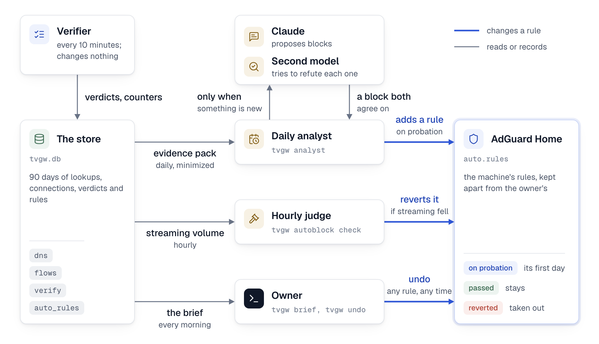

# The analyst and autonomous blocking

This page owns the analyst and [design decision 20](design-decisions.md#20-the-gateway-blocks-on-its-own-under-three-watches) as built: what each pass reads, sends and decides, every gate and its constant, and everything the gateway changes on its own. It is for the owner deciding whether to set `ANALYST_APPLY=auto`, and for anyone reviewing what the analyst sends, decides and changes.

## What it does

`tvgw analyst` (`src/tvgw/analyst.py`) reads one window of the store, builds a minimized evidence pack and, when the window holds something new, asks a Claude model for proposals in one request answered inside a JSON schema. It vets each proposal as a profile rule would be vetted and writes the result to `reports/proposals/`. With `ANALYST_APPLY=off`, that is all: the owner adopts a rule by editing the profile ([design decision 19](design-decisions.md#19-a-daily-analyst-that-only-proposes)). With `ANALYST_APPLY=auto`, a block that passes the code's gates and a second model goes into the machine's own rules file and AdGuard Home, the TV is watched for 10 minutes, and the rule stays on probation for at least a day. Those are the three watches of design decision 20's title: [the live canary](#the-live-canary) for 10 minutes, at once when the TV is on with an app in front or else the first time it is, [the hourly judge](#probation-and-the-hourly-judge) for the trial after, and the owner's `sudo tvgw undo` at any time ([taking a rule out](#taking-a-rule-out)). One rule is on trial at a time; a block that clears the gates during another's trial [waits its turn](#one-trial-at-a-time). [Design decision 41](design-decisions.md#41-the-autonomy-refuses-what-it-cannot-see-and-keeps-what-it-decided) closed the places where these watches used to pass a rule they had not seen, and made every decision a row that is never rewritten. Design decision 19 says nothing is applied; the code applies blocks when `ANALYST_APPLY=auto`, as [design decision 20](design-decisions.md#20-the-gateway-blocks-on-its-own-under-three-watches) says.

<picture>
  <source media="(prefers-color-scheme: dark)" srcset="diagrams/fig-3-judgement.dark.png">
  
</picture>

*Two different models and the code must agree before the gateway adds a rule, and only three actors may change the machine's rules.*

A run with `ANALYST_APPLY=auto`, in order:

1. `tvgw-analyst.timer` starts `tvgw analyst`, which reads the window from the store read-only (`mode=ro`).
2. It builds and scrubs the pack, then checks it for novelty; with nothing new it makes no request, and only [the queue](#one-trial-at-a-time) may move.
3. It writes the pack it is about to send as `<stem>.pack.json`. The proposer request sends the pack and the schema; the answer is the proposals.
4. The run gives the queue its turn first, then vets each proposal and puts each vetted block through the gates. A block that clears them while another rule is on trial joins the queue.
5. For a block that passes with no trial running, the verifier request asks the second model, with the proposal's name and rule and nothing the proposer wrote; it answers `safe_to_block` and a confidence.
6. The run takes two readings of the TV 60 seconds apart, appends the rule to `auto.rules`, applies AdGuard Home (`adguardcfg.apply()`) and records the rule in `auto_rules`.
7. With the TV on and an app in front, the canary reads the TV's `tx_bytes`, power state and foreground app every 30 seconds for 10 minutes. Otherwise the canary is armed, and the hourly check runs it later.
8. The run remembers its judgments and writes the proposals as `.md` and `.json` to `reports/proposals/`. Every gate decision, second-model answer, apply and canary outcome on the way is a row in [`decisions`](#files-and-records).

## The daily and weekly passes

Both passes run the same code: the pack, the novelty check, the request, the vetting and, with `ANALYST_APPLY=auto`, the autonomous blocks. They differ in window, model and schedule. The settings' defaults are in [the settings file](../deploy/README.md#the-settings-file), and the shipped timers in [units](../deploy/systemd/README.md#units).

| Pass | Started by | Window | Model and effort | Schedule |
|---|---|---|---|---|
| Daily | `tvgw-analyst.timer` running `tvgw analyst` | `ANALYST_WINDOW`: `day` is the previous calendar day; `Nh` is the last N hours up to the run, from `1h` to `168h` | `ANALYST_MODEL`, `ANALYST_EFFORT` | `ANALYST_SCHEDULE`: `HH:MM`, `hourly`, or a systemd calendar expression |
| Weekly | `tvgw-analyst-weekly.timer` running `tvgw analyst --weekly` | The ISO week, Monday to Sunday, that ended most recently | `ANALYST_WEEKLY_MODEL`, `ANALYST_WEEKLY_EFFORT`; `off` skips the pass | `ANALYST_WEEKLY_SCHEDULE`: `Day HH:MM` or a calendar expression |

- **Schedules.** `install.sh` renders each schedule into a timer drop-in (`schedule.conf` in `tvgw-analyst.timer.d` and `tvgw-analyst-weekly.timer.d`) and asks `systemd-analyze calendar` first, so a schedule systemd cannot read stops the install. A schedule change therefore takes effect at the next deploy. The hardware suite's `test_analyst_timer_follows_the_conf_schedule` checks the live timer against the settings.
- **Model and effort.** The model, effort and window settings are read at each run, so a change takes effect at the next one. Efforts are `config.EFFORTS`: `low`, `medium`, `high`, `xhigh`, `max`. `--model` and `--effort` override them for one run.
- **One week's window.** The weekly pass judges shapes over the whole week, so its download limit (see [the gates](#the-gates)) applies to a week of traffic.
- **Blocks from either pass.** `analyst.run` applies the blocks of any non-dry run with a key while `ANALYST_APPLY=auto`, the weekly pass and runs by hand included. [Design decision 20](design-decisions.md#20-the-gateway-blocks-on-its-own-under-three-watches) and `deploy/tvgw.conf.example` speak of a block the daily model proposes; the weekly unit's description and the code apply the weekly model's too.

## The evidence pack

`analyst.pack` computes the window with `queries.window_report`, the same computation as the brief, keeps a minimized subset, and scrubs it. What leaves the Pi, where it goes and what never leaves are in [what leaves the Pi](privacy-and-retention.md#what-leaves-the-pi). The pack's fields:

| Field | What it carries |
|---|---|
| `day`, `profile` | The window's label; the profile's name, vendor, expected categories, apex zones and must-allow hosts with their reasons |
| `tv` | The number of hourly readings and of `Active` ones, the apps seen, the Live Plus setting, every setting first read or changed in the window, and each firmware change with the names that followed it. A changed setting carries its value only when its key is in `PACK_SETTINGS` (the switches: Live Plus, country, audio guidance, store mode, Wake-on-LAN, SimpLink, the radios and their tethering, Bluetooth advertising, and (ledger) every `eula.` consent flag through `PACK_SETTING_PREFIXES`; the firmware, the platform, the model and the country code); any other key, the ZIP code the TV holds and the device name typed on it included, goes as `[redacted]` |
| `totals` | Lookups, connections and bytes, While off/asleep, and the clock-host lookups |
| `by_category`, `new_hosts`, `blocked_retries`, `blocked_reached`, `allowed_unexpected`, `must_allow_blocked` | The brief's sections of the same names |
| `top_upload` | Per destination: the TLS name, the address only when there is no name, the port, connections, bytes up, the payload bound and bytes down |
| `periodic`, `unresolved_destinations`, `dns_gate`, `dns_bypass`, `odd_ports`, `gfts_filter` | The brief's Periodic connections, Unresolved flows, DNS-gated egress, DNS sent to other resolvers, Unexpected ports and URL-filter sections |
| `plain_http` | Host, method and request count; no path or query string |
| `dns_anomalies` | Kind, name, lookups and whether a rule blocks the name |
| `lan_probes_dropped`, `ptr_sweep_lookups` | Counts only; no targets and no reverse-lookup names |
| `red_lines`, `firewall`, `coverage`, `rule_changes` | The red lines, the firewall checks and counters, Coverage, and the rules added or removed |
| `current_rules` | Every rule AdGuard is given (`analyst.rules_in_place`): the profile's, the generated ones included, then the machine's own that pass the lint. The list is sent whole, past `LIST_CAP`, so the model sees every rule it must not propose again |
| `shapes` | The traffic shape (`autoblock.shapes`) of up to 60 candidate names: new hosts, allowed names outside the expected categories, periodic names, blocked names reached, named top-upload destinations and DNS oddities |
| `previous_judgments` | Up to 40 names judged in the 7 days before the window's end, with the kind, the days since and the reason: real verdicts first, newest first, then the `quiet` ones (a pass that looked and proposed nothing). The whole judged set stays on the Pi under the pack's `_judged` key, which `analyst.public` strips before anything is written or sent; only the novelty check reads it |
| `changes_in_effect` | (ledger) Counts only, from `ledger.pack_entry`: change kinds with their counts, the hour classes (off, no demand, confounded, clean), the confounder labels with the hours each cost, the number of firmware changes and of machine rules on trial. Never a subject, a time, a trigger or a detail; `{}` with `LEDGER=off` or when the section failed |

The pack never carries the hourly timeline: hours on and the apps seen stand in for it.

`analyst.scrub` then walks every string, dictionary keys included (`shapes` is keyed by the names it describes). First `analyst.canonical` drops the characters a model reads and a person never sees: Unicode format characters (zero-width ones, the byte-order mark, the bidi embeddings, overrides and isolates), private-use, unassigned and surrogate code points, the tag block (U+E0000 to U+E007F, an invisible copy of ASCII), and the C1 controls (U+0080 to U+009F). It runs before the redaction, so a zero-width character inside a secret cannot split it past the scrub. `analyst.vet` runs the same function over everything the model writes back: names, reasons, evidence, the summary and the rollback. Then the scrub redacts, with the secrets from `secrets_for`: `TV_MAC`, `TV_NAME`, `TV_IP`, `GW_IP`, the Pi's host name, and every value the store holds for the `IDENTITY_SETTINGS`, `option.zipcode` and `network.deviceName` (the ZIP code the TV holds and whatever name was typed on it, which need not be `TV_NAME`). Each secret of 3 characters or more is replaced by `[redacted]` wherever it stands as a whole word, ignoring case. Any MAC address, and any private, CGNAT, link-local, loopback, multicast or `0.0.0.0/8` IPv4 address, is replaced too. Control characters become spaces, strings are cut at `STRING_CAP = 200` characters, and lists at `LIST_CAP = 40` entries with a last entry saying how many were left out. `current_rules` is scrubbed entry by entry and added after the list cap. The hardware suite's `test_analyst_dry_run_pack_carries_no_home_identifier` checks the real pack for the TV's MAC, the TV subnet, home-LAN addresses, the host name, the TV's name and every stored ZIP code and device name, over yesterday and over the day each of those values was first read.

## When no request is made

A run builds the pack first, then decides whether to ask:

1. **Novelty.** `analyst.novelty` lists the reasons the window deserves a request. It finds none when the TV had no `Active` reading and made no lookups. Otherwise the reasons are: names first seen and not judged in the last week; allowed names outside the expected categories and not judged; any red line other than the gateway's own health lines (`HEALTH_RED_LINES`: firewall checks, ingest warnings, a producer gone quiet while the TV was on), which the model cannot act on; a must-allow name blocked; blocked names still reached; DNS-gate samples that nothing explains (`dns_gate.unexplained`: neither the feeder's lateness nor any answer of the week before; the gate's count and its other samples never count, since the feeder race inflates both every viewing day); unresolved destinations; DNS oddities on names not judged and not already blocked; a firmware or settings change. A periodic connection is never a reason on its own (acr): a timer is an attribute, since captive-portal probes, a Hue bridge's polling and streaming heartbeats keep one too, and LG's ACR client shows no timer between connection starts. ACR-shaped uploads and the adtech port wall count through their red line ([design decision 45](design-decisions.md#45-the-acr-red-line-is-an-upload-test-and-a-port-wall)). A `quiet` verdict counts as judged for the daily pass, and so does a `held` verdict while the name's evidence is what the verdict was given (below); the weekly review (`--week`, the weekly timer) ignores both and looks again at what the daily passes waved through ([design decision 22](design-decisions.md#22-a-pass-that-proposes-nothing-is-remembered)).
2. **A quiet window.** With no reason, the run writes `<stem>.md` with a heading and one sentence saying no request was made, and sends nothing to the proposer. With `ANALYST_APPLY=auto`, a block waiting in the queue still gets its turn when no trial runs and the key is there, so a run of quiet days cannot hold it back; the `.md` then lists it under "From the queue". `--force` asks anyway, and `--dry-run` writes the pack whether or not the window is quiet.
3. **A dry run.** `--dry-run` writes `<stem>.pack.json` and `<stem>.prompt.txt` and stops.
4. **The key.** Without `/etc/tvgw/claude.key` (`KEY_PATH`), the run says so and sends nothing. A key file that its group or others can read is refused with an error.

After a request, `autoblock.remember` records each proposal's name and kind in `judgments`, and the novelty check treats the name as judged for 7 days. Then `autoblock.remember_quiet` records every name in `analyst.asked_about` (the new hosts, the allowed names outside the expected categories and the unblocked DNS oddities) that drew no proposal as `quiet` (or `held`, below), with the pass's stem as the source; a real verdict younger than 7 days is never overwritten by it. A refusal or a cut-off answer records nothing, so the next run asks again. A block the gates refused for a reason in `RETRY_PREFIXES` is not recorded, so its name counts as new again at the next pass: too few days of evidence (`no: seen on`), the daily cap (`no: 3 autonomous blocks`), a second model that could not be asked, AdGuard not taking the rule, and a name with no observed connection whose answers did reach a flow (`no: no observed connections`), which a later day's capture may name. The cap's prefix spells the number, so it matches only while `MAX_PER_DAY` is 3. A block that waits in the queue is a verdict and is recorded: the queue holds it, so the name does not buy a request while it waits.

A name that reads like words meant for a model never gets a `quiet` verdict (`autoblock.instruction_shaped`): a label with `ignore`, `instruction`, `system`, `assistant`, `override`, `prompt`, `allowlist` or `tvgw` as a whole word (the label split on hyphens, underscores and digits, a plural `s` allowed), or a label longer than `LONG_LABEL = 40` characters. Whole words, so `c.amazon-adsystem.com`, `ecosystem.example.com` and `systemupdate.lge.com` are hosts; `assistant.lgtvcommon.com` and a hash label over 40 characters still match. A week of silence is what such a name would be after, so it gets a `held` verdict instead (`autoblock.HELD`), whose reason records the name's evidence (`analyst.evidence`: the categories it was allowed under outside the expected ones, the kinds of unblocked DNS oddity, and whether it carried payload over `MAX_TOTAL_DOWN`; never the counts, which move every day). The daily pass treats a held name as judged only while that evidence is unchanged, and the weekly review looks at it again. The record lists these names under `never_quiet`. The test is a router, not a filter: a false positive costs one request each time the name's evidence changes, plus its share of the weekly review, not a request every day the TV looks the name up ([design decision 22](design-decisions.md#22-a-pass-that-proposes-nothing-is-remembered)). The held verdict applies with `ANALYST_APPLY=off` too.

A second run over the same window, once the first has judged its names, usually finds nothing new and replaces `<stem>.md` with the quiet file; the first run's `<stem>.json` stays. `test_autonomous_run_blocks_telemetry_refuses_content_and_remembers` in `tests/unit/test_autoblock.py` pins this.

## Proposals and vetting

`analyst.call` sends one streamed request: the model, `MAX_TOKENS = 64000` (the streaming default; thinking counts toward it, so a deep weekly pass needs the room), the system prompt `SYSTEM`, the pack as JSON in the user message, the effort, and the JSON schema `SCHEMA`. The client retries twice and waits up to 600 seconds. The answer is a summary, a `nothing_to_do` flag and a list of proposals.

- **A refusal.** When the model's safety layer declines, the run writes a `<stem>.md` saying so, with the refusal's category, and a `<stem>.json` record with `refused`, the usage and the cost and no proposals, so an earlier run's proposals for the same window do not outlive it. It exits 0.
- **A cut-off answer.** An answer that reaches `MAX_TOKENS` before it is complete was billed all the same: the run writes a `<stem>.json` record with `cut_off: true`, the usage and the cost, and a `<stem>.md` that says nothing was proposed, prints `tvgw analyst: the answer was cut off at max_tokens; its cost is in <base>.json`, and exits 1.
- **Errors.** A refused key, an unavailable API or any other error ends the run with a message and exit 1, and writes nothing. The next scheduled run asks about its own window, not the missed one: run `sudo tvgw analyst --day <day>` for that ([run a pass](#run-a-pass)).

Each proposal has a kind (`block`, `allow`, `unblock`, `watch` or `question`), the name, one AdGuard rule or none, the reason, the evidence (the system prompt asks each entry to name the pack field it rests on), the risk to the TV's working (`low`, `medium` or `high`) and a rollback. `analyst.vet` keeps the first `MAX_PROPOSALS = 12`. An unknown kind becomes `question` and an unknown risk becomes `high`, every string is cut to a fixed length, and `_canonical` writes each rule's `$dnstype` values upper-case, as the profile writes them, so `||host^$dnstype=https|svcb` and `||host^$dnstype=HTTPS|SVCB` are one rule. Then `_verdict` judges each rule as the profile's own would be judged, in this order:

| Case | Vetted |
|---|---|
| A `watch` or a `question` | `ok` |
| No rule | `refused: no rule` |
| An `unblock` of a rule not in `current_rules` | `refused: no such rule in place` |
| An `unblock` of a rule in place that does not act on the name it is headed with | `refused: the rule does not act on '<name>', the name it is headed with` |
| Any other `unblock` | `ok` |
| Not one AdGuard DNS rule (`||host^` or `@@||host^`, with modifiers in either case, or a `/regex/`) | `refused: not one AdGuard DNS rule` |
| A modifier other than `$important`, or, on a `block`, `$dnstype` with types other than HTTPS and SVCB or on a wildcard that names every host (`_modifiers`) | `refused: $<modifier> is not for proposals`, `refused: $dnstype may only withhold HTTPS or SVCB`, or `refused: $dnstype names one host, not every name` |
| Already in `current_rules` | `refused: already in place` |
| An `allow` without `@@` | `refused: an allow rule starts with @@` |
| A `block` with `@@` | `refused: a block rule does not start with @@` |
| The profile's lint finds a problem with the rule added | `refused:` and the first problem |
| The rule does not act on the name the proposal is headed with: not the name, a parent zone, a wildcard or a regex that matches it (`_heading`) | `refused: the rule does not act on '<name>', the name it is headed with` |
| Anything else | `ok` |

`Vetted: ok` means the rule passes the lint the profile must pass, carries no modifier but `$important` (or, on a block of one named host, `$dnstype=HTTPS|SVCB`), and acts on the name it is headed with; `Vetted: refused: ...` says why it does not. The modifier check exists because the heading says block or allow and the modifier decides what the rule does: `$badfilter` disables the rule it names, `$dnsrewrite` answers with an address, `$client`, `$ctag` and `$denyallow` change whom it is for. The heading check exists because the owner reads the heading and the autonomous gate judges that name's traffic shape. No proposal is dropped, so the owner sees every refusal. The vetting reads the whole, unscrubbed `current_rules`, the machine's rules included, so a rule already in the machine's file is "already in place" and an `unblock` of one is vetted `ok`. To adopt a proposal by hand, add its rule to the profile's `.rules` file with a dated comment, run `make gate` and deploy.

## Autonomous blocks

With `ANALYST_APPLY=auto`, `analyst.autonomous` first gives [the queue](#one-trial-at-a-time) its turn, then takes each vetted `block` proposal in turn; other kinds are never applied. A block passes [the gates](#the-gates), then, when no other rule is on trial, [the second model](#the-second-model). The run takes two readings of the TV 60 seconds apart, appends the rule to [the machine's rules file](#the-machines-rules-file) and applies AdGuard (`adguardcfg.apply()`, as `tvgw adguard apply` does, without the profile lint, since the profile was linted when it was deployed). When AdGuard takes the rule, the run records it in `auto_rules` and watches [the live canary](#the-live-canary), or arms it; a rule that survives is on [probation](#probation-and-the-hourly-judge) for at least a day.

Every outcome is written on the proposal as `Applied:` and in the record's `autonomous` list:

| `Applied:` | Meaning | Asked again tomorrow |
|---|---|---|
| `no:` and a gate's reason | A gate refused it | For too few days or the daily cap |
| `no: the second model could not be asked (<error>)` | The verifier request failed | Yes |
| `no: <verifier> did not clear it: <reason>` | The verifier vetoed it | No |
| `no: AdGuard did not take it (<error>)` | The apply failed; the rule left the file again | Yes |
| `queued: waiting its turn behind <rule> (one trial at a time)` | Cleared the gates while another rule was on trial; it waits in `auto_queue` | No: the queue holds it |
| `queued: already waiting its turn (one trial at a time)` | Proposed again while it waits | No |
| `reverted within minutes: <why>` | The canary took it out | No |
| `yes; <verifier> agreed (<reason>); canary <outcome>: <why>; on probation until at least <time>` | Applied; `<outcome>` is `passed`, or `armed` when the TV was not on with an app in front | No |

A block becomes a machine rule only if it gets through four checks in turn, and any no stops it:

1. [The gates](#the-gates), in their order.
2. A free trial slot; otherwise [the queue](#one-trial-at-a-time).
3. [The second model](#the-second-model).
4. AdGuard Home taking the rule.
5. [The live canary](#the-live-canary): a collapse reverts the rule; otherwise it is on probation, with the canary passed or armed.

An applied block holds the run for about 11 minutes when the TV is on with an app in front (60 seconds of baseline and 10 minutes of canary) and about one minute when it is not. One rule is on trial at a time, so a run applies at most one block while its trial runs, and the run fits the start timeout of `tvgw-analyst.service` and `tvgw-analyst-weekly.service` ([units](../deploy/systemd/README.md#units)). A run stopped by its timeout leaves a rule already applied in the file, in AdGuard and in `auto_rules`, on probation.

### One trial at a time

`MAX_CONCURRENT_TRIALS = 1`: while a rule is on trial (no verdict yet), a block that clears the gates goes into the store's `auto_queue` with the start of the window it was judged on, and so does any block proposed while older ones wait, so a newer proposal waits its turn. The hourly judge then has one new rule to blame for one bad hour, not two.

`analyst.autonomous` gives the queue its turn before it reads the run's own proposals, and a quiet run does the same when the key is there. While no trial runs, the oldest waiting block is taken out of the queue and judged again from the start: the vetting (the profile or the rules may have changed since), then the gates on a shape and answers read from the start of its window up to now, so a name that started carrying payload while it waited is refused. Then the second model and the canary, as for a new proposal. A block that waited longer than `TRIAL_CEILING` (14 days) is dropped as `expired`; a later pass may propose it again. A waiting block that fails its turn for a reason in `RETRY_PREFIXES` (the second model or AdGuard out of reach, the daily cap, too few days, unnamed connections) goes back into the queue with its place and the start of its evidence unchanged, a `requeued` row in `decisions`, so the 14 days still bound its wait: its name is remembered as a block, so no pass would propose it again for a week. The brief and `tvgw autoblock list` show waiting blocks as `queued`.

A trial ends when the rule is passed, reverted or left untested (see [probation](#probation-and-the-hourly-judge)); an untested rule stays in place but holds no trial slot.

## The gates

`autoblock.gate` checks a block proposal in this order; the first refusal ends it. The constants are in `src/tvgw/autoblock.py`.

| Gate | Constant | Refusal | Asked again |
|---|---|---|---|
| The proposal is a vetted `block` | | `no: only a vetted block can be applied on its own` | No |
| The proposer rated the risk `low` | | `no: the proposer rated the risk <risk>` | No |
| Fewer than the cap of machine rules added in the last 24 hours | `MAX_PER_DAY = 3` | `no: 3 autonomous blocks in 24 h already` | Yes |
| The rule is not in `current_rules` or applied earlier in the same run | | `no: already in place` | No |
| The pack holds a shape for the name | | `no: no evidence of how the TV used this name` | No |
| The name was looked up on enough distinct local days | `MIN_DAYS_SEEN = 2` | `no: seen on <n> day(s), fewer than 2` | Yes |
| The TV connected to the name, or never used what its lookups returned: a shape with no connection passes only when the name received at least one A answer in the window and no flow ending in or after the window went to any of those addresses | | `no: no observed connections` | Yes |
| No payload: the median bytes down per connection and the total bytes down in the window are within their limits | `MAX_MEDIAN_DOWN = 16 * 1024` (16 KB), `MAX_TOTAL_DOWN = 2 * 1024 * 1024` (2 MB) | `no: carried payload (median <n> B down per connection, <n> B down in the window)` | No |

The cap counts `auto_rules` rows whose `added_t` lies in the `TRIAL` seconds before the run (`autoblock.added_in`). The days come from every `dns` row the store holds for the name, by local calendar day. The shape is `autoblock.shapes` over the window: the flows `FLOW_NAME` names with the name ([naming a connection](architecture.md#naming-a-connection)), with their counts, total and median bytes down and up, median duration, distinct hours, the apps on in those hours (from readings in `queries.AWAKE`), and the first and last start. A name outside the pack's candidates has no shape at all.

A name the pack lists with no named flow has a shape of zeros, and zero bytes observed is not zero bytes carried: its connections may have gone unnamed (a capture or extractor fault, a hello the extractor missed, ECH). `autoblock.answer_use` tells the two cases apart with the same join the DNS gate uses: the addresses in the name's A answers over the window (a blocked `0.0.0.0` answer names no server), and how many of them any flow went to, whatever name that flow carries. Answers no flow used mean the TV looked the name up and never connected, and the block costs nothing; an answer that reached a flow means the evidence is missing, so the block is refused and asked about again. A shared address counts as used, which can only refuse more.

Every gate decision is a row in `decisions` with its margins: the connections, the median and total bytes down, the days seen, the addresses answered and used, and the limits the gate held them to. How close accepted rules came to a limit is what tunes it.

The payload gate holds whatever a model says, because it reads the bytes, not the name. The code refuses only values above the limits (`>`), so a median of exactly 16 KB passes.

The gate reads the same unscrubbed `current_rules` as the vetting, the machine's rules included, so a rule already in `auto.rules`, on probation or passed, is refused as `no: already in place` when a model proposes it again.

## The second model

`analyst.verifier_for` picks the verifier: the first of `ANALYST_VERIFIER_MODEL`, `ANALYST_MODEL`, `ANALYST_WEEKLY_MODEL`, `MODEL` (`claude-opus-5-5`, in `src/tvgw/analyst.py`) and `claude-fable-5-1` that is not `off` and is not the proposer. It never returns the proposer, whatever the settings say. The request runs at `ANALYST_VERIFIER_EFFORT`.

The verifier gets `autoblock.VERIFIER_SYSTEM`, which tells it its only job is to find what the block would break, that a block it clears is applied on its own, and to answer `false` when in doubt. Its message holds the proposal's structured fields only (`VERIFIER_FIELDS`: the kind, the name and the rule), the category the gateway gave the name, the traffic shape the code computed, the limits the gate held it to, and the context: the window, the apps seen, the must-allow hosts, the expected categories, the current rules (with any rule the run has just applied) and the by-category totals. The proposer's reason, evidence and rollback never reach it, so one injection cannot ride the first model's prose into the second, and the second does not anchor on the first's argument. All of it comes from the scrubbed pack, the vetted proposal and the store, canonicalized. It answers inside `VERIFY_SCHEMA`: `safe_to_block` (a boolean), `confidence` (`low`, `medium` or `high`), `reason` and `watch_for`.

- **Veto.** A refusal by the model, `safe_to_block` false, or `confidence` `low` leaves the rule unapplied, and the name is judged.
- **Error.** Any exception from the request leaves the rule unapplied, and the name is asked about again at the next pass.

Each answer, or the error, is a row in `decisions` with the verifier's model, effort and token usage ([cost](#cost)).

## The machine's rules file

The machine writes one file, `AUTO_RULES`; the default path is in [the settings file](../deploy/README.md#the-settings-file). It never edits the profile's `.rules` file, so the owner's rules and the machine's have separate histories.

- **Format.** The first line is `HEADER`: `! rules added by tvgw itself (design decision 20); delete this file to undo them all`. Each rule follows a note line, `! <YYYY-MM-DD HH:MM> <stem>: <name>`, in the Pi's local time. Lines that start with `!` are comments. `autoblock.read_rules` returns the rest.
- **Writes.** `add_rule` never adds a rule twice; `remove_rule` takes out the rule and its note line. Both write a temporary file and rename it over the old one.
- **The apply.** `tvgw adguard apply`, and the analyst's, the hourly judge's and `tvgw undo`'s own call of `adguardcfg.apply()`, append every rule that passes `autoblock.admissible`, which runs the profile's lint with the rule beside the profile's own. A rule that fails is left out with `tvgw adguard: machine rule dropped: <rule>: <problem>` on stderr, so a machine rule can never cover a must-allow host. Every apply appends the file, whatever `ANALYST_APPLY` says.
- **A failed apply.** When AdGuard does not take a new rule, the run takes it out of the file again and records nothing.

The hardware suite's `test_autoblock_file_record_and_resolver_tell_one_story` checks that no rule in the file is refused, that the rules in place in `auto_rules` are the admissible rules, that `tvgw autoblock check` and `list` run clean, and that the three units may write AdGuard's configuration.

## The live canary

The canary watches the TV for 10 minutes after a block. Its constants are in `src/tvgw/autoblock.py`:

| Constant | Value | What it sets |
|---|---|---|
| `CANARY_MINUTES` | `10` | How long the canary watches |
| `CANARY_INTERVAL` | `30` | Seconds between readings |
| `CANARY_MIN_RATE` | `1_000_000` | Bytes a minute to the TV before the block (about 977 KB) for the rate test to apply |
| `CANARY_COLLAPSE` | `0.2` | The share of the rate before the block under which a reading counts as collapsed |
| `HOME_APPS` | `""`, `com.webos.app.home`, `com.webos.app.launcher` | The foreground apps that mean the TV is at its launcher |

A reading (`analyst.live_sample`) is the time, `tx_bytes` of `eth0` (the bytes the Pi has sent the TV), and, for the `lg-webos` profile, the TV's power state and foreground app over its LAN API. Other profiles read `unknown`. The TV counts as on when its power state is in `queries.AWAKE`: `Active`, `Screen Off` (on with the panel dark, an app or its sound still running) or `Screen Saver` (on and idle, its app still in front), the set the brief uses.

1. **Baseline.** Two readings 60 seconds apart, before the rule is appended, give the download rate. When the second shows the TV on with an app in front that could be streaming (`autoblock.watchable`: not in `HOME_APPS`, and not an input such as `com.webos.app.hdmi1` or `com.webos.app.livetv`, `INPUT_APP_PREFIXES`), the watch starts at once. Otherwise the canary is armed (below).
2. **Watching.** Every 30 seconds, 20 times, the canary takes a reading. The TV leaving `queries.AWAKE` cuts the watch short, and the canary is armed again for the next time the TV is watched. The rule is recorded with its canary `armed` before the watch starts, and the outcome replaces it after, so a watch the process does not live to finish (the unit's timeout, a SIGTERM, a crash) leaves the canary armed for the hourly check.
3. **The app.** A foreground app outside `HOME_APPS` giving way to one inside it reverts the rule.
4. **The rate.** When the baseline was at least `CANARY_MIN_RATE`, three readings in a row under 20% of it revert the rule. Below that rate, the TV was on but not streaming, and only the app is watched.
5. **Passed.** Otherwise the canary passes, and the rule is on probation.

A canary revert takes the rule out of the file, applies AdGuard again (a failure is added to the reason), and records the verdict `reverted` with the reason `canary: <why>`.

**The armed canary.** The daily pass runs at 03:50, when the TV is usually off, so a canary that needed the TV on at apply time almost never watched anything. A block applied with nobody watching is armed instead (`auto_rules.canary = 'armed'`, the brief's `on probation, canary armed`). Each hourly check looks at the oldest armed rule: when the newest TV reading after its block shows the TV in `queries.AWAKE` with a watchable app in front, the check takes the two baseline readings and, if the TV is still so, runs the same 10-minute watch. One armed watch per check, so the check ends inside its unit's 25-minute timeout. The outcomes, each a row in `decisions` under the rule's trial: `armed` at apply time, `passed` or `reverted` when it is watched, and `unobserved` when the rule leaves its trial (passed, reverted or taken out by the owner) before the TV was ever watched. A watch the TV cuts short leaves the canary armed. Its baseline is the rate at the start of the watch, with the block already in place, so it sees a stream that collapses while it watches and an app that falls back to the launcher; a stream that never starts is the hourly judge's to catch, as two low hours with the app in front.

## Probation and the hourly judge

`tvgw-autoblock.timer` runs `tvgw autoblock check` every hour, after the ingest, whatever `ANALYST_APPLY` says. The check takes the autonomy's lock first (`autoblock.exclusive`, an `flock` on `/var/lib/tvgw/autoblock.lock`) and, when another check or the analyst's autonomous steps hold it, says so and exits 0: two processes would otherwise watch the same armed canary and overwrite each other's outcome, and the next hour judges. The analyst takes the same lock for its queue and its blocks; while a check holds it, the analyst drains nothing and a block that clears the gates waits in the queue, `queued: waiting its turn behind the hourly check`. A lock file that cannot be opened never stops the judge. `tvgw autoblock check --no-watch` judges without the armed canary, so it never reads the TV and never reverts from a watch; the hardware suite runs it so. `analyst.check` does three things:

1. **Owner removals.** Each rule on probation or passed that is no longer in the file is recorded as `reverted`, "owner removed it from the file".
2. **The armed canary.** At most one, as [above](#the-live-canary).
3. **Judging.** `autoblock.judge` judges each watched rule (on trial, or untested) against the store:
    - A must-allow name or a clock-host lookup blocked since the block reverts the rule.
    - The measure is demand, not the clock. A TV hour with demand (`autoblock.demand_hours`) is a clock hour with a reading in `queries.AWAKE` and, in it, a streaming app in front (`autoblock.demand_app`) or a connection opened to a name in the profile's expected categories (`Streaming` when it names none). An hour on an input, at the launcher or with the TV off has no streaming bytes by construction, and judging a rule on it would blame the rule for the household's evening.
    - The baseline is the streaming volume of the 3 days before the block: the bytes down of flows named into the expected categories, per TV hour with demand (`autoblock.demand_rate`).
    - During the trial, the rule is reverted when `LOW_HOURS_TO_REVERT = 2` full hours running after the block each had demand and each streamed under `HOURLY_COLLAPSE = 0.2` (20%) of the baseline (`autoblock.low_run`, over the last `LOW_RUN_LOOKBACK = 6` hours, so a missed check misses nothing). An hour's volume credits each flow's bytes to the hour its conntrack entry expired (`t_end`), while demand hours are keyed by the reading and by `t_start`, so one long video connection over the first two hours of an evening can read as two low demand hours followed by a high one; this end-time accounting is a known confounder ([16 F3](research/deep-dive-2026-11/16-gap-one-change-at-a-time-a-change-ledger-and.md#f3-the-judges-arithmetic-multiplies-confounders-min-of-n-hours-end-time-accounting-no-demand-model)), left to the change ledger's judge v2. The baseline needs at least `MIN_TRIAL_TV_HOURS = 2` TV hours with demand and some volume. One low hour is never enough: at a 10% chance that an innocent hour reads low, the minimum of 4 hours reverts a good rule 34% of the time, and two hours running about 3% ([16 F3](research/deep-dive-2026-11/16-gap-one-change-at-a-time-a-change-ledger-and.md#f3-the-judges-arithmetic-multiplies-confounders-min-of-n-hours-end-time-accounting-no-demand-model)).
    - When the trial window (`TRIAL = 86400` seconds, 1 day, at first) has closed, the whole trial is judged, and nothing passes without the hours. With at least 2 TV hours with demand on both sides: under `STREAMING_COLLAPSE = 0.5` (50%) of the baseline it is reverted; otherwise it passes. With too few in the trial: NODATA, and the trial runs one `TRIAL` longer (`autoblock.extended_until`), up to `TRIAL_CEILING = 14` days after the block. At the ceiling, or at once when the 3 days before the block hold too little to compare with (an extension cannot add hours before the block), the verdict is `untested`.
    - An `untested` rule stays in the file and in AdGuard, the brief lists it as `on probation, untested` every day until the owner decides, and the hourly check keeps judging it for harm (the red lines and the two-hour test), but it never passes on its own and holds no trial slot.
4. **Re-applying.** Reverted rules leave the file, and AdGuard is applied once at the end. When that fails, each reverted rule's reason says so, an `apply` row with outcome `reapply_failed` joins `decisions`, and the command fails, so the unit shows in `systemctl --failed`. `sudo tvgw adguard apply` is the remedy.

Every verdict, NODATA included, is a row in `decisions` under the rule's trial id, with its margins (`autoblock.judge_margins`): the demand rate and demand hours before (`before`, `n_before`) and in the trial (`after`, `n_after`), the trial's share of the baseline, the low hours running with their shares, and the thresholds (`STREAMING_COLLAPSE`, `HOURLY_COLLAPSE`, `MIN_TRIAL_TV_HOURS`, `LOW_HOURS_TO_REVERT`), so the uncalibrated thresholds can be tuned from the store rather than from the reason text. A rule that passed is not judged again; only the owner takes it out. `tvgw autoblock check` prints each decision: `reverted`, `passed`, `nodata` (with the new end of the trial), `untested`, or `observed` for an armed canary that watched and passed.

The judge's structure is one loop over the watched rules with one call of `autoblock.judge` each (`hooks["judge"]` stands in for it in tests), so a second judge can run beside it in shadow and decide nothing.

<picture>
  <source media="(prefers-color-scheme: dark)" srcset="diagrams/fig-7-rule-life.dark.png">
  
</picture>

*A rule passes only on viewing it did not harm; without viewing it stays untested, and the three watches cover it from the first minute to any time after.*

## Taking a rule out

The owner has three ways, all recorded in `auto_rules`:

- **`sudo tvgw undo`** takes the newest machine rule still in place out of the file, records it as `reverted` by "owner undo", and applies AdGuard.
- **`sudo tvgw undo --all`** does the same for every one.
- **Editing or deleting the file** works at the next hourly check, which records each missing rule as reverted and applies AdGuard.

When `tvgw undo` cannot apply AdGuard, the file has changed and AdGuard has not; the command fails and says to run `sudo tvgw adguard apply`. These applies are `adguardcfg.apply()` called directly (`analyst.adguardcfg_apply`): the profile's lint does not run, and readiness is a probe of `example.com` (`adguardcfg.dns_ready`'s default), not of the first must-allow name as in `tvgw adguard apply`.

`ANALYST_APPLY=off` stops new blocks, and the queue with them: the rules already in the file stay applied, and the hourly judge keeps judging those on probation. An untested rule is the owner's to decide: undo it, or adopt it into the profile's `.rules` with a dated comment and then undo the machine's copy. After a revert, the TV may hold the blocked answer for up to 60 seconds, the blocked-response TTL `tvgw adguard apply` sets (`blocked_response_ttl` in `src/tvgw/adguardcfg.py`). A name added to the profile's `[must_allow]` can never be blocked by a machine rule, because the lint refuses any rule covering it.

What the machine can never do: add anything but a block, allow or unblock a name, edit the profile's rules, change the firewall, add more than `MAX_PER_DAY` rules in 24 hours, or keep a rule that covers a must-allow host.

## The change ledger

(ledger) The hourly judge asks one question, whether streaming per TV hour fell, and blames the newest machine rule for any yes. On this gateway a day always holds other changes: every machine-rule apply, revert and undo restarts AdGuard Home; the NetworkManager dispatcher re-runs `tvgw-apply` on every uplink, TV-port and VPN event; deploys arrive through CI; the VPN reconnects; the household watches HDMI inputs, which are `Active` hours with no streaming bytes. The change ledger records them so the judge, the brief and the analyst can tell them apart ([design decision 48](design-decisions.md#48-one-ledger-of-changes-one-hour-classifier-and-a-second-judge-that-only-watches)). `LEDGER=on`, the default, turns it on; `LEDGER=off` turns off the sampler, the ledger's ingest step, the shadow judge and the brief's "Changes in effect".

Four writers feed the `changes` table, one row per change, append-only, with no address in it:

| Writer | How | Kinds |
|---|---|---|
| `tvgw-apply` | One spool line per run: the process that ran it and whether it touched the policy route | `apply`, class A only when routing changed |
| The NetworkManager dispatcher | One spool line per event on `WAN_IF`, `TV_IF` or the VPN interface | `tv_link_up` and `_down`, `wan_link_up` and `_down`, `vpn_up` and `_down` (class A), `dhcp_change` (class B) |
| `install.sh` | `tvgw changes --note-deploy`: the version and two fingerprints of the installed package | `code_deploy`, class A when the code changed, marked metric-affecting when the modules that name and count flows changed |
| The sampler and the ingest | Events derived from consecutive gateway samples, and the machine rules copied from `auto_rules` | `reboot`, `tv_flap`, `wan_flap`, `vpn_flap`, `vpn_gone`, `vpn_back`, `pia_down`, `adguard_restart`, `ct_drop`, `ct_pressure` (class A); `list_refresh`, `list_removed` (class B); `machine_rule_add` and `machine_rule_reverted` (class A), `machine_rule_passed` (class B) |

The shell writers append to `/var/lib/tvgw/changes.spool`, a file and not the store, because they are shell or run while the store may be locked; a failed write never fails them. The hourly ingest loads the spool exactly once (`changes` in `ingest_state`) and renames it to `changes.spool.1` once it is read whole and over 256 KB.

**The sampler.** With `--record`, `tvgw verify` stores one row of `gw_samples` every 10 minutes: the boot id; carrier changes and byte counters of `TV_IF` and `WAN_IF`; whether the VPN interface (`tun0` or `wgpia0`) exists and its carrier changes; `piactl get connectionstate` when PIA's CLI is installed; signal, bitrates and failed transmissions from `iw dev <WAN_IF> station dump` when the uplink is wireless (never the station's address); conntrack's count, its maximum and the summed `drop`, `early_drop` and `insert_failed` of `conntrack -S`; AdGuard Home's `InvocationID` and `NRestarts` from `systemctl show`; and the modification time and size of each list file under AdGuard's `data/filters`. Each command has a 5-second timeout and each source is optional: a missing tool leaves its columns NULL. A sampler that fails prints a line to stderr and never fails `verify`.

Most of these are cumulative counters, so a 10-minute sample loses no event, only its exact time. An event derived from two samples carries `t_precision` 600 (or the gap, when samples were missed), meaning it happened in the 10 minutes before the sample that saw it. A changed boot id is one `reboot` and nothing else, since the counters restart with it. A PIA outage is one `pia_down` row from the first sample not `Connected` to the first that is, written when it ends.

`tvgw changes 1d` lists the ledger.

## The hour classifier

(ledger) `ledger.classify_hour(conn, h)` labels the clock hour starting at `h` from the store, the samples and the ledger over [h - 10 min, h + 60 min):

1. **`off`**: no reading in the hour says the TV was awake (`queries.AWAKE`).
2. **`no_demand`**: the TV was on but nothing asked for streaming. Demand is any of: an app in front at the reading other than the launcher or an input (`ledger.NO_DEMAND_APPS` and `NO_DEMAND_PREFIXES`); at least 3 connections started to names in the profile's expected categories; at least 3 allowed lookups of such names.
3. **`confounded`**: demand, and something known against the hour: a class-A change that may have happened in the window (a sampler event counts from `t - t_precision`), a sample with PIA not `Connected`, conntrack over 75% full, Wi-Fi signal 6 dB under its 14-day median or the receive bitrate under its 10th percentile in two samples, the Pi's own upload over half the hour's peak TV download rate (and over 1 Mbit/s), a capture file of the hour with SYNs to port 443 and no hello named, a connection the gateway broke (`ESTABLISHED` with time left), or a lost-events warning from an ingest run within two hours after the hour began.
4. **`clean`**: demand and nothing against it.

Judging a rule excuses the rule's own `machine_rule_add` and an AdGuard restart that may have happened within 5 minutes after it was applied. The thresholds are starting values from section 16 of the November research, to be checked against the store with `tvgw autoblock calibrate --by-class`.

## Judge v2, in shadow

(ledger) `judge2.verdict()` is the judge the research proposes, strict on passing and soft on reverting. It decides nothing yet: `tvgw autoblock check` calls `judge2.shadow()` after the shipped judge has decided and printed its decisions, so a slow or failing shadow pass can never hold up a revert. The pass has a budget of 120 s (`SHADOW_BUDGET` in `cli.py`); the rules it did not reach wait for the next hour, and the check says so. It writes both judges' verdicts on every rule on probation (and on rules the shipped judge passed, until v2 reaches its own verdict) to `judge_shadow`, one row per rule and hour. The brief's "Changes in effect" shows them side by side.

- **Hard red lines**, in any hour: a must-allow name or a clock lookup blocked since the rule, or the blocked name asked for at 10 times its rate before the block over at least 2 TV hours: `reverted`.
- **Rates** are expected-category bytes per clean hour, the rule's hours against the clean hours of the 3 days before, which need at least 2.
- **Hourly**: two clock-consecutive demand hours both under 20% of that rate: `reverted` when both are clean, `suspended` when either is confounded (the rule would come out, recorded with the confounder, to be tried again). One low hour is not enough. A `no_demand` hour neither starts nor breaks a run.
- **At the end of the trial**: with `JUDGE2_CLEAN_HOURS` (6) clean hours, under 50% of the rate before is `reverted`, otherwise `passed`. With fewer, `nodata`: the trial extends, and at 14 days the rule stays on probation and the brief raises a red line once half of that has passed short of K.

`tvgw autoblock calibrate --days 60 --arms A,B,C,D --by-class` measures what each design would have done on the store's history: a rule pretended at every hour, nothing blocked. Arm A is the shipped judge's arithmetic, arm B the same on clean hours only, arm C judge v2 with each flow's bytes spread over its lifetime (prorated), and arm D judge v2 with each flow's bytes at its end, as the shadow judge counts them, so arm D and the `judge_shadow` rows measure the same judge. The table's last line names each arm's byte accounting. For each it reports the false-revert rate (hourly and final), the blind-pass or NODATA rate, the share of trials that held a confounded hour, the share whose reverting hour was confounded or had no demand, and the power at a breakage of 0.3 (every expected-category byte after the rule scaled by 0.3). The report goes to `reports/calibrate/<date>.json`. Whether judge v2 replaces the shipped judge, and with which K and byte accounting, is the owner's decision after two weeks of shadow verdicts and a calibration.

## The TV's state and the 26-hour probe

(ledger) The hourly reading misses whole sessions: a 20-minute evening falls between two readings two times in three. `sudo tvgw tvprobe --hours 26` holds one read-only session over the existing pairing instead, subscribes to `getPowerState` and `getForegroundAppInfo`, and appends each change with the Pi's time to `/var/lib/tvgw/probe/tvprobe.jsonl` (mode 0600 in a 0700 directory). It logs the carrier of `TV_IF` too (`link` lines). The rules it keeps:

- It never pairs. A key the TV refuses (an error, or a pairing prompt not answered `registered` within 3 seconds) ends the probe for good with exit 2: every registration attempt with a refused key puts a prompt on the screen. Once a prompt has been answered, every way the session can end before `registered` (silence, a closed socket, a close frame, a frame that is not JSON) counts as a refusal, and so does an answer that is not a JSON object; none of them leads to a reconnect.
- At least 5 seconds between connection attempts; after a failure it waits 5, 15, 30, then 60 seconds; while `TV_IF` has no carrier it tries nothing.
- Its own WebSocket client closes a session with code 1009 on any frame or message over 1 MiB, before the payload is read.
- It sends a ping every 30 seconds and ends the session when no pong comes within 10.
- It sends nothing but the registration and the two subscriptions: no `set` call, no channel or programme subscription, no pointer-input socket, no Wake-on-LAN.
- A power field outside the plain-word vocabulary is logged as `other`, and an app id that does not look like one as `invalid`.

The file is a viewing record at app granularity: delete it once its report is read. The hourly reading also stores the TV's consent record: every flag of `eulaStatus` as `eula.<flag>` = `true`, `false` or `unknown` (a flag the TV leaves out is unknown, never off), and `network.bleAdvertisingOnOff`, which is recorded only. A flag that goes from `false` to `true` is a red line in the brief.

## Files and records

The analyst writes into `reports/proposals/` under the reports directory. Their owners and modes are in [where it lives and who can read it](privacy-and-retention.md#where-it-lives-and-who-can-read-it).

| File | Written | Holds |
|---|---|---|
| `<stem>.md` | A quiet window, a refusal, a cut-off answer, or an answer | The proposals for the owner, the refusal, the cut-off notice, or the quiet-window text |
| `<stem>.json` | Every request the model answered: an answer, a refusal or a cut-off | The record: `window`, `since`, `until`, `model`, `effort`, `generated`, `pack_sha256_16`, `usage`, `cost_usd`, `reasons`, `autonomous`, `verifier_usage` (per second-model request: the name, the model, the usage and the cost), `never_quiet`, `summary`, `nothing_to_do`, `proposals` (each with `vetted` and any `applied`) and `vetted_ok`; `refused` with the category on a refusal, `cut_off: true` on an answer cut off at `MAX_TOKENS` |
| `<stem>.pack.json` | `--dry-run`, and every request sent | The scrubbed pack, exactly as the user message carries it, without the `_` keys; its SHA-256 starts with the record's `pack_sha256_16` |
| `<stem>.prompt.txt` | `--dry-run` | The system prompt and the user message |

The stem names the window: `<day>` (`YYYY-MM-DD`) for a day, `<YYYY-Www>` for an ISO week, and `<YYYY-MM-DDTHHMM>-<N>h` for a window of hours. A run with `--model` naming a model other than its pass's own appends `.<model>`, as in `<day>.<model>.md`, so a comparison sits beside the usual file. `tvgw analyst --show` prints the proposals file written last (`analyst.latest`, by modification time, not by name: a week's stem sorts after every day of its year).

In the store, `auto_rules` holds every machine rule as it stands now (its verdict, its canary state and its `trial_id`), `auto_queue` the blocks waiting their turn, and `judgments` every remembered verdict by name; their columns are in [tables](data-model.md#tables). `decisions` is the history: one row per gate decision, queue event, second-model answer, apply, canary outcome, judge verdict and owner revert, with its time, stage, outcome, rule, name, source window, trial id (the id of the trial's `apply` row), reason, the gate's or the judge's margins, and the verifier's model, effort and token usage. Rows are appended and never edited (a trigger refuses an `UPDATE`), so a rule tried twice, or a name judged twice, keeps both histories, and `judgments` and `auto_rules` keep their current roles. `DECISIONS_DAYS` (default `keep`) sets how long the rows are kept ([the settings file](../deploy/README.md#the-settings-file)). `tvgw autoblock list` prints each machine rule with when it was added, its state (`on probation`, `on probation, canary armed`, `on probation, untested`, `passed` or `reverted`) and why, and then the waiting blocks. The brief's "Rules the gateway added on its own" section lists the rules added and decided in its window, every untested rule and the queue ([sections](reading-the-brief.md#sections)).

## Cost

`analyst.PRICES` holds the list prices of 2026-10, in dollars per million tokens:

| Model | Input | Output |
|---|---|---|
| `claude-opus-5-5` | $4.00 | $20.00 |
| `claude-sonnet-5-5` | $2.00 | $10.00 |
| `claude-haiku-5-5` | $0.10 | $0.50 |
| `claude-fable-5-1` | $10.00 | $50.00 |
| `claude-opus-5` | $5.00 | $25.00 |

`analyst.cost` multiplies the input and output tokens by these prices; cached input is not priced apart. For a model not in the table the record has no cost, and the `.md` says the price is not on file. The record keeps the usage (input, output and cache-read tokens) and `cost_usd`, and the `.md` ends with the tokens and the cost to the cent. The second model's requests are kept as well: each one's usage and cost in the record's `verifier_usage`, a line each at the end of the `.md`, and its tokens in its `decisions` row. On the Pi, `sudo jq '.usage, .verifier_usage' /var/lib/tvgw/reports/proposals/2026-1*.json` shows what the passes have cost.

`deploy/tvgw.conf.example` gives the estimates as of 2026-10: about $0.07 for a day with `claude-opus-5-5`, and $0.40 to $0.60 for a weekly pass with `claude-fable-5-1`. A quiet window sends nothing and costs nothing.

## Running it by hand

### Install the key

On the Pi:

```sh
sudo install -m 600 -o root -g root /dev/null /etc/tvgw/claude.key
sudoedit /etc/tvgw/claude.key    # the API key, on one line
```

These are the steps of [the quick start](../README.md#quick-start), step 9. The key file's required mode is in [where it lives and who can read it](privacy-and-retention.md#where-it-lives-and-who-can-read-it). To stop the analyst, remove the file or disable its timers.

### See what would be sent

On the Pi:

```sh
sudo tvgw analyst --dry-run --day <day>
sudo less /var/lib/tvgw/reports/proposals/<day>.pack.json
sudo less /var/lib/tvgw/reports/proposals/<day>.prompt.txt
```

A dry run sends nothing and applies nothing.

### Run a pass

On the Pi:

```sh
sudo tvgw analyst --day <day>            # one calendar day
sudo tvgw analyst --day <day> --force    # ask even when nothing is new
sudo tvgw analyst --since 6h             # the last 6 hours
sudo tvgw analyst --week 2026-W43        # one ISO week
sudo tvgw analyst --weekly               # the weekly pass, with its own model
sudo tvgw analyst --show                 # print the newest proposals
```

`--day`, `--since`, `--week` and `--weekly` exclude each other, and `--since` takes whole or decimal hours up to `168h`. With `ANALYST_APPLY=auto`, a run by hand is a full run: it can apply blocks and it records judgments.

### Compare two models

On the Pi:

```sh
sudo tvgw analyst --day <day> --model claude-fable-5-1 --effort max --force
```

The run writes `<day>.claude-fable-5-1.md` beside `<day>.md`. `--force` is needed once the day's own run has judged its names. With `ANALYST_APPLY=auto` the comparison can apply blocks too.

### Switch autonomous blocking on or off

1. On the Pi, edit `/etc/tvgw/tvgw.conf` and set `ANALYST_APPLY=auto`, or `ANALYST_APPLY=off`.
2. Wait for the next run, or run a pass by hand; each run reads the setting, and no deploy is needed.
3. To clear the machine's rules as well, run `sudo tvgw undo --all`.

### Take machine rules out

On the Pi:

```sh
sudo tvgw undo          # the newest machine rule
sudo tvgw undo --all    # every machine rule
```

### Check what the machine did

On the Pi:

```sh
sudo tvgw autoblock list
sudo tvgw autoblock check
journalctl -u tvgw-autoblock --since today
journalctl -u tvgw-analyst --since today
tvgw sql "select datetime(t,'unixepoch','localtime'), stage, outcome, rule, reason from decisions order by id desc limit 20"
```

`tvgw autoblock check` is the hourly judge run by hand; it can revert rules, and with an armed canary and the TV on with an app in front it watches for about 11 minutes. `--no-watch` leaves the armed canary for the timer. While the timer's check runs, a check by hand says so and does nothing.
