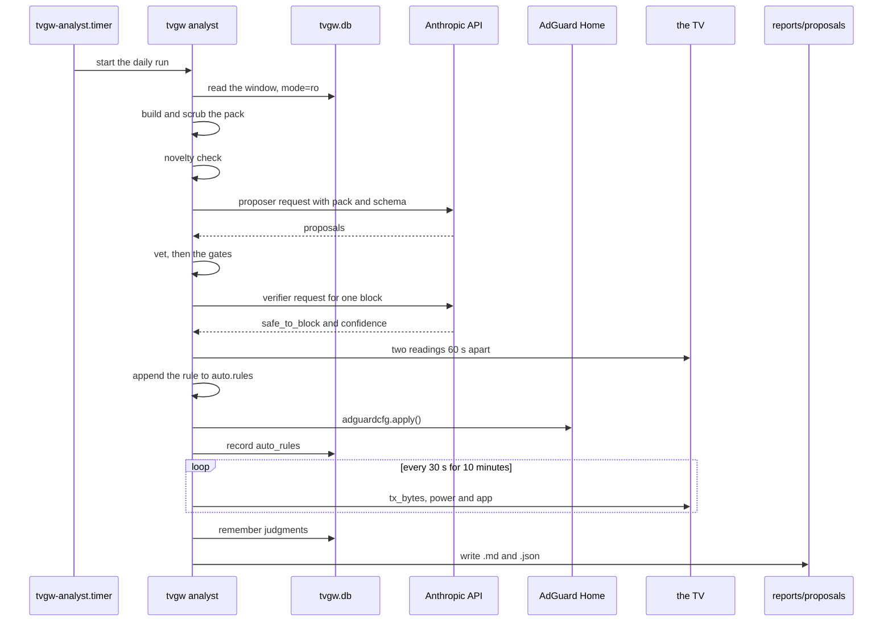
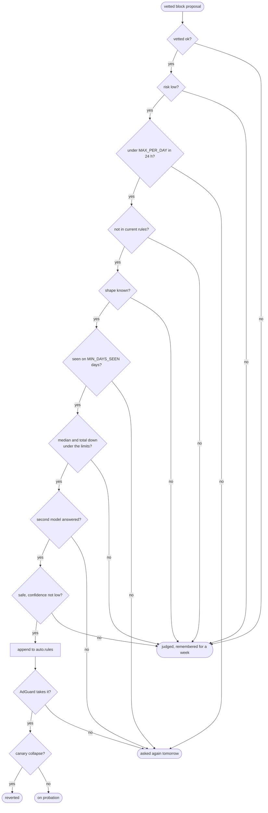
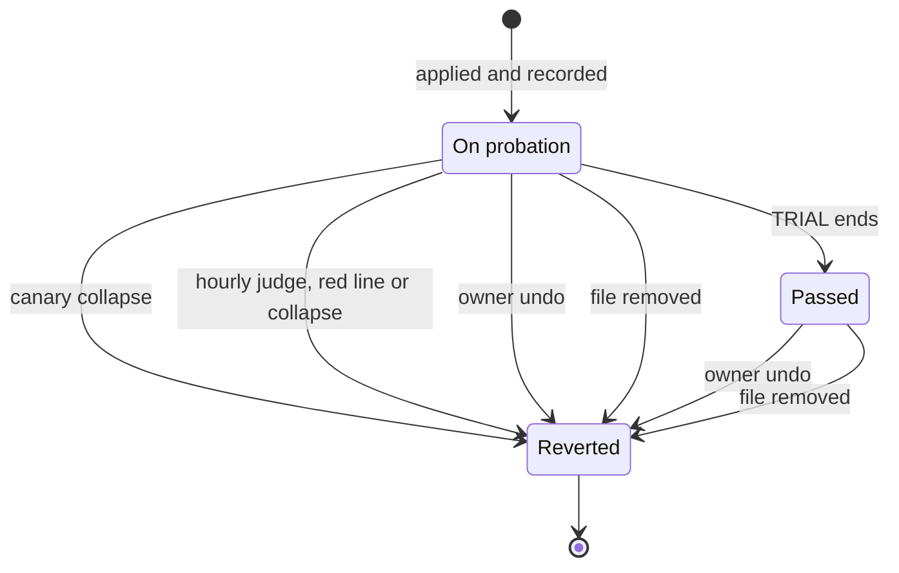

# The analyst and autonomous blocking

This page owns the analyst and [design decision 20](design-decisions.md#20-the-gateway-blocks-on-its-own-under-three-watches) as built: what each pass reads, sends and decides, every gate and its constant, and everything the gateway changes on its own. It is for the owner deciding whether to set `ANALYST_APPLY=auto`, and for anyone reviewing what the analyst sends, decides and changes.

## What it does

`tvgw analyst` (`src/tvgw/analyst.py`) reads one window of the store, builds a minimized evidence pack and, when the window holds something new, asks a Claude model for proposals in one request answered inside a JSON schema. It vets each proposal as a profile rule would be vetted and writes the result to `reports/proposals/`. With `ANALYST_APPLY=off`, that is all: the owner adopts a rule by editing the profile ([design decision 19](design-decisions.md#19-a-daily-analyst-that-only-proposes)). With `ANALYST_APPLY=auto`, a block that passes the code's gates and a second model goes into the machine's own rules file and AdGuard Home, the TV is watched for 10 minutes, and the rule stays on probation for a day. Those are the three watches of design decision 20's title: [the live canary](#the-live-canary) for the first 10 minutes, [the hourly judge](#probation-and-the-hourly-judge) for the day after, and the owner's `sudo tvgw undo` at any time ([taking a rule out](#taking-a-rule-out)). Design decision 19 says nothing is applied; the code applies blocks when `ANALYST_APPLY=auto`, as [design decision 20](design-decisions.md#20-the-gateway-blocks-on-its-own-under-three-watches) says.



*Two different models and the code must agree before the gateway changes anything.*

## The daily and weekly passes

Both passes run the same code: the pack, the novelty check, the request, the vetting and, with `ANALYST_APPLY=auto`, the autonomous blocks. They differ in window, model and schedule. The settings' defaults are in [the settings file](../deploy/README.md#the-settings-file), and the shipped timers in [units](../deploy/systemd/README.md#units).

| Pass | Started by | Window | Model and effort | Schedule |
|---|---|---|---|---|
| Daily | `tvgw-analyst.timer` running `tvgw analyst` | `ANALYST_WINDOW`: `day` is the previous calendar day; `Nh` is the last N hours up to the run, from `1h` to `168h` | `ANALYST_MODEL`, `ANALYST_EFFORT` | `ANALYST_SCHEDULE`: `HH:MM`, `hourly`, or a systemd calendar expression |
| Weekly | `tvgw-analyst-weekly.timer` running `tvgw analyst --weekly` | The ISO week, Monday to Sunday, that ended most recently | `ANALYST_WEEKLY_MODEL`, `ANALYST_WEEKLY_EFFORT`; `off` skips the pass | `ANALYST_WEEKLY_SCHEDULE`: `Day HH:MM` or a calendar expression |

- **Schedules.** `install.sh` renders each schedule into a timer drop-in (`schedule.conf` in `tvgw-analyst.timer.d` and `tvgw-analyst-weekly.timer.d`) and asks `systemd-analyze calendar` first, so a schedule systemd cannot read stops the install. A schedule change therefore takes effect at the next deploy. The hardware suite's `test_analyst_timer_follows_the_conf_schedule` checks the live timer against the settings.
- **Model and effort.** The model, effort and window settings are read at each run, so a change takes effect at the next one. Efforts are `config.EFFORTS`: `low`, `medium`, `high`, `xhigh`, `max`. `--model` and `--effort` override them for one run.
- **One week's window.** The weekly pass judges shapes over the whole week, so its download limit (see [the gates](#the-gates)) applies to a week of traffic.
- **Blocks from either pass.** `analyst.run` applies the blocks of any non-dry run with a key while `ANALYST_APPLY=auto`, the weekly pass and runs by hand included. [Design decision 20](design-decisions.md#20-the-gateway-blocks-on-its-own-under-three-watches) and `deploy/tvgw.conf.example` speak of a block the daily model proposes; the weekly unit's description and the code apply the weekly model's too.

## The evidence pack

`analyst.pack` computes the window with `queries.window_report`, the same computation as the brief, keeps a minimized subset, and scrubs it. What leaves the Pi, where it goes and what never leaves are in [what leaves the Pi](privacy-and-retention.md#what-leaves-the-pi). The pack's fields:

| Field | What it carries |
|---|---|
| `day`, `profile` | The window's label; the profile's name, vendor, expected categories, apex zones and must-allow hosts with their reasons |
| `tv` | The number of hourly readings and of `Active` ones, the apps seen, the Live Plus setting, every setting first read or changed in the window, and each firmware change with the names that followed it. A changed setting carries its value only when its key is in `PACK_SETTINGS` (the switches: Live Plus, country, audio guidance, store mode, Wake-on-LAN, SimpLink; the firmware, the platform, the model and the country code); any other key, the ZIP code the TV holds and the device name typed on it included, goes as `[redacted]` |
| `totals` | Lookups, connections and bytes, While off/asleep, and the clock-host lookups |
| `by_category`, `new_hosts`, `blocked_retries`, `blocked_reached`, `allowed_unexpected`, `must_allow_blocked` | The brief's sections of the same names |
| `top_upload` | Per destination: the TLS name, the address only when there is no name, the port, connections, bytes up, the payload bound and bytes down |
| `periodic`, `unresolved_destinations`, `dns_gate`, `dns_bypass`, `odd_ports`, `gfts_filter` | The brief's Periodic connections, Unresolved flows, DNS-gated egress, DNS sent to other resolvers, Unexpected ports and URL-filter sections |
| `plain_http` | Host, method and request count; no path or query string |
| `dns_anomalies` | Kind, name and lookups |
| `lan_probes_dropped`, `ptr_sweep_lookups` | Counts only; no targets and no reverse-lookup names |
| `red_lines`, `firewall`, `coverage`, `rule_changes` | The red lines, the firewall checks and counters, Coverage, and the rules added or removed |
| `current_rules` | Every rule AdGuard is given (`analyst.rules_in_place`): the profile's, the generated ones included, then the machine's own that pass the lint. The list is sent whole, past `LIST_CAP`, so the model sees every rule it must not propose again |
| `shapes` | The traffic shape (`autoblock.shapes`) of up to 60 candidate names: new hosts, allowed names outside the expected categories, periodic names, blocked names reached, named top-upload destinations and DNS oddities |
| `previous_judgments` | Up to 40 names judged in the 7 days before the window's end, with the kind, the days since and the reason |

The pack never carries the hourly timeline: hours on and the apps seen stand in for it.

`analyst.scrub` then walks every string, dictionary keys included (`shapes` is keyed by the names it describes), with the secrets from `secrets_for`: `TV_MAC`, `TV_NAME`, `TV_IP`, `GW_IP`, the Pi's host name, and every value the store holds for the `IDENTITY_SETTINGS`, `option.zipcode` and `network.deviceName` (the ZIP code the TV holds and whatever name was typed on it, which need not be `TV_NAME`). Each secret of 3 characters or more is replaced by `[redacted]` wherever it stands as a whole word, ignoring case. Any MAC address, and any private, CGNAT, link-local, loopback, multicast or `0.0.0.0/8` IPv4 address, is replaced too. Control characters become spaces, strings are cut at `STRING_CAP = 200` characters, and lists at `LIST_CAP = 40` entries with a last entry saying how many were left out. `current_rules` is scrubbed entry by entry and added after the list cap. The hardware suite's `test_analyst_dry_run_pack_carries_no_home_identifier` checks the real pack for the TV's MAC, the TV subnet, home-LAN addresses, the host name, the TV's name and every stored ZIP code and device name, over yesterday and over the day each of those values was first read.

## When no request is made

A run builds the pack first, then decides whether to ask:

1. **Novelty.** `analyst.novelty` lists the reasons the window deserves a request. It finds none when the TV had no `Active` reading and made no lookups. Otherwise the reasons are: names first seen and not judged in the last week; allowed names outside the expected categories and not judged; any red line other than a firewall-check one; a must-allow name blocked; blocked names still reached; DNS-gate samples or count; unresolved destinations; DNS oddities on names not judged; a firmware or settings change. An ACR-like cadence counts through its red line.
2. **A quiet window.** With no reason, the run writes `<stem>.md` with a heading and one sentence saying no request was made, and sends nothing. `--force` asks anyway, and `--dry-run` writes the pack whether or not the window is quiet.
3. **A dry run.** `--dry-run` writes `<stem>.pack.json` and `<stem>.prompt.txt` and stops.
4. **The key.** Without `/etc/tvgw/claude.key` (`KEY_PATH`), the run says so and sends nothing. A key file that its group or others can read is refused with an error.

After a request, `autoblock.remember` records each proposal's name and kind in `judgments`, and the novelty check treats the name as judged for 7 days. A block the gates refused for a reason in `RETRY_PREFIXES` is not recorded, so its name counts as new again at the next pass: too few days of evidence (`no: seen on`), the daily cap (`no: 3 autonomous blocks`), a second model that could not be asked, and AdGuard not taking the rule. The cap's prefix spells the number, so it matches only while `MAX_PER_DAY` is 3.

A second run over the same window, once the first has judged its names, usually finds nothing new and replaces `<stem>.md` with the quiet file; the first run's `<stem>.json` stays. `test_autonomous_run_blocks_telemetry_refuses_content_and_remembers` in `tests/unit/test_autoblock.py` pins this.

## Proposals and vetting

`analyst.call` sends one streamed request: the model, `MAX_TOKENS = 64000` (the streaming default; thinking counts toward it, so a deep weekly pass needs the room), the system prompt `SYSTEM`, the pack as JSON in the user message, the effort, and the JSON schema `SCHEMA`. The client retries twice and waits up to 600 seconds. The answer is a summary, a `nothing_to_do` flag and a list of proposals.

- **A refusal.** When the model's safety layer declines, the run writes a `<stem>.md` saying so, with the refusal's category, and a `<stem>.json` record with `refused`, the usage and the cost and no proposals, so an earlier run's proposals for the same window do not outlive it. It exits 0.
- **A cut-off answer.** An answer that reaches `MAX_TOKENS` before it is complete was billed all the same: the run writes a `<stem>.json` record with `cut_off: true`, the usage and the cost, and a `<stem>.md` that says nothing was proposed, prints `tvgw analyst: the answer was cut off at max_tokens; its cost is in <base>.json`, and exits 1.
- **Errors.** A refused key, an unavailable API or any other error ends the run with a message and exit 1, and writes nothing. The next scheduled run asks about its own window, not the missed one: run `sudo tvgw analyst --day <day>` for that ([run a pass](#run-a-pass)).

Each proposal has a kind (`block`, `allow`, `unblock`, `watch` or `question`), the name, one AdGuard rule or none, the reason, the evidence (the system prompt asks each entry to name the pack field it rests on), the risk to the TV's working (`low`, `medium` or `high`) and a rollback. `analyst.vet` keeps the first `MAX_PROPOSALS = 12`. An unknown kind becomes `question` and an unknown risk becomes `high`, every string is cut to a fixed length, and `_canonical` writes each rule's `$dnstype` values upper-case, as the profile writes them, so `||host^$dnstype=https|svcb` and `||host^$dnstype=HTTPS|SVCB` are one rule. Then `_verdict` judges each rule as the profile's own would be judged, in this order:

| Case | Vetted |
|---|---|
| A `watch` or a `question` | `ok` |
| No rule | `refused: no rule` |
| An `unblock` of a rule not in `current_rules` | `refused: no such rule in place` |
| An `unblock` of a rule in place that does not act on the name it is headed with | `refused: the rule does not act on '<name>', the name it is headed with` |
| Any other `unblock` | `ok` |
| Not one AdGuard DNS rule (`||host^` or `@@||host^`, with modifiers in either case, or a `/regex/`) | `refused: not one AdGuard DNS rule` |
| A modifier other than `$important`, or, on a `block`, `$dnstype` with types other than HTTPS and SVCB or on a wildcard that names every host (`_modifiers`) | `refused: $<modifier> is not for proposals`, `refused: $dnstype may only withhold HTTPS or SVCB`, or `refused: $dnstype names one host, not every name` |
| Already in `current_rules` | `refused: already in place` |
| An `allow` without `@@` | `refused: an allow rule starts with @@` |
| A `block` with `@@` | `refused: a block rule does not start with @@` |
| The profile's lint finds a problem with the rule added | `refused:` and the first problem |
| The rule does not act on the name the proposal is headed with: not the name, a parent zone, a wildcard or a regex that matches it (`_heading`) | `refused: the rule does not act on '<name>', the name it is headed with` |
| Anything else | `ok` |

`Vetted: ok` means the rule passes the lint the profile must pass, carries no modifier but `$important` (or, on a block of one named host, `$dnstype=HTTPS|SVCB`), and acts on the name it is headed with; `Vetted: refused: ...` says why it does not. The modifier check exists because the heading says block or allow and the modifier decides what the rule does: `$badfilter` disables the rule it names, `$dnsrewrite` answers with an address, `$client`, `$ctag` and `$denyallow` change whom it is for. The heading check exists because the owner reads the heading and the autonomous gate judges that name's traffic shape. No proposal is dropped, so the owner sees every refusal. The vetting reads the whole, unscrubbed `current_rules`, the machine's rules included, so a rule already in the machine's file is "already in place" and an `unblock` of one is vetted `ok`. To adopt a proposal by hand, add its rule to the profile's `.rules` file with a dated comment, run `make gate` and deploy.

## Autonomous blocks

With `ANALYST_APPLY=auto`, `analyst.autonomous` takes each vetted `block` proposal in turn; other kinds are never applied. A block passes [the gates](#the-gates), then [the second model](#the-second-model). The run takes two readings of the TV 60 seconds apart, appends the rule to [the machine's rules file](#the-machines-rules-file) and applies AdGuard (`adguardcfg.apply()`, as `tvgw adguard apply` does, without the profile lint, since the profile was linted when it was deployed). When AdGuard takes the rule, the run records it in `auto_rules` and watches [the live canary](#the-live-canary); a rule that survives is on [probation](#probation-and-the-hourly-judge) for a day.

Every outcome is written on the proposal as `Applied:` and in the record's `autonomous` list:

| `Applied:` | Meaning | Asked again tomorrow |
|---|---|---|
| `no:` and a gate's reason | A gate refused it | For too few days or the daily cap |
| `no: the second model could not be asked (<error>)` | The verifier request failed | Yes |
| `no: <verifier> did not clear it: <reason>` | The verifier vetoed it | No |
| `no: AdGuard did not take it (<error>)` | The apply failed; the rule left the file again | Yes |
| `reverted within minutes: <why>` | The canary took it out | No |
| `yes; <verifier> agreed (<reason>); canary <outcome>: <why>; on probation until <time>` | Applied | No |



*Any no stops the block, and only a block can come out of this flow.*

Each applied block holds the run for about 11 minutes: 60 seconds of baseline and 10 minutes of canary. `tvgw-analyst.service` and `tvgw-analyst-weekly.service` have a start timeout ([units](../deploy/systemd/README.md#units)) sized for one request, so a run that applies a second block outlasts it, and systemd stops the run before the proposals file, the record and the judgments are written. A rule already applied by then stays in the file, in AdGuard and in `auto_rules`, on probation.

## The gates

`autoblock.gate` checks a block proposal in this order; the first refusal ends it. The constants are in `src/tvgw/autoblock.py`.

| Gate | Constant | Refusal | Asked again |
|---|---|---|---|
| The proposal is a vetted `block` | | `no: only a vetted block can be applied on its own` | No |
| The proposer rated the risk `low` | | `no: the proposer rated the risk <risk>` | No |
| Fewer than the cap of machine rules added in the last 24 hours | `MAX_PER_DAY = 3` | `no: 3 autonomous blocks in 24 h already` | Yes |
| The rule is not in `current_rules` or applied earlier in the same run | | `no: already in place` | No |
| The pack holds a shape for the name | | `no: no evidence of how the TV used this name` | No |
| The name was looked up on enough distinct local days | `MIN_DAYS_SEEN = 2` | `no: seen on <n> day(s), fewer than 2` | Yes |
| No payload: the median bytes down per connection and the total bytes down in the window are within their limits | `MAX_MEDIAN_DOWN = 16 * 1024` (16 KB), `MAX_TOTAL_DOWN = 2 * 1024 * 1024` (2 MB) | `no: carried payload (median <n> B down per connection, <n> B down in the window)` | No |

The cap counts `auto_rules` rows whose `added_t` lies in the `TRIAL` seconds before the run (`autoblock.added_in`). The days come from every `dns` row the store holds for the name, by local calendar day. The shape is `autoblock.shapes` over the window: the flows `FLOW_NAME` names with the name ([naming a connection](architecture.md#naming-a-connection)), with their counts, total and median bytes down and up, median duration, distinct hours, the apps on in those hours, and the first and last start. A name the pack lists with no named flow has a shape of zeros, which passes the payload limits. A name outside the pack's candidates has no shape at all.

The payload gate holds whatever a model says, because it reads the bytes, not the name. The code refuses only values above the limits (`>`), so a median of exactly 16 KB passes.

The gate reads the same unscrubbed `current_rules` as the vetting, the machine's rules included, so a rule already in `auto.rules`, on probation or passed, is refused as `no: already in place` when a model proposes it again.

## The second model

`analyst.verifier_for` picks the verifier: the first of `ANALYST_VERIFIER_MODEL`, `ANALYST_MODEL`, `ANALYST_WEEKLY_MODEL`, `MODEL` (`claude-opus-5-5`, in `src/tvgw/analyst.py`) and `claude-fable-5-1` that is not `off` and is not the proposer. It never returns the proposer, whatever the settings say. The request runs at `ANALYST_VERIFIER_EFFORT`.

The verifier gets `autoblock.VERIFIER_SYSTEM`, which tells it its only job is to find what the block would break and to answer `false` when in doubt, and a message holding the proposal, its traffic shape and the context: the window, the apps seen, the must-allow hosts, the expected categories, the current rules and the by-category totals. All of it comes from the scrubbed pack and the vetted proposal. It answers inside `VERIFY_SCHEMA`: `safe_to_block` (a boolean), `confidence` (`low`, `medium` or `high`), `reason` and `watch_for`.

- **Veto.** A refusal by the model, `safe_to_block` false, or `confidence` `low` leaves the rule unapplied, and the name is judged.
- **Error.** Any exception from the request leaves the rule unapplied, and the name is asked about again at the next pass.

The verifier's token usage is not recorded ([cost](#cost)).

## The machine's rules file

The machine writes one file, `AUTO_RULES`; the default path is in [the settings file](../deploy/README.md#the-settings-file). It never edits the profile's `.rules` file, so the owner's rules and the machine's have separate histories.

- **Format.** The first line is `HEADER`: `! rules added by tvgw itself (design decision 20); delete this file to undo them all`. Each rule follows a note line, `! <YYYY-MM-DD HH:MM> <stem>: <name>`, in the Pi's local time. Lines that start with `!` are comments. `autoblock.read_rules` returns the rest.
- **Writes.** `add_rule` never adds a rule twice; `remove_rule` takes out the rule and its note line. Both write a temporary file and rename it over the old one.
- **The apply.** `tvgw adguard apply`, and the analyst's, the hourly judge's and `tvgw undo`'s own call of `adguardcfg.apply()`, append every rule that passes `autoblock.admissible`, which runs the profile's lint with the rule beside the profile's own. A rule that fails is left out with `tvgw adguard: machine rule dropped: <rule>: <problem>` on stderr, so a machine rule can never cover a must-allow host. Every apply appends the file, whatever `ANALYST_APPLY` says.
- **A failed apply.** When AdGuard does not take a new rule, the run takes it out of the file again and records nothing.

The hardware suite's `test_autoblock_file_record_and_resolver_tell_one_story` checks that no rule in the file is refused, that the rules in place in `auto_rules` are the admissible rules, that `tvgw autoblock check` and `list` run clean, and that the three units may write AdGuard's configuration.

## The live canary

The canary watches the TV for 10 minutes after a block. Its constants are in `src/tvgw/autoblock.py`:

| Constant | Value | What it sets |
|---|---|---|
| `CANARY_MINUTES` | `10` | How long the canary watches |
| `CANARY_INTERVAL` | `30` | Seconds between readings |
| `CANARY_MIN_RATE` | `1_000_000` | Bytes a minute to the TV before the block (about 977 KB) for the rate test to apply |
| `CANARY_COLLAPSE` | `0.2` | The share of the rate before the block under which a reading counts as collapsed |
| `HOME_APPS` | `""`, `com.webos.app.home`, `com.webos.app.launcher` | The foreground apps that mean the TV is at its launcher |

A reading (`analyst.live_sample`) is the time, `tx_bytes` of `eth0` (the bytes the Pi has sent the TV), and, for the `lg-webos` profile, the TV's power state and foreground app over its LAN API. Other profiles read `unknown`.

1. **Baseline.** Two readings 60 seconds apart, before the rule is appended, give the download rate. With fewer than two readings, or the TV not `Active` at the second, the canary is `unobserved` and the hourly judge takes over.
2. **Watching.** Every 30 seconds, 20 times, the canary takes a reading. The TV leaving `Active` ends it as `unobserved`.
3. **The app.** A foreground app outside `HOME_APPS` giving way to one inside it reverts the rule.
4. **The rate.** When the baseline was at least `CANARY_MIN_RATE`, three readings in a row under 20% of it revert the rule. Below that rate, the TV was on but not streaming, and only the app is watched.
5. **Passed.** Otherwise the canary passes, and the rule is on probation.

A canary revert takes the rule out of the file, applies AdGuard again (a failure is added to the reason), and records the verdict `reverted` with the reason `canary: <why>`.

## Probation and the hourly judge

`tvgw-autoblock.timer` runs `tvgw autoblock check` every hour, after the ingest, whatever `ANALYST_APPLY` says. `analyst.check` does three things:

1. **Owner removals.** Each rule on probation or passed that is no longer in the file is recorded as `reverted`, "owner removed it from the file".
2. **Judging.** `autoblock.judge` judges each rule still on probation against the store:
    - A must-allow name or a clock-host lookup blocked at any time since the block reverts the rule.
    - The baseline is the streaming volume of the 3 days before the block: the bytes down of flows named into the profile's expected categories (`Streaming` when it names none), per hour the TV was on, counted as `Active` readings (`autoblock.streaming_rate`).
    - During the trial, the last full hour after the block reverts the rule when the TV was on in it, the baseline had at least `MIN_TRIAL_TV_HOURS = 2` TV hours and some volume, and the hour's volume is under `HOURLY_COLLAPSE = 0.2` (20%) of the baseline.
    - When `TRIAL = 86400` seconds (1 day) have passed, the whole trial is judged. With fewer than 2 TV hours on either side the rule passes, since there is too little to compare. Under `STREAMING_COLLAPSE = 0.5` (50%) of the baseline it is reverted; otherwise it passes.
3. **Re-applying.** Reverted rules leave the file, and AdGuard is applied once at the end. When that fails, each reverted rule's reason says so, and the command fails, so the unit shows in `systemctl --failed`. `sudo tvgw adguard apply` is the remedy.

A rule that passed is not judged again; only the owner takes it out.



*A rule leaves on its own, by the hourly judge, or by one command, and the record follows the file.*

## Taking a rule out

The owner has three ways, all recorded in `auto_rules`:

- **`sudo tvgw undo`** takes the newest machine rule still in place out of the file, records it as `reverted` by "owner undo", and applies AdGuard.
- **`sudo tvgw undo --all`** does the same for every one.
- **Editing or deleting the file** works at the next hourly check, which records each missing rule as reverted and applies AdGuard.

When `tvgw undo` cannot apply AdGuard, the file has changed and AdGuard has not; the command fails and says to run `sudo tvgw adguard apply`. These applies are `adguardcfg.apply()` called directly (`analyst.adguardcfg_apply`): the profile's lint does not run, and readiness is a probe of `example.com` (`adguardcfg.dns_ready`'s default), not of the first must-allow name as in `tvgw adguard apply`.

`ANALYST_APPLY=off` stops new blocks only: the rules already in the file stay applied, and the hourly judge keeps judging those on probation. After a revert, the TV may hold the blocked answer for up to 60 seconds, the blocked-response TTL `tvgw adguard apply` sets (`blocked_response_ttl` in `src/tvgw/adguardcfg.py`). A name added to the profile's `[must_allow]` can never be blocked by a machine rule, because the lint refuses any rule covering it.

What the machine can never do: add anything but a block, allow or unblock a name, edit the profile's rules, change the firewall, add more than `MAX_PER_DAY` rules in 24 hours, or keep a rule that covers a must-allow host.

## Files and records

The analyst writes into `reports/proposals/` under the reports directory. Their owners and modes are in [where it lives and who can read it](privacy-and-retention.md#where-it-lives-and-who-can-read-it).

| File | Written | Holds |
|---|---|---|
| `<stem>.md` | A quiet window, a refusal, a cut-off answer, or an answer | The proposals for the owner, the refusal, the cut-off notice, or the quiet-window text |
| `<stem>.json` | Every request the model answered: an answer, a refusal or a cut-off | The record: `window`, `since`, `until`, `model`, `effort`, `generated`, `pack_sha256_16`, `usage`, `cost_usd`, `reasons`, `autonomous`, `summary`, `nothing_to_do`, `proposals` (each with `vetted` and any `applied`) and `vetted_ok`; `refused` with the category on a refusal, `cut_off: true` on an answer cut off at `MAX_TOKENS` |
| `<stem>.pack.json` | `--dry-run` | The scrubbed pack |
| `<stem>.prompt.txt` | `--dry-run` | The system prompt and the user message |

The stem names the window: `<day>` (`YYYY-MM-DD`) for a day, `<YYYY-Www>` for an ISO week, and `<YYYY-MM-DDTHHMM>-<N>h` for a window of hours. A run with `--model` naming a model other than its pass's own appends `.<model>`, as in `<day>.<model>.md`, so a comparison sits beside the usual file. `tvgw analyst --show` prints the proposals file written last (`analyst.latest`, by modification time, not by name: a week's stem sorts after every day of its year).

In the store, `auto_rules` holds every machine rule and its verdict, and `judgments` every remembered verdict; their columns are in [tables](data-model.md#tables). `tvgw autoblock list` prints each machine rule with when it was added, its verdict (`on probation` while it has none) and why. The brief's "Rules the gateway added on its own" section lists the rules added and decided in its window ([sections](reading-the-brief.md#sections)).

## Cost

`analyst.PRICES` holds the list prices of 2026-10, in dollars per million tokens:

| Model | Input | Output |
|---|---|---|
| `claude-opus-5-5` | $4.00 | $20.00 |
| `claude-sonnet-5-5` | $2.00 | $10.00 |
| `claude-haiku-5-5` | $0.10 | $0.50 |
| `claude-fable-5-1` | $10.00 | $50.00 |
| `claude-opus-5` | $5.00 | $25.00 |

`analyst.cost` multiplies the input and output tokens by these prices; cached input is not priced apart. For a model not in the table the record has no cost, and the `.md` says the price is not on file. The record keeps the usage (input, output and cache-read tokens) and `cost_usd`, and the `.md` ends with the tokens and the cost to the cent. Both cover the proposer's request only: `analyst.autonomous` discards the second model's usage.

`deploy/tvgw.conf.example` gives the estimates as of 2026-10: about $0.07 for a day with `claude-opus-5-5`, and $0.40 to $0.60 for a weekly pass with `claude-fable-5-1`. A quiet window sends nothing and costs nothing.

## Running it by hand

### Install the key

On the Pi:

```sh
sudo install -m 600 -o root -g root /dev/null /etc/tvgw/claude.key
sudoedit /etc/tvgw/claude.key    # the API key, on one line
```

These are the steps of [the quick start](../README.md#quick-start), step 9. The key file's required mode is in [where it lives and who can read it](privacy-and-retention.md#where-it-lives-and-who-can-read-it). To stop the analyst, remove the file or disable its timers.

### See what would be sent

On the Pi:

```sh
sudo tvgw analyst --dry-run --day <day>
sudo less /var/lib/tvgw/reports/proposals/<day>.pack.json
sudo less /var/lib/tvgw/reports/proposals/<day>.prompt.txt
```

A dry run sends nothing and applies nothing.

### Run a pass

On the Pi:

```sh
sudo tvgw analyst --day <day>            # one calendar day
sudo tvgw analyst --day <day> --force    # ask even when nothing is new
sudo tvgw analyst --since 6h             # the last 6 hours
sudo tvgw analyst --week 2026-W43        # one ISO week
sudo tvgw analyst --weekly               # the weekly pass, with its own model
sudo tvgw analyst --show                 # print the newest proposals
```

`--day`, `--since`, `--week` and `--weekly` exclude each other, and `--since` takes whole or decimal hours up to `168h`. With `ANALYST_APPLY=auto`, a run by hand is a full run: it can apply blocks and it records judgments.

### Compare two models

On the Pi:

```sh
sudo tvgw analyst --day <day> --model claude-fable-5-1 --effort max --force
```

The run writes `<day>.claude-fable-5-1.md` beside `<day>.md`. `--force` is needed once the day's own run has judged its names. With `ANALYST_APPLY=auto` the comparison can apply blocks too.

### Switch autonomous blocking on or off

1. On the Pi, edit `/etc/tvgw/tvgw.conf` and set `ANALYST_APPLY=auto`, or `ANALYST_APPLY=off`.
2. Wait for the next run, or run a pass by hand; each run reads the setting, and no deploy is needed.
3. To clear the machine's rules as well, run `sudo tvgw undo --all`.

### Take machine rules out

On the Pi:

```sh
sudo tvgw undo          # the newest machine rule
sudo tvgw undo --all    # every machine rule
```

### Check what the machine did

On the Pi:

```sh
sudo tvgw autoblock list
sudo tvgw autoblock check
journalctl -u tvgw-autoblock --since today
journalctl -u tvgw-analyst --since today
```

`tvgw autoblock check` is the hourly judge run by hand; it can revert rules.
