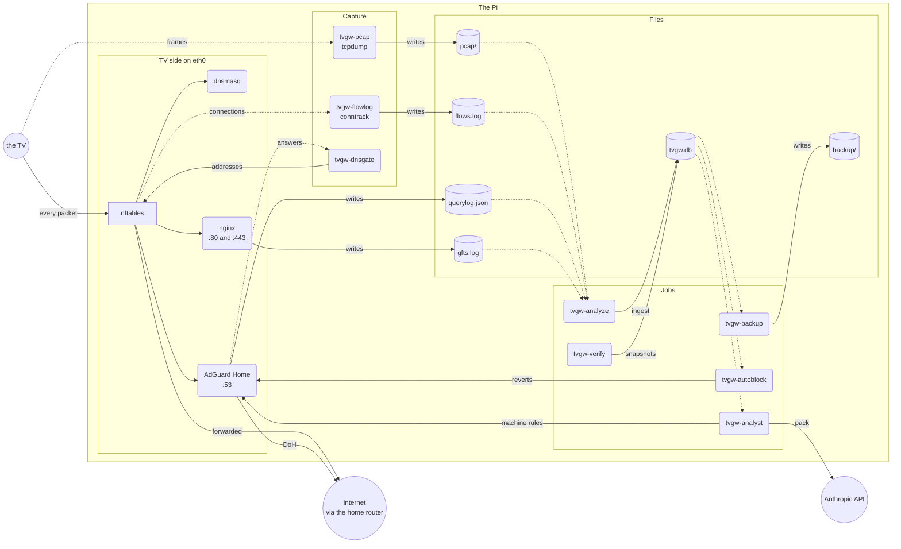
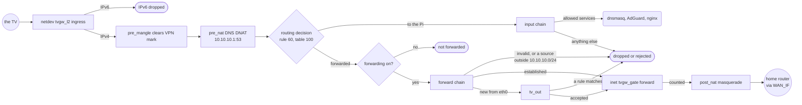
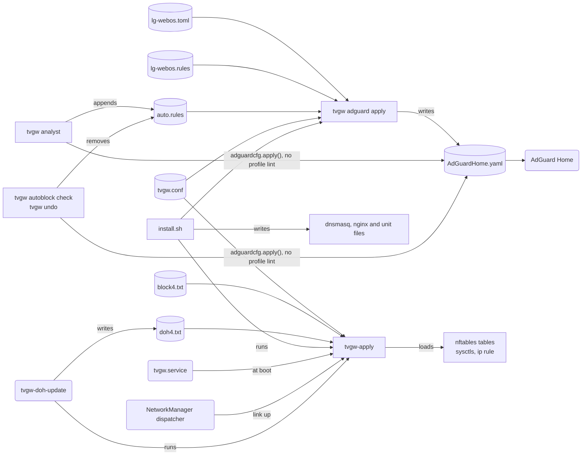
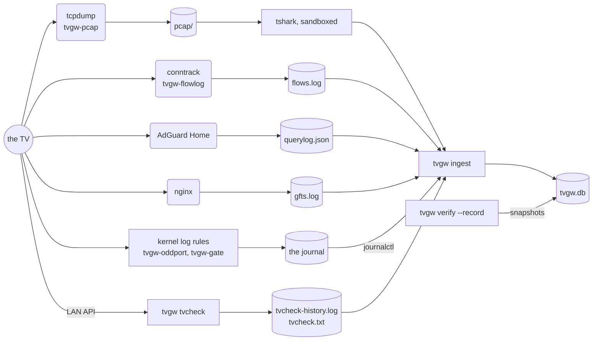
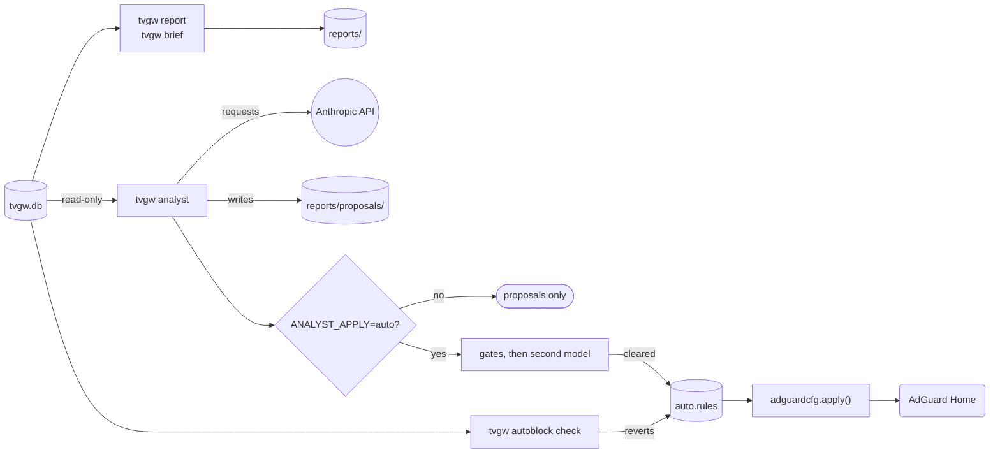

# Architecture

This page owns how tvgw works: the components on the Pi, the path a packet takes, how policy becomes configuration, how evidence becomes a block, how a connection is named, how often each job runs, and what each component may touch. It is for a technical reader who wants to understand tvgw before changing it, operating it or auditing it.

## Components on the Pi

The TV has one cable, to the Pi's `eth0`, and no other way out: isolation comes first and filtering is layered on it ([design decision 2](design-decisions.md#2-isolate-first-then-filter)). The Pi reaches the home router through `WAN_IF`. Its components:

- **nftables** holds the firewall in three tables ([the packet path](#the-packet-path)).
- **dnsmasq** serves DHCP only on `eth0`: it pins the TV's address and names `10.10.10.1` as router and DNS server.
- **AdGuard Home** is the TV's resolver on `10.10.10.1:53`. It forwards what it allows over DNS-over-HTTPS to upstreams given by address ([design decision 9](design-decisions.md#9-doh-upstreams-by-ip-address)) and logs every query to `querylog.json`. Its configuration is generated ([the control plane](#the-control-plane)).
- **nginx** listens on `10.10.10.1:80` as the URL filter for LG's plain-HTTP file service ([design decision 8](design-decisions.md#8-a-url-filter-for-lgs-file-service-instead-of-a-dns-block)) and on `10.10.10.1:443`, where it passes TLS for the same names through by server name without decrypting it. It logs to `gfts.log`.
- **NetworkManager** keeps `10.10.10.1/24` on `eth0` (never a default route, IPv6 off), and keeps it while the TV is off. Its dispatcher re-runs `tvgw-apply` when a link comes up.
- **The capture units**: `tvgw-pcap` runs `tcpdump` into hourly pcaps of what the TV sends; `tvgw-flowlog` runs `conntrack` and writes one line per finished TV connection to `flows.log`; `tvgw-dnsgate` reads the resolver's answers to the TV and feeds the DNS gate's address set.
- **The tvgw jobs**: `tvgw-analyze` (hourly: the TV's settings, `tvgw ingest`, the reports), `tvgw-prune`, `tvgw-verify`, `tvgw-backup`, `tvgw-analyst`, `tvgw-analyst-weekly`, `tvgw-autoblock` and `tvgw-doh-update`, each started by its timer. With `tvgw.service` and the three capture units, `deploy/systemd` holds twelve services and eight timers ([units](../deploy/systemd/README.md#units)).
- **The store**, `tvgw.db`: one SQLite file that every report reads ([the store](data-model.md)).
- **A VPN client**, when the Pi runs one, carries the Pi's own traffic, AdGuard's DoH included. In direct mode it does not carry the TV's ([design decision 1](design-decisions.md#1-the-tv-uses-the-direct-uplink-not-the-vpn)).

*Everything the TV does passes a component that writes evidence.*

## The packet path

The firewall is three nftables tables, all loaded by [deploy/nftables/tvgw-apply](../deploy/nftables/tvgw-apply). `inet tvgw` is the filter, replaced whole on every apply. `netdev tvgw_l2` drops IPv6 at the wire. `inet tvgw_gate` counts connections to addresses no lookup returned; it is a table of its own, created with `add` statements, so a re-apply keeps its set and `tvgw verify`'s baseline of `inet tvgw` stays fixed ([design decision 18](design-decisions.md#18-dns-gated-egress-starts-as-a-count-in-its-own-table)). The rules one by one, with their reasons, are in [the firewall](../deploy/nftables/README.md).

A packet from the TV meets them in this order:

1. **`netdev tvgw_l2`**, on `eth0`'s ingress, drops every IPv6 frame. IPv6 is also disabled on `eth0`.
2. **`pre_mangle`**, in direct mode, sets the packet's mark to `0`: the Pi's VPN client marks forwarded packets to send them into its tunnel.
3. **`pre_nat`** rewrites DNS (UDP or TCP port 53) aimed at any address but `10.10.10.1` to `10.10.10.1:53`, so a hardcoded resolver lands on AdGuard Home. It runs before the VPN client's own NAT chain.
4. **Routing.** Traffic for the Pi goes to the `input` chain. In direct mode, policy rule priority 60 (`from 10.10.10.0/24 lookup 100`) sends the TV's other traffic to routing table 100, whose default route is `WAN_GW` on `WAN_IF`.
5. **`input`** accepts from the TV established traffic and DHCP, and, addressed to `10.10.10.1` only, DNS, TCP 80 and 443 for nginx, and pings at up to 5 a second. It drops the rest, and counts the TV's DNS to the gateway per packet.
6. **The forwarding switch.** Nothing from `eth0` is forwarded while `net.ipv4.conf.eth0.forwarding` is off.
7. **`forward`** drops packets with an invalid connection state, then any packet from `eth0` whose source is outside `10.10.10.0/24` (`TV source outside its subnet`): masquerade covers only the TV subnet, and the capture, the flow log and the gate all key on its addresses, so such a packet would leave un-NATed and unrecorded. It accepts established and related traffic, sends each new IPv4 connection from `eth0` to `tv_out`, and drops everything else into or out of the TV subnet.
8. **`tv_out`** drops anything not leaving by the chosen uplink, anything for the home LAN (`lan4`) and protocols other than TCP, UDP and ICMP, which a rule of its own logs as `tvgw-proto` at most 6 times a minute (every such packet reaches the rule, and an unlimited log could flood the journal ingest reads its samples from). It keeps small pings and drops other ICMP, and rejects DoT and DoQ ports, QUIC when `BLOCK_QUIC=yes` ([design decision 3](design-decisions.md#3-no-tls-interception)), known DoH resolvers (`doh4`) and manual IP blocks (`block4`). It accepts and logs LG's firmware fallback to `156.147.69.32:8080`, and logs other ports; with `STRICT_PORTS=yes` it also rejects them ([STRICT_PORTS](operations.md#strict_ports)). It accepts the rest.
9. **`inet tvgw_gate`**'s forward chain runs after the filter. It counts each new connection to an address outside `resolved4` and logs a sample, at most 6 a minute. conntrack calls every packet of a flow new until a reply comes, so the dynamic set `seen4` holds each flow's tuple for two minutes and the rule counts a tuple only when it is not there yet: a retransmitted SYN to a server that is down is one connection. It never drops.
10. **`post_nat`** masquerades the TV subnet out of the uplink.

The `output` chain also stops the Pi's own broadcast and multicast chatter into the TV subnet, DHCP excepted.

*DNS is rewritten before routing, and nothing is forwarded until the forwarding switch is on.*

### The fail-closed gate

`tvgw-apply` takes `/run/lock/tvgw-apply.lock`, so one apply runs at a time, and refuses a switch setting that is not exactly one of its values. It then sets the conntrack sysctls (accounting, timestamps, `nf_conntrack_tcp_timeout_established=7440`), lists every counter of the three tables, and loads `inet tvgw` in one `nft` transaction; under `set -e`, a rejected ruleset stops the script there. Then it loads `netdev tvgw_l2` and `inet tvgw_gate`, each of which only warns when it fails, lists the counters again and publishes both listings together (`/run/tvgw/counters.before-apply` and `counters.after-apply`, which the next `tvgw verify --record` stores, so the brief sees the reset). Only then does it turn forwarding on, globally, for `eth0` and for the uplink once the uplink exists (in vpn mode `tun0` appears after the boot apply, and the dispatcher re-runs the script when it does), write the applied ruleset to `/run/tvgw/ruleset.applied` and the settings it used to `/run/tvgw/settings.applied` for `tvgw verify`, and add rule 60 and table 100's route. Between the switch and rule 60, the TV's traffic follows the main table, and `tv_out` drops whatever does not leave by the uplink.

Stopping `tvgw.service` turns `eth0`'s forwarding off first, then deletes rule 60, `netdev tvgw_l2` and `inet tvgw`; `inet tvgw_gate` stays. A stopped or half-applied gateway leaves the TV dark, never unfiltered ([design decision 5](design-decisions.md#5-fail-closed)). While the service is stopped the `input` chain is gone too, so the Pi's own services answer on the TV subnet.

### Uplink modes

`UPLINK=direct`, the mode in use, sends the TV out of `WAN_IF` through table 100. `UPLINK=vpn` exists and is not used ([design decision 1](design-decisions.md#1-the-tv-uses-the-direct-uplink-not-the-vpn)): it sends the TV out of `tun0`, clamps the TCP MSS to the route's MTU, adds no rule 60 and clears no mark. In that mode `tv_out` drops the TV's traffic whenever the tunnel is down.

## The control plane

Policy lives in files, and three commands turn them into running configuration ([design decision 6](design-decisions.md#6-adguard-home-is-configured-as-code)):

| File | Where | Read by |
|---|---|---|
| `lg-webos.toml`, `lg-webos.rules` | The profile, in the installed package ([the profile format](adding-a-profile.md#the-profile-format)) | `tvgw adguard apply` |
| `auto.rules` | The machine's rules file, `AUTO_RULES` ([the machine's rules file](analyst-and-autonomy.md#the-machines-rules-file)) | `tvgw adguard apply` |
| `tvgw.conf` | The site settings ([the settings file](../deploy/README.md#the-settings-file)) | `tvgw adguard apply`, `tvgw-apply`, `install.sh` |
| `block4.txt` | Manual IP blocks | `tvgw-apply` |
| `doh4.txt` | DoH resolver addresses, written by `tvgw-doh-update` | `tvgw-apply` |

`tvgw-apply` loads the firewall, the sysctls and the policy routing. `tvgw adguard apply` writes `AdGuardHome.yaml`. `install.sh` writes the dnsmasq and nginx files from their templates and installs the units, then runs the other two. How a commit reaches the Pi through `make deploy` or CI is in [how a change reaches the gateway](../deploy/README.md#how-a-change-reaches-the-gateway).

| Command | Triggered by |
|---|---|
| `tvgw-apply` | `tvgw.service` at boot; the NetworkManager dispatcher when `WAN_IF`, `eth0` or `tun0` comes up or renews its address, since table 100's route vanishes with the uplink; `tvgw-doh-update` after a new list; `install.sh`, in place when the service is already up; by hand after a firewall setting changes |
| `tvgw adguard apply` | `install.sh`; by hand |
| `adguardcfg.apply()`, the same apply without the profile lint | `tvgw analyst` after it appends a machine rule and after a canary revert; `tvgw autoblock check` after a revert; `tvgw undo` (all through `analyst.adguardcfg_apply`) |
| `install.sh` | `make deploy PI=<ssh-host>` and the CI deploy |

### How tvgw adguard apply works

1. **Lint.** The profile must pass its own lint, or nothing is planned ([design decision 7](design-decisions.md#7-must-allow-exceptions-are-generated-from-the-toml)).
2. **Desired state.** `adguardcfg.desired` takes the profile's lists and builds the custom rules: an `@@||host^$important` exception per must-allow host, the URL filter's `$dnsrewrite` rules to `GW_IP`, one rule withholding the profile's `strip_qtypes` records (HTTPS and SVCB) from `TV_IP`, then the `.rules` file. Each machine rule follows if it passes the same lint beside the profile (`autoblock.admissible`); one that fails is dropped with a message. The upstreams, the bootstrap servers and the TV as a named client come from the settings.
3. **Plan.** `plan` sets only the keys tvgw owns on a copy of AdGuard's current YAML, and `changes` lists the differences. With none, nothing happens and AdGuard is not restarted.
4. **Lock.** The apply takes `.tvgw-adguard.lock` beside the YAML without waiting; a second apply fails at once. It refuses a YAML with no `schema_version`, which means an empty or truncated file.
5. **Check.** The candidate is written beside the live file and passed to `AdGuardHome --check-config`, which has 120 seconds. A rejection changes nothing. When the binary is missing, the apply goes on and says the file was not validated.
6. **Backup.** The live file is copied to `AdGuardHome.yaml.bak-<stamp>Z-<pid>` (UTC), never over an earlier copy, before AdGuard is stopped.
7. **Swap.** With SIGTERM, SIGHUP and SIGINT held off, the apply stops AdGuard, renames the candidate over the live file, syncs the directory and starts AdGuard.
8. **Readiness.** It waits up to 30 seconds for the resolver to answer the profile's first must-allow name (`us.lgtvsdp.com` in `lg-webos`, the clock host) with NOERROR or NXDOMAIN; the analyst's, the hourly judge's and `tvgw undo`'s applies probe `example.com`, the default of `adguardcfg.dns_ready`. SERVFAIL or REFUSED means not ready, so an apply while the DoH upstreams are unreachable rolls back.
9. **Rollback.** Any failure from the stop on puts the backup back the same atomic way and starts AdGuard, and the command fails saying which file is live.

`tvgw adguard diff` prints the same differences and writes nothing. The analyst, the hourly judge and `tvgw undo` call `adguardcfg.apply()` directly through `analyst.adguardcfg_apply`: steps 2 to 9 run, step 1 does not, and the machine's rules are still linted one by one in step 2.

*Policy lives in files in the repository and on the Pi, and three commands apply it.*

## From capture to block

Evidence moves through the Pi in stages, each written down before the next reads it:

- **Capture.** `tcpdump` keeps the frames the TV sends that the analysis needs, one pcap an hour ([what the capture keeps](privacy-and-retention.md#what-the-capture-keeps)).
- **Connections.** `conntrack` writes one line per finished TV connection to `flows.log`, with packets and bytes each way. When its netlink socket overflows it drops events and says so only in `tvgw-flowlog`'s journal (`We have hit ENOBUFS!`), which ingest reads and turns into a warning.
- **Lookups.** AdGuard Home logs every query with the rule that matched to `querylog.json`, in batches: it appends to the file once `querylog.size_memory` lookups have built up, 10 since `tvgw adguard apply` owns the key (`log_buffer` in `adguardcfg.Desired`).
- **The URL filter.** nginx logs each request to the file-service names to `gfts.log`.
- **The kernel log.** The unexpected-port rule logs `tvgw-oddport` lines and the DNS gate logs `tvgw-gate` lines, at most 6 a minute each, to the journal.
- **The TV's own report.** For the `lg-webos` profile, `tvgw-analyze` runs `tvgw tvcheck` every hour over the TV's read-only LAN API ([design decision 4](design-decisions.md#4-no-rooting-of-the-tv)) and keeps `tvcheck.txt` and `tvcheck-history.log`.
- **The firewall's record.** `tvgw verify --record` stores its verdict and every firewall counter in the store itself ([design decision 13](design-decisions.md#13-counters-not-logs-prove-the-firewall-held); the checks are in [what tvgw verify checks](troubleshooting.md#what-tvgw-verify-checks)).
- **The store.** `tvgw ingest` reads every other source into `tvgw.db` each hour, pcaps through a sandboxed tshark ([how rows arrive](data-model.md#how-rows-arrive)).
- **Reports.** `tvgw-analyze` writes the latest, daily and weekly reports from the store with `tvgw report`; `tvgw brief` computes the same from the store by hand ([sections](reading-the-brief.md#sections)).
- **The analyst.** `tvgw analyst` reads the store read-only, builds a minimized evidence pack and writes proposals ([the analyst and autonomous blocking](analyst-and-autonomy.md)).
- **An autonomous block.** With `ANALYST_APPLY=auto`, a block that passes [the gates](analyst-and-autonomy.md#the-gates) and a second model goes into `auto.rules` and to AdGuard Home (`adguardcfg.apply()`), the live canary watches it for 10 minutes, and `tvgw autoblock check` judges it against the store every hour for a day ([design decision 20](design-decisions.md#20-the-gateway-blocks-on-its-own-under-three-watches)).

*Every source reaches the store through tvgw ingest, except the firewall snapshots, which tvgw verify writes itself.*

*Every report and every machine rule is computed from the store, never from live logs.*

## Naming a connection

A CDN address serves many names, so the destination address alone says little. tvgw names each flow by its own TLS hello ([design decision 12](design-decisions.md#12-each-flow-is-named-by-its-own-tls-hello)). `FLOW_NAME` in `src/tvgw/queries.py` takes the `tls` row with the flow's `dst`, `dport` and TV source port `sport` whose time falls between the flow's `t_start` less `FLOW_SLACK = 300` seconds and its `t_end`; when several match, the latest wins. The index `tls_conn` on `tls(dst, sport, t)` makes this one index seek per flow. A flow with no hello of its own that starts within `FLOW_SLACK` of the end of an earlier flow on the same tuple is a continuation (conntrack lost the entry mid-connection and opened a new one) and takes that flow's name, one hop back ([design decision 21](design-decisions.md#21-a-continuation-inherits-its-name)).

The slack exists because the code takes conntrack's start time to run up to a minute late. `t_end` is when the kernel expired the entry, one idle timeout after the last packet: 120 seconds in `TIME_WAIT`, 7440 s (2 h 04 min) for an established connection that went quiet, which `tvgw-apply` sets, and 30 or 120 seconds for UDP, plus up to about a minute of garbage-collector lag (`src/tvgw/conntrack.py`). An entry the kernel destroyed before its timer ran out (a reused tuple, a flush) ends when it was destroyed, and the seconds it had left are in `flows.timeout_left`. What this premise gets wrong is in [known limits](data-model.md#known-limits).

Names are computed when a report runs, never stored. A flow whose pcap is not ingested yet has no name until the next ingest, and a later report names it. A flow without a captured hello (UDP, plain HTTP, a missed packet) stays unnamed: By category counts it as `Unresolved`, and Top upload lists it by address.

## Cadences

Each job runs as often as its evidence changes and no more. The exact schedules and timeouts are in [units](../deploy/systemd/README.md#units).

| Job | Cadence | Why that often |
|---|---|---|
| Capture, flows, DNS, URL filter, kernel log | Continuous | Evidence is written as it happens |
| `tvgw verify --record` | Every 10 minutes | Counters reset on every apply. The brief sums the positive steps between snapshots, and `tvgw-apply`'s listings either side of each reload are stored as snapshots of their own, so a reset costs nothing unless a second apply follows within the same interval ([design decision 13](design-decisions.md#13-counters-not-logs-prove-the-firewall-held)). A window's first step is taken from the last snapshot in the hour before it (`FW_BASELINE = 3600` in `src/tvgw/queries.py`), so days nobody recorded are not credited to it. A failed check shows within 10 minutes |
| `tvgw-analyze` | Hourly | The pcaps and the TV readings are hourly, and an incremental ingest stays small |
| `tvgw prune-pcaps` | Hourly | It keeps the pcap directory within its limits, deleting only files the store has read |
| `tvgw autoblock check` | Hourly, after the ingest | The hourly judge needs the store the ingest has refreshed |
| `tvgw backup` | Daily, after the daily report | One checked copy a day |
| `tvgw analyst` | Daily, after the daily report and the backup; set by `ANALYST_SCHEDULE` | It reads a finished day, once its evidence has settled |
| `tvgw analyst --weekly` | Weekly, after the daily pass | It reads the ISO week that ended most recently |
| `tvgw-doh-update` | Daily, with a random delay of up to 1 hour | `tvgw verify` calls the list stale after 8 days |
| `tvgw-apply` from the dispatcher | When a link comes up | Table 100's route vanishes when the uplink drops |

Evidence reaches the store late, and by different amounts:

| Evidence | Reaches the store | Why |
|---|---|---|
| URL-filter requests, kernel log lines | At the next hourly ingest | They are logged as they happen |
| Lookups | Once AdGuard has written them, then the next hourly ingest | AdGuard Home appends to `querylog.json` only when `querylog.size_memory` lookups (10, set by `tvgw adguard apply`, every client together) have built up, or when it stops. That is a write every few minutes while an app runs, so on a quiet night the TV's last few lookups can land after 03:20 and miss the day's file and the analyst's pack; they are in the store and the weekly file |
| Flows | One idle timeout after the last packet, then the next ingest | conntrack reports a connection when it expires: 7440 s (2 h 04 min) after an established connection went quiet |
| TLS hellos, plain HTTP, LAN probes | Once the hour's pcap is finished, then the next ingest | `tcpdump` starts a new file 3600 s after the last, and a pcap closes up to an hour after its hour |
| TV state | Every hour, before the ingest | `tvgw-analyze` reads the TV and then ingests |
| Firewall verdicts and counters | Every 10 minutes | `tvgw verify --record` writes them itself |

Because flows and pcaps land late, `tvgw-analyze` writes a finished day or week once, at the first hourly run at least `SETTLE=10800` seconds (3 hours, in `deploy/bin/tvgw-analyze`) after it ends. `tvgw brief <day>` recomputes from the store at any time.

## Trust boundaries

The TV is untrusted. It reaches DHCP, DNS, ports 80 and 443 and pings on `10.10.10.1`, nothing else on the Pi, and nothing on the home LAN. Text that came from the TV or the servers it talks to (names, URIs, user agents, the TV's device name) is escaped before it reaches a terminal (`cli.clean`, `lgwebos.clean`). File owners and modes are in [where it lives and who can read it](privacy-and-retention.md#where-it-lives-and-who-can-read-it).

| Component | Runs as | Can touch |
|---|---|---|
| `tvgw-apply` (`tvgw.service`, the dispatcher, `tvgw-doh-update`, `install.sh`) | root | The firewall, the sysctls and the routes |
| `tvgw-doh-update` | root | Fetches the DoH list over HTTPS only, at most `8000000` bytes; refuses fewer than 50 entries; writes `doh4.txt` |
| `tcpdump` (`tvgw-pcap`) | The system user `tvgw-pcap`, group `nogroup`, with `CAP_NET_RAW` and `CAP_NET_ADMIN` only; read-only system | The TV's frames, into the pcap directory, its only writable path |
| `conntrack` (`tvgw-flowlog`) | root | Connection events for `TV_IP`, appended to `flows.log` |
| `tvgw-dnsgate` | root, bounded to `CAP_NET_RAW` and `CAP_NET_ADMIN`; read-only system; 128 MB of memory | The resolver's answers to the TV, and the set `inet tvgw_gate resolved4`; writes no file |
| `tvgw-analyze` | root; no new privileges; read-only system but the state, log and lock directories | Reads every log and the TV's LAN API; writes the store, the TV history and the reports |
| tshark | `nobody:nogroup` in a transient `systemd-run` unit: no network, read-only system, no devices, no capabilities, the service system calls, 512 MB and a time limit | One pcap, read-only. As root without `systemd-run`, ingest refuses to run it |
| `tvgw verify --record` | root | Reads the firewall, the routes and the resolver; writes `verify`, `fw_counters` and `meta` |
| `tvgw-analyst`, `tvgw-analyst-weekly` | root; no new privileges; read-only system but the state directory and `/opt/AdGuardHome` | Read the store and the API key; reach Anthropic's API and the TV; write proposals, the machine's rules file, the store and, with `ANALYST_APPLY=auto`, AdGuard's config |
| `tvgw-autoblock` | The same sandbox | Reads the store; writes the machine's rules file, the store and, on a revert, AdGuard's config |
| `tvgw-backup` | root; read-only system but the state directory | Copies the store |
| `tvgw prune-pcaps` (`tvgw-prune`) | root | Deletes pcaps the store has read |
| `tvgw adguard apply` | root | Stops and starts AdGuard Home and rewrites its YAML |
| The read-only commands (`brief`, `report`, `host`, `sql`) | Any member of `adm` | Open the store `mode=ro`; `sql` also sets `query_only` |
| dnsmasq, nginx, AdGuard Home | Their packages' own units | tvgw writes their configuration, and adds a restart drop-in for nginx and a working-directory drop-in for AdGuard Home |
