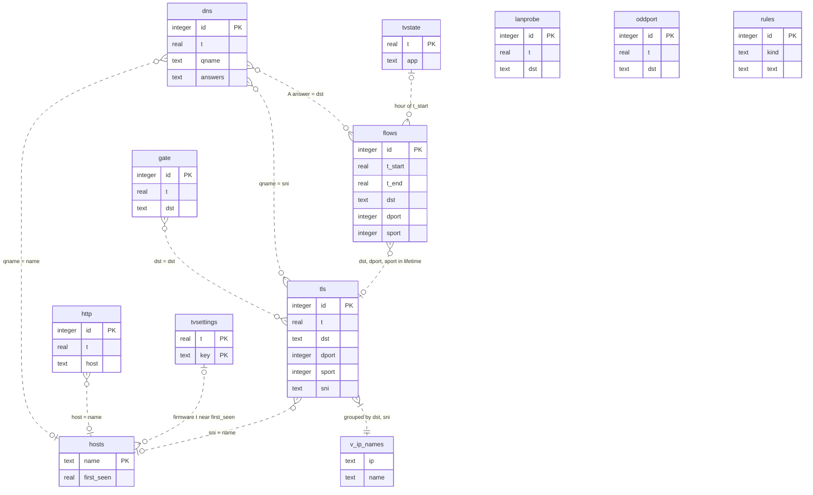
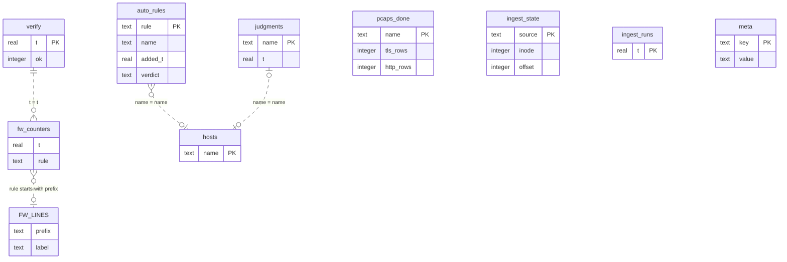
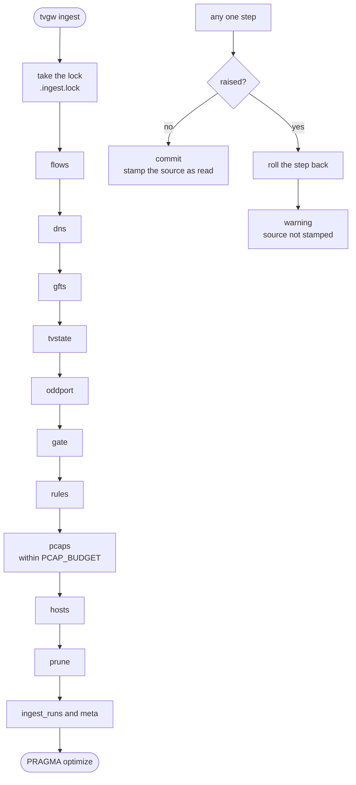

# The store: data model and ingest

This page owns the store as built: the file, the 19 tables and the view in [src/tvgw/db.py](../src/tvgw/db.py), how rows arrive, how they are pruned, and the limits the code still shows. It is for anyone who writes a query against the store, changes ingest or the schema, or checks what a line of the brief counts.

## The file

The store is one SQLite file, `/var/lib/tvgw/tvgw.db` (`Settings.db_path` in `src/tvgw/config.py`). The `DB_PATH` setting moves it; its default is in [the settings file](../deploy/README.md#the-settings-file). Its owner, its mode and who may read it are in [where it lives and who can read it](privacy-and-retention.md#where-it-lives-and-who-can-read-it).

`db.connect` in `src/tvgw/db.py` opens the store for every command except `tvgw analyst` and `tvgw backup`, which call `sqlite3.connect` themselves.

- **A rollback journal, not WAL.** A writer sets `journal_mode=DELETE`. WAL needs `-wal` and `-shm` side files that every reader can write, and the read commands run without root ([design decision 10](design-decisions.md#10-a-rollback-journal-not-wal)).
- **`synchronous=FULL` on every writer.** With a rollback journal, `NORMAL` leaves a window for corruption on power loss. `FULL` costs one fsync per commit.
- **Readers open `mode=ro`.** `db.connect(path, readonly=True)` opens a `file:` URI with `mode=ro`, so a reader needs read access to the one file and nothing else. `tvgw sql` also sets `PRAGMA query_only=1`.
- **A 60-second lock wait.** A connection from `db.connect` waits up to 60 seconds for a lock (`timeout=60`). Writers commit per batch and per pcap, so a reader waits for one batch, never for a whole backlog. The analyst's writer waits up to 30 seconds.
- **The schema on every writer open.** A writer runs `SCHEMA`, where every statement is `CREATE ... IF NOT EXISTS`, then `_migrate`, then stores `SCHEMA_VERSION = 6` (in `src/tvgw/db.py`) in `meta` under `schema`. It then commits before it returns. It has done so since 2026-10-28: before, the open transaction held the write lock until the caller's first commit, and every other writer waited.
- **A new file gets its mode at once.** When `db.connect` creates the file, it sets the restricted mode itself, because the file holds the TV's whole DNS history.

The writers are `tvgw ingest`, `tvgw verify --record`, `tvgw analyst`, `tvgw autoblock` and `tvgw undo`. Every other command only reads. `tvgw backup` copies the store with `VACUUM INTO` from a read-only connection; backups are described in [privacy and retention](privacy-and-retention.md).

## Tables

This is the only column reference for the store. The tables are listed in the order `SCHEMA` creates them. "Pruned" means rows older than `DB_DAYS` are deleted by every ingest run ([pruning and size](#pruning-and-size)).

| Table | One row is | Written by | Pruned |
|---|---|---|---|
| `meta` | One bookkeeping value, by key | `db.connect`, `tvgw ingest`, `tvgw verify --record` | No |
| `ingest_state` | One source's read cursor | `tvgw ingest` | No |
| `ingest_runs` | One ingest run | `tvgw ingest` | Yes |
| `pcaps_done` | One finished pcap, read or given up on | `tvgw ingest` | Own rule |
| `flows` | One finished TV connection | `tvgw ingest` | Yes |
| `dns` | One DNS query from the TV | `tvgw ingest` | Yes |
| `tls` | One TLS ClientHello from the TV | `tvgw ingest` | Yes |
| `http` | One plain-HTTP request from the TV | `tvgw ingest` | Yes |
| `lanprobe` | One TCP connection attempt to a local address | `tvgw ingest` | Yes |
| `tvstate` | One hourly power reading | `tvgw ingest` | No |
| `tvsettings` | One TV setting value, stored when it changes | `tvgw ingest` | No |
| `oddport` | One kernel log line of the unexpected-port rule | `tvgw ingest` | Yes |
| `gate` | One kernel log line of the DNS gate | `tvgw ingest` | Yes |
| `auto_rules` | One block rule the gateway applied on its own | `tvgw analyst`, `tvgw autoblock check`, `tvgw undo` | No |
| `judgments` | The latest verdict on one proposed name | `tvgw analyst` | No |
| `hosts` | One public name seen in `dns`, `tls` or `http` | `tvgw ingest` | No |
| `rules` | One policy rule, with when it appeared and left | `tvgw ingest` | No |
| `verify` | One `tvgw verify --record` run | `tvgw verify --record` | Yes |
| `fw_counters` | One firewall counter in one snapshot | `tvgw verify --record` | Yes |
| `v_ip_names` | One address and TLS name pair (a view) | Derived from `tls` | Not stored |

Times are epoch seconds (`real`) throughout. The natural key given for an evidence table is the set of columns the hardware suite's `test_ingest_twice_duplicates_nothing` treats as one event (`NATURAL_KEYS` in `tests/hardware/test_gateway.py`).

### `meta`

Two columns: `key` (`text`, primary key) and `value` (`text`). The keys, in the order the code writes them:

| Key | Value | Written by | Read by |
|---|---|---|---|
| `schema` | The `SCHEMA_VERSION` of the last writer that opened the file | `db.connect` | The hardware suite only |
| `hosts_wm` | JSON: for `dns`, `tls` and `http`, the row id and `t` of the last row counted into `hosts` | `ingest.refresh_hosts` | `ingest.refresh_hosts` |
| `hosts_profile` | SHA-256 of the profile's `rules` and `strip_prefixes`, the inputs of `categorize()` | `ingest.refresh_hosts` | `ingest.refresh_hosts` |
| `last_vacuum` | When the last vacuum check ran | `ingest.prune` | `ingest.prune` |
| `sources_read` | JSON: each source and the start time of the last run that read it | `ingest.run` | `queries.coverage` |
| `last_warnings` | JSON list of the last run's warnings | `ingest.run` | The hardware suite |
| `last_run` | The start time of the last ingest run | `ingest.run` | `queries.coverage`, the hardware suite |
| `adguard_version` | AdGuard Home's version as `tvgw verify` read it | `verify.record` | `queries.coverage` |

### `ingest_state`

| Column | Type | What it holds |
|---|---|---|
| `source` | `text`, primary key | `flows`, `adguard`, `gfts`, `tvstate`, `oddport` or `gate` |
| `inode` | `integer` | The inode of the file last read; `0` for `oddport` and `gate` |
| `offset` | `integer` | The byte offset after the last complete line read; `0` for `oddport` and `gate` |
| `last_t` | `real` | For a log file, when it was read. For `oddport` and `gate`, the time of the newest event stored |
| `head` | `blob` | The file's first 64 bytes (`HEAD = 64` in `src/tvgw/logtail.py`), its fingerprint |

The `dns` source's cursor is keyed `adguard`, a name older than the source's: renaming it would make every gateway read its whole query log again. `test_tail_state_keys_are_stable` in `tests/unit/test_ingest.py` pins the keys. Only `src/tvgw/ingest.py` reads or writes this table.

### `ingest_runs`

| Column | Type | What it holds |
|---|---|---|
| `t` | `real`, primary key | The start time of the run |
| `seconds` | `real` | How long the run took |
| `stats` | `text` | JSON of the run's counters: rows per source, pcaps read, hosts touched, rows pruned |
| `warnings` | `text` | JSON list of the run's warnings |

`queries.coverage` reads it. A report's Coverage lists the warnings of the runs that started inside its window or within `STALE = 7200` seconds (2 hours, in `src/tvgw/queries.py`) after it, so yesterday's brief does not carry this morning's problems.

### `pcaps_done`

| Column | Type | What it holds |
|---|---|---|
| `name` | `text`, primary key | The pcap's file name |
| `done_at` | `real` | When ingest last tried it |
| `tls_rows` | `integer` | The `tls` rows stored from it |
| `http_rows` | `integer` | The `http` rows stored from it |
| `syn443_rows` | `integer` | The TV's connection attempts to port 443 in it, each counted once |
| `error` | `text` | NULL when the file was read; otherwise the first 200 characters of the failure |
| `attempts` | `integer` | Failed reads so far |

A file is settled when `error` is NULL or `attempts` has reached `PCAP_MAX_ATTEMPTS = 24` (in `src/tvgw/ingest.py`). Ingest skips settled files, and `tvgw prune-pcaps` deletes only settled files (`ingest.deletable_pcaps`). A read that succeeds after failures keeps its attempt count. No column ties a `tls`, `http` or `lanprobe` row to the file it came from; this table keeps the counts only. `queries.coverage` counts the rows with `error` NULL by `done_at`.

### `flows`

| Column | Type | What it holds |
|---|---|---|
| `id` | `integer`, primary key | Row id |
| `t_start` | `real` | `t_end` less conntrack's `delta-time` |
| `t_end` | `real`, not null | When the kernel expired the entry: the timestamp of the `DESTROY` line |
| `proto` | `text` | `tcp`, `udp` or `icmp` |
| `dst` | `text`, not null | The destination address |
| `dport` | `integer` | The destination port; NULL for ICMP |
| `sport` | `integer` | The TV's source port; NULL for ICMP |
| `pkts_up` | `integer` | Packets the TV sent |
| `bytes_up` | `integer` | Bytes the TV sent, IP and TCP headers included |
| `pkts_down` | `integer` | Packets the TV received |
| `bytes_down` | `integer` | Bytes the TV received |
| `state` | `text` | The TCP state at expiry, such as `TIME_WAIT` or `ESTABLISHED`; NULL for UDP and ICMP |

Indexes: `flows_t` on `t_end`, `flows_start` on `t_start`, `flows_conn` on `(dst, sport, t_end)`. Natural key: `(t_end, dst, dport, sport)`.

`ingest_flows` writes one row per `conntrack -E -e DESTROY` line in `flows.log` whose original source is `TV_IP`. The first address tuple of a line is the TV's direction (upload) and the second the reply (download). How late `t_end` runs is in [cadences](architecture.md#cadences). `queries.py` reads the table for Top upload, Periodic connections, By category, Unresolved flows, DNS sent to other resolvers, While off/asleep, By day, `tvgw host` and Coverage; `autoblock.py` reads it for traffic shapes and streaming volume. A flow's name is computed from `tls` when a report runs ([naming a connection](architecture.md#naming-a-connection)).

### `dns`

| Column | Type | What it holds |
|---|---|---|
| `id` | `integer`, primary key | Row id |
| `t` | `real`, not null | AdGuard's time for the query |
| `qname` | `text`, not null | The name asked, lowercased, with no trailing dot |
| `qtype` | `text` | The record type, such as `A`, `HTTPS` or `PTR` |
| `answers` | `text` | The answer records as `A:203.0.113.4,CNAME:cdn.example`; NULL when the record carries none |
| `blocked` | `integer`, not null | `1` for AdGuard reasons 3 to 8 (the `Filtered` reasons); `0` otherwise, rewrites included |
| `reason` | `text` | AdGuard's reason name, such as `FilteredBlockList` or `RewrittenRule` |
| `rule` | `text` | The text of the first matching rule, cut at 2,000 characters |
| `filter_id` | `integer` | The list id of that rule |
| `upstream` | `text` | The upstream that answered |
| `cached` | `integer` | `1` when AdGuard answered from its cache |
| `elapsed_ms` | `real` | AdGuard's time for the query, in milliseconds |

Indexes: `dns_t` on `t`, `dns_q_t` on `(qname, t)`. Natural key: `(t, qname, qtype)`.

`ingest_dns` writes one row per record in AdGuard's query log (`querylog.json`, one JSON record per line) whose client is `TV_IP`. A line that is not a record is counted as malformed; other fields of an oddly typed record are converted to their column's type, so one record cannot roll back the hour. Most brief sections read this table, and `autoblock.shapes` reads it for the number of days a name was looked up.

### `tls`

| Column | Type | What it holds |
|---|---|---|
| `id` | `integer`, primary key | Row id |
| `t` | `real`, not null | The capture time of the hello |
| `dst` | `text` | The destination address |
| `dport` | `integer` | The destination port |
| `sport` | `integer` | The TV's source port |
| `sni` | `text`, not null | The server name, lowercased, at most 255 characters (`NAME_MAX = 255` in `src/tvgw/tshark.py`) |
| `ech` | `integer` | `1` when the hello carried the `encrypted_client_hello` extension (`0xfe0d`), `0` when it did not; NULL in rows stored before schema 4 |

Indexes: `tls_t` on `t`, `tls_sni` on `sni`, `tls_conn` on `(dst, sport, t)`. Natural key: `(t, dst, sport)`.

`ingest_pcaps` writes one row per hello from `TV_IP` that tshark returns with a server name. The ports are the TCP ports, or the UDP ports when the packet has no TCP header. Every flow name (`queries.FLOW_NAME`), Blocked names still reached over TLS, the ECH red line, the DNS-gate samples, Unresolved flows, `tvgw host` and `v_ip_names` read it.

### `http`

| Column | Type | What it holds |
|---|---|---|
| `id` | `integer`, primary key | Row id |
| `t` | `real`, not null | The request's time |
| `host` | `text` | The Host header, lowercased |
| `method` | `text` | The request method; NULL in `gfts` rows from before 2026-10-27, when nginx's log format gained it |
| `uri` | `text` | The request URI with its query string, cut at 2,000 characters |
| `ua` | `text` | The user agent, cut at 300 characters |
| `status` | `integer` | The status nginx logged; NULL in `pcap` rows |
| `bytes` | `integer` | The body bytes nginx sent; NULL in `pcap` rows |
| `src` | `text`, not null | `pcap` or `gfts` |

Indexes: `http_t` on `t`, `http_host` on `host`. Natural key: `(t, host, uri, src)`.

`ingest_gfts` writes the `gfts` rows from nginx's URL-filter log (`gfts.log`) for requests whose client is `TV_IP`. `ingest_pcaps` writes the `pcap` rows for the TV's requests to any address but the gateway: a request to the gateway is already in nginx's log with its status and bytes, and storing the capture's copy too would count it twice. The GFTS URL filter and Plain HTTP sections and `tvgw host` read it.

### `lanprobe`

| Column | Type | What it holds |
|---|---|---|
| `id` | `integer`, primary key | Row id |
| `t` | `real`, not null | The time of the SYN |
| `dst` | `text`, not null | A private, loopback, multicast or broadcast address other than the gateway |
| `proto` | `text` | Always `tcp` |
| `dport` | `integer` | The port the TV tried |

Index: `lanprobe_t` on `t`. Natural key: `(t, dst, dport)`.

`ingest_pcaps` writes one row per TCP SYN without ACK from the TV to such an address (`names.is_local_address`). A retransmitted SYN, with the same source port, address and port in the same pcap, is the same attempt and one row. The LAN probes section reads it; the analyst's pack carries only the count.

### `tvstate`

| Column | Type | What it holds |
|---|---|---|
| `t` | `real`, primary key | The reading's time |
| `power` | `text` | The webOS power state (`Active`, `Active Standby`, `Screen Off`); `unreachable` when the TV did not answer; `unknown` when it answered and the power read failed |
| `app` | `text` | The foreground app id; NULL when there is none |

`ingest_tvstate` writes one row per line of `tvcheck-history.log`, which `tvgw-analyze` appends every hour for the `lg-webos` profile. A line read again replaces its reading. The fields are tab-separated because webOS states contain spaces; older space-separated lines still read. The brief counts anything but `Active` as off. While off/asleep, the TV section, Coverage, the analyst's pack, `autoblock.shapes` (the app on in each hour) and `autoblock.streaming_rate` (TV hours) read it.

### `tvsettings`

| Column | Type | What it holds |
|---|---|---|
| `t` | `real`, primary key with `key` | The time of the reading that saw the value |
| `key` | `text`, primary key with `t` | The setting, such as `option.livePlus`, `network.deviceName`, `firmware` or `model` |
| `value` | `text` | Its value |

`ingest_tvstate` reads `tvcheck.txt`, the last LAN-API reading, and stores a value only when it differs from the last value stored for its key. A read error (a value that starts `ERR `) and the `power`, `app` and `info` lines are not settings and are not stored. The TV settings and Firmware sections, the Live Plus red line, `tvgw profile` (the stored model) and the analyst's pack read it.

### `oddport`

| Column | Type | What it holds |
|---|---|---|
| `id` | `integer`, primary key | Row id |
| `t` | `real`, not null | The kernel's time for the line |
| `proto` | `text` | `PROTO=` from the line |
| `dst` | `text` | `DST=` from the line |
| `dport` | `integer` | `DPT=` from the line |
| `raw` | `text` | The line's last 400 characters |

Index: `oddport_t` on `t`. Natural key: `(t, raw)`.

`ingest_oddport` writes one row per journal line carrying the `tvgw-oddport` prefix, which the unexpected-port rule in `tv_out` logs at most 6 times a minute. The Unexpected ports section and Coverage read it.

### `gate`

The same six columns as `oddport`, with index `gate_t` on `t` and natural key `(t, raw)`. `ingest_gate` writes one row per journal line carrying the `tvgw-gate` prefix: the DNS gate's sample, at most 6 a minute, of a new TV connection to an address no lookup returned ([design decision 18](design-decisions.md#18-dns-gated-egress-starts-as-a-count-in-its-own-table)). The DNS-gated egress section and Coverage read it.

### `auto_rules`

| Column | Type | What it holds |
|---|---|---|
| `rule` | `text`, primary key | The AdGuard rule, as written in the machine's rules file |
| `name` | `text` | The name it blocks |
| `added_t` | `real`, not null | When the rule was applied |
| `source` | `text` | The stem of the proposals file it came from: a day, an ISO week or an hours window |
| `proposer` | `text` | The model that proposed it |
| `verifier` | `text` | The model that cleared it |
| `verifier_reason` | `text` | The verifier's reason, cut at 1,000 characters |
| `trial_until` | `real` | `added_t` plus `TRIAL` |
| `verdict` | `text` | NULL while on probation; then `passed` or `reverted` |
| `decided_t` | `real` | When the verdict was reached |
| `reason` | `text` | Why, cut at 500 characters |

`autoblock.record` inserts or replaces the row once AdGuard has taken the rule; `autoblock.decide` sets the verdict. `tvgw autoblock list`, the brief's "Rules the gateway added on its own" section, the hourly judge and the daily cap read it. What the gateway does with these rows is in [the analyst and autonomous blocking](analyst-and-autonomy.md).

### `judgments`

| Column | Type | What it holds |
|---|---|---|
| `name` | `text`, primary key | The name a proposal was about |
| `kind` | `text`, not null | The proposal's kind: `block`, `allow`, `unblock`, `watch` or `question` |
| `t` | `real`, not null | When the verdict was recorded |
| `source` | `text` | The stem of the proposals file |
| `reason` | `text` | The proposal's reason, cut at 300 characters |

`autoblock.remember` writes one row per proposal after each analyst run that made a request, replacing the name's earlier row. A block the gates refused for too little evidence, the daily cap or a transient failure is not written, so the name is asked about again. `autoblock.judged_recently` reads the verdicts of the last 7 days for the analyst's pack and its novelty check.

### `hosts`

| Column | Type | What it holds |
|---|---|---|
| `name` | `text`, primary key | A public DNS name, lowercased, with no trailing dot or port |
| `first_seen` | `real` | The earliest row time counted for it |
| `last_seen` | `real` | The latest row time counted for it |
| `category` | `text` | The profile's category for it (`profile.categorize`) |
| `dns_n` | `integer` | `dns` rows counted |
| `tls_n` | `integer` | `tls` rows counted |
| `http_n` | `integer` | `http` rows counted |
| `last_blocked` | `integer` | `blocked` of the newest `dns` row for the name at the last refresh |
| `last_rule` | `text` | `rule` of that row |
| `notes` | `text` | Free text; no command writes it, and a rebuild keeps the rows that have it |

`ingest.refresh_hosts` writes it at the end of each ingest run ([how rows arrive](#how-rows-arrive)). New hosts, Firmware, `tvgw host`, Periodic connections (the category) and `autoblock.streaming_rate` (the category of each named flow) read it.

### `rules`

| Column | Type | What it holds |
|---|---|---|
| `id` | `integer`, primary key | Row id |
| `kind` | `text`, not null | `adguard`, `gfts-block` or `block4` |
| `text` | `text`, not null | The rule's text |
| `first_seen` | `real`, not null | The first ingest run that saw it |
| `last_seen` | `real`, not null | The latest ingest run that saw it |
| `removed_at` | `real` | The first run that no longer saw it; NULL while it is in place |

`ingest_rules` reads three policy files on every run: the `user_rules` of `AdGuardHome.yaml` (`adguard`: the profile's rules and the machine's together), each `$request_uri ~*` pattern in the installed nginx URL-filter file (`gfts-block`), and each address or range in `block4.txt` (`block4`). A rule that comes back after it was removed gets a new row. `tvgw rules` and the Rule changes section read it.

### `verify`

| Column | Type | What it holds |
|---|---|---|
| `t` | `real`, primary key | The time of the run |
| `ok` | `integer`, not null | `1` when every check passed |
| `failures` | `text` | JSON list of the failures |

`verify.record` writes one row per `tvgw verify --record` run. The Firewall held line, the verify red lines and Coverage, which treats the watchdog as a source, read it. What the checks are: [what tvgw verify checks](troubleshooting.md#what-tvgw-verify-checks).

### `fw_counters`

| Column | Type | What it holds |
|---|---|---|
| `t` | `real`, not null | The snapshot's time, the same as the `verify` row's |
| `rule` | `text`, not null | The rule's nftables comment |
| `packets` | `integer` | Its packet counter |
| `bytes` | `integer` | Its byte counter |

Indexes: `fw_counters_rule_t` on `(rule, t)`, `fw_counters_t` on `t`. The table has no primary key. `verify.record` writes one row per commented counter in the tables `inet tvgw`, `netdev tvgw_l2` and `inet tvgw_gate`. Two rules that share a comment give two rows per snapshot (the two DNS redirects in `pre_nat` do), and `queries.fw_activity` sums them per snapshot. The Firewall held line reads it ([design decision 13](design-decisions.md#13-counters-not-logs-prove-the-firewall-held)).

### `v_ip_names`

A view: `SELECT dst AS ip, sni AS name, COUNT(*) AS n, MAX(t) AS last_t FROM tls GROUP BY dst, sni`. It lists which TLS names were seen on which address. No module reads it; it is there for `tvgw sql`.

## Entity relationships

No table in the store declares a foreign key, so SQLite enforces none. Every relationship below is a join the code makes:

- **`flows` and `tls`.** A flow takes the server name of the hello with the same `dst`, `dport` and `sport` whose `t` lies between the flow's `t_start` less `FLOW_SLACK` and its `t_end`; the latest such hello wins (`FLOW_NAME` in `src/tvgw/queries.py`, explained in [naming a connection](architecture.md#naming-a-connection)).
- **`dns`, `tls` and `http` into `hosts`.** `refresh_hosts` counts `dns.qname`, `tls.sni` and `http.host` into `hosts.name` after normalizing them, public names only.
- **`dns` and `tls`.** Blocked names still reached over TLS matches `tls.sni` to `dns.qname`.
- **`dns` and `flows`.** Unresolved flows looks for each `flows.dst` among the `A:` records of `dns.answers` in the window and the day before.
- **`gate` and `tls`.** Each DNS-gate sample takes the server name of the latest hello in the window to its `dst`.
- **`tvstate` and `flows`.** `autoblock.shapes` gives each flow the app of the reading in the hour its `t_start` falls in; While off/asleep counts the flows that started between two off readings.
- **`tvsettings` and `hosts`.** The Firmware section lists the names whose `first_seen` lies from 1 hour before a new `firmware` value's reading to 72 hours after it.
- **`v_ip_names`** is `tls` grouped by `dst` and `sni`.



*SQLite enforces no foreign keys here; every relationship is a join the queries make.*

The control and bookkeeping tables join less. `fw_counters` rows share their `t` with the `verify` row of the same run. `queries.FW_LINES` maps each comment prefix to the label the brief prints, so `fw_counters.rule` joins it by prefix; renaming a comment in `tvgw-apply` drops its line from the brief ([design decision 13](design-decisions.md#13-counters-not-logs-prove-the-firewall-held)). `auto_rules.name` and `judgments.name` are names the analyst saw, the same names `hosts` holds. `pcaps_done`, `ingest_state`, `ingest_runs` and `meta` join nothing.



*These tables record what the gateway did and how far ingest has read, and their relationships are logical joins.*

## How rows arrive

`tvgw ingest` (`ingest.run` in `src/tvgw/ingest.py`) loads every source in one run. The hourly `tvgw-analyze` job runs it ([units](../deploy/systemd/README.md#units)); a run by hand is safe, because every step reads only what the store does not have yet.



*Each source commits on its own, so one failure costs one source, not the hour.*

### The run

The run takes an exclusive `flock` on `.ingest.lock` in the state directory, so two runs never interleave, and opens the store as a writer. Then it runs ten steps in a fixed order: `flows`, `dns`, `gfts`, `tvstate`, `oddport`, `gate`, `rules`, `pcaps`, `hosts` and `prune`. The cheap sources come first. tshark is the slow one, and running it within a budget means a backlog of pcaps cannot starve the steps after it before the unit's timeout (`test_the_cheap_sources_are_read_before_the_pcaps` in `tests/unit/test_ingest_gaps.py`).

Each step is its own transaction. A step that raises is rolled back and becomes a warning, and the other steps still land. A source whose input does not exist (a log file, the pcap directory) raises `SourceMissing`, which becomes the warning "`<source>`: `<path>` is missing". The `tvstate` history is the exception and is silent, since it exists only for a profile with a LAN-API reader (`OPTIONAL_SOURCES` in `src/tvgw/ingest.py`). A step that fails or has no input is not stamped as read. After `STALE` seconds, Coverage therefore calls that source `NOT ASSESSED` instead of reporting an empty hour ([design decision 14](design-decisions.md#14-red-lines-are-the-alarm-model)).

At the end the run writes its `ingest_runs` row, the `sources_read`, `last_warnings` and `last_run` keys of `meta`, commits, and runs `PRAGMA optimize`. The exit status of `tvgw ingest` reflects the run's warnings ([commands](../src/tvgw/README.md#commands)).

### Log files: flows, dns, gfts and tvstate

These four sources read a growing file from a stored cursor (`logtail.read_new_lines`):

- **Cursor.** `ingest_state` keeps the file's inode, the byte offset after the last complete line, and the file's first 64 bytes. Everything about the file comes from one open descriptor, so a rotation between two steps cannot pair one file's inode with another's offset.
- **Batches.** Lines are read `BATCH = 10_000` at a time (in `src/tvgw/ingest.py`), and each batch is committed together with the cursor that covers it. Rows and cursor land as one, a run that dies loses only the batch in flight, and a backlog, such as the 90-day query log after a lost store, neither fills memory nor holds the write lock for the whole run.
- **Rotation.** A new inode means the file was renamed to `<path>.1` (AdGuard's way); the same inode with a smaller size or a different beginning means `copytruncate` (logrotate's way, for the files in `/var/log/tvgw`). Either way the rest of the old file is read from `<path>.1` first, when that file is still the one the cursor knew. When lines are known to be lost, because the file was rotated twice or truncated with no copy, the run warns that the lines written before it could not be recovered.
- **Partial lines.** A last line without its newline waits for the next run.
- **Malformed lines.** The flow and URL-filter logs are written by machines in one format each, so a line that does not parse is counted and reported in one warning per source, like a malformed query-log record.
- **Filters.** Only the TV's rows are kept: flows whose source is `TV_IP`, queries whose client is `TV_IP`, nginx lines whose client is `TV_IP`. A `TV_IP` that is not an address is refused when the settings load, because a typo would record nothing while every source counted as read.

The `tvstate` step also reads `tvcheck.txt`, whose first line is `read <time>`, and stores each setting that changed (see [tvsettings](#tvsettings)).

### Kernel log: oddport and gate

Both steps ask the journal for kernel lines carrying their prefix. On the Pi, each step runs:

```sh
journalctl -q --no-pager -o short-unix -g <prefix> --since @<last_t> _TRANSPORT=kernel
```

`_TRANSPORT=kernel` stands in for `-k`, which implies `-b` and so hides every line written before the last reboot. `--since` has 1-second granularity, so the step asks from the second of the newest stored event and skips lines at or before it. The first run asks for the last 30 days. A `journalctl` that exits non-zero with an error message raises, because a silent empty answer would look like a quiet log; a non-zero exit with nothing on stderr is a quiet journal.

### Rule history

The `rules` step reads the three policy files listed under [rules](#rules). A kind whose file cannot be read, or whose `AdGuardHome.yaml` has no `user_rules` list, is unknown, not empty: the run warns, and that kind's rules stay open rather than all being marked removed.

### Pcaps

The `pcaps` step reads each finished hourly file once:

1. **Finished files.** A file is finished when no `tcpdump` process holds it open, which `pcaps.live_files` reads from `/proc`. With `tcpdump` down, every file is finished. When the answer cannot be had (no `/proc`, or not root), the step reads nothing and warns, because reading a file `tcpdump` is still writing would record part of an hour as the whole hour.
2. **Order and budget.** Unsettled files are read in name order until `PCAP_BUDGET = 20 * 60` seconds (20 minutes, in `src/tvgw/ingest.py`) of wall time have passed; the rest wait for the next run with a warning.
3. **Short files.** A file under `PCAP_HEADER = 24` bytes, the size of a pcap header, is marked "not a capture file" without running tshark.
4. **One tshark pass.** tshark reads the file inside a sandbox ([trust boundaries](architecture.md#trust-boundaries)) and returns hellos, HTTP requests and SYNs. Exit status 2 counts as success only when tshark's message says the file was cut short, which is normal for a capture; a file it cannot open also exits 2.
5. **Rows.** The step writes the TV's hellos to `tls`, its HTTP requests to anywhere but the gateway to `http`, and its SYNs to local addresses to `lanprobe`. It counts the TV's distinct connection attempts to port 443, and warns when a file holds `SYN_CHECK = 20` or more of them and not one hello: an extraction fault looks exactly like a quiet hour otherwise (the 2026-10-27 incident in [the incident log](incidents.md)).
6. **Mark and commit.** The file's `pcaps_done` row and its rows commit together, file by file.
7. **Failures.** A failed read raises the file's `attempts` and records the error. The file is retried on each run until `PCAP_MAX_ATTEMPTS`, then recorded as unreadable with a warning. One warning per run covers every file that failed in it.

### Hosts

The `hosts` step (`refresh_hosts`) counts each new `dns`, `tls` and `http` row once, by row id ([design decision 11](design-decisions.md#11-row-id-watermarks-for-the-hosts-counters)):

- **Watermark.** `meta.hosts_wm` holds, per table, the id and time of the last row counted. The step counts the rows above it up to the newest, keeps public names only (`names.is_public_name`), and upserts each name's first and last seen, counters, category, and the verdict and rule of its newest `dns` row. A row is counted once however late it arrives.
- **Rebuild.** With no usable watermark, or when the watermark's row is gone or carries another time, the step rebuilds the table. The tables have no `AUTOINCREMENT`, so SQLite reuses row ids once a table empties, and ids below the watermark may be new rows. A rebuild deletes every `hosts` row without `notes`, resets the counters of the rest, and counts the base tables again; the counters then mean the rows the store still holds. A watermark in the bare-id form of earlier versions is trusted once and rewritten.
- **Categories.** When the SHA-256 of the profile's `rules` and `strip_prefixes` differs from `meta.hosts_profile`, every name's category is computed again, so a profile change shows without waiting for each name to be seen again.

## Pruning and size

The `prune` step deletes, from these tables, the rows older than `DB_DAYS` days, judged by the column shown:

| Table | Column |
|---|---|
| `flows` | `t_end` |
| `dns` | `t` |
| `tls` | `t` |
| `http` | `t` |
| `lanprobe` | `t` |
| `oddport` | `t` |
| `gate` | `t` |
| `verify` | `t` |
| `fw_counters` | `t` |
| `ingest_runs` | `t` |

`tvstate`, `tvsettings`, `hosts`, `rules`, `auto_rules`, `judgments`, `meta` and `ingest_state` are never pruned; they grow slowly. A `pcaps_done` mark goes once its `done_at` is more than 7 days old and its file is gone from the pcap directory, because a mark deleted while its file remains would have the file ingested twice. How long the pcap files themselves, and every other copy of the data, are kept is in [privacy and retention](privacy-and-retention.md).

Every 30 days, judged by `meta.last_vacuum`, the step checks the file's free pages. It records the attempt and commits first, so a `VACUUM` that fails on a full card is not retried every hour. It then runs `VACUUM` only when at least a quarter of the file's pages are free (`freelist_count * 4 >= page_count`). Steady-state churn reuses freed pages; only a lowered `DB_DAYS` or a deletion by hand leaves a file worth rewriting under an exclusive lock.

`tvgw size` prints the row count of each table in `db.TABLES` (`src/tvgw/db.py`), the time of the oldest `dns` row, and the file's size. `db.TABLES` leaves out `gate`, `auto_rules`, `judgments`, `meta` and `ingest_state`, so their rows are not counted. The size is the byte count divided by `1e6`, so its "MB" is 1,000,000 bytes, not 1,048,576; `tvgw ingest` prints the store's size the same way.

On the Pi:

```sh
tvgw size
tvgw sql "SELECT COUNT(*) FROM gate"
```

## Schema changes

`SCHEMA` in `src/tvgw/db.py` is applied on every writer open, so the change you make takes effect at the first ingest after a deploy:

1. To add a table or an index, add its `CREATE ... IF NOT EXISTS` statement to `SCHEMA`.
2. To add a column to a table that has shipped, add it to the `CREATE TABLE` statement and add `(table, column, type)` to `ADDED_COLUMNS`. `CREATE TABLE IF NOT EXISTS` leaves an existing table alone; `_migrate` runs `ALTER TABLE ... ADD COLUMN` for each listed column a table lacks.
3. To drop an index, add its name to `DROPPED_INDEXES`; `_migrate` drops it on every open.
4. Raise `SCHEMA_VERSION`. The hardware suite's `test_store_is_fresh_sound_and_at_the_current_schema` fails until the live store carries the new number.
5. Add a test that opens a store in the old shape and checks the new one, as `test_pcaps_done_gains_its_newer_columns_on_an_old_store` and `test_ingest_state_gains_the_head_column_on_an_old_store` in `tests/unit/test_ingest.py` and `test_schema_3_drops_the_superseded_indexes_and_adds_the_time_indexes` in `tests/unit/test_parsers_gaps.py` do.

Changing a column's type or meaning has no mechanism: `_migrate` only adds columns and drops indexes. Old files are then yours to handle.

| Version | What changed | Source |
|---|---|---|
| 2 | `dns(qname, t)` and `tls(dst, sport, t)` indexes; `lanprobe`, `verify`, `fw_counters`; the `hosts` watermarks | The comment above `SCHEMA_VERSION` |
| 3 | Time indexes on `oddport` and `fw_counters`; `flows(t_start)` and `flows(dst, sport, t_end)`; `ingest_runs`; `tls_dst` and `flows_dst` dropped | The comment above `SCHEMA_VERSION`, CHANGELOG (Ingest and store) |
| 4 | `tls.ech`, for the ECH canary | `ADDED_COLUMNS`, CHANGELOG (DNS hardening) |
| 5 | `gate` | CHANGELOG (DNS-gated egress) |
| 6 | `auto_rules` and `judgments` | CHANGELOG (Autonomous blocking) |

On the Pi, the live schema:

```sh
tvgw sql "SELECT value FROM meta WHERE key = 'schema'"
tvgw sql "SELECT name, sql FROM sqlite_master WHERE type IN ('table', 'view')"
```

## Known limits

The current code shows these limits. Each names the file where it lives.

- **Flows are counted in the hour they expired.** Every flow query that takes a window, except Periodic connections and While off/asleep, filters on `t_end` (`src/tvgw/queries.py`, and `shapes` and `streaming_rate` in `src/tvgw/autoblock.py`). `t_end` is when the kernel expired the entry, which `src/tvgw/conntrack.py` documents as one idle timeout after the last packet: 120 seconds after a normal close, 7440 s (2 h 04 min) after an established connection went quiet. A connection the TV abandons at power-off therefore lands up to 2 hours later, and bytes from the end of a day move into the next.
- **The naming join's premise.** `FLOW_SLACK = 300` and the docstring of `src/tvgw/queries.py` answer a start time that "runs late by up to a minute". The late end that `src/tvgw/conntrack.py` documents is `t_end`, and the join's window runs to `t_end`. So a later connection on the same `dst`, `dport` and TV source port that begins inside the earlier flow's expiry tail lends its name to the earlier flow, because the latest hello wins. And the 300 seconds of slack before `t_start` let a flow with no hello of its own take the name of an earlier connection on the same ports.
- **Unresolved flows is generous and blind to plain HTTP.** `unresolved_flows` in `src/tvgw/queries.py` exempts an address when any hello at any time in the store went to it. `http` has no `dst` column (`src/tvgw/db.py`), so a plain-HTTP connection to a hardcoded address is listed as unresolved although its Host header is in the store.
- **Coverage counts pcaps by when they were read.** `coverage` in `src/tvgw/queries.py` counts `pcaps_done` rows by `done_at`, not by the hour each file covers.
- **A hello without a server name is never stored.** tshark's display filter requires `tls.handshake.extensions_server_name` (`FILTER` in `src/tvgw/tshark.py`), and `tls.sni` is `NOT NULL`.
- **A hello's transport is not recorded.** `parse_row` in `src/tvgw/tshark.py` takes the UDP ports when a packet has no TCP ones, and `tls` has no transport column, so a row does not say whether the hello came over TCP or UDP.
- **UDP to local addresses is captured and never stored.** The capture keeps the TV's UDP (`deploy/systemd/tvgw-pcap.service`), but `lanprobe` rows come from TCP SYNs only (`ingest_pcaps` in `src/tvgw/ingest.py`), so SSDP and mDNS probes do not reach the store.
- **The URL filter's own 403 is not told from the real host's.** `src/tvgw/gfts.py` parses `$upstream_status`, which tells the two apart, but `ingest_gfts` stores no column for it, and the GFTS URL filter section groups by status alone.
- **A rebuild of `hosts` forgets names.** A rebuild deletes every row without `notes` and counts only the rows the store still holds (`refresh_hosts` in `src/tvgw/ingest.py`). A name whose rows were all pruned loses its first-seen time, and shows as first seen if it comes back.
- **Nothing reads the stored schema version.** `db.connect` writes its own `SCHEMA_VERSION` over whatever the file says (`src/tvgw/db.py`). An older build that opens a newer store stamps the older number, and only the hardware suite compares the two.
- **`tvgw size` leaves tables out.** `db.TABLES` in `src/tvgw/db.py` omits `gate`, `auto_rules` and `judgments`, as well as `meta` and `ingest_state`.
- **A counter reset can hide packets.** `fw_activity` in `src/tvgw/queries.py` reads a snapshot lower than the one before it as a reset. A re-apply whose new count already exceeds the old one reads as growth, and the interval undercounts by the old count.
