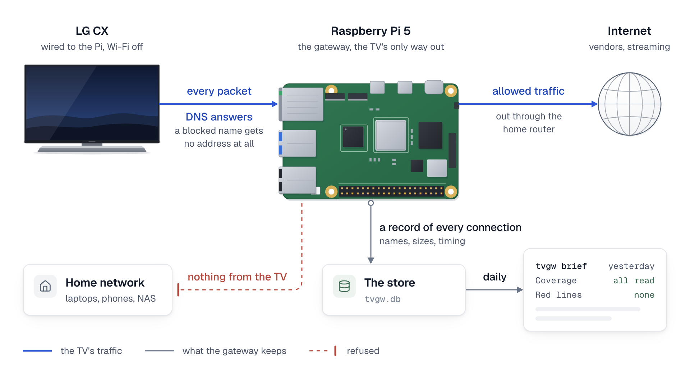

# How tvgw works, in pictures

tvgw puts the TV on a network of its own behind the gateway, filters the names it looks up and records what it does, and [the architecture](architecture.md) explains each part.

## How it fits together

The TV is cabled to the gateway's `eth0` and gets a fixed address from dnsmasq (`TV_IP` and `GW_IP` in [the settings file](../reference/settings.md)). Every packet it sends meets the firewall, table `inet tvgw`, and after it the guard, `inet tvgw_guard`, which can only narrow what the firewall allows ([the firewall](../../deploy/nftables/README.md)). DNS goes to AdGuard Home, which answers the names of LG's file service with the gateway's address (`GW_IP`), so the TV's requests to that service reach the nginx URL filter on the gateway, and the rest leaves through `WAN_IF` to the home router (`UPLINK=direct`, [design decision 1](../design-decisions.md#1-the-tv-uses-the-direct-uplink-not-the-vpn)). Nothing from the TV reaches the home LAN.

AdGuard Home forwards the lookups it allows to its DoH upstreams as the gateway's own traffic, which takes the VPN tunnel when one runs: the `VPN_IF` setting names it, and its default, `auto`, finds `tun0`, else `wgpia0` (PIA's OpenVPN and WireGuard interfaces). nginx proxies the downloads it allows. `tvgw-pcap` and `tvgw-flowlog` record the TV's traffic, and the hourly ingest loads their files and AdGuard's query log into the store, `tvgw.db`. `tvgw analyst` builds its evidence pack from the store and sends it to the Anthropic API only when the key file exists. With `ANALYST_APPLY=auto` it writes `auto.rules` and re-applies AdGuard Home. `tvgw-doh-update` fetches the DoH resolver list from `DOH_LIST_URL` and reloads the `doh4` set. The owner's workstation deploys and pulls backups over ssh, and GitHub Actions deploys through a self-hosted runner on the gateway ([how a change reaches the gateway](../../deploy/README.md#how-a-change-reaches-the-gateway)).

<picture>
  <source media="(prefers-color-scheme: dark)" srcset="../diagrams/fig-1-gateway.dark.png">
  
</picture>

*The TV's one cable runs to the gateway, which answers every DNS question the TV asks so that a blocked name gets no address at all, lets the allowed rest out through the home router but never into the home network, and keeps a record of every connection for the daily brief.*
