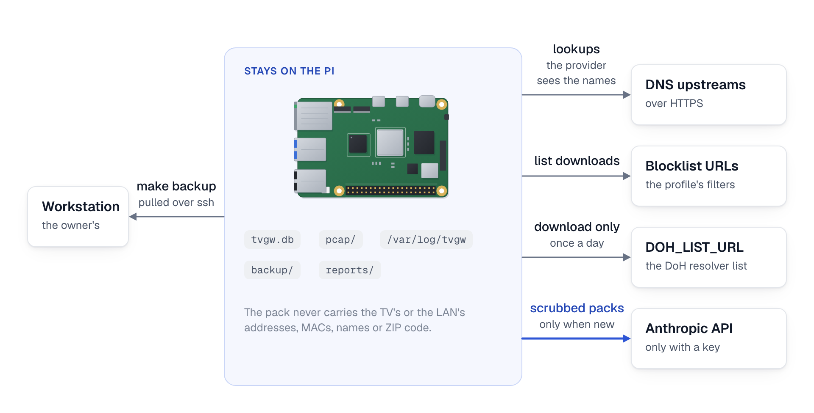

# Privacy and retention

This page owns what the gateway records about the household, how long it keeps each kind of data, who on the gateway can read it, and what it sends off the gateway. It is for the owner and the household, and for anyone auditing what the gateway records, keeps and sends. The settings that keep less, how to forget the record, and a one-page notice the owner may post are in [your household's privacy](../use/privacy.md).

## What the store holds

The store is one SQLite file, `/var/lib/tvgw/tvgw.db`, with 29 tables and one view (`SCHEMA` in `src/tvgw/db.py`). Treat it as personal data. Its `dns`, `tls` and `flows` rows together are a minute-by-minute record of what the household watched and when: which services and apps, at what hours, for how long, and how much video each one moved. The hourly `tvstate` readings add which app was in the foreground.

Ingest stores only the TV's own traffic. A flow, a lookup, a TLS hello, a plain-HTTP request or a connection attempt is stored only when its source is `TV_IP` (`src/tvgw/ingest.py`). The three kernel-log tables, `oddport`, `gate` and (acr) `adport`, hold what the firewall logged for the TV subnet.

The groups below follow the order in which `SCHEMA` creates the tables. Every column is in [the table reference](../reference/data-model.md#tables).

(app in front) With `LIVE_READING=on` the store also holds `tv_events`: each change of the TV's power state and of the app in front, at the second it happened. That is a finer viewing record than the hourly readings in `tvstate`, so it has its own, shorter span (`TV_EVENTS_DAYS`, pruned at the hourly ingest whether or not the log is still there). Its rows are in the store, which `root` and the `adm` group read (`640`); its own log, `tvlive-events.log`, is root's alone (`0600`). It is never part of the analyst's pack, and it is never written into a persisted report: the brief's "App in front" section and `tvgw receipt` are computed for an interactive run only, so the minute-level record does not land in `reports/`. (did it work) The same holds for the app starts that may have failed: a persisted report carries only how many there were, and the lines that name the app, the time and the name refused in its minutes are computed for an interactive run. `tvgw receipt --evaluate` prints app identifiers, registrable domains, categories and counts from it, never a time. Each app's picture (which domains were seen with it, on how many days) is worked out from it and from `tls` at each command and is stored nowhere.

(attention) With it on, the store also holds `attention`: each connection the attention count counted outside the TV's essentials, with its time to the second and the state the TV was in (the screen saver on, an input or live TV), and the count's `attention:` counters ([design decision 69](../design-decisions.md#69-the-tvs-own-state-held-by-entries-that-expire-and-a-count-of-what-a-wall-keyed-to-it-would-refuse)). They say when the TV was idle, so they are kept as long as `tv_events` and no longer (`TV_EVENTS_DAYS`), and `tvgw forget` removes both, the samples and the counters. The count's samples wait up to 3 hours in the kernel's memory before the hourly ingest stores them, and never reach the journal. The live reading's word of the state, `/run/tvgw-tvlive/attention`, and the holder's status, `/run/tvgw-attention/status.json`, are in memory and overwritten in place: neither is a record, and each goes when its service stops. The brief's Attention section and the plain brief's `Screen saver and inputs:` line carry counts per state and service for their window, never a time of day; the time the TV spent in each state is shown only in an interactive brief, never in a saved report.

| Group | Tables | What it tells about the household |
|---|---|---|
| Bookkeeping | `meta`, `ingest_state`, `ingest_runs`, `pcaps_done` | When each source was read, the read position in each log, one row per ingest run with its counters and warnings, and which pcaps were read. Times of activity, little else. |
| What the TV did | `flows`, `dns`, `tls`, (namebound) `answer_ip`, `tls_noname`, `http`, `lanprobe` | Every lookup with its answers and the rule that matched, every TLS server name, every connection with its times, destination, ports, packets and bytes each way, every plain-HTTP request with host, method, URL including the query string and user agent, and every connection attempt to an address no internet host answers from (the home-LAN ranges, loopback, multicast, broadcast). A probed address can belong to one of your own devices or to a network the TV remembers. (namebound) `answer_ip` repeats no name: it says which address each lookup's answer gave and when, keyed to the lookup. |
| The TV itself | `tvstate`, `tvsettings` | One power reading and foreground app an hour. Each setting the LAN API reads, stored when first read and whenever its value changes: Live Plus (ACR), the ZIP code and country the TV holds, its device name, Wake-on-LAN, SimpLink, store mode, audio guidance, firmware, platform code and model (`READS` in `src/tvgw/lgwebos.py`). (ledger) Also the TV's consent record: one `eula.<flag>` key per agreement in `eulaStatus` (Viewing Information, voice, advertising and the others; `true`, `false` or `unknown`) and `network.bleAdvertisingOnOff`. They say which agreements the household accepted. The analyst's pack carries their values when they change (`PACK_SETTINGS` names `network.bleAdvertisingOnOff`, and `PACK_SETTING_PREFIXES` every `eula.` key): each is a switch, `true`, `false` or `unknown`, and names nobody. |
| What the firewall logged | `oddport`, `gate`, `adport`, `gate_inpath` | Traffic to unexpected ports, (acr) sampled attempts on LG's ad-tech ports, and sampled connections to addresses no lookup returned ((inpath) `gate_inpath` holds the same for the gate's second count, only with `DNSGATE_FILL=inpath`). The `raw` column keeps the kernel's log line without the gateway's host name and with the frame's MAC header emptied (`MAC=`); ingest strips both before it stores the line, and stripped the rows stored before once (`scrub_kernel_line` in `src/tvgw/minimize.py`). |
| The machine's decisions | `auto_rules`, `judgments`, `decisions`, `auto_queue` | Each rule the gateway added on its own, with the models that agreed and its verdict, the analyst's last verdict on each name, every step the autonomy took with its margins, and the blocks waiting their turn. |
| Names | `hosts` and the view `v_ip_names` | One row per public name ever seen, with first and last seen, counters, category, and the latest DNS verdict and its rule. The view lists which server names were seen on which address. |
| Policy history | `rules` | Every AdGuard rule, URL-filter regex and manual IP block, with when it appeared and when it left. |
| The gateway's checks | `verify`, `fw_counters` | Each recorded `tvgw verify` verdict and each firewall counter snapshot. After `tvgw forget`, one total of each counter. |
| The change ledger | `changes`, `gw_samples`, `judge_shadow` | (ledger) What changed on the gateway and when: deploys, applies, AdGuard restarts, VPN and link events, DHCP renewals, firmware changes; the gateway's own counters every 10 minutes (link flaps, conntrack, the VPN's state, Wi-Fi signal, and a keyed tag that changes when the uplink's address or router does); the judges' verdicts per machine rule and hour, and (exposure) the apps that were in front when the rule's name was used before the block and since. No address and no MAC; the times say when the gateway, and through it the household's network, changed ([design decision 48](../design-decisions.md#48-one-ledger-of-changes-one-hour-classifier-and-a-second-judge-that-only-watches)). |

Personal data also sits beside the store: the pcaps, the logs under `/var/log/tvgw`, the last LAN-API reading in `tvcheck.txt` (an LG's with the ZIP code; (samsung) a Samsung's with no name, address or identifier of the TV or the home's Wi-Fi), the hourly power and app line in `tvcheck-history.log`, the rendered reports and proposals, the backups, and AdGuard Home's query log. [Where it lives and who can read it](#where-it-lives-and-who-can-read-it) lists them all.

## What the capture keeps

`tvgw-pcap.service` runs dumpcap on `eth0` as the system user `tvgw-pcap`. It writes one file per clock hour (`-b interval:3600`) to `/var/lib/tvgw/pcap/tv_YYYYMMDDHHMMSS_NNNNN.pcap`, named in UTC so that no two files share a name (files written by tcpdump before capture v2 are named `tv-YYYYMMDDTHHMMSSZ.pcap`). This is `CAPTURE_MODE=full`, the default; the `headers` prototype keeps a different set, the first packets of each connection, described in [the capture](capture.md#the-headers-mode). It keeps whole frames (`-s 0`), but only the frames its filter passes. The filter is the unit's own `ExecStart`, and `tests/unit/test_capture_filter.py` runs that exact expression through tcpdump on a synthetic hour and checks which frames survive.

The filter first takes only IPv4 frames whose source is in `10.10.10.0/24` and is not `10.10.10.1`: frames sent from the TV side, never frames sent to it. Of those it keeps five classes, in this order:

| Class | Filter term | Why it is kept |
|---|---|---|
| Connection flags | `tcp[tcpflags] & (tcp-syn\|tcp-fin\|tcp-rst) != 0` | When a connection was tried and when it ended, LAN probes included. |
| Requests to port 80 | `tcp dst port 80` | The TV's plain-HTTP requests, whole: request line, headers and any body. |
| UDP | `udp and (not dst port 443 or udp[8] & 0x80 = 0x80)` | DNS, SSDP, mDNS, NTP and any other UDP the TV sends, whole. On port 443 only QUIC long-header packets, the handshakes the firewall rejects with `BLOCK_QUIC=yes`. |
| TLS ClientHello | payload starts `0x16 0x03`, handshake type `0x01` at offset 5 | The server name of each TLS connection. |
| HTTP method on any port | payload starts `GET `, `POST`, `HEAD` or `PUT ` | Plain HTTP on other ports, such as LG's firmware fallback on TCP 8080. |

The two terms that read the payload come last on purpose. A BPF load past the end of a short segment ends the whole program as "no match", so the flag, port and UDP terms must decide first.

The capture never keeps:

- anything the TV receives: no response body, no server certificate, no DNS answer on the wire (the answers come from AdGuard's query log instead);
- TLS records after the ClientHello, so no encrypted application data. A ciphertext segment passes only by a chance match of the three fixed bytes the ClientHello term tests, about one segment in 16.8 million;
- the second segment of a ClientHello split across two segments. If the server name falls in that segment, the connection stays unnamed;
- QUIC short-header packets, ICMP, ARP, IPv6, and frames from the gateway's own address.

No TLS is decrypted ([design decision 3](../design-decisions.md#3-no-tls-interception)). tshark does unwrap QUIC Initial packets, whose keys are published (they derive from the connection ID), to read the ClientHello inside; that is the same hello a TCP connection sends in the clear, and nothing after it can be read ([the extractor](extractor.md#how-a-hello-is-read)).

Ingest reads three things out of a pcap with tshark: TLS hellos (time, destination, ports, server name, whether the hello carried the ECH extension, its JA4 fingerprint, TCP or QUIC, and whether it was read from a cut first segment; a hello without a server name goes to `tls_noname`), plain-HTTP requests not sent to the gateway (host, method, URI cut at 2000 characters, user agent cut at 300), and connection attempts (those to an address no internet host answers from, other than the gateway, become `lanprobe` rows). Everything else stays only in the pcap file until it is pruned: request bodies sent to port 80, the payload of UDP sent to unexpected ports, the DNS questions.

## How long it is kept

Each kind of data has its own clock. Raw evidence goes first, the store's rows last much longer, and some files are never pruned. The four retention settings are `DB_DAYS`, `PCAP_DAYS`, `PCAP_MAX_GB` and `DECISIONS_DAYS` in `/etc/tvgw/tvgw.conf`; their defaults are in [the settings file](../reference/settings.md).

<picture>
  <source media="(prefers-color-scheme: dark)" srcset="../diagrams/fig-13-retention.dark.png">
  
</picture>

*The data lifecycle: the raw logs and the journal go within weeks and a raw pcap once the store holds what it showed, while the store's facts last a year and its history is never pruned.*

| Data | Where | Kept | Set by |
|---|---|---|---|
| Raw pcaps | `/var/lib/tvgw/pcap/` | `PCAP_DAYS` days once read, less when space is short ([below](#raw-pcaps)) | `PCAP_DAYS`, `PCAP_MAX_GB` |
| Facts in the store | `flows`, `dns`, `tls`, `tls_noname`, `http`, `lanprobe`, `tvstate`, `oddport`, `gate`, `adport`, `gate_inpath`, `verify`, `fw_counters`, `ingest_runs`, (ledger) `changes`, `gw_samples`, `judge_shadow`, and (threats) `threat_hits`, by its last lookup | `DB_DAYS` days | `DB_DAYS` |
| (namebound) The addresses each answer gave | `answer_ip` | 35 days (`ANSWER_IP_DAYS` in `src/tvgw/namebound.py`), or `DB_DAYS` when that is shorter: the names stay in `dns` | `DB_DAYS` |
| History in the store | `tvsettings`, `hosts`, `rules`, `auto_rules`, `judgments`, `auto_queue`, `meta`, `ingest_state` | Not pruned; a queued block leaves `auto_queue` when its turn comes, or as expired once it has waited 14 days | none |
| The machine's decision history | `decisions` | Not pruned by default; a number of days prunes at the hourly ingest | `DECISIONS_DAYS` (default `keep`) |
| Pcap read marks | `pcaps_done` | 7 days, and only once the file itself is gone; none goes while the pcap directory is missing | `7 * 86400` in `ingest.prune` |
| Checked copies of the store | `/var/lib/tvgw/backup/` | The first copy of each of the newest seven UTC days, plus the newest copy | `tvgw backup --keep` |
| Pulled copies | `backups/` in your checkout | Until you delete them | none |
| Reports and proposals | `/var/lib/tvgw/reports/` | Not pruned | none |
| The change ledger's spool | `/var/lib/tvgw/changes.spool`, `changes.spool.1` | (ledger) The ingest reads it every hour and renames it to `.1` past 256 KiB, replacing the older `.1` | `SPOOL_ROTATE` in `src/tvgw/ledger.py` |
| The probe's viewing record | `/var/lib/tvgw/probe/tvprobe.jsonl` | (ledger) Not pruned: no automatic retention. The owner deletes it once its report is read (`sudo shred -u /var/lib/tvgw/probe/tvprobe.jsonl`) | none |
| The evidence file | `/var/lib/tvgw/evidence/evidence.jsonl` | (evidence) Not pruned, since a line taken out breaks every line after it; `tvgw forget` deletes it, or the owner does | none |
| Request drafts | `/var/lib/tvgw/requests/<day>/` | (requests) Not pruned; `tvgw forget` deletes them, or the owner does | none |
| TV readings | `/var/lib/tvgw/tvcheck.txt`, `tvcheck-history.log` | The first holds the last reading the TV answered; the second gains a line an hour and is rotated daily, 35 old copies | `deploy/logrotate/tvgw` |
| The app in front, to the second (only with `LIVE_READING=on`) | `tv_events` in the store; `/var/lib/tvgw/tvlive-events.log` | Rows go after `TV_EVENTS_DAYS` (14) days at the hourly ingest; the file is rotated daily, 2 old copies, and the hourly ingest deletes a copy last written more than `TV_EVENTS_DAYS` ago, whether or not the file itself is still there | `ingest_tvlive` in `src/tvgw/ingest.py`; `deploy/logrotate/tvgw` |
| The attention count's samples (only with `LIVE_READING=on`) | `attention` in the store, and its `attention:` rows in `fw_counters` | Rows go after `TV_EVENTS_DAYS` (14) days at the hourly ingest | `ingest.prune` in `src/tvgw/ingest.py` |
| Flow and URL-filter logs | `/var/log/tvgw/flows.log`, `gfts.log` | Rotated weekly, 2 old copies, the second compressed: up to 3 weeks | `deploy/logrotate/tvgw` |
| TLS-passthrough log | `/var/log/tvgw/gfts-tls.log` | Rotated weekly, 1 old copy: up to 2 weeks. It is never ingested | `deploy/logrotate/tvgw` |
| AdGuard Home query log and statistics | `/opt/AdGuardHome/` | `QUERYLOG_DAYS` and `STATS_DAYS` days, default 90 each (`querylog.interval`, `statistics.interval`); the query log rotates to one `.1` file only when its oldest entry passes the interval, so it can hold up to twice `QUERYLOG_DAYS` (180 days at the default) | `QUERYLOG_DAYS`, `STATS_DAYS` ([the settings file](../reference/settings.md)) |
| AdGuard config backups | `/opt/AdGuardHome/AdGuardHome.yaml.bak-*` | Not pruned; one per apply that changed something | none |
| Kernel log lines, dnsmasq's DHCP lines and unit output | the systemd journal | `JOURNAL_DAYS` days, 14 by default, plus up to a day for the file being written | `JOURNAL_DAYS`, through `/etc/systemd/journald.conf.d/60-tvgw.conf` |
| The threat lists' copies (only with `THREAT_LISTS=count`) | `/var/lib/tvgw/threat/`; a newly-registered list's in `/run/tvgw-threat/`, memory a reboot empties | Replaced by a day's download when the list changed; a list `THREAT_LIST_URLS` no longer names, and every copy once the setting is `off`, is removed at the next download | `tvgw-threat-update.timer` |
| Name keys | `/var/lib/tvgw/name-keys/` | With `NAME_HMAC=on`: one key per 90 days, the previous one kept 35 days into the next | `src/tvgw/minimize.py` |

### Raw pcaps

`tvgw prune-pcaps` runs hourly (`tvgw-prune.timer`, [schedule](../../deploy/systemd/README.md#units)) and works in this order (`prune` in `src/tvgw/pcaps.py`):

- It looks only at finished files. A file is finished when no capture process (dumpcap, or tcpdump before capture v2) holds it open, read from `/proc`. When that cannot be told, it deletes nothing and warns.
- A finished file older than `PCAP_DAYS` days, by its modification time, is deleted when the store has read it or given up on it after `PCAP_MAX_ATTEMPTS = 24` failed attempts, counted at most once per clock hour, so a day (`src/tvgw/ingest.py`).
- A finished file the store has not read is kept, with a warning, until it is twice `PCAP_DAYS` days old. Then it is deleted with a warning of its own.
- While the finished files add up to more than `PCAP_MAX_GB` GB, the oldest read file goes.
- While the filesystem holding the pcaps has under `FREE_FLOOR = 1 << 30` bytes (1 GB) free, the oldest read file goes.

Any warning fails the run, so the unit shows in `systemctl --failed`. Each warning's text and fix are in [retention warnings](../use/troubleshooting.md#retention-warnings).

### Rows in the store

Pruning runs at the end of each hourly ingest (`prune` in `src/tvgw/ingest.py`). It deletes the fact rows older than `DB_DAYS` days, `flows` by `t_end` and the rest by `t`. A `pcaps_done` mark goes once it is 7 days old and its file is gone, because a mark removed while the file exists would have the file read twice; while the pcap directory itself is missing, no mark goes.

Deleting rows frees pages inside the file; it does not shrink it. Every 30 days ingest records a check, and when at least 25% of the file's pages are free (`free * 4 >= pages`) it runs `VACUUM`. Lowering `DB_DAYS` therefore removes rows at the next hourly ingest and shrinks the file at the next check. There is no command that deletes a chosen span of rows. Lowering `DB_DAYS` keeps less from then on, and `tvgw forget` deletes the whole viewing record at once ([forgetting](#forgetting)).

### Logs and AdGuard Home

logrotate rotates `flows.log` and `gfts.log` weekly with `copytruncate` and keeps 2 old copies, the newest plain (`delaycompress`), and `gfts-tls.log`, which is never ingested, with 1. It rotates `tvcheck-history.log` daily and keeps 35, a month of readings beside the store's own `tvstate`. The rotation does not wait for ingest. Ingest reads only the live file and the newest rotated copy, for lines written shortly before a rotation, and warns when lines were lost; nothing older is read by anything. The policy names each log rather than a glob, because a glob would name `gfts-tls.log` twice and logrotate refuses that, and `tests/unit/test_record_deploy.py` fails when a log the code or the units write is in no stanza. `install.sh` removes, on every run, the rotated copies past each log's count, which logrotate itself never removes after a count is lowered ([log rotation](../../deploy/logrotate/README.md)).

The journal holds the firewall's kernel log lines, which ingest reads into `oddport` and `gate`, dnsmasq's DHCP lines with the TV's MAC address and name (`log-dhcp`), and every unit's output. `install.sh` writes `/etc/systemd/journald.conf.d/60-tvgw.conf` with `Storage=persistent`, so a reboot before the next hourly ingest loses no kernel line, `MaxRetentionSec=` `JOURNAL_DAYS` days, and `MaxFileSec=1day`: journald deletes only whole archived files, and with its default of a month per file an entry could outlive the span by a month. The drop-in sorts after a `50-*.conf` and overrides it, so it sets the span for every service on the gateway, not only tvgw's. When another file sets a different `MaxRetentionSec=`, the installer prints a note naming it and saying which span is in effect. `JOURNAL_DAYS=off` ships no drop-in ([the journal drop-in](../../deploy/journald/README.md)).

`tvgw adguard apply` sets AdGuard Home's query log and statistics to `enabled: true` with `interval: 90d`, and writes the query log to a file (`querylog.file_enabled`). AdGuard Home applies that interval itself. The query log holds every lookup of every client AdGuard serves, not only the TV's.

## Where it lives and who can read it

Every path the gateway writes or installs, in path order. "`adm`" means members of the `adm` group, who can run the read commands ([privileges](../reference/commands.md)).

| Path | What it holds | Owner, group and mode | Set by | Who can read |
|---|---|---|---|---|
| `/etc/NetworkManager/conf.d/90-tvgw.conf`, `/etc/NetworkManager/dispatcher.d/90-tvgw`, `/etc/logrotate.d/tvgw`, `/etc/systemd/system/tvgw*` | Installed configs and units | `root:root 644`; the dispatcher `755` | `install.sh` | Everyone |
| `/etc/dnsmasq.d/tvgw.conf` | The DHCP config, with the TV's MAC, address and name in its pin line | `root:root`, mode from the umask `install.sh` runs with (`644` under `022`) | `install.sh` | Everyone, under a `022` umask |
| `/etc/nginx/conf.d/tvgw-gfts.conf`, `/etc/nginx/tvgw/stream.conf` | The URL filter and the TLS passthrough | `root:root`, mode from the umask | `install.sh` | Everyone, under a `022` umask |
| `/etc/systemd/journald.conf.d/60-tvgw.conf` | The journal's span (`JOURNAL_DAYS`) | `root:root 644` | `install.sh` | Everyone |
| `/etc/tvgw/` | The site's settings and lists | `root:root 755` | `install.sh` | Everyone can list it |
| `/etc/tvgw/block4.txt` | The owner's manual IPv4 blocks | `root:root 644` | `install.sh`, when missing | Everyone |
| `/etc/tvgw/claude.key` | The Anthropic API key | root, `600`; any group or other bit is refused | The owner; `read_key` in `src/tvgw/analyst.py` checks it | root |
| `/etc/tvgw/adguard-admin` | (adguard) The user and password of AdGuard Home's page, when `tvgw adguard install` set AdGuard up; `sudo tvgw check` asks AdGuard's API with them | `root:root 600` | `tvgw adguard install`, or the owner for an AdGuard set up through its own first-run page ([asking AdGuard Home about one name](adguard.md#asking-adguard-home-about-one-name)) | root |
| `/etc/tvgw/doh-exclude.txt` | Shared CDN ranges kept out of the DoH set | `root:root 644` | `install.sh`, every run | Everyone |
| `/etc/tvgw/doh-exclude.local.txt` | (dohguard) The owner's own ranges kept out of the DoH set, in the same format; optional | as the owner makes it | The owner; no install writes it | root, and whoever its mode lets; `tvgw-doh-update` reads it |
| `/etc/tvgw/local.rules` (`LOCAL_RULES`) | (site rules) The owner's own allow and block rules, each under a dated comment with its reason; absent until the first `tvgw allow` or `tvgw block` | `root:adm 640` | `src/tvgw/localrules.py` on every write (a renamed temporary file) | root and `adm` |
| `/etc/tvgw/tvgw.conf` | The settings: the TV's MAC, address and name, the router's address | `root:adm 640` | `install.sh`, every run | root and `adm` |
| `/etc/tvgw/web-cert.pem` | (web) The page's certificate on the home network ([design decision 76](../design-decisions.md#76-the-brief-on-your-phone-a-read-only-page-of-its-own-on-the-home-network-behind-https-and-a-password-closed-to-the-tv-and-off-by-default)) | `root:root 644` | `sudo tvgw web cert` | Everyone |
| `/etc/tvgw/web-key.pem` | (web) The certificate's private key | `root:tvgw-web 640` | `sudo tvgw web cert`; `install.sh`, every run | root and the page's user `tvgw-web` |
| `/etc/tvgw/web-password` | (web) The page's password as an scrypt hash, never the password | `root:tvgw-web 640` | `sudo tvgw web password`; `install.sh`, every run | root and `tvgw-web` |
| `/opt/AdGuardHome/` | `AdGuardHome.yaml` with the TV's client entry, its `.bak-*` copies, `data/querylog.json` | As AdGuard Home sets them; each `.bak-*` copies the live file's mode | AdGuard Home; `tvgw adguard apply` writes the `.bak-*` copies | Check with `sudo ls -l` |
| `/opt/tvgw-venv/`, `/usr/local/bin/tvgw` | The installed package and the `tvgw` command | root, as `python3 -m venv` creates it | `install.sh` | Everyone |
| `/opt/tvgw/src/` | The repository checkout | As the deploy copied it | `make deploy` | Everyone, as copied |
| `/run/tvgw-threat/` | (threats) The public newly-registered-domain lists, when `THREAT_LIST_URLS` names any; memory, gone at reboot | `root:root`: the directory `750` (the unit's `RuntimeDirectory`, kept between runs), the files `640` | `tvgw threats --update` (`tvgw-threat-update.service`) | root |
| `/run/tvgw/` | `ruleset.applied`, `settings.applied` (the firewall settings the last apply used), (revert) `inputs.applied` (those settings with a hash of each list and of the script, root's alone, `600`), `counters.before-apply` and `counters.after-apply` (every firewall counter either side of the last reload), (plain) `status.txt` (the last `tvgw verify` run's verdict: `ok` or `fail`, its time and check names, never a detail), (counting) `counting.txt` (the last `tvgw verify --record` run's look at each count-only mechanism: its key, its state, the date its run began and the date its two weeks end, never a time of day or a detail), (uplink) `wan_gw.last` (with `WAN_GW_MODE=auto`, the router an apply last took from the uplink's own route, as `settings.applied` names it in `WAN_GW_USED`), and the install lock; gone at reboot | `root:root 755`; `status.txt`, `counting.txt` and `wan_gw.last` `644` | `install.sh`, `tvgw-apply`, `sync-install.sh`; `tvgw verify` and (depth) `tvgw doctor` for `status.txt`; `tvgw verify --record` for `counting.txt` | Everyone |
| `/run/tvgw/wan.last` | (uplink) The uplink's address and router at the dispatcher's last `up` or DHCP event, against which it says `changed` or `same` in the spool; gone at reboot | `root 600` | the NetworkManager dispatcher | root |
| `/run/tvgw-names/status.json` | (namebound) Only with `NAME_BINDING=count`: the live name count's counts since it started, and its last five connections to an address answered for another name or never answered, by name (tagged with `NAME_HMAC=on`), address and port; removed when the unit stops | `root:root 640`, in a `750` directory | `tvgw-names` | root |
| `/usr/local/sbin/tvgw-apply`, `tvgw-analyze`, `tvgw-doh-update` | The shell scripts | `root:root 755` | `install.sh` | Everyone |
| `/var/lib/tvgw/` | The state directory | `root:adm 2751` | `install.sh` | root and `adm` list it; others may pass through to a file they can name |
| `/var/lib/tvgw/.adguard-installed-by-tvgw`, `.adguard-install.lock` | (adguard) The version `tvgw adguard install` installed, and its lock | the marker `640`, the lock `600`; the group from the state directory | `tvgw adguard install` | root and `adm` |
| `/var/lib/tvgw/.installed-by-tvgw` | (uninstall) What the package's install changed that its removal gives back: the services apt installed for tvgw and the NetworkManager connections stopped from connecting on their own ([what removing the package gives back](../project/packaging.md#what-removing-the-package-gives-back)); absent when there was nothing | the group from the state directory, `640` | the package's postinst; its postrm takes out what it gave back | root and `adm` |
| `/var/lib/tvgw/apply-held` | (revert) One line while `tvgw-apply` holds an apply back: its time, `reverted` or `interrupted`, the step that failed or why it did not finish, a hash of what it was made of and the names of the settings and lists it changed; no value of any of them ([design decision 65](../design-decisions.md#65-a-test-client-stands-where-the-tv-stands-an-apply-is-probed-before-and-after-and-only-reports-what-it-would-undo), its note of 2026-11-08) | from root's umask (`644` under `022`), the group from the state directory | `tvgw-apply` | root and `adm`; `tvgw verify` reads it |
| `/var/lib/tvgw/auto.rules` | The rules the gateway added on its own | root, group `adm`, `640` | `src/tvgw/autoblock.py` on every write | root and `adm` |
| `/var/lib/tvgw/backup/` | The checked copies | `root:adm 2750` | `tvgw backup` creates it `750`; the group and setgid bit come from the state directory | root and `adm` |
| `/var/lib/tvgw/backup/tvgw-<stamp>.db` | One checked copy of the store | `root:adm 640` | `tvgw backup` | root and `adm` |
| `/var/lib/tvgw/changes.spool`, `changes.spool.1` | (ledger) One line per deploy, apply and interface event: a time, the writer, an interface name or the caller, the event; (uplink) the dispatcher's `addr=` and `gw=` words; (site rules) for `tvgw allow`, `block`, `unallow` and `unblock`, the command and the name it ruled on. No address | `root:adm 640` | `install.sh` creates it `640` and closes up an older one; `umask 027` in `tvgw-apply` and the dispatcher, should either create it; `0640` in `tvgw changes --note-deploy` | root and `adm` |
| `/var/lib/tvgw/deploy-deferred` | (deploy window) A commit CI's hardware job deferred to the quiet window, one line, left only on a gateway it deployed to before 2026-11-11; nothing reads it, and it can be deleted | `root:adm 640` | Nothing since 2026-11-11 ([design decision 83](../design-decisions.md#83-no-job-of-any-workflow-runs-on-a-gateway-a-change-reaches-one-only-when-its-owner-deploys-it)); CI's hardware job wrote it | root and `adm`; it holds a public commit id |
| `/var/lib/tvgw/doh4.txt` | The current DoH block list | `root:adm 640` | `tvgw-doh-update`; `install.sh`, every run | root and `adm` |
| `/var/lib/tvgw/doh4.held`, `doh4.base` | (listguard) While a DoH list refresh is held back because it would drop more than `DOH_DROP_MAX` percent of the last refresh taken: the hold's record (counts of public addresses and three times), and that refresh: the public list less (dohguard) the networks the TV fetched from then; both absent while none is held | `root:adm 640` | `tvgw-doh-update` | root and `adm` |
| `/var/lib/tvgw/doh4.spared` | (dohguard) How many networks of the last DoH list refresh judged were left out because the TV fetches from an address in each, and when; no address; absent when none was ([design decision 95](../design-decisions.md#95-a-doh-list-refresh-leaves-out-a-network-that-holds-an-address-the-tv-fetches-payload-from-and-says-how-many)) | `root:adm 640` | `tvgw-doh-update` | root and `adm`; `tvgw verify` reads it |
| `/var/lib/tvgw/evidence/`, `evidence/evidence.jsonl` | (evidence) One line of facts per day: the TV's model and firmware, its consent readings, the tracking domains it tried to reach and reached, the uploads over the budget, the day's counts of lookups and connections; no address, time of day or record of the app in front | root, the directory `700`, the file `600` | `tvgw evidence` | root |
| `/var/lib/tvgw/threat/` | (threats) The public threat lists, one entry a line, and `lists.json`, the manifest of every copy; no viewing data | `root:root`: the directory `750` (the unit's `StateDirectory`), the files `640` | `tvgw threats --update` (`tvgw-threat-update.service`) | root |
| `/var/lib/tvgw/last-good/` | (revert) The firewall state a confirmed apply kept before it changed anything, to put back: the four tables as nft lists them (the TV's address and pin among them; the address gate's table terse, with its rules and no element of its sets, so no address DNS returned to the TV and no connection of the TV's is kept), the switches, rule 60 and table 100, and copies of `settings.applied` (the TV's MAC) and `inputs.applied`; the `armed` mark while a restore is armed | root, the directory `700` | `tvgw-apply` with `APPLY_CONFIRM` set | root |
| `/var/lib/tvgw/lgtv-keys.sqlite` | The LG pairing key (the library's table); it can control the TV. (W12) Beside it tvgw's own table `tvgw_pairing` (src/tvgw/lgkeys.py): the manifest the key was made with, a refusal with its time and reason, the TV's release from `hello`, and the settings keys the TV answered 401 to | `600` | `lgwebos.pair()` (setup and `tvgw tv pair`), created under umask 077; `install.sh`, every run; the hourly reading writes the `tvgw_pairing` row | root |
| `/var/lib/tvgw/lists/`, `lists/<id>.txt.gz` | (listguard) A gzipped copy of each subscribed blocklist's rule lines, public text, for the next update's preview ([the list guard](adguard.md#the-list-guard)); a list no longer subscribed loses its copy | the directory `750`, each copy `640`, the group from the state directory | the hourly ingest's `lists` step | root and `adm` |
| `/var/lib/tvgw/probe/`, `probe/tvprobe.jsonl` | (ledger) `tvgw tvprobe`'s record: power states and foreground app ids with their times, a viewing record at app granularity | root, the directory `700`, the file `600` | `tvgw tvprobe` | root |
| `/var/lib/tvgw/name-keys/` | With `NAME_HMAC=on`, the keys of the title tags, 32 random bytes each, never copied by `tvgw backup` or pulled by `make backup`; (plain) with `LEDGER=on`, `wan.salt`, the key of the uplink's tag in `gw_samples` | `root 0700`, each key `0600` | `src/tvgw/minimize.py`; `ledger.wan_salt()` for `wan.salt` | root |
| `/var/lib/tvgw/onscreen.log` | (plain) The owner's answers about TV settings the TV does not report, one line each: the local time, `onscreen.<setting>` and the answer. No address, name or anything the TV sent | `root:adm 640` | `record()` in src/tvgw/onscreen.py, which sets `640` on every write | root and `adm` |
| `/var/lib/tvgw/pcap/` | The hourly captures | `tvgw-pcap:nogroup 2750` | `install.sh` | root, and the extractor through group `nogroup` |
| `/var/lib/tvgw/packages/` | (updates) On a package install with `UPDATE_INSTALL=all`, the tvgw package installed last, kept to go back to if the next one fails `tvgw verify`; no viewing record | `root 700`, the package `644` under root's umask | `tvgw updates` (`tvgw-update.service`) | root |
| `/var/lib/tvgw/reboot-pending.json` | (updates) The restart the gateway made for an update: its time and how many packages asked for it, until `tvgw-update-boot.service` has checked the gateway after it and removed it | `root 644` | `tvgw updates` (`tvgw-update.service`) | anyone who can name it |
| `/var/lib/tvgw/pcap/tv_<stamp>_<n>.pcap`, `tvhdr_<stamp>_<n>.pcap` with `CAPTURE_MODE=headers` | One hour of captured frames | `tvgw-pcap:nogroup 640` | dumpcap's `-g` and `UMask=0027` in the capture unit; `install.sh` for existing files | root, and tshark running as `nobody:nogroup` |
| `/var/lib/tvgw/reports/` and its `daily/`, `weekly/`, `legacy/`, `proposals/` | Rendered reports, proposals, dry-run packs; (plain) `action.txt`, the plain brief's action for the login message, which names no host, address or time | `root:adm 2750` | `tvgw-analyze`, `install.sh`, `tvgw analyst` | root and `adm` |
| Files under `/var/lib/tvgw/reports/` | One report, proposal or pack each | `root:adm 640` | `umask 027` in `tvgw-analyze`; `UMask=0027` and an explicit `640` in `tvgw analyst` | root and `adm` |
| `/var/lib/tvgw/requests/`, `requests/<day>/` and its files | (requests) The request drafts and their `README.txt`: the companies the TV reached, their registrable domains and the number of days each was reached | root, the directories `700`, each file `600` | `tvgw requests --draft` | root |
| `/var/lib/tvgw/tvcheck.txt`, `/var/lib/tvgw/tvcheck-history.log` | The last LAN-API reading, with the ZIP code; one power and app line an hour | `root:adm 640` | `umask 027` in `tvgw-analyze`; `install.sh`, every run | root and `adm` |
| `/var/lib/tvgw/tvgw.db` | The store | `root:adm 640` | `db.connect` for a new file; `install.sh`, every run | root and `adm` |
| `/var/lib/tvgw/tvlive-events.log`, `tvlive-attempts`, `tvlive-progress`, `tvlive-stood-down` | (app in front) The live reading's events, to the second; the TV's connection attempts in the last hour; the give-up counts; why the service stood down | `0600`, group `adm` by the setgid state directory but with no group access, so root alone reads them | `UMask=0077` in `tvgw-tvlive.service`; an explicit `0600` at each open in `src/tvgw/tvlive.py` | root |
| `/run/tvgw-tvlive/attention`, `/run/tvgw-attention/status.json` | (attention) The TV's attention state as the live reading last said it, rewritten every second (the state alone and the reading's steady clock); the holder's status, which names the state it holds | `0600` in a `0700` directory; `0640` in a `0750` directory, both root's | `tvgw-tvlive.service` and `tvgw-attention.service` (`RuntimeDirectory=`), each gone when its unit stops | root |
| `/var/log/tvgw/` | The flow, URL-filter and TLS-passthrough logs and their rotations | `root:adm 2750` | `install.sh` | root and `adm` |
| `/var/log/tvgw/*.log` | `flows.log`, `gfts.log`, `gfts-tls.log` | `root:adm 640` | `install.sh`, every run; `UMask=0027` in `tvgw-flowlog.service` | root and `adm` |
| `backups/` in your checkout | Store copies pulled by `make backup`, encrypted to your age key (`tvgw-<stamp>.db.age`), or by `make backup-plain`, plain | Your user; an encrypted copy your umask's mode, a plain one keeps `640` (`rsync -a`) | `make backup`, `make backup-plain` | Anyone who can read your checkout; an encrypted copy only with your age key |

The setgid bit on `/var/lib/tvgw`, its `reports/` and `/var/log/tvgw` gives every file created there the `adm` group. The state directory is traversable by others (`2751`) because tshark runs as `nobody` and must reach the pcaps; nobody but root and `adm` can list it.

The hardware suite guards these modes on the gateway. `test_state_is_not_world_readable` fails when the settings file, the state directory, the store, a log, the pcap directory, a pcap, or any regular file directly in the state directory is readable by others, or when the pairing key is not `600`. `test_pcaps_are_readable_by_the_extractor_and_owned_by_the_capture_user` checks that `nobody` can read the newest pcap and cannot write it. `test_backup_copy_is_fresh_and_sound` checks the newest copy's mode.

On the gateway, list who is in the group:

```sh
getent group adm
```

## Where to keep it

By default the store, the pcaps, the reports and the backups live under `/var/lib/tvgw`, and the logs under `/var/log/tvgw`, on the gateway's own card or disk. The hardware suite fails when that filesystem has under 2 GB free, or when the kernel logged an `I/O error` or `EXT4-fs error` in the last hour (`test_capture_is_live_and_the_disk_is_healthy`). Keep the data on storage that passes those checks.

A card failure takes the store and the copies beside it together, so pull copies off the gateway ([backups](#backups)). Any disk that ever held these files holds the household's viewing history until it is wiped.

## What leaves the gateway

On its own behalf, the gateway sends three kinds of traffic: the resolver's, the daily list downloads (the DoH list and, with `THREAT_LISTS=count`, the threat lists), and the analyst's requests. (updates) With the update settings on it sends a fourth, below: the update check and the downloads of what it installs. The TV's own connections are forwarded, not sent by the gateway: on the direct uplink they leave through the home router, and the ISP sees their destinations and TLS server names ([design decision 1](../design-decisions.md#1-the-tv-uses-the-direct-uplink-not-the-vpn)).

<picture>
  <source media="(prefers-color-scheme: dark)" srcset="../diagrams/fig-14-what-leaves.dark.png">
  
</picture>

*Three kinds of traffic leave the gateway on its own behalf, the analyst's scrubbed and readable before it is sent, and copies leave only when the owner pulls them.*

### The resolver

AdGuard Home forwards each lookup it does not answer itself to the upstreams in `DNS_UPSTREAMS`: DNS-over-HTTPS URLs with literal addresses ([design decision 9](../design-decisions.md#9-doh-upstreams-by-ip-address)). That is the gateway's own traffic, so it follows the gateway's routes, through the VPN client when one runs. The upstream provider sees the names looked up; (resolver) `tvgw resolver` chooses which one ([who answers the lookups](adguard.md#who-answers-the-lookups)). AdGuard answers these without forwarding them: blocked names, cached answers, AAAA queries (`dns.aaaa_disabled`), private reverse lookups (`dns.use_private_ptr_resolvers` is off) and the resolver-upgrade probe (`dns.handle_ddr`), all set by `tvgw adguard apply` (`plan` in `src/tvgw/adguardcfg.py`).

AdGuard Home also downloads the blocklists the profile names in `[adguard] filters`, from their URLs. nginx resolves the four URL-filter host names itself, over plain DNS, through `URL_FILTER_RESOLVER` (the `resolver` line in `deploy/nginx/tvgw-gfts.conf`).

### The DoH list

`tvgw-doh-update` downloads `DOH_LIST_URL` once a day. It uses HTTPS only, follows redirects only to HTTPS, and stops at 8,000,000 bytes or 60 seconds (`deploy/bin/tvgw-doh-update`). It sends nothing but the request.

### The threat lists

(threats) With `THREAT_LISTS=count`, `tvgw-threat-update.timer` downloads each list `THREAT_LIST_URLS` names once a day, between 00:00 and 01:00, and 10 minutes after each boot ([design decision 80](../design-decisions.md#80-threat-and-newly-registered-domain-lists-are-downloaded-and-matched-on-the-gateway-counted-only-a-red-line-when-the-filter-answered-a-known-bad-name)). By default that is one of HaGeZi's lists, from jsDelivr's CDN: the Threat Intelligence Feeds' mini form, 3,979,770 bytes on 2026-11-08. The owner may add HaGeZi's two youngest bands of newly registered domains, 52,393,869 and 49,746,961 bytes that day. Each download uses HTTPS only, follows redirects only to HTTPS, and stops at 100 MiB or 600 seconds (`MAX_BYTES` and `FETCH_SECONDS` in `src/tvgw/threats.py`). It sends nothing but the request, so what it reveals is that this gateway's address downloads these lists, once a day and after a boot. The TV's names are matched against the copies on the gateway; none is sent to HaGeZi, to jsDelivr or to any lookup service. With `THREAT_LISTS=off`, the default, nothing is downloaded.

### The analyst

`tvgw analyst` sends requests to Anthropic's API only when `/etc/tvgw/claude.key` exists, and only when the window holds something the store does not already know (`novelty` in `src/tvgw/analyst.py`) or `--force` is given. There are three kinds of request:

- The daily pass: one request carrying the evidence pack for its window, the previous day by default ([design decision 19](../design-decisions.md#19-a-daily-analyst-that-only-proposes)).
- The weekly pass: one request carrying the pack for the ISO week that ended most recently.
- With `ANALYST_APPLY=auto`, one request to the second model for each block proposal that passes the code's gates and gets its trial slot. It carries the proposal's kind, name and rule (never the proposer's reasoning), the name's category, its traffic shape and context taken from the same pack (`verifier_message` in `src/tvgw/autoblock.py`; design decisions [20](../design-decisions.md#20-the-gateway-blocks-on-its-own-under-three-watches) and [41](../design-decisions.md#41-the-autonomy-refuses-what-it-cannot-see-and-keeps-what-it-decided)).

The client retries a failed request up to two more times (`max_retries=2`). The structure of the pack is in [the evidence pack](analyst-and-autonomy.md#the-evidence-pack).

The pack holds DNS names, counts, categories, the current rules (the profile's, the owner's site rules from `LOCAL_RULES` and the machine's) and the profile's must-allow list, public server addresses the TV connected to, how many hourly readings there were and how many said the TV was on, the apps seen, which settings changed (the value only for the switches, the firmware, the platform, the model and the country: `PACK_SETTINGS` in `src/tvgw/analyst.py`; every other value is `[redacted]`), firmware changes, red lines, firewall counts and coverage, and each candidate name's traffic shape and earlier verdicts.

The pack never holds the TV's or the LAN's addresses, MAC addresses, the TV's or the gateway's names, the ZIP code the TV holds, LAN probe targets (only their count), reverse-lookup names (only their count), request paths or query strings (plain HTTP is host, method and count), an hourly timeline (the readings are reduced to counts and the set of apps), or the time of day of anything the TV did: no number in it is a second inside its window and a red line names its day and no hour, which a test holds. A window asked for in hours (`ANALYST_WINDOW=<N>h`, `--since`) is labelled with the minute it ends, which is the run's own time ([design decision 91](../design-decisions.md#91-what-the-machine-applies-on-its-own-is-one-rule-for-one-name-a-revert-adguard-did-not-take-is-owed-no-rule-stays-without-a-record-and-the-pack-holds-no-time-of-day)). [Known gaps](#known-gaps) lists where this falls short.

A long run of letters and digits that reads as an identifier, such as a device's in a host's name, leaves as a token (`<id32-1>`: 16 characters or more, all hexadecimal or with three digits or more), the same token for the same run within one run. The gateway puts the run back in what the model answers, and the copy of the pack kept beside the request holds the tokens, as sent ([design decision 93](../design-decisions.md#93-an-identifier-a-name-carries-goes-to-the-models-as-a-token-and-comes-back-as-itself)).

`scrub` in `src/tvgw/analyst.py` runs over every string in the pack, dictionary keys included, before it is written or sent. It replaces with `[redacted]`:

- the values `secrets_for` returns: `TV_MAC`, `TV_NAME`, `TV_IP`, `GW_IP`, the gateway's host name, and every ZIP code and device name the TV has ever reported (`option.zipcode` and `network.deviceName` in `tvsettings`), each when at least three characters long, matched case-insensitively and as a whole word;
- any MAC address;
- any private, shared (CGNAT), link-local, loopback, unspecified or multicast IPv4 address.

It first drops the characters a model reads and a person never sees (Unicode format, private-use and unassigned code points, the tag block, the bidi and C1 controls: `canonical`), then redacts, turns control characters into spaces and cuts long strings and long lists ([the evidence pack](analyst-and-autonomy.md#the-evidence-pack) has the caps). The hardware test `test_analyst_dry_run_pack_carries_no_home_identifier` builds the real pack from the live store and fails when it carries the TV's MAC, the TV subnet's prefix, a home-LAN prefix, the gateway's host name, `TV_NAME`, or a stored ZIP code or device name; it packs yesterday and the day each of those values was first read.

Read what would be sent before anything is sent. On the gateway:

```sh
sudo tvgw analyst --dry-run --day <day>
sudo less /var/lib/tvgw/reports/proposals/<day>.pack.json
```

The dry run writes `<day>.pack.json` and `<day>.prompt.txt` beside the proposals and sends nothing. It needs no key and runs even on a day with nothing new. A real run that sends a request writes the same `<day>.pack.json`, the pack exactly as sent, so a past day can be replayed and scored; its record, `<day>.json`, keeps the first 16 hex digits of its SHA-256 (`pack_sha256_16`), the model, the token counts and the cost, and the second model's token counts and cost (design decision 41).

### At Anthropic

Read from Anthropic's documentation on 2026-11-01 and re-checked in [the state-of-the-art report, section 14](../research/state-of-the-art-2026-11.md#14-claims-re-verified-for-this-report):

- The daily pass on `claude-opus-5-5`: the standard API deletes inputs and outputs within 30 days. Zero data retention is possible by agreement with Anthropic.
- `claude-fable-5-1`, the default weekly model and verifier, is a Covered Model: it requires 30-day retention, its prompts are assessed by automated safety systems, and it is not available under zero data retention unless Anthropic expressly authorizes it.
- The Message Batches API keeps requests and responses up to 29 days and is not eligible for zero data retention.

Moving the weekly pass to `claude-opus-5-5` (`ANALYST_WEEKLY_MODEL`) shortens the footprint of a week's pack. The verifier (`ANALYST_VERIFIER_MODEL`) sees one candidate's shape per block and is on Fable by default too.

### The probe

With `TV_PROBE=on`, the test from the TV's position ([the probe](architecture.md#the-probe-from-the-tvs-position)) runs every 10 minutes and around each confirmed apply. It never connects to the TV's vendor: a must-allow name is only looked up, at the gateway's resolver. Four times a day, and two to six times for each confirmed apply (one before, one after, one more when a failure is taken again, each doubled when the first server does not answer and the second is tried), it completes a TLS handshake with a neutral server, from the home's address, and closes it: no request, no identifier, and a client that is not the TV's. The server is `TV_PROBE_TARGET`, or the host one of the profile's blocklists is fetched from; it and the networks between learn that the address is online, with the TV on or off. Everything else the probe sends is refused on the gateway or answered by the gateway's own resolver, whose upstream sees the lookup of a must-allow name when its cached answer has expired. AdGuard Home's own query log holds the probe's lookups under `TV_PROBE_IP`, about a dozen a run (every must-allow name of the profile, the blocked name and, when a connection out is due, the target's name), for `QUERYLOG_DAYS` like every other entry; tvgw's ingest never reads them. All of it stops with `TV_PROBE=off` ([design decision 65](../design-decisions.md#65-a-test-client-stands-where-the-tv-stands-an-apply-is-probed-before-and-after-and-only-reports-what-it-would-undo) has the numbers). Nothing of the probe is in the store but its verdict (`gw_samples.tv_probe`: a verdict and the step that decided it, no name and no address). Its lookups are in AdGuard Home's own query log under `TV_PROBE_IP`, which the ingest never reads.

### Updates

(updates) Each request is made only with its setting on, and neither setting is in a settings file from before them ([design decision 77](../design-decisions.md#77-the-gateway-installs-its-own-security-updates-in-the-quiet-window-checks-each-install-and-rolls-back-what-it-can)). None carries an account, a token, a cookie or anything of the household; each carries what any HTTPS request carries, the home's address among it, and a `User-Agent: tvgw/<version>` header.

- **The weekly check**, `UPDATE_CHECK=weekly`: one GET a week of `https://api.github.com/repos/<UPDATE_REPO>/releases/latest`, with `Accept: application/vnd.github+json` and `X-GitHub-Api-Version: 2022-11-28` besides the `User-Agent`, a 20-second timeout and a 1 MB cap, redirects to HTTPS only (`open_url` in src/tvgw/updates.py). GitHub learns that a tvgw of that version runs at that address. The gateway keeps the latest version, its publication time and the time of the check (`meta.update_check`).
- **The installs**, `UPDATE_INSTALL=security` or `all`, on a night the gateway is in its window with the TV quiet: apt's own fetch of the package lists and packages from the mirrors the system is set up with, as any Debian, Ubuntu or Raspberry Pi OS computer makes; one GET of `https://api.github.com/repos/AdguardTeam/AdGuardHome/releases/latest`, and, only when a newer patch release is installed, its `checksums.txt` and tarball from `github.com` (which redirects to GitHub's download host); with `all` on a package install, one GET of tvgw's latest release and, only when a newer one is installed, its `SHA256SUMS` and package, and the running version's from its own release the first time.
- With either install setting, apt's own daily job also fetches the package lists once a day (`APT::Periodic::Update-Package-Lists "1"` in the configuration tvgw writes), from the same mirrors.

The state of the system's updates is read locally from apt and is never a request ([what tvgw verify checks](../reference/verify-checks.md)).

### Traffic the owner starts

`make backup` pulls the newest checked copy to your workstation over ssh, encrypted on the gateway to your age key; `make backup-plain` pulls them all unencrypted ([backups](#backups)). (requests) A request draft leaves only if you send it yourself, and then tells its company who sent it ([request drafts](experiments.md#request-drafts)). Until 2026-11-11 CI's hardware job ran on the gateway, and its log went to GitHub Actions: the test names and, when a test failed, its assertion message, which can quote a live value, piped through the scrubber, which replaces the addresses outside `TV_NET`, the MACs and the home's names; a value of another kind reached the log. The suite's output now stays on the terminal that runs `make hardware` ([what the hardware job prints](../../deploy/README.md#what-the-hardware-job-prints)).

## Backups

`tvgw backup` runs daily from `tvgw-backup.timer` ([schedule](../../deploy/systemd/README.md#units)); `install.sh` runs it once, near its end, only on a gateway with no copy yet. It opens the store read-only and runs `VACUUM INTO` a temporary file in `/var/lib/tvgw/backup/`: a fresh, compact copy, safe while ingest runs ([design decision 10](../design-decisions.md#10-a-rollback-journal-not-wal)). It runs `PRAGMA quick_check` on the copy, and only a copy that answers `ok` gets its name, `tvgw-YYYYMMDDTHHMMSSZ.db` in UTC (`NAME` in `src/tvgw/backup.py`). A copy that fails the check is deleted and the run fails with `tvgw backup: FAILED: quick_check on the copy: ...`. A good copy is fsynced, made `640` and renamed, and the directory is fsynced after it, since `VACUUM INTO` does not sync what it writes. The run keeps the first copy of each of the newest seven UTC days (`--keep`, default `7`), normally the timer's, plus the newest copy, and deletes the rest: a burst of copies on one day cannot push out the days before it. A temporary copy over an hour old, left by a run killed at its timeout, is removed. A copy holds no free pages, so rows pruned before it was made are not in it.

The hardware test `test_backup_copy_is_fresh_and_sound` fails when the newest copy is more than 36 hours old, fails `quick_check`, holds no DNS rows, or is not root's with mode `640`.

A copy on the card fails with the card. (reliability) On your workstation, pull the newest copy into `backups/` in your checkout, encrypted to your own age key ([design decision 73](../design-decisions.md#73-the-store-refuses-a-newer-version-and-commits-durably-the-gateway-samples-its-own-health-the-quic-refusal-is-watched-an-encrypted-copy-leaves-the-box)):

```sh
make backup PI=<ssh-host>
```

It runs `sudo tvgw backup --export` on the gateway over ssh, which hands the newest checked copy to `age`, encrypted to `BACKUP_RECIPIENT`, your age public key in the settings file, and writes it to `backups/tvgw-<stamp>.db.age`, the stamp in UTC. Only ciphertext crosses and lands, and the key that opens it never touches the gateway, so a stolen gateway holds no way into the pulled copies. The file gets its name only after the gateway's command succeeded; a failed pull removes what it wrote and names `make backup-plain`. Your ssh user needs sudo there, and the gateway needs `age` (`sudo apt install age`). `make backup-plain PI=<ssh-host>` pulls every copy unencrypted, as `make backup` did before, by `sudo rsync`. Git ignores `backups/` (`.gitignore`). Neither ever deletes: a copy the gateway has rotated away stays on your workstation until you delete it.

`tvgw restore --check <file> --identity <key file>` on your workstation proves a pulled copy restores: it decrypts it into a scratch directory, checks it whole, opens it as tvgw would, counts it and removes the scratch ([commands](../reference/commands.md)). Run it after the first pull, and now and then.

Each copy is the whole store, the household's viewing history back `DB_DAYS` days. Protect every copy as you protect the original. Lowering `DB_DAYS` does not touch copies already made: the gateway's age out in 7 days, and the workstation's stay until you delete them.

To restore a copy, follow [back up and restore](../use/maintenance.md#back-up-and-restore).

## The whole inventory

Every place viewing-derived data persists, on the gateway and off it, as of this version. It follows section F1 of [the research on the gateway's own record](../research/deep-dive-2026-11/15-gap-the-gateway-s-own-viewing-record-retenti.md). Sizes marked (estimate) are arithmetic on the "about 1 GB a year" fact rate, not measurements; `sudo du -sh` on the gateway gives the real ones. "Forget" says what `tvgw forget` does to it.

| # | Store | What a reader learns | Size | Kept | Forget |
|---|---|---|---|---|---|
| 1 | `flows`, `dns`, `tls`, `tls_noname`, `http`, `lanprobe`, `oddport`, `gate` in `tvgw.db` | Minute by minute: every name, connection and byte count; `http.uri` with its query string | about 2.7 MB a day, 1 GB at 365 days (estimate) | `DB_DAYS`, 365 by default | deleted |
| 2 | `tvstate` | The foreground app, hour by hour | small | `DB_DAYS`, 365 by default | deleted |
| 3 | `hosts` | Every name ever seen, with first and last sighting | small | never pruned | deleted |
| 4 | `tvsettings` | The TV's settings history, the ZIP code and device name among them | tiny | never pruned | kept: the Live Plus and radio red lines read it |
| 5 | `judgments` | The names the analyst judged, with its reasons | small | never pruned | deleted |
| 6 | `auto_rules`, `rules` | The policy and its history | small | never pruned | kept |
| 7 | `ingest_runs`, `pcaps_done` | When each run and capture happened, with counts | small | `DB_DAYS`; 7 days after the pcap | deleted |
| 8 | `/var/lib/tvgw/backup/*.db` | The whole store, up to eight times | up to 8 GB at 365 days (estimate) | the first copy of each of 7 UTC days, plus the newest | deleted, then one fresh copy |
| 9 | `/var/lib/tvgw/pcap/*.pcap` | Whole port-80 requests with bodies, every UDP payload, DNS questions, ClientHellos | at most `PCAP_MAX_GB`, 1.5 GB | `PCAP_DAYS`, 7 days once read | deleted, all but the file the capture is writing; a forget names that file, and the hourly prune deletes it once the capture has moved on and ingest has read it |
| 10 | `/var/log/tvgw/flows.log*`, `gfts.log*` | Conntrack lines and URL-filter requests | unknown; measure with `du` | up to 3 weeks | live files emptied, copies deleted |
| 11 | `/var/log/tvgw/gfts-tls.log*` | TLS passthrough lines, never ingested | small | up to 2 weeks | emptied and deleted |
| 12 | `/opt/AdGuardHome/data/querylog.json` and `.1` | Every lookup of every client AdGuard serves | unknown | up to twice `QUERYLOG_DAYS`: 180 days at the default 90 | with `--querylog` only |
| 13 | `/opt/AdGuardHome/data/stats.db` | Top names and clients | small | 90 days | not reached |
| 14 | the systemd journal | dnsmasq's DHCP lines with the TV's MAC and name, the firewall's kernel lines, unit output | at most journald's size cap | `JOURNAL_DAYS`, 14 by default | not reached (shared with every service) |
| 15 | `/var/lib/tvgw/reports/` | The full brief per day and week, with its JSON; proposals and dry-run packs | tens of KB a day (estimate) | never pruned | deleted |
| 16 | `/var/lib/tvgw/tvcheck.txt`, `tvcheck-history.log*` | The last reading with its app; a power and app line an hour | about 20 KB a month | 35 daily copies | deleted, the live log emptied |
| 17 | `/var/lib/tvgw/name-keys/` | Nothing alone; with the store, which tags are the same title | 32 bytes a key | 90 days plus 35 | deleted, so old tags can never be linked again |
| 18 | `backups/` on the owner's workstation | The whole store, per pull | one store per copy | until deleted | not reached |
| 19 | Anthropic | Each day's and week's scrubbed pack, and the verifier's messages | 10 to 40 thousand tokens a day | [at Anthropic](#at-anthropic) | not reached |
| 20 | GitHub Actions logs of the hardware job, up to 2026-11-11 | A failing hardware assertion can quote a live value; addresses outside `TV_NET`, MACs and the home's names are scrubbed out | tiny | 90 days by GitHub's default | not reached |
| 21 | `tv_events` in the store (and so in each daily backup, row 8, and each pulled copy, row 18); `/var/lib/tvgw/tvlive-events.log*` (only with `LIVE_READING=on`) | Which app was in front and whether the TV was on, to the second | a few KB a day | `TV_EVENTS_DAYS` (14) days of rows; a backup holds them up to 7 days longer; 2 daily copies of the log, each deleted at the hourly ingest once last written more than `TV_EVENTS_DAYS` ago, whether or not the live log is still there | deleted, the live file emptied |
| 22 | `meta.list_preview` in the store (and so in each backup) | (listguard) The names the TV looked up in the 14 days before a blocklist's update whose verdict the update changed, with their lookups | at most 100 names an update | 14 days | deleted |
| 23 | `/var/lib/tvgw/evidence/evidence.jsonl` | Day by day: which tracking companies the TV tried to reach and reached, its consent readings, the destinations sent more than the upload budget (one can be an app's own server), and the day's counts of lookups and connections, which show how much the TV was used; no time of day | a few KB a day (estimate) | never pruned, and outlives `DB_DAYS` for the days it holds | deleted |
| 24 | `/var/lib/tvgw/requests/<day>/` | The companies the TV reached over a run's window, and on how many days | a few KB a run (estimate) | never pruned | deleted |
| 22 | `threat_hits` in the store (and so in each daily backup, row 8, and each pulled copy, row 18), only with `THREAT_LISTS=count` | The names the TV looked up that a threat or newly-registered list covers, with their lookups and first and last times | a few rows a day at most | `DB_DAYS`, 365 by default | deleted, with the days matched |

The research also proposes stores that are not built in this version: `list_version` and `list_delta`, daily and monthly rollups, an evaluation corpus and an HTML brief served on the LAN. Each must be classified in `forget.TABLES` or `forget.STATE_ENTRIES` when it lands; `tests/unit/test_forget.py` fails until it is. The schema-9 tables are classified: `adport`, `decisions`, `auto_queue`, `changes`, `gw_samples` and `judge_shadow` are forgotten, since each holds names or says when the TV was in use (the ledger's link edges and the samples' TV byte counters do), and so are the change ledger's spool and the probe's directory. <!-- (fin-release) --> One `decisions` row can stay: when a revert's re-apply is still owed to AdGuard, forget leaves a single `apply` row saying so, with no rule, no name and the forget's own time, so the next hourly check still takes the reverted rule out of AdGuard.

## Forgetting

`sudo tvgw forget` deletes every viewing-derived row and file tvgw keeps, and keeps the gateway: the settings, the rules and their history, the machine's rules, the verify history and one total of each firewall counter (`forget.FW_LAST`; the rest of the counters go, as do the (attention) attention count's rows and the time servers' rows, `forget.ROWS_FORGET`), the TV's settings history and the on-screen answers in `onscreen.log`, the pairing key, the DoH list and the schema. `--dry-run` lists what would go, with counts and sizes only. `forget.TABLES` and `forget.STATE_ENTRIES` in `src/tvgw/forget.py` classify every table and file tree, and an entry nobody classified is kept and reported, never deleted. How to run it, what it cannot reach and how to check it are in [forget the viewing record](../use/privacy.md#forget-the-viewing-record).

What goes: the store's rows that hold names, addresses or times of use (`flows`, `dns`, `tls`, `tls_noname`, `http`, `lanprobe`, `tvstate`, `tv_events`, `oddport`, `gate`, `adport`, `gate_inpath`, (attention) `attention` and the `attention:` rows of `fw_counters`, every snapshot of a firewall counter but the newest of each series, the time servers' rows (`ntp: <address>`, the list's own row and the clock rule's total), `hosts`, `judgments`, `decisions`, `auto_queue`, `changes`, `gw_samples`, `judge_shadow`, (threats) `threat_hits` with the days matched in `meta.threat_matched`, `ingest_runs`, `pcaps_done`), every finished pcap, every report, proposal and pack, `tvcheck.txt`, the copies in `backup/`, the name keys, the change ledger's unread spool (`changes.spool` and `.1`), (budget) the upload budget's ceiling in `meta.upload_budget`, whose derivation names a destination and an hour (the next clean history sets it again), (counting) the runs of the count-only mechanisms in `meta.counting`, whose two weeks are judged by rows that go too (the next `tvgw verify --record` begins each again from what its own record still holds), `tvgw tvprobe`'s `probe/` directory, (evidence) the evidence file's `evidence/` and (requests) the request drafts' `requests/`, the live reading's `tvlive-events.log` and its rotations, its give-up counts (`tvlive-progress`) and the times of the last hour's connection attempts in `tvlive-attempts`, and the flow, URL-filter, TLS-passthrough and TV-reading logs with their rotations. The live logs are emptied in place, because their writers keep them open. So is `tvlive-attempts`, because the hourly reading counts its attempts only in a file that is there. With `--querylog`, AdGuard Home's query log is emptied too.

What stays: the settings, `rules`, `auto_rules` and `auto.rules`, `verify`, `tvsettings`, the on-screen answers in `onscreen.log`, the schema and the bookkeeping in `meta`, the pairing key, the live reading's stood-down marker, the DoH list, which is a public list less (dohguard) the networks the TV fetches from (a gap below), and (threats) the threat lists' copies, which are public lists. Three things stay for a time, and each holds no address and no hour of use:

- **One total of each firewall counter.** For each series the rows of its newest snapshot stay, moved to the time of the forget, and every earlier snapshot goes. A total says that a rule held, and when nothing, and the next snapshot is read against it. There is no timeline: a counter that grows only while the TV is on would let each watched hour be read back. A series whose newest snapshot is a day older than the newest of all is a rule the firewall no longer has, and goes whole.
- **One count of NTP requests, for two weeks.** Before the time servers' rows go, forget keeps how many requests the last two weeks held, as one number in `meta.ntp_seen_kept`. `tvgw ports --ntp-seen` adds it, so the clock port's guard in `tvgw-apply` reads the same before and after ([design decision 71](../design-decisions.md#71-the-port-walls-are-ready-to-switch-the-probe-checks-them-and-tvgw-refused-reads-the-firewall)). It holds no address and no time of a request, and it stops vouching two weeks later. A request made since the last snapshot is in the kernel's list of the TV's time servers alone, so forget reads that list too and keeps the larger of the two counts. It reads the list last, when every row has gone and just before the store's transaction commits, so that what the TV asks while forget works is counted. As soon as the commit holds the count, forget empties the list (`nft flush set inet tvgw_ntp ntp4`), as root; a list it could not read it leaves alone, and the "not reached" lines say so. The hourly ingest removes the number when its two weeks are over.
- **The names of the capture files that were open.** The pcap the capture is writing cannot be deleted while it is open. Forget names it in `meta.forget_pcaps`, and the hourly `tvgw prune-pcaps` deletes it as soon as the capture has moved on and ingest has read it, whatever `PCAP_DAYS` says: within about two hours. The name goes with the forget's floor, after 7 days.

A forget runs in this order, under the ingest lock so no ingest writes in between:

- The store: every forgotten table is emptied with `PRAGMA secure_delete=ON`, which overwrites deleted content with zeros, in one transaction that also records `meta.forget_before`, keeps the NTP count and the open capture files' names, keeps one total of each firewall counter, resets the change spool's read position, moves each journal source's read position (`oddport`, `gate`, `adport`, `gate_inpath`, `flowlog`) up to the forget's time, and takes the time of a TV reading out of the failures the kept check history holds. The kernel's list of the TV's time servers is read as the last step of that transaction.
- The kernel's list is emptied, once the commit holds its count.
- `VACUUM`, when the filesystem has twice the file's size free, and `PRAGMA integrity_check`.
- The files: deleted or emptied as listed above. A file in the state or log directory that `forget` does not know is kept and named in a warning.
- One fresh copy of the store goes into `backup/`, and any other copy there is removed.
- For 7 days every ingest deletes rows older than `forget_before`, then removes it. Evidence of the forgotten time keeps arriving for a while: conntrack reports an idle connection two hours after its last packet and an established one at most 5 days after, the capture's open file holds up to an hour, AdGuard flushes its query log in batches, and the journal's lines wait out an ingest that was down. A connection that began before the forget goes too, and so does a firewall snapshot a `tvgw verify --record` that began before the forget writes after it. After a forget the count-only runs and the readiness of `tvgw ports` begin their two weeks again, as every count that rests on forgotten rows does.

## Known gaps

- **A traversable state directory.** Others may pass through `/var/lib/tvgw`, so any file in it that is itself readable by others can be read by anyone who knows its name. `tvgw-analyze` runs with `umask 027`, `install.sh` resets the known files' modes on every run, and the hardware suite checks every regular file directly in the directory.
- **The pairing key's first mode.** A key made by hand with the library's own pairing command carries that command's umask until `install.sh` or the next `tvgw tv pair` makes it `600`; setup and `tvgw tv pair` create it `600`.
- **AdGuard Home's own files.** `install.sh` sets no mode under `/opt/AdGuardHome/`. The YAML holds the TV's MAC and address in its client entry, every `.bak-*` copy holds the same, and the query log holds every lookup. Check them with `sudo ls -l`.
- **The TV's MAC outside the settings file.** The dnsmasq config holds it, readable by everyone under a `022` umask, and dnsmasq logs every DHCP exchange (`log-dhcp` in `deploy/dnsmasq/tvgw.conf.template`).
- **Setting names in the pack.** A changed setting outside `PACK_SETTINGS` goes with its value withheld, but its key goes: on the day the ZIP code or the device name changes, the pack says that it changed, not to what. A key a new firmware adds goes the same way. Read the dry-run pack on such a day before the request goes out.
- **Identifiers the mask does not take.** An identifier written with hyphens (a UUID), a run under 16 characters (a MAC address without separators), an identifier split over labels, and a run mostly of letters with fewer than three digits go as they are ([design decision 93](../design-decisions.md#93-an-identifier-a-name-carries-goes-to-the-models-as-a-token-and-comes-back-as-itself)). The profile's own section goes to the first model unmasked.
- **IPv4 only in the scrub.** The scrub recognizes MAC addresses and IPv4 addresses; it has no IPv6 pattern.
- **The whole TV side is captured.** The capture filter keeps frames from any address in `10.10.10.0/24` but the gateway's. A second device on the TV side is captured too; ingest stores only rows from `TV_IP`.
- **Pruned rows are freed, not erased.** A row `DB_DAYS` prunes leaves its bytes in the file's free pages until SQLite reuses them or the 30-day check runs `VACUUM`. `tvgw forget` deletes with `secure_delete` on and then runs `VACUUM`, so its rows are overwritten.
- **No encryption at rest.** The store, the pcaps, the copies on the gateway and the pulled copies are plain files. On flash, a block that held deleted data stays readable until the card reuses it, which no command on the gateway can force.
- **Files that are never pruned.** Reports, proposals, AdGuard's `.bak-*` copies and the pulled copies grow until you delete them, or until `tvgw forget`.
- **The DoH list after a forget.** (dohguard) The list in force, `doh4.txt`, leaves out each listed network that holds an address the TV fetches from ([design decision 95](../design-decisions.md#95-a-doh-list-refresh-leaves-out-a-network-that-holds-an-address-the-tv-fetches-payload-from-and-says-how-many)), and `doh4.base`, kept while a refresh is held back, leaves out those the TV fetched from when the hold began. So comparing either with the public list shows which networks those were. `tvgw forget` keeps both. The list in force goes on showing them until its next refresh that succeeds, which no longer finds them in the store, and `doh4.base` until the hold ends.
- **Contents in two places.** The pcaps keep whole port-80 requests with their bodies and the payload of UDP to unexpected ports, and `http.uri` keeps query strings unless `URI_VALUES=lengths`. These are the parts of the record closest to the contents of a communication rather than its addressing ([keep less](../use/privacy.md#keep-less)).
- **CI logs.** Until 2026-11-11 a failed hardware test could quote a live value into the GitHub Actions log, which GitHub keeps 90 days by default.
