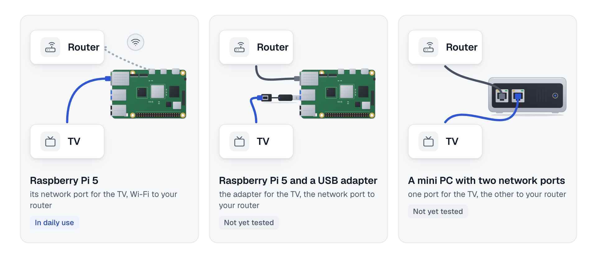

# Choose a gateway computer

You can pick a computer for the gateway here, check its ports, and see which systems are tested. The reference is a Raspberry Pi 5, and it is the only computer that runs tvgw every day so far.

## What the gateway needs

- **A 64-bit computer.** A Raspberry Pi 5 is the reference.
- **One network port for the TV**, and nothing else on it. On a Pi this is its built-in port.
- **A second connection to your router**: Wi-Fi, or a second network port.
- **A system tvgw's installer can work with.** The installer sets the TV's port up through the network manager that Raspberry Pi OS and the desktop editions of Debian and Ubuntu use. Most server editions use another one.
- **Room for the record**: a card or disk of 32 GB or more. The gateway caps its packet captures at 1.5 GB by default, and keeps a week of daily copies of its record.
- **Memory**: 2 GB at the least, 4 GB to be comfortable. These two figures are estimates; the project has not measured them yet.

## What the status words mean

| Word | What it means |
|---|---|
| **Tested** | The project's hardware tests pass on a gateway installed the way the front page says. No computer is at this level yet. |
| **In daily use** | A gateway runs it every day, installed another way. |
| **Not yet tested** | It should work, but nobody has run tvgw on it yet. |
| **Not supported** | tvgw does not work there, or the project does not try. |

## Systems

| System | Status | What to know |
|---|---|---|
| Raspberry Pi OS 13 (trixie), 64-bit, Lite or Desktop | **In daily use** on the reference gateway, which was upgraded in place from Raspberry Pi OS 12 and installed from source. A fresh card is **Not yet tested** | Uses NetworkManager |
| Raspberry Pi OS 12 (bookworm), 64-bit | **Not yet tested** | Uses NetworkManager |
| Debian 13 with a desktop | **Not yet tested** | Uses NetworkManager |
| Debian 13, server install | **Not yet tested** | Comes without NetworkManager, which tvgw's installer needs |
| Debian 12 (bookworm) | **Not yet tested** | |
| Ubuntu 24.04 or 26.04 Desktop | **Not yet tested** | Uses NetworkManager |
| Ubuntu Server, and Debian's cloud images | **Not supported** | Their networks are managed without NetworkManager |
| Armbian, DietPi | **Not yet tested** | |
| 32-bit systems, Alpine, Fedora, RHEL, Arch, OpenWrt, containers, WSL | **Not supported** | |

## Hardware

| Computer | The TV's port | The router connection | Status |
|---|---|---|---|
| Raspberry Pi 5 | The built-in network port | Wi-Fi | **In daily use** on the reference gateway. Its Wi-Fi carries the TV's streaming, about 60 GB a day over a measured week |
| Raspberry Pi 5 or 4, wired to the router | A USB 3 network adapter, in a blue USB 3 port | The built-in network port | **Not yet tested**. The TV's port is then a setting an engineer changes |
| Raspberry Pi 4 with 2 GB or more | Either | Either | **Not yet tested**; the smallest Pi that should work |
| Raspberry Pi 3B+, Zero 2 W | | | **Not supported**: 1 GB of memory or less |
| A mini PC with two network ports (Intel or AMD) | The free port | The other port, or Wi-Fi | **Not yet tested**. Releases carry a package for ARM computers only, so such a computer installs from source |

<picture>
  <source media="(prefers-color-scheme: dark)" srcset="../diagrams/fig-20-choosing-a-gateway.dark.png">
  
</picture>

*Any computer with a network port for the TV and a second way to the router can be the gateway; only the Raspberry Pi 5 with Wi-Fi is in daily use.*

## Which port is the TV's

The TV's port is the built-in network port unless an engineer changes it in [the settings](../reference/settings.md#the-tv-side). Plug nothing else into it: no switch, and no cable to your router.

On a Pi, keep the network port empty until the install guide says to plug in the TV. The Pi reaches your router over Wi-Fi meanwhile.

## Other programs on the same computer

The gateway keeps its own services and the computer's other services closed to the TV, so other programs can share the computer. File sharing, remote desktop and similar services keep working for your home network.

Two kinds of program cannot share it:

- **Another DNS filter, such as Pi-hole.** The gateway's filter needs the DNS port.
- **An AdGuard Home that already filters your household.** tvgw takes over its settings, which would change the filtering for every device in your home.

Use a separate computer for tvgw in either case.

Next: [install tvgw](README.md).
