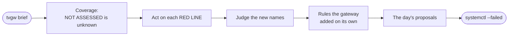
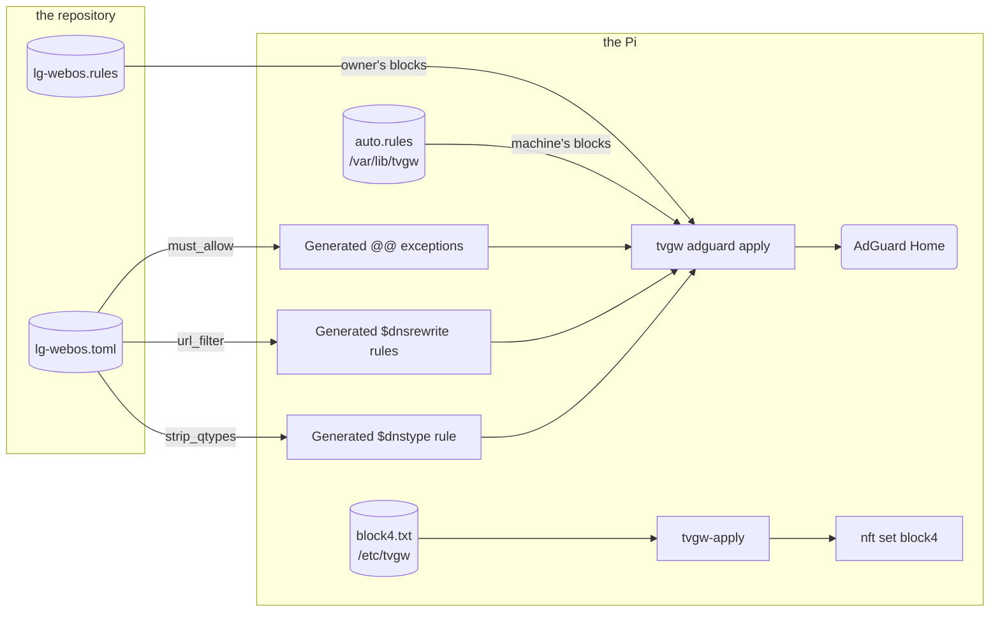

# Operations runbook

This page is the owner's runbook for a running gateway: the daily routine, the action for every red line, and the procedures for deploying, rolling back, changing policy, restoring a backup and upgrading the OS. It holds procedures; the mechanisms behind them are on the pages it links, and symptoms are in [troubleshooting](troubleshooting.md).

## Daily routine

Read the brief top to bottom, because its first lines say whether the rest can be trusted. The read commands run on the Pi as any member of `adm` ([privileges](../src/tvgw/README.md#commands)).



*The daily read, in the order of the steps below: the lines that say whether the rest can be trusted come first.*

1. On the Pi, run `tvgw brief`. It shows yesterday; `tvgw brief <day>` shows another day. What each section means is in [the brief's sections](reading-the-brief.md#sections).
2. Read the Coverage line. A source marked `NOT ASSESSED` was not read recently, so its sections are unknown, not clean. Find out why in [ingest warnings](troubleshooting.md#ingest-warnings).
3. Act on every `RED LINE:` line as [Red lines](#red-lines) says.
4. Read New hosts, Blocked and still retried, and Allowed, outside the expected categories. Decide on each new name: block it ([changing policy](#changing-policy)), allow it (leave it, or put it in an expected category in the profile), or watch it.
5. With `ANALYST_APPLY=auto`, read Rules the gateway added on its own. If a machine rule broke something, take it out with `sudo tvgw undo` ([taking a rule out](analyst-and-autonomy.md#taking-a-rule-out)).
6. Read the day's proposals: `sudo tvgw analyst --show` prints the proposals file written last, and `/var/lib/tvgw/reports/proposals/<day>.md` is the day's by name.
7. Run `systemctl --failed`. It must list nothing; for a listed unit, see [failed units](troubleshooting.md#failed-units).

On the Pi:

```sh
tvgw brief                                       # yesterday's brief
sudo tvgw analyst --show                         # the analyst's newest proposals
systemctl --failed                               # must list nothing
```

### Once a week

The hourly job writes a report for each finished ISO week to `/var/lib/tvgw/reports/weekly/<week>.txt`, and the weekly analyst pass writes `/var/lib/tvgw/reports/proposals/<week>.md` (`<week>` looks like `2026-W43`). Read both, then look at the week's names on the Pi:

```sh
tvgw allowed 7d       # allowed names outside the expected categories
tvgw top-upload 7d    # destinations by bytes the TV sent
tvgw retries 7d       # blocked names the TV keeps asking for
```

## Red lines

A red line is a sentence that must never be true, printed as `RED LINE:` near the top of the brief ([design decision 14](design-decisions.md#14-red-lines-are-the-alarm-model)). `red_lines` in `src/tvgw/queries.py` writes them in the order to act on them: the TV's needs, then the firewall and its watchdog, then the pipeline. Nothing pages anyone, so each row below is the whole response. The table follows the code's order; `<...>` marks a value the line fills in.

| Red line | What it means | What to do |
|---|---|---|
| `must-allow name blocked: <name> x<N> by <rule>` | A name in the profile's `[must_allow]` came back blocked. Its generated `@@\|\|<name>^$important` exception should have won, so a rule, a list or AdGuard's config changed. `by a list` means the log row named no rule. | `tvgw host <name>` shows the rule. Run `sudo tvgw adguard diff`; on drift, run `sudo tvgw adguard apply`. With no drift, run `tvgw profile` for the lint, then read the answer's CNAME chain with `tvgw sql "select answers, rule from dns where qname='<name>' and blocked=1 order by t desc limit 1"`: AdGuard matches a rule against CNAME targets too (`src/tvgw/profiles/lg-webos.toml`). Fix the rule in the profile and deploy ([changing policy](#changing-policy)). |
| `Live Plus (ACR) is <value> on the TV (since <time>): General > Additional Settings` | The TV's own ACR switch, read hourly over its LAN API, is not `off`: someone turned it on, or a firmware update reset it. The brief reads the last known value at the window's end, so the line stays until a reading says `off`. | Turn Live Plus off with the remote, under General > Additional Settings; the CX's LAN API refuses writes ([design decision 4](design-decisions.md#4-no-rooting-of-the-tv)). `tvgw tvstate 2d` shows when it changed, and `sudo tvgw tvcheck` reads it again now. |
| `clock host lookups blocked: <N> (the TV's clock comes from them)` | A lookup of a clock host (`clock_hosts` in the profile) was blocked. webOS takes its time from LG's SDP reply; blocked, the clock resets and TLS fails everywhere (the `[must_allow]` reason in `src/tvgw/profiles/lg-webos.toml`). | Do what the must-allow row says for the clock host, then restart the TV so it asks again. |
| `TV was on but never looked up its clock host (check the SDP hosts are reachable)` | A whole-day window (at least 82800 s, so the 23-hour day the clocks go forward counts) had an `Active` or `Screen Saver` reading and no lookup matching `clock_hosts`. The TV syncs its clock at boot, so a day without a boot can pass without one. | Check other days with `tvgw host <clock-host>`. If lookups appear there, watch the next day. If they never appear, the pattern does not match this firmware's host: `tvgw profile --webos <version>` lists the generation's clock hosts and `tvgw new-hosts 7d` the recent names. Fix `clock_hosts` in the profile and deploy. |
| `firewall checks failed <N> of <M> times; last: <failures>` | Recorded `tvgw verify` runs failed in the window. | Run `sudo tvgw verify` and act on each FAIL ([what tvgw verify checks](troubleshooting.md#what-tvgw-verify-checks)). If it passes now, find when it failed with `tvgw sql "select datetime(t,'unixepoch','localtime'), failures from verify where ok=0 order by t desc limit 10"`. Treat every FAIL after a deploy as an outage ([incidents](incidents.md)). |
| `firewall checks ran <N> of ~<M> times (is tvgw-verify.timer alive?)` | Fewer than half the verify runs the window owed were recorded: one per 600 s, counted from the first run the store ever saw, once at least six are owed. A dead watchdog otherwise looks like a clean day. | `systemctl list-timers 'tvgw-*'` must show `tvgw-verify.timer` with a next run. Read `journalctl -u tvgw-verify -n 20`. If the timer runs, look in that journal for `tvgw verify: could not record the run`. |
| `ACR-like cadence: <name> every <P> s, about <B> B per connection, <N> times (Live Plus is off: what is this?)` | A name outside the profile's expected categories connects on LG's ACR cadence: small uploads on a short timer (Periodic connections in [the brief's sections](reading-the-brief.md#sections)). The line says Live Plus is off whatever the TV's setting is. | Confirm Live Plus is off with `sudo tvgw tvcheck`. Look the name up with `tvgw host <name>`. If it is a tracker, block it in the profile's `.rules` file and deploy. |
| `Encrypted ClientHello in <N> handshakes since <time> (outer names: <names>): per-connection TLS naming is going dark; keep HTTPS records stripped` | TLS hellos from the TV carried the ECH extension under an outer name the TV never looked up, in the window or the day before: real ECH. The capture sees only the outer name of those connections, so they can no longer be named one by one ([design decision 12](design-decisions.md#12-each-flow-is-named-by-its-own-tls-hello)). A hello with the extension whose name the TV did look up is GREASE (random bytes with the real name outside, which Chromium 117 and later send whenever they have no ECH config); it names its server and is counted apart, as `grease` in the report's JSON, not as this line. | Run `sudo tvgw adguard diff` and confirm it exits 0, so the generated rule that withholds HTTPS and SVCB records from the TV is live (`[adguard] strip_qtypes`). Look up each outer name with `tvgw host <name>`, and watch whether the count grows. |
| `TV was on but no lookups were recorded (is the AdGuard query log being read?)` | The TV had an `Active` or `Screen Saver` reading, an hour or more of the window was observed, and the store holds no DNS row for it. A TV that is on resolves names, so the query log is not being written or not being read. | In Coverage, check whether `dns` is `NOT ASSESSED`. Read `journalctl -u tvgw-analyze -n 50` for the ingest step. Check `sudo ls -l /opt/AdGuardHome/data/querylog.json` and `systemctl status AdGuardHome`. `sudo tvgw adguard diff` shows whether the query-log settings drifted. |
| `TV was on but no connections were recorded (is the flow log being read?)` | The same for conntrack: an `Active` or `Screen Saver` reading and no flow row. | Run `systemctl status tvgw-flowlog`. `tail /var/log/tvgw/flows.log` must be growing. Coverage says whether `flows` was read. |
| `ingest warnings: <N>` | The ingest runs that fed the window produced N distinct warnings, printed under Coverage as `ingest warning:` lines. | Look each text up in [ingest warnings](troubleshooting.md#ingest-warnings). `sudo tvgw ingest` runs ingest now and prints its warnings to stderr. The same warning every hour is a real fault. |

### Lines worth an answer

These are not red lines, but each deserves a look when it appears. Rows follow the brief's render order.

| Line | What it means | What to do |
|---|---|---|
| `NOT ASSESSED` in Coverage | That source was not read recently or its input is missing, so its sections are unknown. | Find the cause in [ingest warnings](troubleshooting.md#ingest-warnings). |
| Firewall held: `DNS forced to AdGuard` above 0 | The TV sent DNS to another resolver and the firewall redirected it to AdGuard. The TV has hardcoded resolvers ([design decision 2](design-decisions.md#2-isolate-first-then-filter)). | Note a rise after a firmware change. |
| While off/asleep with traffic | Lookups or connections in hours the TV reported itself neither `Active` nor in its screen saver at both hourly readings; the hours shown are the time those readings span. | `tvgw tvstate 2d` shows the readings and the TV's settings. |
| Blocked names still reached over TLS | A name with blocked lookups that the TV still sent a TLS hello for: a cached or hardcoded answer, or a rule that changed in the window. | If its allowed lookups are 0, the TV reached it by address. `tvgw host <name>` lists the addresses; add them to `block4.txt` ([manual IP blocks](#manual-ip-blocks)). |
| DNS-gated egress (count-only) | New connections to addresses no lookup in the last day returned ([design decision 18](design-decisions.md#18-dns-gated-egress-starts-as-a-count-in-its-own-table)); the count is never below the samples. Samples under `just looked up` came within two seconds of an answer naming the address: the TV connected before the feeder, a few milliseconds behind the answer, had added it. Of the rest, a sample with a TLS name was known to a lookup the gate had forgotten; `(none)` is a hardcoded server or a resolver bypass. | Look at the address's connections with `tvgw sql "select datetime(t_start,'unixepoch','localtime'), dport, bytes_up, bytes_down from flows where dst='<address>' order by t_start desc limit 10"`. If it is a tracker, add it to `block4.txt`. |
| Rules the gateway added on its own, verdict `reverted` | A watch took a machine rule out; the reason says which. | Read the proposal's `Applied:` line and [taking a rule out](analyst-and-autonomy.md#taking-a-rule-out). |
| Periodic connections marked `ACR-like` in an expected category | LG's ACR cadence under a name that is the TV doing its job. | Look the name up with `tvgw host <name>`. |
| Unexpected ports | TV traffic to ports other than 80, 123 and 443. | See [STRICT_PORTS](#strict_ports). |
| Unresolved flows | TCP destinations no DNS answer or TLS name explains: a hardcoded address or a DNS bypass. | Look the address up as for DNS-gated egress; if it is vendor telemetry, add it to `block4.txt`. |
| Firmware | A firmware version that differs from the reading before it, and the names first seen around it. The first firmware reading a store holds is not an update and is not shown. | Judge the new names as New hosts; each firmware update can bring new endpoints ([design decision 4](design-decisions.md#4-no-rooting-of-the-tv)). |

## Deploying and rolling back

### Deploying

On your workstation:

1. Run `make gate` and check that it exits 0. CI runs the same.
2. Run `make deploy PI=<ssh-host>`. It copies the working tree, uncommitted changes included, to a staging copy on the Pi, `~/tvgw-deploy/`, leaving out what `deploy/rsync.exclude` lists, then runs `sudo tvgw-deploy/deploy/sync-install.sh` there. That script takes the install lock (`/run/tvgw/install.lock`, waiting up to 10 minutes), copies the staging tree to `/opt/tvgw/src/` with `rsync --delete` and runs `install.sh` with the lock handed down, so a CI deploy cannot replace the tree under it, nor it under a CI run. The installer's steps are in [what install.sh does](../deploy/README.md#what-installsh-does).
3. Read the end of the output. The installer ends by running `tvgw verify` and exits with its status, so a FAIL fails the deploy. Treat any FAIL as an outage until it is explained ([incidents](incidents.md)).
4. Run `make hardware PI=<ssh-host>` for the hardware suite. It runs under the same install lock, so no deploy replaces the tree while it runs.
5. On the Pi, run `sudo tvgw adguard diff`. It must exit 0.

On your workstation:

```sh
make gate
make deploy PI=<ssh-host>
make hardware PI=<ssh-host>
```

A push to `main` deploys the same way from CI ([how a change reaches the gateway](../deploy/README.md#how-a-change-reaches-the-gateway)). During a deploy AdGuard Home restarts only when its config changed, and the firewall is re-applied in place rather than restarted: the counters reset, and the stop path's blackout is avoided.

`tvgw adguard apply` run by itself uses the profile inside the installed package, not the files in `/opt/tvgw/src` ([design decision 6](design-decisions.md#6-adguard-home-is-configured-as-code)). Change policy by deploying; editing the copy on the Pi changes nothing.

### Rolling back the code

On your workstation:

1. Check out the last good commit, and check with `git status` that nothing uncommitted would go with it.
2. Run `make deploy PI=<ssh-host>`. `sync-install.sh` replaces the tree on the Pi with `rsync --delete`, and the installer reinstalls the package, scripts and units and re-applies AdGuard from the older profile.
3. Finish with steps 3 to 5 of [deploying](#deploying).

### Rolling back AdGuard alone

Each `tvgw adguard apply` that changes something first copies the live config to `AdGuardHome.yaml.bak-<stamp>-<pid>` beside it, where `<stamp>` is the UTC time such as `20261027151500Z`, and never over an earlier copy (`_backup` in `src/tvgw/adguardcfg.py`). The newest copy is the config from before the newest apply. Nothing prunes them.

On the Pi:

1. List the copies and pick one.
2. Stop AdGuard Home, put the copy back, and start it.
3. Run `sudo tvgw verify`; `resolver_rewrite` and `resolver_must_allow` must pass.

On the Pi:

```sh
sudo ls -l /opt/AdGuardHome/AdGuardHome.yaml.bak-*
sudo systemctl stop AdGuardHome
sudo cp /opt/AdGuardHome/AdGuardHome.yaml.bak-<stamp>-<pid> /opt/AdGuardHome/AdGuardHome.yaml
sudo systemctl start AdGuardHome
sudo tvgw verify
```

This leaves AdGuard out of line with the repository: `tvgw adguard diff` reports drift and the hardware suite fails until they match. The next apply of AdGuard's config puts the profile's back, whoever runs it: a deploy or `tvgw adguard apply`, `tvgw undo`, or, with `ANALYST_APPLY=auto`, the analyst after an autonomous block or the hourly check after a revert. Roll the repository back as well, or apply again. `tvgw adguard apply --dry-run` and `tvgw adguard diff` show the changes without making them, and an apply that fails rolls itself back ([AdGuard apply failures](troubleshooting.md#adguard-apply-failures)).

### Rolling back a firewall setting

On the Pi:

1. Edit `/etc/tvgw/tvgw.conf` and put the old value back. `tvgw-apply` reads `UPLINK`, `WAN_IF`, `WAN_GW`, `BLOCK_QUIC`, `STRICT_PORTS` and `DNSGATE` ([the settings file](../deploy/README.md#the-settings-file)).
2. Run `sudo tvgw-apply`. Prefer it to `systemctl restart tvgw`, because a restart runs the stop path first and the TV is dark for a moment ([the firewall](../deploy/nftables/README.md)).
3. Run `sudo tvgw verify`.

## Changing policy

The repository is the source of truth for what AdGuard Home blocks and allows ([design decision 6](design-decisions.md#6-adguard-home-is-configured-as-code)). The owner's rules live in the profile, the gateway's own rules in a file it owns on the Pi, and manual IP blocks in `/etc/tvgw/block4.txt`.



*Which file holds which rule: the owner edits two repository files and one file on the Pi, and the machine edits only `auto.rules`.*

### The owner's rules

On your workstation:

1. Edit `src/tvgw/profiles/lg-webos.toml` (categories, must-allow hosts, blocklists, the URL filter, `strip_qtypes`) or `src/tvgw/profiles/lg-webos.rules` (AdGuard rules). Give each new block a dated reason and, when blocking it breaks a feature, its cost ([design decision 15](design-decisions.md#15-blocklist-entries-come-from-evidence-with-grades)). The file format is in [the profile format](adding-a-profile.md#the-profile-format).
2. Run `make gate`. The unit tests include the profile lint.
3. Run `make deploy PI=<ssh-host>`. The installer runs `tvgw adguard apply`.
4. On the Pi, run `sudo tvgw adguard diff`. It must exit 0.

The next brief's Rule changes section shows the change.

### Generated rules

`tvgw adguard apply` builds three kinds of rule from the TOML (`adguard_rules` in `src/tvgw/profile.py`). Never write them by hand: a hand-written copy in the `.rules` file is dropped as a duplicate, and the TOML stays the one place to edit ([design decision 7](design-decisions.md#7-must-allow-exceptions-are-generated-from-the-toml)).

| Rule | Generated from |
|---|---|
| `@@\|\|<host>^$important`, one per host | `[must_allow]` |
| `\|\|<host>^$dnsrewrite=<GW_IP>`, one per host | `[url_filter] hosts` and `GW_IP` |
| `\|\|*^$dnstype=HTTPS\|SVCB,client=<TV_IP>` | `[adguard] strip_qtypes` and `TV_IP` |

`tvgw adguard diff` and `tvgw adguard apply` run the profile lint first and refuse a profile that fails it.

### The URL filter and nginx

If you change `[url_filter] block_regex` or `hosts`, change `deploy/nginx/tvgw-gfts.conf` and `deploy/nginx/stream.conf` to match. `test_nginx_conf_matches_the_profile` in `tests/unit/test_profile.py` fails `make gate` until the block regex, the `server_name` list and the passthrough map agree with the profile ([design decision 8](design-decisions.md#8-a-url-filter-for-lgs-file-service-instead-of-a-dns-block)).

### Manual IP blocks

Use `block4.txt` for an endpoint the TV reaches by a hardcoded address, which DNS cannot stop. It is a site file: `install.sh` creates it once and never overwrites it.

On the Pi:

1. Add one IPv4 address or CIDR per line to `/etc/tvgw/block4.txt`.
2. Run `sudo tvgw-apply`. It loads the lines into the nft set `block4`, whose rule rejects new connections to them. It must end with `tvgw: applied (...)`. An nft error means it rejected a line, and the old set stays loaded.
3. Run `sudo tvgw verify`.

Open connections survive a new block ([established connections](#established-connections)).

### The machine's rules

With `ANALYST_APPLY=auto` the gateway adds blocks to `/var/lib/tvgw/auto.rules` on its own, and `tvgw adguard apply` appends them to the profile's rules after the same lint. The machine never edits the profile. To take one of its rules out, see [taking a rule out](analyst-and-autonomy.md#taking-a-rule-out).

Never make these changes in AdGuard's web UI ([the AdGuard web UI](#the-adguard-web-ui)).

## Restoring a backup

Restore a checked copy when the store is damaged or lost. The copies are in `/var/lib/tvgw/backup/`, and pulled copies are in `backups/` on your workstation ([backups](privacy-and-retention.md#backups)). Copy a workstation copy to the Pi first.

On the Pi:

1. List the copies. Their names are UTC times.
2. Stop the timers of every unit that writes the store.
3. Wait until none of those units is running: no line of `systemctl is-active` may say `active` or `activating`.
4. Move the current store aside, with its journal file if there is one. A leftover journal would be rolled back into whichever file carries the store's name.
5. Install the copy with the store's owner and mode.
6. Check it: `PRAGMA quick_check` must print `ok`, and `tvgw size` shows the row counts and the oldest DNS row.
7. Start the timers again.
8. Run `sudo tvgw ingest`. The copy carries the log read positions of the moment it was made, so ingest picks up from there. A `log rotated or truncated` warning means lines written since then are gone, and Coverage shows the gap. Pcaps still on disk that the copy has not read are read again; rows from pcaps pruned since the copy are gone.

On the Pi:

```sh
sudo ls -l /var/lib/tvgw/backup/
sudo systemctl stop tvgw-analyze.timer tvgw-verify.timer tvgw-autoblock.timer tvgw-analyst.timer tvgw-analyst-weekly.timer tvgw-backup.timer
systemctl is-active tvgw-analyze tvgw-verify tvgw-autoblock tvgw-analyst tvgw-analyst-weekly tvgw-backup
sudo mv /var/lib/tvgw/tvgw.db /var/lib/tvgw/tvgw.db.old
sudo mv /var/lib/tvgw/tvgw.db-journal /var/lib/tvgw/tvgw.db-journal.old   # only if it exists
sudo install -m 640 -o root -g adm /var/lib/tvgw/backup/<copy> /var/lib/tvgw/tvgw.db
sudo tvgw sql "PRAGMA quick_check"                                         # must print ok
tvgw size
sudo systemctl start tvgw-analyze.timer tvgw-verify.timer tvgw-autoblock.timer tvgw-analyst.timer tvgw-analyst-weekly.timer tvgw-backup.timer
sudo tvgw ingest
```

9. With `ANALYST_APPLY=auto`, compare the record with the machine's file: `sudo tvgw autoblock list` against `sudo cat /var/lib/tvgw/auto.rules`. A rule the restored record lacks is neither judged hourly nor removed by `tvgw undo`: delete its line from the file and run `sudo tvgw adguard apply`. A recorded rule that is not in the file is recorded as reverted at the next hourly check.
10. Once the restored store checks out, delete the old one, which holds the same personal data: `sudo rm /var/lib/tvgw/tvgw.db.old`.

## Upgrading the OS in place

The reference gateway went from Debian 12 (bookworm) to Debian 13 (trixie) in place on 2026-10-27 ([CHANGELOG](../CHANGELOG.md), Platform: Debian 13). Nothing in tvgw changed for it; the virtualenv was rebuilt on the new Python, and the hardware suite then passed unchanged. Two snags came up: needrestart restarted the upgrade's own runner, and Pi desktop packages collided.

On the Pi:

1. Run the upgrade detached from your ssh session, with `systemd-run` or inside `tmux`. NetworkManager and sshd restart during the run, and a dropped session must not take apt with it.
2. If needrestart is installed, exclude the runner's unit first. Its apt hook restarts every service whose libraries changed, the detached runner included, which then starts over from its first step. For a runner unit named `os-upgrade`, create `/etc/needrestart/conf.d/90-upgrade.conf` holding `$nrconf{override_rc}{qr(^os-upgrade\.service$)} = 0;`.
3. Bring the current release fully up to date with `apt full-upgrade`.
4. Replace `bookworm` with `trixie` in `/etc/apt/sources.list` and `/etc/apt/sources.list.d/raspi.list`, then run `apt update`.
5. Simulate with `apt-get -s full-upgrade`. Stop if the removal list holds a package the gateway needs: `network-manager`, `openssh-server`, `nftables`, `dnsmasq`, `nginx`, `libnginx-mod-stream`, `python3`, `python3-venv`, `tcpdump`, `tshark` or `conntrack`.
6. Run `apt upgrade --without-new-pkgs`, then `apt full-upgrade`, then `apt autoremove --purge` and `dpkg --audit`. Run them with `DEBIAN_FRONTEND=noninteractive` and `-o Dpkg::Options::=--force-confdef -o Dpkg::Options::=--force-confold`, so the gateway's edited files keep their contents.
7. If `apt full-upgrade` stops on "trying to overwrite", bookworm's `lxplug-*` and `pi-greeter` packages ship files that trixie's `lxpanel` and `raspberrypi-ui-mods` own. Finish with `dpkg --configure -a`, `apt-get -f install` and `apt-get full-upgrade -o Dpkg::Options::=--force-overwrite`. A gateway without the desktop does not meet this.
8. Reboot.
9. Rebuild the virtualenv, which was built for the old Python: delete `/opt/tvgw-venv` and run the installer. It creates the virtualenv when `/opt/tvgw-venv/bin/python` is missing, and ends with `tvgw verify`.
10. From your workstation, run `make hardware PI=<ssh-host>`. Then check `systemctl --failed`, the VPN client and the CI runner.

On the Pi, for step 9:

```sh
sudo rm -rf /opt/tvgw-venv
cd /opt/tvgw/src/deploy
sudo ./install.sh
```

## STRICT_PORTS

`STRICT_PORTS` decides what happens to TV traffic to ports other than 80, 123 and 443 (`ODDPORT` in `deploy/nftables/tvgw-apply`). With `STRICT_PORTS=no`, that traffic is logged as `tvgw-oddport:` (`limit rate 6/minute`), counted and allowed. With `STRICT_PORTS=yes`, it is rejected with `admin-prohibited`, so apps fail fast instead of hanging. NTP on port 123 is allowed either way. LG's firmware fallback to `156.147.69.32` on TCP 8080 is accepted and logged, before the port rule, in both modes.

The owner's rule is 2 clean weeks before the flip ([design decision 17](design-decisions.md#17-strict_ports-stays-off-until-two-clean-weeks)). Flip it only when:

- 2 consecutive weeks of briefs show `Unexpected ports: none`, or only entries you looked up and accepted;
- those weeks cover a firmware check, a cold boot, a Content Store install and every app the household uses (the comment in `deploy/tvgw.conf.example`);
- the `odd ports` counter in Firewall held is zero or explained.

To flip it, on the Pi:

1. Set `STRICT_PORTS=yes` in `/etc/tvgw/tvgw.conf`.
2. Run `sudo tvgw-apply`, then `sudo tvgw verify`.
3. Use the TV for a few hours across its apps. The `odd ports` counter now counts rejected packets.

To revert, set `STRICT_PORTS=no` and run `sudo tvgw-apply` again.

## Established connections

The forward chain accepts established and related traffic before it reaches the TV's rules (`ct state established,related accept` in `deploy/nftables/tvgw-apply`). A new entry in `block4.txt`, a refreshed DoH set or `STRICT_PORTS=yes` therefore stops only new connections, and so does a new DNS block. An idle TCP connection lasts up to 7440 s (2 h 04 min), the established timeout `tvgw-apply` sets.

To cut the connections to one address now, on the Pi:

```sh
sudo conntrack -D -d <address>
```

The TV opens a new connection and meets the new rule. The cut connection appears in the flow log as ended.

## After unblocking something

Blocked answers carry a TTL of 60 seconds (`blocked_response_ttl = 60` in `src/tvgw/adguardcfg.py`), so the TV can keep a blocked answer for up to 60 seconds after its rule is gone. After an unblock is deployed, or after `sudo tvgw undo`, wait at least that long and retry the app before you judge whether the change fixed anything. A test before then can meet the old answer.

## The AdGuard web UI

AdGuard Home's web UI listens on `127.0.0.1:3000` on the Pi only (`http.address`, set by `tvgw adguard apply`). Reach it through an ssh port-forward. On your workstation:

```sh
ssh -L 3000:127.0.0.1:3000 <ssh-host>
```

Then open `http://127.0.0.1:3000` in a browser.

Use it to browse the query log and the statistics. Do not change filters, allowlists, custom rules, upstreams or settings there: `tvgw adguard apply` owns those keys ([design decision 6](design-decisions.md#6-adguard-home-is-configured-as-code)) and writes them back at its next run, and until then `tvgw adguard diff` reports drift and `test_adguard_matches_profile_and_settings` in the hardware suite fails. Make the change in the profile instead ([changing policy](#changing-policy)).
