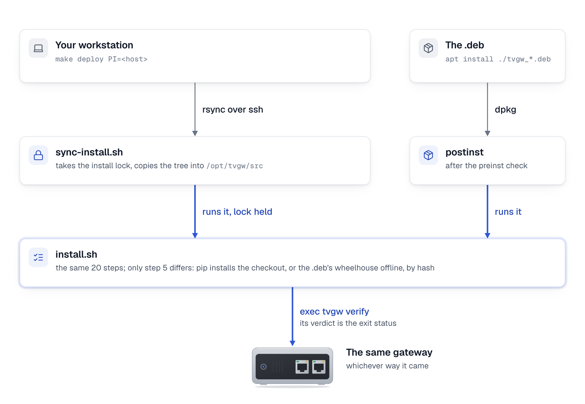
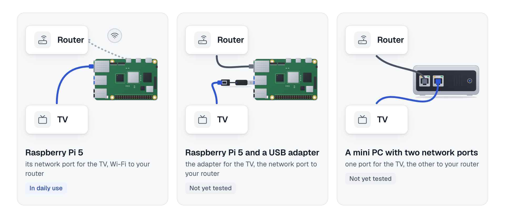

# Packaging

tvgw installs two ways: from a checkout with `deploy/install.sh`, as the reference gateway and CI do, or from a .deb for arm64 or amd64, which the release's one-line installer, `get.sh`, downloads, checks and installs. This page owns the .deb and the installer: what the package holds, how to install, upgrade and remove it, how it relates to `install.sh`, how to build it, how a release is made and checked, and the signed apt repository that is still to come. It is for the owner setting up a second gateway and for whoever cuts a release. It implements §8.2 and §8.4 item 1 of [the 2026-10 survey](research/state-of-the-art-2026-10.md#8-packaging-and-distro-compatibility); the decisions are [23](design-decisions.md#23-the-deb-runs-installsh), [24](design-decisions.md#24-the-tv-side-comes-from-the-settings-file), [25](design-decisions.md#25-adguard-home-is-a-checked-dependency-never-bundled) and [53](design-decisions.md#53-releases-carry-a-hash-checked-bootstrap-for-two-architectures-with-provenance-under-immutable-releases-updates-are-checked-weekly-installed-only-by-the-user-judged-by-verify-and-rolled-back-a-new-settings-key-never-changes-the-meaning-of-an-old-keys-value). <!-- (fin-docs) anchor fixed -->

## What the package is

The .deb is a carrier for the installer. It holds the same `deploy/` tree a checkout has, an offline wheelhouse of every Python dependency pinned by hash, and four maintainer scripts; its postinst runs that tree's `install.sh`. So a package install, a source install and a CI deploy are one sequence of steps, and the gateway they produce is the same: the virtualenv in `/opt/tvgw-venv`, `tvgw` in `/usr/local/bin`, the scripts in `/usr/local/sbin`, the units in `/etc/systemd/system`, the settings in `/etc/tvgw/tvgw.conf` and the state in `/var/lib/tvgw` ([what install.sh does](../deploy/README.md#what-installsh-does)).

| Path in the package | What it is |
|---|---|
| `/usr/lib/tvgw/deploy/` | The tracked files of `deploy/`, with their modes: `install.sh`, the templates, the units, the scripts and their READMEs. |
| `/usr/lib/tvgw/wheels/` | The tvgw wheel and one wheel per dependency and interpreter: CPython 3.11 (Debian 12), 3.12 (Ubuntu 24.04), 3.13 (Debian 13, Raspberry Pi OS trixie) and 3.14, for the package's architecture (aarch64 or x86_64). |
| `/usr/lib/tvgw/requirements.lock` | `packaging/requirements.lock`, plus the hash of each wheel the build made from a source archive. |
| `/usr/lib/tvgw/SHA256SUMS` | The hash of every file in `wheels/`, made by the build. |
| `/usr/share/doc/tvgw/` | The license (`copyright`) and this page. |

The package depends on `python3 (>= 3.11)`, `python3-venv`, `nftables`, `iproute2`, `procps`, `kmod`, `util-linux`, `network-manager`, `dnsmasq`, `nginx`, `libnginx-mod-stream`, `tcpdump`, `conntrack`, `tshark`, `wireshark-common` (dumpcap, the capture), `curl`, `ca-certificates` and `systemd`, and recommends `logrotate`. It does not depend on AdGuard Home, which has no .deb ([AdGuard Home](#adguard-home)).

<picture>
  <source media="(prefers-color-scheme: dark)" srcset="diagrams/fig-11-install-paths.dark.png">
  
</picture>

*Every route ends in the same installer, and only step 5, where the Python package comes from, differs.*

### How install.sh tells the two apart

`install.sh` runs in package mode when it finds `requirements.lock` and `wheels/` beside its tree, which is the package's layout and never a checkout's. In package mode, step 5 checks the wheelhouse against `SHA256SUMS` (a card that corrupts a file fails here, not in a running unit), installs the dependencies with `pip install --no-index --find-links /usr/lib/tvgw/wheels --require-hashes -r /usr/lib/tvgw/requirements.lock`, and installs the tvgw wheel with `--no-deps --force-reinstall`. Nothing is fetched from the network. Every other step is the same in both modes.

The postinst sets `TVGW_POSTINST=1` and closes stdin, so `install.sh` never prompts, and it reads the installer's exit status ([design decision 23](design-decisions.md#23-the-deb-runs-installsh)):

| `install.sh` ends with | From a checkout | Under the postinst |
|---|---|---|
| 0, verify passed | exit 0 | the package is configured |
| 75, the TV is not identified | exit 75 without a terminal; with one, it runs discovery instead | the package is configured; the postinst says to cable the TV and run `sudo /usr/lib/tvgw/deploy/install.sh` |
| 76, verify reported a `FAIL` | not used: `exec tvgw verify` exits 1 | the package is configured; the postinst says to fix what verify named |
| 1, a step stopped the install | exit 1 | the configuration fails; dpkg marks the package half-configured and `sudo dpkg --configure -a` runs the install again |

Any other status also fails the configuration. A stop is always 1: `install.sh` traps `ERR` (with `set -E`, so in functions and subshells too) and exits 1 whatever the failing command returned. Under `set -e` alone the command's own status became the installer's, and nmcli exits 3 on a timeout and 4 when an activation fails, so a half-done install once read as one of the deliberate exits and dpkg called it configured. The two deliberate exits are 75 and 76 for the same reason: no command `install.sh` runs returns them.

## Before you install

- A 64-bit computer, arm64 or amd64, with Raspberry Pi OS (64-bit), Debian 12 or 13, or Ubuntu 24.04 or 26.04, booted with systemd and NetworkManager. Debian 13 and Raspberry Pi OS trixie on arm64 are the tested base. Every release's packages are installed in clean Debian 13 and Ubuntu 24.04 containers on both architectures ([releases](#releases)); Debian 12, Ubuntu 26.04 and any amd64 computer have the interpreters but are untested on a gateway ([the survey's support policy](research/state-of-the-art-2026-10.md#83-compatibility-matrix)).
- A TV port and an uplink. The defaults are `eth0` for the TV and `wlan0` for the uplink; another port is the setting `TV_IF` ([the TV side](../deploy/README.md#the-tv-side)).
- AdGuard Home, installed natively in `/opt/AdGuardHome`, at least v0.107.79, with its first-run wizard done ([AdGuard Home](#adguard-home)). Without it the package refuses to install and changes nothing.

The TV needs a network port of its own, and the gateway needs a second way to the router, a port or Wi-Fi. Three arrangements fit, and only the first is in daily use: a Raspberry Pi 5 with its network port for the TV and Wi-Fi to the router, as the reference gateway runs; a Pi with a USB network adapter in a blue USB 3 port for the TV and its own port to the router; and a mini PC with two network ports. The last two are not yet tested, and a mini PC is an amd64 computer, while the releases carry only the arm64 package so far ([releases](#releases)).

<picture>
  <source media="(prefers-color-scheme: dark)" srcset="diagrams/fig-20-choosing-a-gateway.dark.png">
  
</picture>

*Any computer with a network port for the TV and a second way to the router can be the gateway; only the Raspberry Pi 5 with Wi-Fi is in daily use.*

## AdGuard Home

AdGuard Home is a checked dependency and is never bundled ([design decision 25](design-decisions.md#25-adguard-home-is-a-checked-dependency-never-bundled)). It is the resolver every TV lookup goes through, its security fixes come from its own project, and a copy inside tvgw's package would be patched only as fast as tvgw is released. It has no .deb to depend on, so three places check it, each against the floor `verify.ADGUARD_MIN`, v0.107.79, the release with the 2026 DoH and DoQ fixes (raised from v0.107.73 on 2026-11-01, [design decision 46](design-decisions.md#46-the-blocklists-are-watched-and-adguard-changes-only-on-purpose)):

| Where | When | What a missing or old AdGuard Home does |
|---|---|---|
| The package's preinst | before dpkg unpacks anything, on install and upgrade | refuses, prints the command below, and leaves the system as it was |
| `install.sh`, step 1 | on every install, from a checkout or the package | stops right after taking the install lock, before it writes anything else |
| `tvgw verify`, `adguard_version` | every 10 minutes and at the end of every install | `FAIL` with the install command, or with the update command when it is below the floor |

To install it, as its project documents (<https://github.com/AdguardTeam/AdGuardHome#getting-started>):

```sh
curl -s -S -L https://raw.githubusercontent.com/AdguardTeam/AdGuardHome/master/scripts/install.sh | sh -s -- -v
```

Then finish its wizard on port 3000, through an ssh tunnel (`ssh -L 3000:127.0.0.1:3000 <ssh-host>`). Give the DNS server a listen address that covers both `GW_IP` (`10.10.10.1` by default) and `127.0.0.1` on port 53; all interfaces does. Once tvgw is installed, AdGuard Home runs with `--no-check-update` and is updated only with `sudo tvgw adguard upgrade <new AdGuardHome binary>`, which checks the live config with the new binary first ([upgrading AdGuard Home](adguard.md#upgrading-adguard-home)).

## The installer, get.sh

Every release carries `get.sh`, a POSIX `sh` script the release job renders from `packaging/get.sh.in` with the release's version and the SHA-256 of both packages written in ([releases](#releases)). It is the one-line install:

```sh
curl -fsSL https://github.com/kywwilson11/tvgw/releases/latest/download/get.sh | sudo sh
```

`releases/latest/download/` serves the file of that name from the release GitHub marks latest, never a draft or a prerelease, and the release job marks the newest version ([releases](#releases)), so the address never changes. In order, the script:

1. Checks the computer and stops, with one line that says why, when it is not root ("put sudo before sh"), runs no systemd, has no `curl` (the script may have come by another tool), is 32-bit (`armhf`, `armel` or `i386`: "reflash with Raspberry Pi OS Lite (64-bit), or install the 64-bit version of your system"), is another architecture than arm64 and amd64, or runs a system other than Raspberry Pi OS (64-bit), Debian 12 or 13, and Ubuntu 24.04 or 26.04 (read from `/etc/os-release` in a subshell, so no name in it can replace one of the script's; a file the shell cannot read stops it too). It also stops when `/usr/local/bin/tvgw` exists and dpkg has no tvgw package: that tvgw came from a checkout's `install.sh`, and a gateway runs from one or the other ([how the .deb and install.sh relate](#how-the-deb-and-installsh-relate)).
2. Downloads `tvgw_<version>-1_<arch>.deb` and `SHA256SUMS` from its own release, over HTTPS, with redirects allowed only to HTTPS.
3. Refuses the package unless its SHA-256 equals the one written into the script and its line in `SHA256SUMS` matches: "the downloaded package does not match this installer's hash; nothing was installed". Nothing on the computer has changed before this check passes.
4. Writes `/run/tvgw/fresh-deps`, the names among `nginx` and `dnsmasq` that dpkg does not have installed, which apt is about to install new. Nothing in this version reads it; it records which services the package brought before apt runs, which the computer cannot tell afterwards.
5. Answers No to `wireshark-common`'s capture question before apt asks, as in [installing from the .deb](#installing-from-the-deb).
6. Runs `apt-get update`, then `apt-get install -y` of the package, both with `-o DPkg::Lock::Timeout=300`, since a first boot's unattended upgrades or PackageKit can hold apt's lock for minutes, and with no input; the install keeps the administrator's version of a changed configuration file (`--force-confdef`, `--force-confold`). While apt installs, `/usr/sbin/policy-rc.d` exits 101, so no service the dependencies bring, such as nginx or dnsmasq, starts during the transaction: `deb-systemd-invoke` and `invoke-rc.d` ask it first, while `install.sh` calls `systemctl`, which does not. A `policy-rc.d` that was already there, even a link to nothing, is the administrator's and stays as it was. The script's own carries a marker line, and is removed when apt finishes, when the script stops, including on Ctrl-C, a closed terminal or a kill, or by the next run when a power cut left it.
7. Removes its download folder and its `policy-rc.d` by hand, because `exec` skips the shell's exit trap, then runs `tvgw setup` on the terminal (`exec tvgw setup </dev/tty`), since the script itself arrived on standard input.

It asks nothing itself. `TVGW_NO_SETUP=1` stops after the package and prints the next step, as the script does when there is no terminal (cloud-init, another script). Everything is inside a function, `main`, called on the script's last line, so a download that stops part way runs nothing; `tests/unit/test_get_sh.py` cuts the script at every line and in the middle of every line and checks that nothing ran. `TVGW_ROOT` (a directory the system paths are read under) and `TVGW_BASE` (an `https://` or `file://` folder to download from) exist for the tests: the hashes are written into the script, so neither changes what it installs, and `sudo` resets the environment anyway.

To read the script before it runs:

```sh
curl -fsSLO https://github.com/kywwilson11/tvgw/releases/latest/download/get.sh
less get.sh
sudo sh get.sh
```

The hash makes the script refuse any package but the one the release job built. The script's own integrity rests on GitHub: on the account that publishes releases, and on immutable releases, which keep a published release's files and tag from changing ([checking a release](#checking-a-release)). No signature is checked until the owner signs `SHA256SUMS` with a key of their own ([a signed apt repository](#a-signed-apt-repository)).

## Installing from the .deb

`get.sh` does steps 1 and 2. By hand:

1. Download `tvgw_<version>-1_<arch>.deb` for this computer's architecture (`dpkg --print-architecture` names it) and `SHA256SUMS` from the release, and check them:
   ```sh
   sha256sum -c SHA256SUMS --ignore-missing
   ```
2. Install it; apt pulls in the dependencies. The first line answers No, before `wireshark-common` asks, to letting non-superusers capture, which would leave dumpcap unusable by the capture user and stop `install.sh` ([what dumpcap needs](capture.md#what-dumpcap-needs)):
   ```sh
   echo 'wireshark-common wireshark-common/install-setuid boolean false' | sudo debconf-set-selections
   sudo apt install ./tvgw_<version>-1_<arch>.deb
   ```
   On a new gateway the install stops by design before it loads the firewall: the TV is not identified yet, and the settings still hold the template's uplink. The postinst prints `installed but not finished`, and the package is installed.
3. Set the uplink, and the TV side if it is not the default, in the settings file the install created:
   ```sh
   sudoedit /etc/tvgw/tvgw.conf      # WAN_IF, WAN_GW; TV_IF, TV_NET, GW_IP only if not eth0 and 10.10.10.0/24
   ```
4. Cable the TV to the TV port, make it forget its Wi-Fi networks, switch it on, and run the installer from a terminal. It finds the TV with `tvgw discover`, finishes the install and ends with `tvgw verify`:
   ```sh
   sudo /usr/lib/tvgw/deploy/install.sh
   ```
5. Every line of `sudo tvgw verify` must start with `OK`. The remaining first-day steps, pairing the TV's LAN API and the analyst's key, are the same as from a checkout ([the install guide](install.md), step 5 and the optional analyst step).

An install in an image build or a chroot, with no running systemd, unpacks the package and does nothing else; run `sudo /usr/lib/tvgw/deploy/install.sh` on the first boot.

## Upgrading

On a gateway installed from the package, run the newest release's installer without setup:

```sh
curl -fsSL https://github.com/kywwilson11/tvgw/releases/latest/download/get.sh | sudo env TVGW_NO_SETUP=1 sh
```

or, with the new release's files downloaded:

```sh
sha256sum -c SHA256SUMS --ignore-missing
sudo apt install ./tvgw_<new-version>-1_<arch>.deb
```

A gateway installed from a checkout stays on it; `get.sh` refuses to install the package over it.

The old prerm stops nothing on an upgrade, and the new postinst runs `install.sh`, which keeps the settings file and `block4.txt`, re-applies the firewall in place without a gap, and restarts a long-running unit only when what it started with changed ([what is idempotent](../deploy/README.md#what-is-idempotent)). An upgrade disturbs what any re-run of `install.sh` disturbs: nginx reloads (or restarts once, when its drop-in changed), dnsmasq restarts, and the firewall's counters reset, which the next `tvgw verify --record` accounts for. `tvgw-guard.service` is reloaded, in one nft transaction, only when its rendered file changed, and never restarted or stopped, so the Pi stays closed to the TV through the upgrade ([design decision 42](design-decisions.md#42-the-pi-is-closed-to-the-tv-whatever-nftables-holds)). Once the signed repository exists, `sudo apt update && sudo apt upgrade` does the same.

## Removing

```sh
sudo apt remove tvgw      # or: sudo apt purge tvgw
```

| | `remove` | `purge` |
|---|---|---|
| The timers, the capture units, then `tvgw.service` | stopped and disabled; the firewall's stop turns forwarding off first, so the TV is dark, never unfiltered | the same |
| `tvgw-guard.service` and its table `inet tvgw_guard` | the unit is disabled and its file removed; the table stays in the kernel until the next boot (`sudo nft delete table inet tvgw_guard` lifts it now) | the same |
| What `install.sh` wrote: `/usr/local/sbin/tvgw-*`, `/usr/local/bin/tvgw`, the units and their drop-ins, the dnsmasq hardening drop-in and the co-tenants' `10-tvgw-not-from-tv.conf` drop-ins (the daemon-reload lifts their filters), the dnsmasq, nginx, NetworkManager and logrotate files, the `include` line in `nginx.conf`, `/opt/tvgw-venv` | removed | removed |
| `/etc/tvgw` (settings, `block4.txt`, the analyst's key) and `/var/log/tvgw` | kept | removed |
| The `tv-lan` connection | kept | deleted |
| `/var/lib/tvgw`: the store, the pcaps, the reports, the TV pairing key | kept | kept, with a message: `sudo rm -rf /var/lib/tvgw` deletes it |
| AdGuard Home, its configuration, its `workdir.conf` drop-in, the `tvgw-pcap` user, the mask on `nftables.service`, avahi's `deny-interfaces` line (its original is `avahi-daemon.conf.tvgw-backup`) | left as they are | left as they are |

Purge keeps the store because it is up to a year of evidence and a habitual purge must not destroy it ([design decision 23](design-decisions.md#23-the-deb-runs-installsh)). AdGuard Home keeps the rules tvgw last applied; change them in its UI or reinstall it. `nftables.service` stays masked: unmask it with `sudo systemctl unmask nftables` if you want it.

## How the .deb and install.sh relate

- `install.sh` remains the from-source path and the CI deploy path: `make deploy` and the hardware job run `sync-install.sh`, which runs `install.sh` from `/opt/tvgw/src` ([how a change reaches the gateway](../deploy/README.md#how-a-change-reaches-the-gateway)). The reference gateway stays on that path.
- Both paths take the install lock, `/run/tvgw/install.lock`, so a package install and a CI deploy never interleave.
- Both write the same files, so whichever ran last owns the gateway. A `make deploy` or a CI deploy on a gateway installed from the .deb replaces its Python package with the checkout's until the next package install, and the next package install does the reverse. Keep each gateway on one path.
- A source install resolves the dependencies at install time, unpinned; the package installs exactly the lock. Moving the source path onto the lock is a follow-up, not done here, because it would change the reference gateway's dependency versions on the next deploy.
- `tests/unit/test_packaging.py` keeps the two in step: the layout `install.sh` looks for, the shared AdGuard Home check, and the paths postrm removes against the paths `install.sh` writes.

## Building the .deb

You need Python 3.11 or newer with pip, git, and nfpm (`brew install nfpm`, or a release from <https://github.com/goreleaser/nfpm/releases>). Build from a checkout with nothing untracked under `deploy/`, `src/` or `packaging/`:

```sh
make deb                    # dist/tvgw_<version>-1_arm64.deb
TVGW_ARCH=amd64 make deb    # dist/tvgw_<version>-1_amd64.deb
```

`make deb` runs `packaging/build-deb.sh`, which the release workflow runs too:

1. Refuses untracked files under `deploy/`, `src/` or `packaging/`, because `deploy/local/` holds a site's real settings; only what git tracks is packaged.
2. Creates a build venv, `build/venv`, and installs the build backend into it from `packaging/build-requirements.lock` with `--require-hashes`: setuptools, wheel and wheel's one dependency, packaging. Both wheel builds below run in that venv with `--no-build-isolation`, so pip never fetches an unpinned backend into an isolated build environment, and a changed backend cannot reach a release unhashed.
3. Builds the tvgw wheel from a fresh build directory.
4. Runs `packaging/wheelhouse.py`, which fetches every dependency in `packaging/requirements.lock` with `pip download --require-hashes`, one wheel per target interpreter for the package's architecture, aarch64 or x86_64 ([packaging/README.md](../packaging/README.md)). A file PyPI serves that the lock does not list is refused. A dependency with no wheel at all, today only `sqlitedict`, is fetched as its source archive against the lock's hash and built into a pure-Python wheel; that wheel's hash is added to the lock the package carries, so the gateway's pip checks it too.
5. Writes `SHA256SUMS` of the wheelhouse and copies the tracked `deploy/` tree.
6. Runs `nfpm package` with `packaging/nfpm.yaml`.

Both architectures build from the same steps on any machine, since pip fetches wheels for the target and nfpm only packs files. Build releases on Linux: pip judges a dependency's environment markers by the machine it runs on.

### The lock

`packaging/requirements.lock` pins every runtime dependency of the `lgwebos` and `analyst` extras, the ones `install.sh` installs, with every published file's hash, resolved for Python 3.11 and later on any platform. Regenerate it after a change to `pyproject.toml`'s dependencies, and to take dependency updates, with uv at the version the Makefile pins (`UV_VERSION`; `pip install uv==<that version>`). `make lock` refuses any other uv, since another version may resolve or annotate the lock differently. It also regenerates `packaging/build-requirements.lock` from `packaging/build-requirements.in`, the pinned build backend; raise those pins on purpose, once a release is two weeks old:

```sh
make lock
git diff packaging/requirements.lock   # review what moved
```

## Releases

`.github/workflows/release.yml` runs on a pushed tag that starts with `v`, and on a manual run (`workflow_dispatch`). Its token reads the repository and nothing else; the two jobs that need more say so on the job. The jobs, in order:

| Job | Runs on | What it does | Its token |
|---|---|---|---|
| `gate` | `ubuntu-latest` | On a tag, `packaging/release_notes.py` checks the changelog's section for the tag's version first ([the changelog's Highlights and Status](#the-changelogs-highlights-and-status)), so a tag whose section is not ready stops before anything is built. Then it installs the checkout with its `dev` extras and runs `make gate`. | read |
| `deb`, once for `arm64` and once for `amd64` | `ubuntu-latest` | Downloads nfpm 2.48.0 for Linux x86_64 and refuses it unless its SHA-256 is the pinned `NFPM_SHA256`, then runs `packaging/build-deb.sh dist` with `TVGW_ARCH` set to the architecture and `TVGW_TAG` to the tag, empty on a manual run. With `TVGW_TAG` set, the script refuses to build unless the tag is `v` followed by the version in `pyproject.toml`: `v0.2.0` builds 0.2.0 and nothing else. nfpm and pip build both packages on the x86_64 runner. Keeps the package as the artifact `tvgw-deb-<arch>`. | read |
| `install-check-arm64`, `install-check-amd64` | `ubuntu-24.04-arm`, `ubuntu-latest` | Runs `packaging/install-check.sh` on its architecture's package in `debian:13` and `ubuntu:24.04` containers, each pinned by digest: AdGuard Home at the floor first, since the preinst refuses a system without it, then the package with apt, then the package's wheelhouse checked against its `SHA256SUMS` and installed offline and hash-checked, with `install.sh`'s own commands, into a scratch virtualenv on the container's `python3`; `tvgw --version` must name the package's version, and `bscpylgtv`, `anthropic` and `yaml` must import. A container runs no systemd, so the postinst runs no `install.sh` there. | read |
| `assets` | `ubuntu-latest` | `packaging/release-assets.sh` writes `SHA256SUMS` of both packages, renders `get.sh` from `packaging/get.sh.in` with `sed` (the version and both hashes; a field left unfilled fails the job) and adds `get.sh` to `SHA256SUMS`. On a tag it also writes the notes and attests the packages and `get.sh` with `actions/attest`. Keeps all of it as the artifact `tvgw-release`. It is the one job that can sign, and it runs only this repository's scripts and pinned actions, none of the build's third-party code. | read, `id-token: write`, `attestations: write` |
| `publish`, on a tag, after `assets` and both install checks | `ubuntu-latest` | `packaging/publish-release.sh` creates the release as a draft (`gh release create --verify-tag --draft`, titled `tvgw <version>`, with the notes), uploads both packages, `get.sh` and `SHA256SUMS` to it, then publishes it (`gh release edit --draft=false`). It is marked latest unless a newer version is already published, so a fix for an older line never takes over `releases/latest`. A draft left by a failed run is refreshed and published; a published release is refused. Only GitHub's "release not found" counts as no release: any other failure to read a release's state stops the job, so a passing outage never makes a second draft or hands an older version `releases/latest`. Two runs for one tag queue rather than race. | `contents: write` |

Draft first because, once immutable releases are on, a published release's files cannot change: a release is never public with a file missing. Every action is pinned by commit with its version in a comment, and every container image by digest ([supply chain](supply-chain.md#what-is-in-place)). A manual run on any ref builds and checks the same files and keeps them as artifacts; it writes no notes, attests nothing and publishes nothing. Nothing here deploys: `ci.yml`'s hardware job, on pushes to `main`, is the one path to the gateway. The workflow does not check which branch the tagged commit is on, so only a commit of `main` is tagged, or of a `release/<major>.<minor>.x` branch for a fix to an older line.

### The changelog's Highlights and Status

A version's section of `CHANGELOG.md`, `## <version> (<YYYY-MM-DD>)`, starts with two blocks, in this order, that become the release page's own text:

- `### Highlights`: three to six bullets, one line each and at most 220 characters, in plain words, for someone deciding whether to install or upgrade. `release_notes.py` refuses a highlight that uses one of the engineering terms the user pages avoid (`PLAIN_WORDS` in the script: nftables, conntrack, nginx, dnsmasq, a design decision's number, a VPN product's name and the like) or a settings key.
- `### Status`: one paragraph on what was tested on hardware for this version, and what was not.

The detail for engineers follows in dated `### <topic> (<date>)` subsections, as before, and the notes link it rather than repeat it. `## Unreleased` opens with the same two blocks, kept current as changes land; cutting a release trims the highlights to six at most and rewrites the status. 0.2.0 and the versions before it were released before this convention and keep their sections as written. `tests/unit/test_release_notes.py` holds `CHANGELOG.md` to it: Unreleased opens with the two blocks, and every version released after 0.2.0 renders.

The notes are `.github/release-notes.md.in` filled in: what tvgw is, the highlights and a link to the version's changelog section, the status, the install command and what it does, which file is which, and how to check a download. `release_notes.py` refuses notes longer than 60 lines, and the test checks that every page the template links at the tag exists with its heading.

### Checking a release

Any release can be checked from any computer that has its files:

```sh
sha256sum -c SHA256SUMS --ignore-missing
gh attestation verify tvgw_<version>-1_arm64.deb -R kywwilson11/tvgw \
  --signer-workflow kywwilson11/tvgw/.github/workflows/release.yml
gh release verify-asset v<version> tvgw_<version>-1_arm64.deb -R kywwilson11/tvgw
```

The first compares each file with the release's `SHA256SUMS`. The second checks the build provenance `actions/attest` recorded: a statement, signed with a short-lived Sigstore certificate issued to that workflow run and entered in Sigstore's public transparency log, that this repository's release workflow built the file from that tag's commit. It proves where a file came from, not that the code at that commit is safe. The third checks the file against the release's own attestation, which GitHub makes for a release published while immutable releases are on; such a release's files and tag cannot change once it is published. Immutable releases are a repository setting ([supply chain](supply-chain.md#repository-settings-that-matter-for-the-pi)), and a release published before it was turned on stays mutable.

### Cutting a release

1. On a branch, set the version in `pyproject.toml` and `src/tvgw/__init__.py`. In `CHANGELOG.md`, turn "Unreleased" into a section for the version and date, with its Highlights trimmed to three to six bullets and its Status rewritten for what was tested, and leave a new "Unreleased" above it that opens with an empty `### Highlights` and `### Status`. Check the notes, then merge the branch into `main` through CI:
   ```sh
   python3 packaging/release_notes.py --version 0.3.0 --changelog CHANGELOG.md \
       --template .github/release-notes.md.in --out /tmp/notes.md
   ```
2. Build once locally if nfpm is at hand: `TVGW_TAG=v0.3.0 make deb` runs the same script with the same check.
3. Check that immutable releases are on (`gh api repos/kywwilson11/tvgw/immutable-releases` says `"enabled":true`).
4. Tag the merged commit of `main` and push the tag:
   ```sh
   git switch main && git pull --ff-only
   git tag -a v0.3.0 -m "tvgw 0.3.0"
   git push origin v0.3.0
   ```
5. When the run finishes, download the files and check them as in [checking a release](#checking-a-release), and check that `curl -fsSIL https://github.com/kywwilson11/tvgw/releases/latest/download/get.sh` ends in `200`.

What the owner's signing key adds later, and nothing in the repository does yet: a signed tag (`git tag -s` in place of `git tag -a`, checked with `git tag -v`; [signed commits and tags](supply-chain.md#signed-commits-and-tags)), so a release names who cut it, a signed `SHA256SUMS` that `get.sh` checks, and [the signed apt repository](#a-signed-apt-repository) below, so a gateway takes upgrades through apt with the archive's signature checked. Until then a release's integrity rests on GitHub's account security, immutable releases and the attestations.

## A signed apt repository

Not built yet: it needs a signing key that only the owner may create and hold. Whoever holds that key can change the firewall of every gateway that runs `apt upgrade`, so it is made on a trusted machine, its secret half stays offline, and its public half is the only part that goes anywhere. These are the steps, in order; nothing in the repository generates a key.

1. **Make the key**, once, on a trusted machine:
   ```sh
   gpg --quick-generate-key "tvgw archive signing key <owner@example.org>" ed25519 sign 2y
   FPR=$(gpg --list-secret-keys --with-colons | awk -F: '/^fpr/ {print $10; exit}')
   gpg --export "$FPR" >tvgw-archive-keyring.pgp                       # the public keyring
   gpg --export-secret-keys --armor "$FPR" >tvgw-archive-signing.asc    # the backup: offline media only
   ```
2. **Make the repository** with reprepro, in a directory published as static files (a GitHub Pages branch of a separate repository, say):
   ```sh
   mkdir -p apt/conf
   cat >apt/conf/distributions <<EOF
   Origin: tvgw
   Label: tvgw
   Codename: stable
   Architectures: arm64 amd64
   Components: main
   Description: tvgw gateway packages
   SignWith: $FPR
   EOF
   reprepro -b apt includedeb stable dist/tvgw_<version>-1_arm64.deb
   reprepro -b apt includedeb stable dist/tvgw_<version>-1_amd64.deb
   ```
   Publish `apt/dists` and `apt/pool`, never `apt/conf` or `apt/db`, and publish `tvgw-archive-keyring.pgp` beside them.
3. **On each gateway**, add the key and a deb822 source with `Signed-By`, as Debian asks of third-party repositories (<https://wiki.debian.org/DebianRepository/UseThirdParty>):
   ```sh
   sudo install -D -m 644 tvgw-archive-keyring.pgp /etc/apt/keyrings/tvgw-archive-keyring.pgp
   sudo tee /etc/apt/sources.list.d/tvgw.sources >/dev/null <<EOF
   Types: deb
   URIs: https://<repository-host>/apt
   Suites: stable
   Components: main
   Architectures: arm64 amd64
   Signed-By: /etc/apt/keyrings/tvgw-archive-keyring.pgp
   EOF
   sudo apt update && sudo apt install tvgw
   ```
4. **To sign in CI** instead of by hand, store the armored secret key as a secret of a GitHub environment that requires the owner's approval, and add a job after `assets` in `release.yml` that imports it, runs `reprepro includedeb` and pushes the published tree. Until then, add each release by hand with step 2.
5. **Before the key expires** (two years with the command above), extend it with `gpg --quick-set-expire "$FPR" 2y`, export the keyring again and replace it on every gateway. A key that may have leaked is replaced, not extended: make a new one, publish its keyring, and sign the repository again.

## Limits

- Not yet run on hardware: each release's packages are installed in Debian 13 and Ubuntu 24.04 containers, where no systemd runs `install.sh`, but no gateway has installed one, from `get.sh` or by hand ([checking a package on a gateway](#checking-a-package-on-a-gateway)).
- The package still needs AdGuard Home installed first ([AdGuard Home](#adguard-home)), so `get.sh` on a computer without it stops at apt with the preinst's message.
- No .rpm or Arch package yet; nfpm builds both from the same YAML when a tier-3 distribution is wanted ([the survey's verdicts](research/state-of-the-art-2026-10.md#82-packaging-verdicts)). <!-- (fin-docs) anchor fixed -->
- The firewall front-end is not detected: on a host running firewalld or ufw, their drops still apply to the TV's traffic (§8.4 item 3).
- Whether `nmcli con add` makes a keyfile or netplan YAML on Raspberry Pi OS images from November 2025 on is unverified (§8.1).
- `make wheel`, a developer convenience, still builds with pip's isolated, unpinned backend; `make deb` and the release do not ([building the .deb](#building-the-deb)).

## Checking a package on a gateway

On a spare gateway, or on the reference one with the owner's go-ahead (the package replaces the source install's Python package until the next deploy):

```sh
sudo apt install ./tvgw_<version>-1_arm64.deb                # install.sh's output, then verify's lines
sudo tvgw verify                                             # every line OK
dpkg -s tvgw | grep Status                                   # install ok installed
sudo apt install --reinstall ./tvgw_<version>-1_arm64.deb    # a second run restarts only what install.sh documents
sudo apt remove tvgw
cat /proc/sys/net/ipv4/conf/eth0/forwarding                  # 0: the TV is dark
sudo nft list table inet tvgw                                # gone
ls /usr/local/bin/tvgw /opt/tvgw-venv                        # gone; /etc/tvgw and /var/lib/tvgw are still there
```
