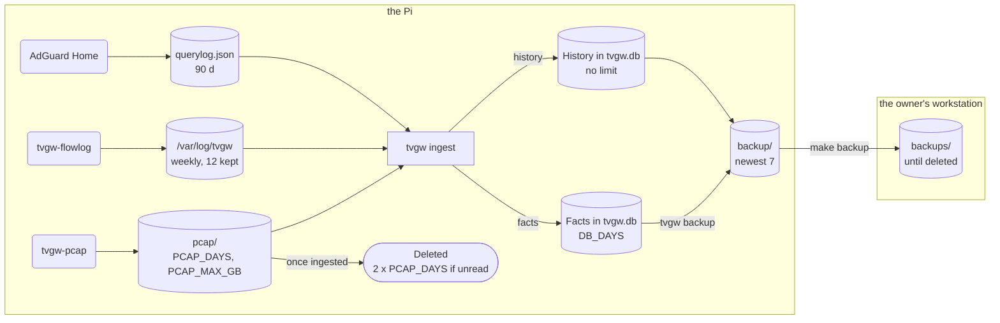
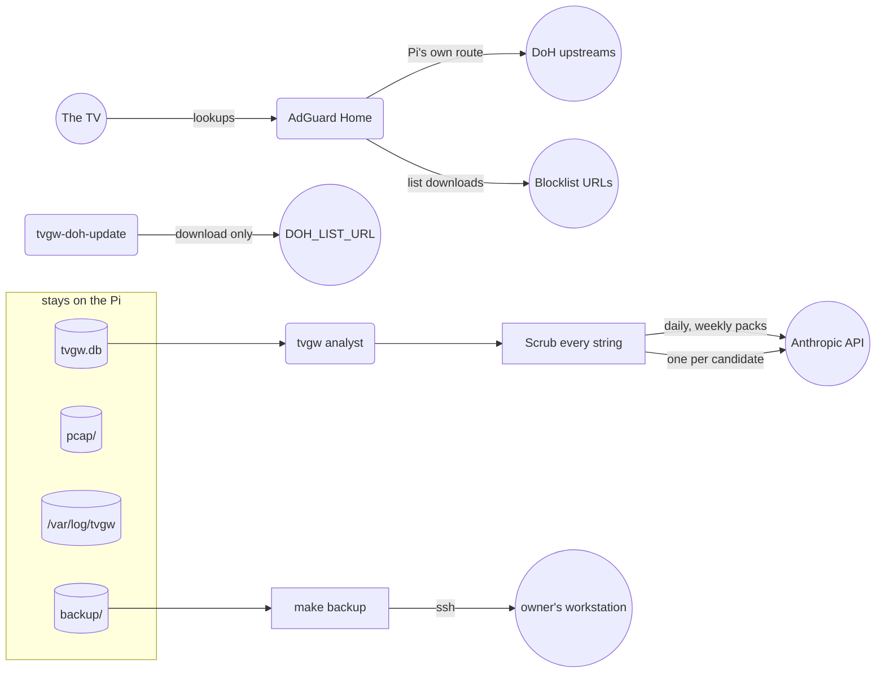

# Privacy and retention

This page owns what the gateway records about the household, how long it keeps each kind of data, who on the Pi can read it, and what it sends off the Pi. It is for the owner and the household, and for anyone auditing what the gateway records, keeps and sends.

## What the store holds

The store is one SQLite file, `/var/lib/tvgw/tvgw.db`, with 19 tables and one view (`SCHEMA` in `src/tvgw/db.py`). Treat it as personal data. Its `dns`, `tls` and `flows` rows together are a minute-by-minute record of what the household watched and when: which services and apps, at what hours, for how long, and how much video each one moved. The hourly `tvstate` readings add which app was in the foreground.

Ingest stores only the TV's own traffic. A flow, a lookup, a TLS hello, a plain-HTTP request or a connection attempt is stored only when its source is `TV_IP` (`src/tvgw/ingest.py`). The two kernel-log tables, `oddport` and `gate`, hold what the firewall logged for the TV subnet.

The groups below follow the order in which `SCHEMA` creates the tables. Every column is in [the table reference](data-model.md#tables).

| Group | Tables | What it tells about the household |
|---|---|---|
| Bookkeeping | `meta`, `ingest_state`, `ingest_runs`, `pcaps_done` | When each source was read, the read position in each log, one row per ingest run with its counters and warnings, and which pcaps were read. Times of activity, little else. |
| What the TV did | `flows`, `dns`, `tls`, `http`, `lanprobe` | Every lookup with its answers and the rule that matched, every TLS server name, every connection with its times, destination, ports, packets and bytes each way, every plain-HTTP request with host, method, URL including the query string and user agent, and every connection attempt to an address no internet host answers from (the home-LAN ranges, loopback, multicast, broadcast). A probed address can belong to one of your own devices or to a network the TV remembers. |
| The TV itself | `tvstate`, `tvsettings` | One power reading and foreground app an hour. Each setting the LAN API reads, stored when first read and whenever its value changes: Live Plus (ACR), the ZIP code and country the TV holds, its device name, Wake-on-LAN, SimpLink, store mode, audio guidance, firmware, platform code and model (`READS` in `src/tvgw/lgwebos.py`). |
| What the firewall logged | `oddport`, `gate` | Traffic to unexpected ports, and sampled connections to addresses no lookup returned. The `raw` column keeps the kernel's log line, which carries the frame's MAC header (`MAC=`) and the Pi's host name. |
| The machine's decisions | `auto_rules`, `judgments` | Each rule the gateway added on its own, with the models that agreed and its verdict, and the analyst's last verdict on each name. |
| Names | `hosts` and the view `v_ip_names` | One row per public name ever seen, with first and last seen, counters, category, and the latest DNS verdict and its rule. The view lists which server names were seen on which address. |
| Policy history | `rules` | Every AdGuard rule, URL-filter regex and manual IP block, with when it appeared and when it left. |
| The gateway's checks | `verify`, `fw_counters` | Each recorded `tvgw verify` verdict and each firewall counter snapshot. |

Personal data also sits beside the store: the pcaps, the logs under `/var/log/tvgw`, the last LAN-API reading in `tvcheck.txt` (with the ZIP code), the hourly power and app line in `tvcheck-history.log`, the rendered reports and proposals, the backups, and AdGuard Home's query log. [Where it lives and who can read it](#where-it-lives-and-who-can-read-it) lists them all.

## What the capture keeps

`tvgw-pcap.service` runs tcpdump on `eth0` as the system user `tvgw-pcap`. It writes one file an hour (`-G 3600`) to `/var/lib/tvgw/pcap/tv-YYYYMMDDTHHMMSSZ.pcap`, named in UTC so that no two files share a name. It keeps whole frames (`-s 0`), but only the frames its filter passes. The filter is the unit's own `ExecStart`, and `tests/unit/test_capture_filter.py` runs that exact expression through tcpdump on a synthetic hour and checks which frames survive.

The filter first takes only IPv4 frames whose source is in `10.10.10.0/24` and is not `10.10.10.1`: frames sent from the TV side, never frames sent to it. Of those it keeps five classes, in this order:

| Class | Filter term | Why it is kept |
|---|---|---|
| Connection flags | `tcp[tcpflags] & (tcp-syn\|tcp-fin\|tcp-rst) != 0` | When a connection was tried and when it ended, LAN probes included. |
| Requests to port 80 | `tcp dst port 80` | The TV's plain-HTTP requests, whole: request line, headers and any body. |
| UDP | `udp and (not dst port 443 or udp[8] & 0x80 = 0x80)` | DNS, SSDP, mDNS, NTP and any other UDP the TV sends, whole. On port 443 only QUIC long-header packets, the handshakes the firewall rejects with `BLOCK_QUIC=yes`. |
| TLS ClientHello | payload starts `0x16 0x03`, handshake type `0x01` at offset 5 | The server name of each TLS connection. |
| HTTP method on any port | payload starts `GET `, `POST`, `HEAD` or `PUT ` | Plain HTTP on other ports, such as LG's firmware fallback on TCP 8080. |

The two terms that read the payload come last on purpose. A BPF load past the end of a short segment ends the whole program as "no match", so the flag, port and UDP terms must decide first.

The capture never keeps:

- anything the TV receives: no response body, no server certificate, no DNS answer on the wire (the answers come from AdGuard's query log instead);
- TLS records after the ClientHello, so no encrypted application data. A ciphertext segment passes only by a chance match of the three fixed bytes the ClientHello term tests, about one segment in 16.8 million;
- the second segment of a ClientHello split across two segments. If the server name falls in that segment, the connection stays unnamed;
- QUIC short-header packets, ICMP, ARP, IPv6, and frames from the gateway's own address.

No TLS is decrypted ([design decision 3](design-decisions.md#3-no-tls-interception)).

Ingest reads three things out of a pcap with tshark: TLS hellos (time, destination, ports, server name, and whether the hello carried the ECH extension), plain-HTTP requests not sent to the gateway (host, method, URI cut at 2000 characters, user agent cut at 300), and connection attempts (those to an address no internet host answers from, other than the gateway, become `lanprobe` rows). Everything else stays only in the pcap file until it is pruned: request bodies sent to port 80, the payload of UDP sent to unexpected ports, the DNS questions.

## How long it is kept

Each kind of data has its own clock. Raw evidence goes first, the store's rows last much longer, and some files are never pruned. The three retention settings are `DB_DAYS`, `PCAP_DAYS` and `PCAP_MAX_GB` in `/etc/tvgw/tvgw.conf`; their defaults are in [the settings file](../deploy/README.md#the-settings-file).



*The data lifecycle: a raw pcap goes only once the store holds what it showed, or at twice `PCAP_DAYS` if it never does.*

| Data | Where | Kept | Set by |
|---|---|---|---|
| Raw pcaps | `/var/lib/tvgw/pcap/` | `PCAP_DAYS` days once read, less when space is short ([below](#raw-pcaps)) | `PCAP_DAYS`, `PCAP_MAX_GB` |
| Facts in the store | `flows`, `dns`, `tls`, `http`, `lanprobe`, `oddport`, `gate`, `verify`, `fw_counters`, `ingest_runs` | `DB_DAYS` days | `DB_DAYS` |
| History in the store | `tvstate`, `tvsettings`, `hosts`, `rules`, `auto_rules`, `judgments`, `meta`, `ingest_state` | Not pruned | none |
| Pcap read marks | `pcaps_done` | 7 days, and only once the file itself is gone | `7 * 86400` in `ingest.prune` |
| Checked copies of the store | `/var/lib/tvgw/backup/` | The newest seven | `tvgw backup --keep` |
| Pulled copies | `backups/` in your checkout | Until you delete them | none |
| Reports and proposals | `/var/lib/tvgw/reports/` | Not pruned | none |
| TV readings | `/var/lib/tvgw/tvcheck.txt`, `tvcheck-history.log` | The first holds the last reading the TV answered; the second grows by a line an hour and is never rotated | none |
| Flow, URL-filter and TLS-passthrough logs | `/var/log/tvgw/*.log` | Rotated weekly, 12 old copies, compressed from the second | `deploy/logrotate/tvgw` |
| AdGuard Home query log and statistics | `/opt/AdGuardHome/` | Interval `90d` | `log_interval` in `src/tvgw/adguardcfg.py` |
| AdGuard config backups | `/opt/AdGuardHome/AdGuardHome.yaml.bak-*` | Not pruned; one per apply that changed something | none |
| Kernel log lines and unit output | the systemd journal | journald's own limits | journald |

### Raw pcaps

`tvgw prune-pcaps` runs hourly (`tvgw-prune.timer`, [schedule](../deploy/systemd/README.md#units)) and works in this order (`prune` in `src/tvgw/pcaps.py`):

- It looks only at finished files. A file is finished when no tcpdump process holds it open, read from `/proc`. When that cannot be told, it deletes nothing and warns.
- A finished file older than `PCAP_DAYS` days, by its modification time, is deleted when the store has read it or given up on it after `PCAP_MAX_ATTEMPTS = 24` hourly tries (`src/tvgw/ingest.py`).
- A finished file the store has not read is kept, with a warning, until it is twice `PCAP_DAYS` days old. Then it is deleted with a warning of its own.
- While the finished files add up to more than `PCAP_MAX_GB` GB, the oldest read file goes.
- While the filesystem holding the pcaps has under `FREE_FLOOR = 1 << 30` bytes (1 GB) free, the oldest read file goes.

Any warning fails the run, so the unit shows in `systemctl --failed`. Each warning's text and fix are in [retention warnings](troubleshooting.md#retention-warnings).

### Rows in the store

Pruning runs at the end of each hourly ingest (`prune` in `src/tvgw/ingest.py`). It deletes the fact rows older than `DB_DAYS` days, `flows` by `t_end` and the rest by `t`. A `pcaps_done` mark goes once it is 7 days old and its file is gone, because a mark removed while the file exists would have the file read twice.

Deleting rows frees pages inside the file; it does not shrink it. Every 30 days ingest records a check, and when at least 25% of the file's pages are free (`free * 4 >= pages`) it runs `VACUUM`. Lowering `DB_DAYS` therefore removes rows at the next hourly ingest and shrinks the file at the next check. There is no command that deletes a chosen span of rows; lowering `DB_DAYS` is the supported way to keep less.

### Logs and AdGuard Home

logrotate rotates `/var/log/tvgw/*.log` weekly with `copytruncate` and keeps 12 old copies, compressed except the newest (`delaycompress`). The rotation does not wait for ingest. Ingest reads the newest rotated copy for lines written shortly before a rotation, and warns when lines were lost.

`tvgw adguard apply` sets AdGuard Home's query log and statistics to `enabled: true` with `interval: 90d`, and writes the query log to a file (`querylog.file_enabled`). AdGuard Home applies that interval itself. The query log holds every lookup of every client AdGuard serves, not only the TV's.

## Where it lives and who can read it

Every path the gateway writes or installs, in path order. "`adm`" means members of the `adm` group, who can run the read commands ([privileges](../src/tvgw/README.md#commands)).

| Path | What it holds | Owner, group and mode | Set by | Who can read |
|---|---|---|---|---|
| `/etc/NetworkManager/conf.d/90-tvgw.conf`, `/etc/NetworkManager/dispatcher.d/90-tvgw`, `/etc/logrotate.d/tvgw`, `/etc/systemd/system/tvgw*` | Installed configs and units | `root:root 644`; the dispatcher `755` | `install.sh` | Everyone |
| `/etc/dnsmasq.d/tvgw.conf` | The DHCP config, with the TV's MAC, address and name in its pin line | `root:root`, mode from the umask `install.sh` runs with (`644` under `022`) | `install.sh` | Everyone, under a `022` umask |
| `/etc/nginx/conf.d/tvgw-gfts.conf`, `/etc/nginx/tvgw/stream.conf` | The URL filter and the TLS passthrough | `root:root`, mode from the umask | `install.sh` | Everyone, under a `022` umask |
| `/etc/tvgw/` | The site's settings and lists | `root:root 755` | `install.sh` | Everyone can list it |
| `/etc/tvgw/block4.txt` | The owner's manual IPv4 blocks | `root:root 644` | `install.sh`, when missing | Everyone |
| `/etc/tvgw/claude.key` | The Anthropic API key | root, `600`; any group or other bit is refused | The owner; `read_key` in `src/tvgw/analyst.py` checks it | root |
| `/etc/tvgw/doh-exclude.txt` | Shared CDN ranges kept out of the DoH set | `root:root 644` | `install.sh`, every run | Everyone |
| `/etc/tvgw/tvgw.conf` | The settings: the TV's MAC, address and name, the router's address | `root:adm 640` | `install.sh`, every run | root and `adm` |
| `/opt/AdGuardHome/` | `AdGuardHome.yaml` with the TV's client entry, its `.bak-*` copies, `data/querylog.json` | As AdGuard Home sets them; each `.bak-*` copies the live file's mode | AdGuard Home; `tvgw adguard apply` writes the `.bak-*` copies | Check with `sudo ls -l` |
| `/opt/tvgw-venv/`, `/usr/local/bin/tvgw` | The installed package and the `tvgw` command | root, as `python3 -m venv` creates it | `install.sh` | Everyone |
| `/opt/tvgw/src/` | The repository checkout | As the deploy copied it | `make deploy` or the CI deploy | Everyone, as copied |
| `/run/tvgw/` | `ruleset.applied` and the install lock; gone at reboot | `root:root 755` | `install.sh`, `tvgw-apply` | Everyone |
| `/usr/local/sbin/tvgw-apply`, `tvgw-analyze`, `tvgw-doh-update` | The shell scripts | `root:root 755` | `install.sh` | Everyone |
| `/var/lib/tvgw/` | The state directory | `root:adm 2751` | `install.sh` | root and `adm` list it; others may pass through to a file they can name |
| `/var/lib/tvgw/auto.rules` | The rules the gateway added on its own | root, group `adm`, `640` | `src/tvgw/autoblock.py` on every write | root and `adm` |
| `/var/lib/tvgw/backup/` | The checked copies | `root:adm 2750` | `tvgw backup` creates it `750`; the group and setgid bit come from the state directory | root and `adm` |
| `/var/lib/tvgw/backup/tvgw-<stamp>.db` | One checked copy of the store | `root:adm 640` | `tvgw backup` | root and `adm` |
| `/var/lib/tvgw/doh4.txt` | The current DoH block list | `root:adm 640` | `tvgw-doh-update`; `install.sh`, every run | root and `adm` |
| `/var/lib/tvgw/lgtv-keys.sqlite` | The LG pairing key; it can control the TV | `600` | `install.sh`, every run | root |
| `/var/lib/tvgw/pcap/` | The hourly captures | `tvgw-pcap:nogroup 2750` | `install.sh` | root, and the extractor through group `nogroup` |
| `/var/lib/tvgw/pcap/tv-<stamp>.pcap` | One hour of captured frames | `tvgw-pcap:nogroup 640` | `UMask=0027` in `tvgw-pcap.service`; `install.sh` for existing files | root, and tshark running as `nobody:nogroup` |
| `/var/lib/tvgw/reports/` and its `daily/`, `weekly/`, `legacy/`, `proposals/` | Rendered reports, proposals, dry-run packs | `root:adm 2750` | `tvgw-analyze`, `install.sh`, `tvgw analyst` | root and `adm` |
| Files under `/var/lib/tvgw/reports/` | One report, proposal or pack each | `root:adm 640` | `umask 027` in `tvgw-analyze`; `UMask=0027` and an explicit `640` in `tvgw analyst` | root and `adm` |
| `/var/lib/tvgw/tvcheck.txt`, `/var/lib/tvgw/tvcheck-history.log` | The last LAN-API reading, with the ZIP code; one power and app line an hour | `root:adm 640` | `umask 027` in `tvgw-analyze`; `install.sh`, every run | root and `adm` |
| `/var/lib/tvgw/tvgw.db` | The store | `root:adm 640` | `db.connect` for a new file; `install.sh`, every run | root and `adm` |
| `/var/log/tvgw/` | The flow, URL-filter and TLS-passthrough logs and their rotations | `root:adm 2750` | `install.sh` | root and `adm` |
| `/var/log/tvgw/*.log` | `flows.log`, `gfts.log`, `gfts-tls.log` | `root:adm 640` | `install.sh`, every run; `UMask=0027` in `tvgw-flowlog.service` | root and `adm` |
| `backups/` in your checkout | Store copies pulled by `make backup` | Your user; each copy keeps `640` (`rsync -a`) | `make backup` | You, and anyone who can read your checkout |

The setgid bit on `/var/lib/tvgw`, its `reports/` and `/var/log/tvgw` gives every file created there the `adm` group. The state directory is traversable by others (`2751`) because tshark runs as `nobody` and must reach the pcaps; nobody but root and `adm` can list it.

The hardware suite guards these modes on the gateway. `test_state_is_not_world_readable` fails when the settings file, the state directory, the store, a log, the pcap directory, a pcap, or any regular file directly in the state directory is readable by others, or when the pairing key is not `600`. `test_pcaps_are_readable_by_the_extractor_and_owned_by_the_capture_user` checks that `nobody` can read the newest pcap and cannot write it. `test_backup_copy_is_fresh_and_sound` checks the newest copy's mode.

On the Pi, list who is in the group:

```sh
getent group adm
```

## Where to keep it

By default the store, the pcaps, the reports and the backups live under `/var/lib/tvgw`, and the logs under `/var/log/tvgw`, on the Pi's own card. The hardware suite fails when that filesystem has under 2 GB free, or when the kernel logged an `I/O error` or `EXT4-fs error` in the last hour (`test_capture_is_live_and_the_disk_is_healthy`). Keep the data on storage that passes those checks.

A card failure takes the store and the copies beside it together, so pull copies off the Pi ([backups](#backups)). Any disk that ever held these files holds the household's viewing history until it is wiped.

## What leaves the Pi

On its own behalf, the Pi sends three kinds of traffic: the resolver's, the DoH-list download, and the analyst's requests. The TV's own connections are forwarded, not sent by the Pi: on the direct uplink they leave through the home router, and the ISP sees their destinations and TLS server names ([design decision 1](design-decisions.md#1-the-tv-uses-the-direct-uplink-not-the-vpn)).



*Three kinds of traffic leave the Pi on its own behalf, and the analyst's is scrubbed and can be read before it is sent.*

### The resolver

AdGuard Home forwards each lookup it does not answer itself to the upstreams in `DNS_UPSTREAMS`: DNS-over-HTTPS URLs with literal addresses ([design decision 9](design-decisions.md#9-doh-upstreams-by-ip-address)). That is the Pi's own traffic, so it follows the Pi's routes, through the VPN client when one runs. The upstream provider sees the names looked up. AdGuard answers these without forwarding them: blocked names, cached answers, AAAA queries (`dns.aaaa_disabled`), private reverse lookups (`dns.use_private_ptr_resolvers` is off) and the resolver-upgrade probe (`dns.handle_ddr`), all set by `tvgw adguard apply` (`plan` in `src/tvgw/adguardcfg.py`).

AdGuard Home also downloads the blocklists the profile names in `[adguard] filters`, from their URLs. nginx resolves the four URL-filter host names itself, over plain DNS, through `URL_FILTER_RESOLVER` (the `resolver` line in `deploy/nginx/tvgw-gfts.conf`).

### The DoH list

`tvgw-doh-update` downloads `DOH_LIST_URL` once a day. It uses HTTPS only, follows redirects only to HTTPS, and stops at 8,000,000 bytes or 60 seconds (`deploy/bin/tvgw-doh-update`). It sends nothing but the request.

### The analyst

`tvgw analyst` sends requests to Anthropic's API only when `/etc/tvgw/claude.key` exists, and only when the window holds something the store does not already know (`novelty` in `src/tvgw/analyst.py`) or `--force` is given. There are three kinds of request:

- The daily pass: one request carrying the evidence pack for its window, the previous day by default ([design decision 19](design-decisions.md#19-a-daily-analyst-that-only-proposes)).
- The weekly pass: one request carrying the pack for the ISO week that ended most recently.
- With `ANALYST_APPLY=auto`, one request to the second model for each block proposal that passes the code's gates. It carries that proposal, the name's traffic shape and context taken from the same pack (`verifier_message` in `src/tvgw/autoblock.py`; [design decision 20](design-decisions.md#20-the-gateway-blocks-on-its-own-under-three-watches)).

The client retries a failed request up to two more times (`max_retries=2`). The structure of the pack is in [the evidence pack](analyst-and-autonomy.md#the-evidence-pack).

The pack holds DNS names, counts, categories, the current rules and the profile's must-allow list, public server addresses the TV connected to, how many hourly readings there were and how many said the TV was on, the apps seen, settings and firmware changes, red lines, firewall counts and coverage, and each candidate name's traffic shape and earlier verdicts.

The pack never holds the TV's or the LAN's addresses, MAC addresses, the TV's or the Pi's names, LAN probe targets (only their count), reverse-lookup names (only their count), request paths or query strings (plain HTTP is host, method and count), or an hourly timeline (the readings are reduced to counts and the set of apps). [Known gaps](#known-gaps) lists where this falls short.

`scrub` in `src/tvgw/analyst.py` runs over every string in the pack before it is written or sent. It replaces with `[redacted]`:

- the values `secrets_for` returns: `TV_MAC`, `TV_NAME`, `TV_IP`, `GW_IP` and the Pi's host name, each when at least three characters long, matched case-insensitively and as a whole word;
- any MAC address;
- any private, shared (CGNAT), link-local, loopback, unspecified or multicast IPv4 address.

It also turns control characters into spaces and cuts long strings and long lists ([the evidence pack](analyst-and-autonomy.md#the-evidence-pack) has the caps). The hardware test `test_analyst_dry_run_pack_carries_no_home_identifier` builds the real pack from the live store and fails when it carries the TV's MAC, the TV subnet's prefix, a home-LAN prefix, the Pi's host name or `TV_NAME`.

Read what would be sent before anything is sent. On the Pi:

```sh
sudo tvgw analyst --dry-run --day <day>
sudo less /var/lib/tvgw/reports/proposals/<day>.pack.json
```

The dry run writes `<day>.pack.json` and `<day>.prompt.txt` beside the proposals and sends nothing. It needs no key and runs even on a day with nothing new. After a real run the pack itself is not kept; the run's record, `<day>.json`, keeps the first 16 hex digits of its SHA-256 (`pack_sha256_16`), the model, the token counts and the cost.

### Traffic the owner starts

`make backup` pulls the checked copies to your workstation over ssh ([backups](#backups)). The CI's hardware job runs on the Pi, and its log goes to GitHub Actions: the test names and, when a test fails, its assertion message, which can quote a live value ([how a change reaches the gateway](../deploy/README.md#how-a-change-reaches-the-gateway)).

## Backups

`tvgw backup` runs daily from `tvgw-backup.timer` ([schedule](../deploy/systemd/README.md#units)), and once near the end of every `install.sh` run. It opens the store read-only and runs `VACUUM INTO` a temporary file in `/var/lib/tvgw/backup/`: a fresh, compact copy, safe while ingest runs ([design decision 10](design-decisions.md#10-a-rollback-journal-not-wal)). It runs `PRAGMA quick_check` on the copy, and only a copy that answers `ok` gets its name, `tvgw-YYYYMMDDTHHMMSSZ.db` in UTC (`NAME` in `src/tvgw/backup.py`). A copy that fails the check is deleted and the run fails with `tvgw backup: FAILED: quick_check on the copy: ...`. A good copy is made `640`, and the run keeps the newest seven copies (`--keep`, default `7`) and deletes the older ones. A copy holds no free pages, so rows pruned before it was made are not in it.

The hardware test `test_backup_copy_is_fresh_and_sound` fails when the newest copy is more than 36 hours old, fails `quick_check`, holds no DNS rows, or is not root's with mode `640`.

A copy on the card fails with the card. On your workstation, pull the copies into `backups/` in your checkout:

```sh
make backup PI=<ssh-host>
```

It runs `sudo rsync` on the Pi, so your ssh user needs sudo there. Git ignores `backups/` (`.gitignore`). `make backup` never deletes: a copy the Pi has rotated away stays on your workstation until you delete it.

Each copy is the whole store, the household's viewing history back `DB_DAYS` days. Protect every copy as you protect the original. Lowering `DB_DAYS` does not touch copies already made: the Pi's seven age out in 7 days, and the workstation's stay until you delete them.

To restore a copy, follow [restoring a backup](operations.md#restoring-a-backup).

## Known gaps

- **A traversable state directory.** Others may pass through `/var/lib/tvgw`, so any file in it that is itself readable by others can be read by anyone who knows its name. `tvgw-analyze` runs with `umask 027`, `install.sh` resets the known files' modes on every run, and the hardware suite checks every regular file directly in the directory.
- **The pairing key's first mode.** A pairing key written by the pairing command carries that command's umask until `install.sh` next makes it `600`.
- **AdGuard Home's own files.** `install.sh` sets no mode under `/opt/AdGuardHome/`. The YAML holds the TV's MAC and address in its client entry, every `.bak-*` copy holds the same, and the query log holds every lookup. Check them with `sudo ls -l`.
- **The TV's MAC outside the settings file.** The dnsmasq config holds it, readable by everyone under a `022` umask, and dnsmasq logs every DHCP exchange (`log-dhcp` in `deploy/dnsmasq/tvgw.conf.template`).
- **TV settings in the pack.** On a day the TV's settings were first read or changed, the pack's `tv.settings_changes` carries each such setting's key and value, among them `option.zipcode` and `network.deviceName`. The scrub redacts a device name only when it equals `TV_NAME`, and it has no rule for a ZIP code. Read the dry-run pack on such a day before the request goes out.
- **IPv4 only in the scrub.** The scrub recognizes MAC addresses and IPv4 addresses; it has no IPv6 pattern.
- **The whole TV side is captured.** The capture filter keeps frames from any address in `10.10.10.0/24` but the gateway's. A second device on the TV side is captured too; ingest stores only rows from `TV_IP`.
- **Host name and MACs in the kernel-log tables.** `oddport.raw` and `gate.raw` keep the kernel's log line, with the frame's MAC header and the Pi's host name.
- **Pruned rows are freed, not erased.** A deleted row's bytes stay in the file's free pages until SQLite reuses them or the 30-day check runs `VACUUM`.
- **No encryption at rest.** The store, the pcaps, the copies on the Pi and the pulled copies are plain files.
- **Files that are never pruned.** Reports, proposals, `tvcheck-history.log`, AdGuard's `.bak-*` copies and the pulled copies grow until you delete them.
- **CI logs.** A failed hardware test can quote a live value into the GitHub Actions log.
