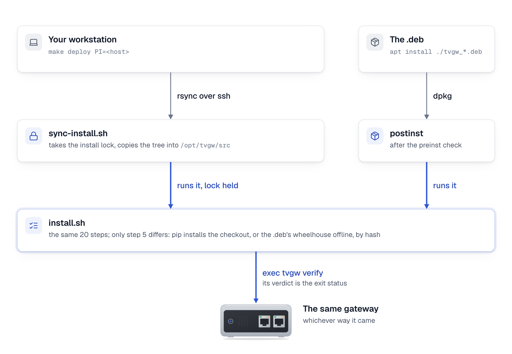

# Packaging

tvgw installs two ways: from a checkout with `deploy/install.sh`, as the reference gateway and CI do, or from a .deb for arm64 or amd64, which the release's one-line installer, `get.sh`, downloads, checks and installs. This page owns the .deb and the installer as project artifacts: what the package holds, how it relates to `install.sh`, how to build it, how a release is made and checked, how each supported distribution's own programs are checked against tvgw's files, and the signed apt repository that is still to come; installing, upgrading and removing it are in [install tvgw](../install/README.md#install-the-package) and [keep it running](../use/maintenance.md#upgrade-tvgw). It is for whoever builds the package or cuts a release, and the decisions behind it are [23](../design-decisions.md#23-the-deb-runs-installsh), [24](../design-decisions.md#24-the-tv-side-comes-from-the-settings-file), [25](../design-decisions.md#25-adguard-home-is-a-checked-dependency-never-bundled) and [53](../design-decisions.md#53-releases-carry-a-hash-checked-bootstrap-for-two-architectures-with-provenance-under-immutable-releases-updates-are-checked-weekly-installed-only-by-the-user-judged-by-verify-and-rolled-back-a-new-settings-key-never-changes-the-meaning-of-an-old-keys-value).

## What the package is

The .deb is a carrier for the installer. It holds the same `deploy/` tree a checkout has, an offline wheelhouse of every Python dependency pinned by hash, and four maintainer scripts; its postinst runs that tree's `install.sh`. So a package install, a source install and a CI deploy are one sequence of steps, and the gateway they produce is the same: the virtualenv in `/opt/tvgw-venv`, `tvgw` in `/usr/local/bin`, the scripts in `/usr/local/sbin`, the units in `/etc/systemd/system`, the settings in `/etc/tvgw/tvgw.conf` and the state in `/var/lib/tvgw` ([what install.sh does](../../deploy/README.md#what-installsh-does)).

| Path in the package | What it is |
|---|---|
| `/usr/lib/tvgw/deploy/` | The tracked files of `deploy/`, with their modes: `install.sh`, the templates, the units, the scripts and their READMEs. |
| `/usr/lib/tvgw/wheels/` | The tvgw wheel and one wheel per dependency and interpreter: CPython 3.11 (Debian 12), 3.12 (Ubuntu 24.04), 3.13 (Debian 13, Raspberry Pi OS trixie) and 3.14 (Ubuntu 26.04), for the package's architecture (aarch64 or x86_64). |
| `/usr/lib/tvgw/requirements.lock` | `packaging/requirements.lock`, plus the hash of each wheel the build made from a source archive. |
| `/usr/lib/tvgw/SHA256SUMS` | The hash of every file in `wheels/`, made by the build. |
| `/usr/share/doc/tvgw/` | The licences in Debian's machine-readable form (`copyright`, from packaging/copyright: MIT for the code and a `Files:` entry for the companies snapshot, CC BY-SA 4.0), `NOTICE`, which says the same in plain text, and this page. |

The package depends on `python3 (>= 3.11)`, `python3-venv`, `nftables`, `iproute2`, `procps`, `kmod`, `util-linux`, `network-manager`, `dnsmasq`, `nginx`, `libnginx-mod-stream`, `tcpdump`, `conntrack`, `tshark`, `wireshark-common` (dumpcap, the capture), `curl`, `ca-certificates` and `systemd`, and recommends `logrotate`. It does not depend on AdGuard Home, which has no .deb ([AdGuard Home](../install/README.md#prepare-the-gateway)).

<picture>
  <source media="(prefers-color-scheme: dark)" srcset="../diagrams/fig-11-install-paths.dark.png">
  
</picture>

*Every route ends in the same installer, and only step 5, where the Python package comes from, differs.*

### How install.sh tells the two apart

`install.sh` runs in package mode when it finds `requirements.lock` and `wheels/` beside its tree, which is the package's layout and never a checkout's. In package mode, step 5 checks the wheelhouse against `SHA256SUMS` (a card that corrupts a file fails here, not in a running unit), installs the dependencies with `pip install --no-index --find-links /usr/lib/tvgw/wheels --require-hashes -r /usr/lib/tvgw/requirements.lock`, and installs the tvgw wheel with `--no-deps --force-reinstall`. Nothing is fetched from the network. Every other step is the same in both modes.

The preinst runs before dpkg unpacks anything and refuses two computers, with nothing changed on either: one without AdGuard Home at the version floor ([design decision 25](../design-decisions.md#25-adguard-home-is-a-checked-dependency-never-bundled)), and, on a fresh install, one whose dnsmasq or nginx already does a job of its own: a `/etc/dnsmasq.conf` with settings in it (comments and Debian's `conf-dir` line do not count), a file in `/etc/dnsmasq.d/` other than Debian's `README`, tvgw's own and dpkg's copies of packaged files (a name that ends in `.dpkg-new`, `.dpkg-dist` or `.dpkg-old`, which Debian's dnsmasq is told to skip, `CONFIG_DIR` in `/etc/default/dnsmasq`), a site in `/etc/nginx/sites-enabled/` other than `default`, or a file in `/etc/nginx/conf.d/` other than tvgw's. `install.sh` would turn that dnsmasq's DNS off and give it the TV port alone, remove nginx's default site and sandbox both services away from `/home` and the home network, so a stranger's resolver or web site would break without a word. The message names each file. `TVGW_TAKE_OVER=1` in the environment lets tvgw take them over on purpose; the one-line installer hands its environment through apt, so `curl ... | sudo env TVGW_TAKE_OVER=1 sh` is the form. An upgrade is not checked: the files it would find are tvgw's own install's. dpkg's copies pass because one is there on every computer that had no dnsmasq: apt unpacks dnsmasq in the same run, a moment before the preinst, and its `README` is `README.dpkg-new` until dpkg configures the package. 0.3.1's preinst named that file as somebody's and refused every such install; the release's install check stopped it on all four systems on 2026-11-05, so 0.3.1 has a tag and no release.

The postinst sets `TVGW_POSTINST=1`, clears `TVGW_SETUP_PASS` (setup's alone: [the setup passes](../../deploy/README.md#the-setup-passes)) and closes stdin, so `install.sh` never prompts and never runs as one of the passes, and it reads the installer's exit status ([design decision 23](../design-decisions.md#23-the-deb-runs-installsh)):

| `install.sh` ends with | From a checkout | Under the postinst |
|---|---|---|
| 0, verify passed | exit 0 | the package is configured |
| 75, the TV is not identified | exit 75 without a terminal; with one, it runs discovery instead | the package is configured; the postinst says to cable the TV and run `sudo /usr/lib/tvgw/deploy/install.sh` |
| 76, verify reported a `FAIL` | not used: `exec tvgw verify` exits 1 | the package is configured; the postinst says to fix what verify named |
| 77, (adguard) AdGuard Home is not tvgw's and serves other devices | exit 77; the line says to set `ADGUARD_TAKE_OVER=yes` and run `sudo ./install.sh` again | the configuration fails; the line names `sudo dpkg --configure -a`, which runs the install again once the setting says yes |
| 1, a step stopped the install | exit 1 | the configuration fails; dpkg marks the package half-configured and `sudo dpkg --configure -a` runs the install again |

Any other status also fails the configuration. A stop is always 1: `install.sh` traps `ERR` (with `set -E`, so in functions and subshells too) and exits 1 whatever the failing command returned. Under `set -e` alone the command's own status became the installer's, and nmcli exits 3 on a timeout and 4 when an activation fails, so a half-done install once read as one of the deliberate exits and dpkg called it configured. The deliberate exits are 75, 76 and 77 for the same reason: no command `install.sh` runs returns them.

## The installer, get.sh

Every release carries `get.sh`, a POSIX `sh` script the release job renders from `packaging/get.sh.in` with the release's version and the SHA-256 of both packages written in ([releases](#releases)). It is the one-line install:

```sh
curl -fsSL https://github.com/kywwilson11/tvgw/releases/latest/download/get.sh | sudo sh
```

`releases/latest/download/` serves the file of that name from the release GitHub marks latest, never a draft or a prerelease, and the release job marks the newest version ([releases](#releases)), so the address never changes. In order, the script:

1. Checks the computer and stops, with one line that says why, when it is not root ("put sudo before sh"), runs no systemd, has no `curl` (the script may have come by another tool), is 32-bit (`armhf`, `armel` or `i386`: "reflash with Raspberry Pi OS Lite (64-bit), or install the 64-bit version of your system"), is another architecture than arm64 and amd64, or runs a system other than Raspberry Pi OS (64-bit), Debian 12 or 13, and Ubuntu 24.04 or 26.04 (read from `/etc/os-release` in a subshell, so no name in it can replace one of the script's; a file the shell cannot read stops it too), or an Ubuntu with no `network-manager` package (Ubuntu Server, whose network netplan and networkd run: the NetworkManager the package would bring keeps off wired ports there, [choose a gateway computer](../install/choosing-a-gateway.md#systems)). A Debian without NetworkManager installs: the package brings it, and `install.sh` starts it before the TV side. It also stops when `/usr/local/bin/tvgw` exists and dpkg has no tvgw package: that tvgw came from a checkout's `install.sh`, and a gateway runs from one or the other ([how the .deb and install.sh relate](#how-the-deb-and-installsh-relate)), and when `/opt/AdGuardHome/AdGuardHome` is missing: the package's preinst refuses a computer without AdGuard Home ([design decision 25](../design-decisions.md#25-adguard-home-is-a-checked-dependency-never-bundled)), and the script says so before it downloads anything, with the command that installs it; the version floor stays the preinst's.
2. Downloads `tvgw_<version>-1_<arch>.deb` and `SHA256SUMS` from its own release, over HTTPS, with redirects allowed only to HTTPS.
3. Refuses the package unless its SHA-256 equals the one written into the script and its line in `SHA256SUMS` matches: "the downloaded package does not match this installer's hash; nothing was installed". Nothing on the computer has changed before this check passes.
4. Writes `/run/tvgw/fresh-deps`, the names among `nginx` and `dnsmasq` that dpkg does not have installed, which apt is about to install new. It records which services the package brought before apt runs, which the computer cannot tell afterwards; the postinst copies it into its record for removal ([what removing the package gives back](#what-removing-the-package-gives-back)).
5. Answers No to `wireshark-common`'s capture question before apt asks, as in [install from the package](../install/advanced.md#install-from-the-package).
6. Runs `apt-get update`, then `apt-get install -y` of the package, both with `-o DPkg::Lock::Timeout=300`, since a first boot's unattended upgrades or PackageKit can hold apt's lock for minutes, and with no input; the install keeps the administrator's version of a changed configuration file (`--force-confdef`, `--force-confold`). While apt installs, `/usr/sbin/policy-rc.d` exits 101, so no service the dependencies bring, such as nginx or dnsmasq, starts during the transaction: `deb-systemd-invoke` and `invoke-rc.d` ask it first, while `install.sh` calls `systemctl`, which does not. A `policy-rc.d` that was already there, even a link to nothing, is the administrator's and stays as it was. The script's own carries a marker line, and is removed when apt finishes, when the script stops, including on Ctrl-C, a closed terminal or a kill, or, when a `SIGKILL` or a power cut left it, by the next run before anything else, even a run that then stops at its checks; until that run, it holds the service starts of every other apt run too.
7. Removes its download folder and its `policy-rc.d` by hand, because `exec` skips the shell's exit trap, then runs `tvgw setup` on the terminal (`exec tvgw setup </dev/tty`), since the script itself arrived on standard input.

It asks nothing itself. `TVGW_NO_SETUP=1` stops after the package and prints the next step, as the script does when there is no terminal (cloud-init, another script). Everything is inside a function, `main`, called on the script's last line, so a download that stops part way runs nothing; `tests/unit/test_get_sh.py` cuts the script at every line and in the middle of every line and checks that nothing ran. `TVGW_ROOT` (a directory the system paths are read under) and `TVGW_BASE` (an `https://` or `file://` folder to download from) exist for the tests: the hashes are written into the script, so neither changes what it installs, and `sudo` resets the environment anyway.

To read the script before it runs:

```sh
curl -fsSLO https://github.com/kywwilson11/tvgw/releases/latest/download/get.sh
less get.sh
sudo sh get.sh
```

The hash makes the script refuse any package but the one the release job built. The script's own integrity rests on GitHub: on the account that publishes releases, and on immutable releases, which keep a published release's files and tag from changing ([checking a release](#checking-a-release)). No signature is checked until the owner signs `SHA256SUMS` with a key of their own ([a signed apt repository](#a-signed-apt-repository)).

## How the .deb and install.sh relate

- `install.sh` remains the from-source path and the CI deploy path: `make deploy` and the hardware job run `sync-install.sh`, which runs `install.sh` from `/opt/tvgw/src` ([how a change reaches the gateway](../../deploy/README.md#how-a-change-reaches-the-gateway)). The reference gateway stays on that path.
- Both paths take the install lock, `/run/tvgw/install.lock`, so a package install and a CI deploy never interleave.
- Both write the same files, so whichever ran last owns the gateway. A `make deploy` or a CI deploy on a gateway installed from the .deb replaces its Python package with the checkout's until the next package install, and the next package install does the reverse. Keep each gateway on one path.
- A source install resolves the dependencies at install time, unpinned; the package installs exactly the lock. Moving the source path onto the lock is a follow-up, not done here, because it would change the reference gateway's dependency versions on the next deploy.
- `tests/unit/test_packaging.py` keeps the two in step: the layout `install.sh` looks for, the shared AdGuard Home check, and the paths postrm removes against the paths `install.sh` writes.

### What removing the package gives back

(uninstall) Two things `install.sh` changes are not files the postrm can delete: the wired connection it stops from connecting on its own, so that `tv-lan` has the TV port (`stand_aside`), and a dnsmasq apt installed for tvgw, which without tvgw's `/etc/dnsmasq.d/tvgw.conf` is Debian's stock resolver on every interface. The postinst keeps both in `/var/lib/tvgw/.installed-by-tvgw`, one fact a line, mode `640`, written only when there is something to keep:

- `package <name>`, from the one-line installer's `/run/tvgw/fresh-deps` (step 4 of [the installer](#the-installer-getsh));
- `autoconnect <uuid>`, a NetworkManager connection that connected on its own before the postinst ran `install.sh` and no longer does afterwards (`nmcli -t -f UUID,AUTOCONNECT con show` either side). Turning that off is `stand_aside`'s alone, and a connection deleted meanwhile is not recorded.

The record is written outside `install.sh`, by the package's own postinst, so a connection stood aside by an `install.sh` the postinst did not run (by hand, or `tvgw setup` moving the TV port) is not in it; a source install has no postrm and no record. The postrm reads it:

| | `remove` | `purge` |
|---|---|---|
| `package dnsmasq` | `systemctl disable --now dnsmasq`, and a line naming `sudo apt purge dnsmasq` | the same |
| no `package dnsmasq` (the administrator's dnsmasq) | restarted on its own configuration, as before | the same |
| `autoconnect <uuid>` | kept, with `tv-lan`: a line says that `purge` gives the port back | after `tv-lan` is deleted, `nmcli con modify <uuid> connection.autoconnect yes`, a line naming the connection, and the line leaves the record; one that cannot be changed is named with the command, and kept |

The `package` lines stay through a purge, with the store. Because a removal switches dnsmasq off, the postinst switches a disabled dnsmasq on at boot before it runs `install.sh`; a masked one is the administrator's and stays masked.

## Building the .deb

You need Python 3.11 or newer with pip, git, and nfpm (`brew install nfpm`, or a release from <https://github.com/goreleaser/nfpm/releases>). Build from a checkout with nothing untracked under `deploy/`, `src/` or `packaging/`:

```sh
make deb                    # dist/tvgw_<version>-1_arm64.deb
TVGW_ARCH=amd64 make deb    # dist/tvgw_<version>-1_amd64.deb
```

`make deb` runs `packaging/build-deb.sh`, which the release workflow runs too:

1. Refuses untracked files under `deploy/`, `src/` or `packaging/`, because `deploy/local/` holds a site's real settings; only what git tracks is packaged.
2. Creates a build venv, `build/venv`, and installs the build backend into it from `packaging/build-requirements.lock` with `--require-hashes`: setuptools, wheel and wheel's one dependency, packaging. Both wheel builds below run in that venv with `--no-build-isolation`, so pip never fetches an unpinned backend into an isolated build environment, and a changed backend cannot reach a release unhashed.
3. Builds the tvgw wheel from a fresh build directory.
4. Runs `packaging/wheelhouse.py`, which fetches every dependency in `packaging/requirements.lock` with `pip download --require-hashes`, one wheel per target interpreter for the package's architecture, aarch64 or x86_64 ([packaging/README.md](../../packaging/README.md)). A file PyPI serves that the lock does not list is refused. A dependency with no wheel at all, today only `sqlitedict`, is fetched as its source archive against the lock's hash and built into a pure-Python wheel; that wheel's hash is added to the lock the package carries, so the gateway's pip checks it too.
5. Writes `SHA256SUMS` of the wheelhouse and copies the tracked `deploy/` tree.
6. Runs `nfpm package` with `packaging/nfpm.yaml`.

Both architectures build from the same steps on any machine, since pip fetches wheels for the target and nfpm only packs files. Build releases on Linux: pip judges a dependency's environment markers by the machine it runs on.

### The lock

`packaging/requirements.lock` pins every runtime dependency of the `lgwebos` and `analyst` extras, the ones `install.sh` installs, with every published file's hash, resolved for Python 3.11 and later on any platform. Regenerate it after a change to `pyproject.toml`'s dependencies, and to take dependency updates, with uv at the version the Makefile pins (`UV_VERSION`; `pip install uv==<that version>`). `make lock` refuses any other uv, since another version may resolve or annotate the lock differently. It also regenerates `packaging/build-requirements.lock` from `packaging/build-requirements.in`, the pinned build backend, and `docs/site/requirements.lock`, the documentation site's generator ([the documentation site](../site/README.md#changing-it)); raise those pins on purpose, once a release is two weeks old:

```sh
make lock
git diff packaging/requirements.lock   # review what moved
```

## Releases

`.github/workflows/release.yml` runs on a pushed tag that starts with `v`, and on a manual run (`workflow_dispatch`). Its token reads the repository and nothing else; the three jobs that need more say so on the job. The jobs, in order:

| Job | Runs on | What it does | Its token |
|---|---|---|---|
| `gate` | `ubuntu-latest` | On a tag, `packaging/release_notes.py` checks the changelog's section for the tag's version first ([the changelog's Highlights and Status](#the-changelogs-highlights-and-status)), so a tag whose section is not ready stops before anything is built. Then it installs the checkout with its `dev` extras and runs `make gate`. | read |
| `deb`, once for `arm64` and once for `amd64` | `ubuntu-latest` | Downloads nfpm 2.48.0 for Linux x86_64 and refuses it unless its SHA-256 is the pinned `NFPM_SHA256`, then runs `packaging/build-deb.sh dist` with `TVGW_ARCH` set to the architecture and `TVGW_TAG` to the tag, empty on a manual run. With `TVGW_TAG` set, the script refuses to build unless the tag is `v` followed by the version in `pyproject.toml`: `v0.2.0` builds 0.2.0 and nothing else. nfpm and pip build both packages on the x86_64 runner. Keeps the package as the artifact `tvgw-deb-<arch>`. | read |
| `install-check-arm64`, `install-check-amd64` | `ubuntu-24.04-arm`, `ubuntu-latest` | Runs `packaging/check-platform.sh --package` on its architecture's package in `debian:13` and `ubuntu:24.04` containers, each pinned by digest and given `NET_ADMIN` and `NET_RAW`. It runs `packaging/install-check.sh` first: AdGuard Home at the floor, since the preinst refuses a system without it, then the package with apt, then the package's wheelhouse checked against its `SHA256SUMS` and installed offline and hash-checked, with `install.sh`'s own commands, into a virtualenv on the container's `python3`; `tvgw --version` must name the package's version, and `bscpylgtv`, `anthropic` and `yaml` must import. Then the rest of the [platform check](#the-platform-check) reads the package's own files in `/usr/lib/tvgw/deploy`. A container runs no systemd, so the postinst runs no `install.sh` there. | read |
| `assets` | `ubuntu-latest` | `packaging/release-assets.sh` writes `SHA256SUMS` of both packages, renders `get.sh` from `packaging/get.sh.in` with `sed` (the version and both hashes; a field left unfilled fails the job) and adds `get.sh` to `SHA256SUMS`. On a tag it also writes the notes and attests the packages and `get.sh` with `actions/attest`. Keeps all of it as the artifact `tvgw-release`. It is the one job that can sign, and it runs only this repository's scripts and pinned actions, none of the build's third-party code. | read, `id-token: write`, `attestations: write` |
| `publish`, on a tag, after `assets` and both install checks | `ubuntu-latest` | `packaging/publish-release.sh` creates the release as a draft (`gh release create --verify-tag --draft`, titled `tvgw <version>`, with the notes), uploads both packages, `get.sh` and `SHA256SUMS` to it, then publishes it (`gh release edit --draft=false`). It is marked latest unless a newer version is already published, so a fix for an older line never takes over `releases/latest`. A draft left by a failed run is refreshed and published; a published release is refused. Only GitHub's "release not found" counts as no release: any other failure to read a release's state stops the job, so a passing outage never makes a second draft or hands an older version `releases/latest`. Two runs for one tag queue rather than race. | `contents: write` |
| `site`, on a tag, after `publish` | `ubuntu-latest` | Starts the documentation site's workflow on `main` with `gh workflow run pages.yml --ref main`. GitHub starts no workflow from a release a job's own token published, so `pages.yml`'s `release` trigger never fires for this one; its gate then decides as for any run on `main` ([when it publishes](../site/README.md#when-it-publishes)). It checks nothing out and runs no action. When the dispatch fails, the job ends with a warning that names the command, and the run stays green: the release is already published. | `actions: write` |

Draft first because, once immutable releases are on, a published release's files cannot change: a release is never public with a file missing. Every action is pinned by commit with its version in a comment, and every container image by digest ([supply chain](supply-chain.md#what-is-in-place)). A manual run on any ref builds and checks the same files and keeps them as artifacts; it writes no notes, attests nothing, publishes nothing and starts no site. Nothing here deploys: `ci.yml`'s hardware job, on pushes to `main`, is the one path to the gateway. The workflow does not check which branch the tagged commit is on, so only a commit of `main` is tagged, or of a `release/<major>.<minor>.x` branch for a fix to an older line.

A pull request that changes what the package is built from builds it too, for amd64, with the same script and nfpm, and keeps nothing: `ci.yml`'s `deb-build` job ([the jobs](../../deploy/README.md#how-a-change-reaches-the-gateway)). A path nfpm can no longer find, such as a page `nfpm.yaml` copies that moved, fails the pull request, before any tag. That job builds the package and installs it nowhere, and a change pushed to `main` without a pull request does not start it. So the manual run in step 3 of [cutting a release](#cutting-a-release) is the one place a package is installed before its tag.

### The changelog's Highlights and Status

A version's section of `CHANGELOG.md`, `## <version> (<YYYY-MM-DD>)`, starts with two blocks, in this order, that become the release page's own text:

- `### Highlights`: three to six bullets, one line each and at most 220 characters, in plain words, for someone deciding whether to install or upgrade. `release_notes.py` refuses a highlight that uses one of the engineering terms the user pages avoid (`PLAIN_WORDS` in the script: nftables, conntrack, nginx, dnsmasq, a design decision's number, a VPN product's name and the like) or a settings key.
- `### Status`: one paragraph on what was tested on hardware for this version, and what was not.

The detail for engineers follows in dated `### <topic> (<date>)` subsections, as before, and the notes link it rather than repeat it. `## Unreleased` opens with the same two blocks, kept current as changes land; cutting a release trims the highlights to six at most and rewrites the status. 0.2.0 and the versions before it were released before this convention and keep their sections as written. `tests/unit/test_release_notes.py` holds `CHANGELOG.md` to it: Unreleased opens with the two blocks, and every version released after 0.2.0 renders.

The notes are `.github/release-notes.md.in` filled in: what tvgw is, the highlights and a link to the version's changelog section, the status, the install command and what it does, which file is which, and how to check a download. `release_notes.py` refuses notes longer than 60 lines, and the test checks that every page the template links at the tag exists with its heading.

### Checking a release

Any release can be checked from any computer that has its files:

```sh
sha256sum -c SHA256SUMS --ignore-missing
gh attestation verify tvgw_<version>-1_arm64.deb -R kywwilson11/tvgw \
  --signer-workflow kywwilson11/tvgw/.github/workflows/release.yml
gh release verify-asset v<version> tvgw_<version>-1_arm64.deb -R kywwilson11/tvgw
```

The first compares each file with the release's `SHA256SUMS`. The second checks the build provenance `actions/attest` recorded: a statement, signed with a short-lived Sigstore certificate issued to that workflow run and entered in Sigstore's public transparency log, that this repository's release workflow built the file from that tag's commit. It proves where a file came from, not that the code at that commit is safe. The third checks the file against the release's own attestation, which GitHub makes for a release published while immutable releases are on; such a release's files and tag cannot change once it is published. Immutable releases are a repository setting ([supply chain](supply-chain.md#repository-settings-that-matter-for-the-reference-gateway)), and a release published before it was turned on stays mutable.

### Cutting a release

1. On a branch, set the version in `pyproject.toml` and `src/tvgw/__init__.py`. In `CHANGELOG.md`, turn "Unreleased" into a section for the version and date, with its Highlights trimmed to three to six bullets and its Status rewritten for what was tested, and leave a new "Unreleased" above it that opens with an empty `### Highlights` and `### Status`. Check the notes, then merge the branch into `main` through CI:
   ```sh
   python3 packaging/release_notes.py --version 0.3.0 --changelog CHANGELOG.md \
       --template .github/release-notes.md.in --out /tmp/notes.md
   ```
2. Build once locally if nfpm is at hand: `TVGW_TAG=v0.3.0 make deb` runs the same script with the same check.
3. Run the release workflow by hand on the merged commit and wait for it: every job but `publish` and `site` runs, so both packages are built and installed on Debian 13 and Ubuntu 24.04, for arm64 and amd64, and nothing is published. Tag only a commit whose manual run is green. 0.3.1 was tagged without this run, and its package refused every computer that had no dnsmasq; the tag's own run was the first to install it.
   ```sh
   gh workflow run release.yml --ref main --repo kywwilson11/tvgw
   gh run watch --repo kywwilson11/tvgw "$(gh run list --workflow release.yml --event workflow_dispatch --repo kywwilson11/tvgw --limit 1 --json databaseId --jq '.[0].databaseId')"
   ```
4. Check that immutable releases are on (`gh api repos/kywwilson11/tvgw/immutable-releases` says `"enabled":true`).
5. Tag the merged commit of `main` and push the tag:
   ```sh
   git switch main && git pull --ff-only
   git tag -a v0.3.0 -m "tvgw 0.3.0"
   git push origin v0.3.0
   ```
6. When the run finishes, download the files and check them as in [checking a release](#checking-a-release), and check that `curl -fsSIL https://github.com/kywwilson11/tvgw/releases/latest/download/get.sh` ends in `200`. The run's last job, `site`, prints `started docs-site (pages.yml) on main for v0.3.0`, and the `docs-site` run it started publishes the site a few minutes later, once its gate finds every command the pages name in the release ([when it publishes](../site/README.md#when-it-publishes)). If `site` ended with a warning instead, the release stands; start the site by hand, and check that the run's `deploy` job ran:
   ```sh
   gh workflow run pages.yml --ref main --repo kywwilson11/tvgw
   gh run list --workflow pages.yml --repo kywwilson11/tvgw --limit 1
   ```

What the owner's signing key adds later, and nothing in the repository does yet: a signed tag (`git tag -s` in place of `git tag -a`, checked with `git tag -v`; [signed commits and tags](supply-chain.md#signed-commits-and-tags)), so a release names who cut it, a signed `SHA256SUMS` that `get.sh` checks, and [the signed apt repository](#a-signed-apt-repository) below, so a gateway takes upgrades through apt with the archive's signature checked. Until then a release's integrity rests on GitHub's account security, immutable releases and the attestations.

## The platform check

`packaging/check-platform.sh` checks that one distribution's own programs run what tvgw installs: its apt resolves the package's dependencies, its `nft` loads the firewall, its `dumpcap` names the capture files with the time stamp the gateway reads back, its `nginx` and `dnsmasq` accept the rendered files, and its systemd reads every unit. It writes system files, so it runs only as root in a throwaway container: outside one (no `/.dockerenv` or `/run/.containerenv`), or beside an `/etc/tvgw` it did not make, it stops before it changes anything.

| Mode | What it installs first | Where it runs |
|---|---|---|
| `--source` | `packaging/nfpm.yaml`'s Depends, with `apt-get satisfy`, so a name or a version the distribution lacks fails | `distro.yml`, for every pull request and every push to `main` that changes more than Markdown and `docs/` |
| `--package <file.deb>` | the package, with `packaging/install-check.sh` ([releases](#releases)) | `release.yml`'s `install-check-arm64` and `install-check-amd64` |
| `--package v<version>` | that release's package for this computer's architecture, refused unless its SHA-256 matches its line in the release's `SHA256SUMS` | by hand, to check a published release in a new distribution |

`--list-depends` prints the Depends it would install and needs nothing. With every service held while apt runs (a `policy-rc.d` of its own, as `get.sh` uses) and dumpcap preseeded as `get.sh` preseeds it, the steps are:

1. It records the versions of `nft`, systemd, `python3`, `dnsmasq`, `nginx`, `dumpcap`, `conntrack`, `tshark`, NetworkManager and the kernel in `versions.txt`. A missing one fails.
2. With `--source`, it runs the unit suite on the distribution's `python3`, in a virtualenv, as an unprivileged user (`tvgwci`) on a copy of the checkout, since as root the tests of unreadable files are skipped. This is the only place the suite runs on Python 3.12 and 3.14. No image has git, and the tests of the deploy window, the pull request's build, the link check and the docs tools make throwaway repositories with it, so the check installs `git` for the suite after the Depends; it is not a Depends of the package. The suite's summary lists each test it skipped, with the reason ([which tests skip](../../tests/unit/README.md#running-them)). Two skip here and not in CI's `test` job, since neither tool is one the package installs: the sync-install test without rsync, which only installing from a checkout uses, and the installer's shellcheck without shellcheck, the gate's lint.
3. It runs `tvgw-apply --check` with the distribution's `nft` against the running kernel, with the TV on `dummy0` and the uplink on `dummy1`: the template's settings, `UPLINK=vpn`, `CAPTURE_MODE=headers` with `TV_PROBE=on` (the probe's rules, [design decision 65](../design-decisions.md#65-a-test-client-stands-where-the-tv-stands-an-apply-is-probed-before-and-after-and-only-reports-what-it-would-undo)), the other value of each remaining switch, and `DNSGATE_FILL=inpath` (the queue rules of [design decision 64](../design-decisions.md#64-the-gates-second-set-is-filled-in-the-path-of-the-answer-beside-the-passive-feeder-and-still-only-counts), which need the kernel's `nft_queue`), five times in all. The check must load nothing: the tables after it must be the ones before it, since a container may hold its own. On a user-defined network, which GitHub's container jobs use, Docker puts iptables rules for its DNS in the container's namespace ([Docker's packet filtering](https://docs.docker.com/engine/network/firewall-iptables/), read 2026-11-03), and `nft list tables` shows them as `table ip nat`.
4. It runs `dumpcap` for 1 second on `lo` with the ring options of `tvgw-pcap.service`'s `ExecStart`, read from the unit, and requires one file named `tv_<14 digits>_00001.pcap`: the time first, so the files sort in time order across restarts, and the stamp the change ledger reads (`_PCAP_UTC` in `src/tvgw/ledger.py`). It also requires `/usr/bin/dumpcap` to be executable by the `tvgw-pcap` user, which is `install.sh`'s own check that the preseed took.
5. It renders the URL filter's files as `install.sh` does and runs `nginx -t` twice: with the stream include appended to `nginx.conf`, as `install.sh` writes it today, and with `nginx.conf` as shipped and the include in `/etc/nginx/modules-enabled/99-tvgw-stream.conf`, read after the stream module's own file there.
6. It renders the DHCP file three ways and runs `dnsmasq --test` on each: open with the TV not yet known (no pin line), open with the TV pinned, and pinned (`TV_DHCP=pinned`), where a static range for the TV's address and `dhcp-ignore=tag:!known` replace the pool, so the pinned TV alone is answered.
7. It installs the units, the capture's drop-in, the hardening drop-ins for `dnsmasq.service` and `nginx.service`, and the scripts the units start, where `install.sh` puts them, and runs `systemd-analyze verify --man=no` on all of them. A finding on a tvgw file fails, unless the script's `ALLOWED` list names it for that distribution with its reason. The one entry today is Debian 12's: systemd 252 predates `RestartSteps=` and `RestartMaxDelaySec=` (systemd 254), so `tvgw-dnsgate.service` restarts every 5 seconds there instead of backing off to 5 minutes. A finding on a file of the distribution's own is printed and passes.

Every step runs, and the run fails at the end when any failed, naming each. `TVGW_PLATFORM_OUT` names the folder it writes to (`/tmp/tvgw-platform` by default): `versions.txt`, each settings file and ruleset of step 3 and the tables before and after it, the dumpcap, nginx and dnsmasq logs and files, `systemd-analyze.log`, and `result.txt`. `distro.yml` keeps it as the artifact `platform-<distribution>-<arch>` for 30 days.

The eight cells of `distro.yml` are `debian:12`, `debian:13`, `ubuntu:24.04` and `ubuntu:26.04`, each pinned by the digest of its multi-architecture index, on `ubuntu-latest` (amd64) and `ubuntu-24.04-arm` (arm64), with `--cap-add=NET_ADMIN --cap-add=NET_RAW` for the dummy ports, `nft -c` and the capture. A container shares the runner's kernel and runs no systemd, so the check covers each distribution's programs, not its kernel, NetworkManager's behaviour or a real run of `install.sh`. `tests/unit/test_check_platform.py` runs the script under `sh` and `dash` against stubs, and `tests/unit/test_supply_chain.py` holds the workflow to the same images and steps on both architectures.

What the cells found that a gateway on that system lives with, which [choosing a gateway](../install/choosing-a-gateway.md#systems) states in plain words:

- **Debian 12.** Its systemd 252 ignores `RestartSteps=` and `RestartMaxDelaySec=` (the `ALLOWED` entry above). Its kernel, 6.1, predates 6.12, so an address in the DNS gate's set keeps the expiry of its first answer, and the gate counts more connections as ones no lookup returned ([design decision 43](../design-decisions.md#43-the-flow-log-hears-the-tv-alone-and-the-gates-day-starts-at-each-answer)). It is best effort until its LTS ends (2028-06-30).
- **Debian 13 with ifupdown (a server install).** The package installs NetworkManager beside ifupdown. When `/etc/resolv.conf` is a regular file and neither systemd-resolved nor resolvconf is in use, NetworkManager writes that file itself ([`rc-manager` in NetworkManager.conf](https://networkmanager.dev/docs/api/latest/NetworkManager.conf.html), read 2026-11-03). The one connection tvgw gives it, the TV's port, has no name server, so whether the gateway keeps its own name lookups is untested.
- **Ubuntu 24.04 and 26.04 Server, and Debian 13's cloud images.** netplan with systemd-networkd runs their network, and `install.sh` sets up the TV's port with NetworkManager: not supported yet.

To run one cell on your workstation, with Docker (an amd64 image on an arm64 machine needs emulation):

```sh
mkdir -p /tmp/tvgw-platform
docker run --rm --cap-add=NET_ADMIN --cap-add=NET_RAW -v "$PWD":/src:ro -v /tmp/tvgw-platform:/out \
    debian:12 sh -c 'TVGW_PLATFORM_OUT=/out sh /src/packaging/check-platform.sh --source'
cat /tmp/tvgw-platform/versions.txt /tmp/tvgw-platform/result.txt
```

## A signed apt repository

Not built yet: it needs a signing key that only the owner may create and hold. Whoever holds that key can change the firewall of every gateway that runs `apt upgrade`, so it is made on a trusted machine, its secret half stays offline, and its public half is the only part that goes anywhere. These are the steps, in order; nothing in the repository generates a key.

1. **Make the key**, once, on a trusted machine:
   ```sh
   gpg --quick-generate-key "tvgw archive signing key <owner@example.org>" ed25519 sign 2y
   FPR=$(gpg --list-secret-keys --with-colons | awk -F: '/^fpr/ {print $10; exit}')
   gpg --export "$FPR" >tvgw-archive-keyring.pgp                       # the public keyring
   gpg --export-secret-keys --armor "$FPR" >tvgw-archive-signing.asc    # the backup: offline media only
   ```
2. **Make the repository** with reprepro, in a directory published as static files (a GitHub Pages branch of a separate repository, say):
   ```sh
   mkdir -p apt/conf
   cat >apt/conf/distributions <<EOF
   Origin: tvgw
   Label: tvgw
   Codename: stable
   Architectures: arm64 amd64
   Components: main
   Description: tvgw gateway packages
   SignWith: $FPR
   EOF
   reprepro -b apt includedeb stable dist/tvgw_<version>-1_arm64.deb
   reprepro -b apt includedeb stable dist/tvgw_<version>-1_amd64.deb
   ```
   Publish `apt/dists` and `apt/pool`, never `apt/conf` or `apt/db`, and publish `tvgw-archive-keyring.pgp` beside them.
3. **On each gateway**, add the key and a deb822 source with `Signed-By`, as Debian asks of third-party repositories (<https://wiki.debian.org/DebianRepository/UseThirdParty>):
   ```sh
   sudo install -D -m 644 tvgw-archive-keyring.pgp /etc/apt/keyrings/tvgw-archive-keyring.pgp
   sudo tee /etc/apt/sources.list.d/tvgw.sources >/dev/null <<EOF
   Types: deb
   URIs: https://<repository-host>/apt
   Suites: stable
   Components: main
   Architectures: arm64 amd64
   Signed-By: /etc/apt/keyrings/tvgw-archive-keyring.pgp
   EOF
   sudo apt update && sudo apt install tvgw
   ```
4. **To sign in CI** instead of by hand, store the armored secret key as a secret of a GitHub environment that requires the owner's approval, and add a job after `assets` in `release.yml` that imports it, runs `reprepro includedeb` and pushes the published tree. Until then, add each release by hand with step 2.
5. **Before the key expires** (two years with the command above), extend it with `gpg --quick-set-expire "$FPR" 2y`, export the keyring again and replace it on every gateway. A key that may have leaked is replaced, not extended: make a new one, publish its keyring, and sign the repository again.

## Limits

- Not yet run on hardware: each release's packages are installed in Debian 13 and Ubuntu 24.04 containers, where no systemd runs `install.sh`, but no gateway has installed one, from `get.sh` or by hand ([checking a package on a gateway](#checking-a-package-on-a-gateway)).
- The platform check covers each distribution's programs in a container on the runner's kernel. The container tier boots Debian 13 with systemd and runs `install.sh` from a checkout ([the container tier](../../tests/container/README.md)), not the package. No job yet boots a distribution and installs from `get.sh` end to end.
- The package still needs AdGuard Home installed first ([AdGuard Home](../install/README.md#prepare-the-gateway)), so `get.sh` on a computer without it stops before the download with the command that installs it, and a package installed by hand stops at the preinst's message.
- No .rpm or Arch package yet; nfpm builds both from the same YAML when a tier-3 distribution is wanted ([the survey's verdicts](../research/state-of-the-art-2026-10.md#82-packaging-verdicts)). <!-- (fin-docs) anchor fixed -->
- The firewall front-end is not detected: on a host running firewalld or ufw, their drops still apply to the TV's traffic (§8.4 item 3).
- Whether `nmcli con add` makes a keyfile or netplan YAML on Raspberry Pi OS images from November 2025 on is unverified (§8.1).
- `make wheel`, a developer convenience, still builds with pip's isolated, unpinned backend; `make deb` and the release do not ([building the .deb](#building-the-deb)).

## Checking a package on a gateway

On a spare gateway, or on the reference one with the owner's go-ahead (the package replaces the source install's Python package until the next deploy):

```sh
sudo apt install ./tvgw_<version>-1_arm64.deb                # install.sh's output, then verify's lines
sudo tvgw verify                                             # every line OK
dpkg -s tvgw | grep Status                                   # install ok installed
sudo apt install --reinstall ./tvgw_<version>-1_arm64.deb    # a second run restarts only what install.sh documents
sudo apt remove tvgw
cat /proc/sys/net/ipv4/conf/eth0/forwarding                  # 0: the TV is dark
sudo nft list table inet tvgw                                # gone
ls /usr/local/bin/tvgw /opt/tvgw-venv                        # gone; /etc/tvgw and /var/lib/tvgw are still there
```
