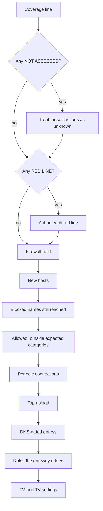

# Reading the brief

This page owns the daily brief and the reports built from the same data: what each line counts, in the order it prints, the thresholds behind it, and how to read it. It is for the owner reading the brief each day and for anyone interpreting a report or its JSON. The terms it uses are defined in [the glossary](glossary.md).

## The brief and the reports

`tvgw brief` covers one calendar day and `tvgw report` covers any window. Both print the same sections, from one function, `queries.window_report()`, which computes everything from the store when the command runs. The syntax of both is in [Commands](../src/tvgw/README.md#commands).

| Command | Window | First line |
|---|---|---|
| `tvgw brief [DAY]` | One local calendar day, yesterday by default (`queries.brief()`). | `=== 2026-10-26: ...` |
| `tvgw report --day DAY` | The same day, with the same output. | `=== 2026-10-26: ...` |
| `tvgw report --week WEEK` | One ISO week, Monday 00:00 to Monday 00:00 (`queries.weekly()`), with a By day table. | `=== week 2026-W44 (2026-10-26 .. 2026-11-01): ...` |
| `tvgw report` | The last 24 h up to now (`queries.latest()`). | `=== last 24 h to 2026-10-26 10:00: ...` |
| `tvgw report --since SINCE [--until UNTIL]` | Any window. | `=== 2026-10-26 00:00 .. 2026-10-27 00:00: ...` |

Days are the Pi's local calendar days, so a day on which the clocks change has 23 or 25 hours, and the ISO week 2026-W44 has 169 hours. Times are the Pi's local time. `cli.hb()` prints every size in powers of 1024 with a one-letter unit: `B`, `K`, `M` or `G`, as in `2.2K`.

### The files the hourly job writes

`tvgw-analyze` writes the same reports, as text and as JSON, under `/var/lib/tvgw/reports/` ([where it lives and who can read it](privacy-and-retention.md#where-it-lives-and-who-can-read-it)). How it decides is in [the shell jobs](../deploy/bin/README.md).

| Files | Window | When they appear |
|---|---|---|
| `latest.txt`, `latest.json` | The last 24 h. | At every run, replacing the previous pair. |
| `daily/<day>.txt`, `daily/<day>.json` | One finished calendar day. | Once, at the first run at least `SETTLE=10800` (3 h, in deploy/bin/tvgw-analyze) after the day ends: 03:20 with the shipped timer. Any of the last 14 finished days that has data in the store and no file yet is written at the next run. |
| `weekly/<week>.txt`, `weekly/<week>.json` | The last finished ISO week. | Once, on the same rule, from Monday 03:20. Older weeks are not written later. |

A daily or weekly file is never rewritten, and its evidence keeps arriving after it is written: conntrack reports an idle connection 7440 seconds (2 hours 4 minutes) after its last packet, and a pcap closes up to an hour after its hour. The archived file can therefore list a day's last connections as unnamed while `tvgw brief DAY`, computed again from the store, names them.

The analyst's proposals are not part of the brief. They are separate files in `reports/proposals/`, described in [the analyst and autonomy](analyst-and-autonomy.md).

## How to read it



*The order to read the brief in: the two checks at the top, NOT ASSESSED and RED LINE, decide how far the rest can be trusted.*

1. Read the header line for the window and its totals, so you know what the rest covers.
2. Read the Coverage line. Treat every section built on a source listed as `NOT ASSESSED` as unknown, not clean, because that source was not read recently.
3. Act on every `RED LINE:` line before anything else, with [the red lines](operations.md#red-lines).
4. Read Firewall held: which rules stopped packets, and whether the `tvgw verify` runs were recorded and passed.
5. Read New hosts, then Blocked names still reached over TLS. A new name is where change shows first, and a blocked name the TV still reached is a rule that did not hold.
6. Read Allowed, outside the expected categories: the allowed names that are not the TV doing its job, which are the candidates for rules.
7. Read Periodic connections, then Top upload. A timer and an upload are how telemetry looks when its name says nothing.
8. Read DNS-gated egress: connections to addresses no lookup returned.
9. Read Rules the gateway added on its own: what the machine blocked and how its watches judged each rule.
10. Read TV and TV settings: when the TV was on, and whether a setting changed.

The other sections are context for these.

## Coverage

The Coverage line says whether the pipeline looked. It names each source with the rows it put in the window, then the AdGuard Home version once `tvgw verify --record` has recorded one, then the time of the last ingest run. Under it come the `NOT ASSESSED` line, when a source qualifies, and one `ingest warning:` line per warning.

```text
Coverage: flows 2, dns 2, pcaps 1, gfts 2, tvstate 2, oddport 1, gate 0, verify 0; last ingest 10-26 10:00
NOT ASSESSED (source not read recently): verify
```

| Source | Rows it counts in the window | Its last read |
|---|---|---|
| `flows` | Connections whose conntrack report (`t_end`) falls in the window. | The last ingest run that read `flows.log` without failing. |
| `dns` | The TV's lookups. | The same, for AdGuard's query log. |
| `pcaps` | Captures read without error whose `done_at` falls in the window. | The same, for the pcap directory. |
| `gfts` | URL-filter requests from nginx's log. | The same, for `gfts.log`. |
| `tvstate` | The TV's hourly power readings. | The same, for `tvcheck-history.log`. |
| `oddport` | The unexpected-port rule's kernel-log lines. | The same, for the kernel log. |
| `gate` | The DNS gate's logged samples. | The same, for the kernel log. |
| `verify` | Recorded `tvgw verify` runs. | The last run recorded before the window's end. |

### The NOT ASSESSED rule

An ingest step stamps its source as read only when its input exists and the step finishes without failing, so a source that failed or is missing is never stamped ([design decision 14](design-decisions.md#14-red-lines-are-the-alarm-model)). A source is `NOT ASSESSED` when it was never read, or when its last read is more than `STALE = 7200` seconds (2 hours, in src/tvgw/queries.py) before the end of the window, or before now while the window is still open. A source that is assessed with 0 rows was read and was empty.

Two sources behave differently:

- **`tvstate` on a profile without a LAN-API reader.** The history file never exists, ingest does not warn about it (`OPTIONAL_SOURCES` in src/tvgw/ingest.py), and the source is `NOT ASSESSED` every day.
- **`pcaps` in a run that could read none of them.** When ingest cannot tell which file tcpdump holds open, or every pending file failed, it warns and raises `SourceSkipped`, so the source is not stamped as read and becomes `NOT ASSESSED` once its last read is `STALE`, rather than an assessed hour with no rows. The warning and its red line carry the news meanwhile.

### The verify runs

The `verify` count is the `tvgw verify --record` runs recorded in the window. The brief also works out how many it should hold: one per 600 seconds of the observed window, which runs from the later of the window's start and the first run the store ever recorded, to the earlier of the window's end and now (`window_report()` in src/tvgw/queries.py). A store that never recorded a run therefore owes none: `verify` shows as `NOT ASSESSED` and no red line follows. The red lines below compare the two numbers.

### Ingest warnings

Each `ingest warning:` line is one distinct warning from the ingest runs that fed the window: the runs that started inside it or within `STALE` after its end, or after now while it is open. A brief for yesterday therefore carries the warnings of the runs up to 02:00 today, and not this morning's.

## Red lines

Each `RED LINE:` line is a sentence that must never be true ([design decision 14](design-decisions.md#14-red-lines-are-the-alarm-model)). `queries.red_lines()` writes them in the order to act on them: the TV's needs first, then what the firewall and its watchdog say, then the pipeline. What each line means and what to do about it is in [the red lines](operations.md#red-lines).

| Order | The line begins | What puts it there |
|---|---|---|
| 1 | `must-allow name blocked:` | A lookup of a `[must_allow]` host came back blocked in the window. One line per name, with the count and the rule. |
| 2 | `Live Plus (ACR) is` | The last Live Plus reading before the window's end (`ACR_KEY` in src/tvgw/lgwebos.py) is neither `off` nor a read error. The reading may be older than the window, so the line stays on every brief until a reading says `off`. |
| 3 | `clock host lookups blocked:` | A lookup matching the profile's `clock_hosts` was blocked in the window. |
| 4 | `TV was on but never looked up its clock host` | No lookup matched `clock_hosts`, the TV had an `Active` or `Screen Saver` reading (`AWAKE` in src/tvgw/queries.py), and the window is at least 82800 s (23 h) long, so the day the clocks go forward counts as a whole day. Not shown with line 3. |
| 5 | `firewall checks failed` | At least one recorded `tvgw verify` run failed. The line ends with the last failure's checks. |
| 6 | `firewall checks ran` | The window owed at least 6 runs and fewer than half were recorded. |
| 7 | `ACR-like cadence:` | A periodic connection marked `ACR-like` falls in a category outside `expected_categories`. One line per name. |
| 8 | `Encrypted ClientHello in` | A TLS hello in the window carried the ECH extension (`ECH_EXTENSION = 0xFE0D` in src/tvgw/tshark.py) under an outer name the TV never looked up in the window or the 86400 s before it: real ECH, whose outer name is the provider's public name (`ech_seen()` in src/tvgw/queries.py). A hello whose name the TV did look up is GREASE, the extension with random bytes and the real name outside, which Chromium 117 and later send whenever they have no ECH config; it is counted apart as `grease` and raises nothing. The line names up to 5 of the outer names. |
| 9 | `TV was on but no lookups were recorded` | The TV had an `Active` or `Screen Saver` reading, at least 3600 s (1 h) of the window has passed, and the window holds no `dns` row. |
| 9 | `TV was on but no connections were recorded` | The same, with no `flows` row. |
| 10 | `ingest warnings:` | Coverage lists at least one ingest warning. |

Three things look like alarms and are not red lines. Blocked names still reached over TLS is a section, because AdGuard gives blocked answers a 60-second TTL (`blocked_response_ttl` in src/tvgw/adguardcfg.py) and a rule that changes during the day would raise false alarms. A periodic connection that is not `ACR-like`, or is `ACR-like` inside an expected category, is listed and raises nothing. The DNS gate's count is evidence, not an alarm.

## Sections

Every section, in the order `cli.render_brief()` prints it. A section marked "always" prints `(none)` or `none` when it has nothing to show; the others are left out. Every string that came from the TV or from a server passes through `cli.clean()`, which escapes control and formatting characters before they reach the terminal.

### The header line

Always. `=== <label>: N lookups (B blocked, D names), C connections, up X down Y`. The lookups, the blocked lookups and the distinct names come from the TV's DNS rows in the window. The connections and bytes come from the connections conntrack reported in it, by `t_end`, which runs late by the idle timeout ([the tables](data-model.md#tables)). Up is what the TV sent; down is what it received.

### The coverage block

Always. The Coverage line, the `NOT ASSESSED` line and the `ingest warning:` lines, described in [Coverage](#coverage).

### The red-line block

When any line qualifies. One `RED LINE:` line each, described in [Red lines](#red-lines).

### Firewall held

Always. `Firewall held: <label> <packets>, ...; N checks, F failed`. Each count is the packets a counted firewall rule matched in the window: the sum of the positive steps between the counter snapshots `tvgw verify --record` takes. A re-apply zeroes the counters, but `tvgw-apply` lists them just before and just after its reload and the next `verify --record` stores both listings as snapshots, so the reset costs nothing unless a second apply follows within the same 10 minutes ([design decision 13](design-decisions.md#13-counters-not-logs-prove-the-firewall-held)). The first step is taken from the last snapshot in the `FW_BASELINE = 3600` seconds (in src/tvgw/queries.py) before the window, or, when there is none, from the window's own first snapshot, so days nobody recorded are not credited to the window after them. The gate's count, `to addresses DNS never gave`, is never below the samples the gate logged in the window, since the rule counts a connection before it samples it. `FW_LINES` in src/tvgw/queries.py turns a rule's comment into its label: the first prefix that matches wins, labels print in `FW_LINES` order, and a rule that had a snapshot in the window shows even at 0. `no counter snapshots yet` means no snapshot fell in the window, and `no checks recorded` means no run did. What each rule does is in [the firewall](../deploy/nftables/README.md).

| Label | Counter comment begins |
|---|---|
| `DNS forced to AdGuard` | `TV DNS aimed elsewhere` |
| `DNS to AdGuard` | `TV DNS to the gateway` |
| `DoT/DoQ` | `DoT/DoQ` |
| `QUIC` | `QUIC` |
| `DoH` | `DoH resolvers` |
| `LAN` | `TV may not reach the home LAN` |
| `IP blocks` | `manual IP blocks` |
| `invalid` | `invalid` |
| `foreign source` | `TV source outside its subnet` |
| `tunnels` | `no GRE/ESP/6in4` |
| `ICMP` | `no ICMP tunnels` |
| `odd ports` | `STRICT_PORTS` |
| `LG 8080 fallback` | `LG firmware fallback path` |
| `to other Pi addresses` | `TV talks to the gateway address only` |
| `other Pi services` | `TV may not reach other Pi services` |
| `Pi chatter` | `no NetBIOS/SSDP chatter` |
| `from VPN` | `nothing unsolicited from the VPN` |
| `other forward drops` | `nothing else into or out of the TV subnet` |
| `wrong uplink` | `only via the chosen uplink` |
| `IPv6` | `no IPv6 from the TV` |
| `to addresses DNS never gave` | `TV to an address DNS never returned` |

`DNS to AdGuard` and `LG 8080 fallback` count traffic the firewall accepts, `odd ports` counts accepted traffic while `STRICT_PORTS=no`, and `to addresses DNS never gave` counts without dropping anything. The rest count packets the firewall dropped, rejected or redirected.

### Clock hosts

When the profile has `clock_hosts`. `Clock hosts: N lookups (B blocked), first at HH:MM`: the lookups whose name matches a `clock_hosts` pattern (`*` matches any run of characters, `?` one character), how many of them were blocked, and the time of the first. webOS sets its clock from LG's SDP reply, which follows these lookups, so a blocked one is red line 3, and a whole day with the TV on and none is red line 4.

### While off or asleep

When the window holds an off hour. `While off/asleep (H h): N lookups, C connections, up X`. An off interval lies between two consecutive readings that are both neither `Active` nor `Screen Saver` (`AWAKE` in src/tvgw/queries.py: a screen saver is the TV on and idle with its app still in front), so `Active Standby`, `Screen Off`, `unknown` and `unreachable` count as off, and that are at most `STANDBY_GAP = 5400` seconds (90 minutes, in src/tvgw/queries.py) apart, so a missed reading never makes an hour look off. `H` is the time those intervals span, not how many there are, so the extra readings a deploy or a run by hand adds do not inflate it. The line counts the lookups made in those hours, the connections opened in them (by `t_start`, which the idle timeout does not inflate) and the bytes those connections sent. With instant-on off this is nothing at all; a connection the TV opens while it says it is asleep is the evidence.

### Private reverse lookups

When any. `Private reverse lookups (LAN inventory): N for D names`: PTR lookups for addresses in the firewall's `lan4` set (`LAN_NETS` in src/tvgw/names.py). This is the TV taking inventory of the network around it.

### By day

Weekly reports only. One row per local day: lookups, blocked lookups, connections, bytes up and bytes down. A day with connections and no lookups still has a row, and the rows add up to the header.

### By category

When the window has a lookup or a connection. One row per profile category, in the profile's order, then `Other`, `Unresolved` and `Gateway`: lookups, blocked lookups, distinct names, connections, bytes up and bytes down. A lookup takes the category of its name. A connection takes the category of the TLS name in its own hello ([naming a connection](architecture.md#naming-a-connection), [design decision 12](design-decisions.md#12-each-flow-is-named-by-its-own-tls-hello)). `Unresolved` holds the connections no hello named: UDP, plain HTTP, a missed packet, or a pcap not ingested yet. `Gateway` holds the connections to the Pi itself.

### DNS sent to other resolvers

When any. `DNS sent to other resolvers (redirected to AdGuard): <address> xN, ...`: connections the TV opened to port 53 of an address other than the gateway, by address. The firewall redirected them to AdGuard, so they are attempts, not leaks.

### New hosts

Always. `New hosts (N):`, one row per name first seen in the window, in first-seen order: category, the `dns`, `tls` and `http` counters, state, and `new domain` when no name under the same registrable domain was seen earlier. The counters are the `hosts` table's and count every row the store holds for the name, not only the window's. The state is `BLOCKED` or `allowed` from the name's last lookup, and `?` for a name seen only in a hello or a plain-HTTP request. A new name is where change shows first, and `new domain` most of all.

### Blocked and still retried

Always. The 15 blocked names the TV looked up most in the window, with the count and the rule that blocked each. Most of this is the rules working while the TV keeps asking.

### Blocked names still reached over TLS

When any. Up to 20 names the TV sent a TLS hello for in the window while a lookup of the same name was blocked in it: hellos, blocked lookups and allowed lookups. The TV used a cached or hardcoded answer, or the rule changed during the window; an allowed count above 0 says the rule changed. Why this is not a red line is under [Red lines](#red-lines).

### Allowed, outside the expected categories

Always. Up to 25 allowed public names whose category is not among the profile's `expected_categories`, most looked up first. A name in a blocked category here is a gap in the rules; a name in `Other` is a candidate for a rule or for a category.

### Top upload

Always. The 12 destinations the TV sent the most bytes to, with the gateway left out, grouped by the TLS name of each connection's own hello, or by address when no hello named it (`(no TLS name)`), and by port. `+N` after an address counts the further addresses under one name. `payload<=` is the most the TV can have sent as data: conntrack's bytes less `HEADER_BYTES = 40` (in src/tvgw/queries.py) per packet for the IPv4 and TCP headers, never below 0, and `?` when the packet count is unknown (`payload_bound()`). A download's own ACKs count as bytes up, and `payload<=` takes them out.

### DNS-gated egress

When the gate counted a connection or logged a sample. `DNS-gated egress (count-only): N new connections to addresses no lookup had returned`. N is the window's count on the gate's rule (`GATE_RULE` in src/tvgw/queries.py), floored at the samples it logged: new connections the TV opened to an address that is not among those its lookups returned within the set's timeout (`TTL = 86400` in src/tvgw/dnsgate.py, one day), each flow's tuple counted once in two minutes (`seen4`) ([design decision 18](design-decisions.md#18-dns-gated-egress-starts-as-a-count-in-its-own-table)). The table lists up to 10 of the samples the firewall logged, by address and port, with the columns `address`, `port`, `samples`, `just looked up`, `first` and `TLS name seen`. `just looked up` counts the samples that came within `FEEDER_LATE = 2.0` seconds (in src/tvgw/queries.py) of an A answer naming the address exactly: the feeder adds an address a few milliseconds after the answer leaves the Pi, and the TV connected sooner. Of the rest, a TLS name means a lookup the gate had forgotten, a day old or from before the Pi last booted; `(none)` is a hardcoded server or a resolver bypass. Nothing is blocked.

### Rules the gateway added on its own

When a machine rule was added or decided in the window. One row per rule: the rule, when it was added, its verdict (`on probation` until it is decided, then `passed` or `reverted`), and why, cut to 70 characters: the decision's reason, or else the second model's. The heading names `tvgw undo`, which takes the newest out. The watches that judge these rules are in [the analyst and autonomy](analyst-and-autonomy.md) and [design decision 20](design-decisions.md#20-the-gateway-blocks-on-its-own-under-three-watches).

### Periodic connections

When any. Up to 12 names the TV connects to on a timer, or addresses marked `(no TLS name)` when no hello named them, most regular first: category, connections, the median start-to-start interval (`every`), the jitter, the median payload per connection (`payload<=`) and the `ACR-like` mark. All the constants are in src/tvgw/queries.py:

- connections opened within `BURST_GAP = 5.0` seconds of an event's first start belong to that event, so a page load is one event, not a timer;
- the name needs at least `BEACON_MIN = 12` events in the window;
- the jitter, the median absolute deviation of the intervals divided by their median, must be under `PERIODIC_JITTER = 0.15`, which is 15%; random arrivals, a Poisson stream, sit near 0.5 and never pass;
- the median interval must fall within `PERIOD_RANGE = (10.0, 86400.0)`, from 10 seconds to a day;
- `ACR-like` marks a median interval within `ACR_PERIOD = (10.0, 20.0)` seconds and a median payload under `ACR_PAYLOAD = 4096` bytes (4 KB), the cadence of LG's ACR client.

A regular timer with small payloads under a name that is not the TV doing its job is how telemetry looks. An `ACR-like` row outside the expected categories is also red line 7.

### GFTS URL filter

Always. `status biz_code: requests` for the requests the URL filter's nginx logged in the window, by HTTP status and `biz_code`, with `(other)` for a URI that carries no `biz_code`. A 403 for a code the profile's `block_regex` names is the filter refusing a side channel; a 200 is a download that passed ([design decision 8](design-decisions.md#8-a-url-filter-for-lgs-file-service-instead-of-a-dns-block)).

### Plain HTTP

When any. Up to 30 groups of unencrypted requests the TV made to the internet, read from the pcaps, by host, method and path without its query string (the path cut to 120 characters), with the count and the user agents, each cut to 60 characters. The vendor file service, which is the URL filter's hosts, and names that are not public, such as SSDP's, are left out.

### Unexpected ports

Always. `Unexpected ports: <PROTO>/<port> -> <address> xN, ...`, or `none`: the kernel-log lines of the firewall's unexpected-port rule, by protocol, port and address ([the firewall](../deploy/nftables/README.md)). `none` is the goal, and two weeks of it is the evidence [design decision 17](design-decisions.md#17-strict_ports-stays-off-until-two-clean-weeks) asks for before `STRICT_PORTS` changes.

### LAN probes

Always. `LAN probes (dropped): <address>:<port> xN, ...`, or `none`: TCP connection attempts from the TV, read from the pcaps, to an address no internet host answers from, other than the gateway: the home-LAN ranges, loopback, multicast and broadcast (`is_local_address()` in src/tvgw/names.py). A retransmitted SYN is the same attempt. The first 12 print, then `+N more`. The firewall dropped them, and this is the evidence that it had to.

### Unresolved flows

When any. Up to 20 TCP destinations, by address and port, that the TV reached in the window with no TLS hello to that address ever and no A answer naming it in the window or the 86400 seconds (one day) before. Only public addresses count, and the gateway is left out. Each is a hardcoded address or a DNS bypass. The section is stricter than the `Unresolved` category, which only means that no hello named the connection.

### Firmware

One block per firmware reading in the window whose version differs from the reading before it (`firmware_changes()` in src/tvgw/queries.py): the first firmware reading a store holds has nothing to differ from, so it is no update, and the TV settings section lists it instead. Each block reads `Firmware <version> seen <time>; new names from the hour before to 72 h after:`, then the names first seen from 3600 seconds before the reading to 72 hours after it, or `(none yet)`. The hourly reading sees an update made since the reading before, so the new firmware's first names fall in the hour before it. New endpoints arrive with updates ([design decision 4](design-decisions.md#4-no-rooting-of-the-tv)).

### DNS oddities

When any. Names outside the expected categories that look like data rather than names. All the constants are in src/tvgw/queries.py:

- `long name`: a name over `LONG_NAME = 100` characters;
- `random label`: a label of at least 16 characters (`RANDOM_LABEL = (16, 3.6)`) that is all hexadecimal with a digit, or that carries at least 3.6 bits of entropy per character;
- `fan-out`: a registrable domain with more than `FANOUT = 200` distinct names per day of the window.

Tunnelled data and tracking identifiers look like this.

### TV

Always. `TV:` and the hourly power readings collapsed into runs, as in `08:20=unreachable, 09:19=Active`. In a window longer than 90000 seconds (25 hours) the times carry the date, as in `10-26 08:20`. `unreachable` means the TV did not answer and `unknown` that it answered without a power state. `no readings` means the window has none, which is every day on a profile without a LAN-API reader.

### TV settings

When any. Each setting first read or changed in the window, with the time of the reading: `option.livePlus` (Live Plus) and the other keys the TV's LAN API reports. A read error is not a value and is not stored. Red line 2 reads the last Live Plus reading before the window's end, not this list.

### Rule changes

When any. The rules added or removed in the window: the kind (`adguard`, `gfts-block` or `block4`), the rule, when it was added and when it was removed. Ingest reads the rule history each run from AdGuard's `user_rules`, the nginx regex and `block4.txt`, so a rule appears here in the hour ingest first or last saw it.

## A sample brief

The golden brief from tests/unit/test_cli_golden.py: the fake gateway's 2026-10-26, one hour of data. Two values are replaced by placeholders, the LAN probe's address and the ZIP code setting, because neither belongs in the repository.

```text
=== 2026-10-26: 2 lookups (1 blocked, 2 names), 2 connections, up 2.3K down 10.6K
Coverage: flows 2, dns 2, pcaps 1, gfts 2, tvstate 2, oddport 1, gate 0, verify 0; last ingest 10-26 10:00
NOT ASSESSED (source not read recently): verify
Firewall held: no counter snapshots yet; no checks recorded
Clock hosts: 1 lookups (0 blocked), first at 09:14

By category:
category    lookups  blocked  names  conns  up    down
LG ads      1        1        1      0      0B    0B
LG core     1        0        1      0      0B    0B
Unresolved  0        0        0      1      2.2K  10.5K
Gateway     0        0        0      1      64B   145B

New hosts (4):
name                          category  dns  tls  http  state
gfts.lge.com                  LG core   0    1    0     ?        new domain
ngfts.lge.com                 LG core   0    0    3     ?
us.lgtvsdp.com                LG core   1    0    0     allowed  new domain
aic.recommend.lgtvcommon.com  LG ads    1    0    0     BLOCKED  new domain

Blocked and still retried:
name                          lookups  rule
aic.recommend.lgtvcommon.com  1        ||recommend.lgtvcommon.com^

Allowed, outside the expected categories:
name  category  lookups
(none)

Top upload (per TLS name; IP when no hello was captured; payload<= strips 40 B of headers per packet):
name           dst            port  conns  up    payload<=  down
(no TLS name)  142.251.219.1  443   1      2.2K  1.5K       10.5K

GFTS URL filter (status biz_code: requests):
  200 APP_STORE: 1, 403 PREMIUM: 1

Unexpected ports: TCP/8080 -> 156.147.69.32 x1
LAN probes (dropped): <lan-address>:80 x1

Unresolved flows (no DNS answer or TLS name explains the address):
dst            port  conns  up    down
142.251.219.1  443   1      2.2K  10.5K

TV: 08:20=unreachable, 09:19=Active

TV settings (first reading or change):
time         key              value
10-26 09:19  option.livePlus  off
10-26 09:19  option.zipcode   <zip>

Rule changes:
kind        rule                                               added        removed
adguard     @@||us.lgtvsdp.com^$important                      10-26 10:00
adguard     ||alphonso.tv^                                     10-26 10:00
adguard     ||ngfts.lge.com^$dnsrewrite=10.10.10.1             10-26 10:00
block4      203.0.113.9                                        10-26 10:00
gfts-block  biz_code=(PREMIUM|CDP|LGSHOPPING|MAS|IBS)([&_]|$)  10-26 10:00
```

What to notice:

1. **Coverage first.** `verify` is `NOT ASSESSED` with 0 rows, because the fixture never ran `tvgw verify --record`. That is why Firewall held says `no counter snapshots yet; no checks recorded`: nothing on this day shows that the firewall held, and the brief says so instead of showing zeros.
2. **No red line.** The TV was `Active` at 09:19 and its one clock lookup, `us.lgtvsdp.com`, was allowed, so red lines 3 and 4 stay away. The store has both lookups and connections, so red line 9 does too.
3. **One connection, seen twice.** The `Unresolved` row in By category and the Unresolved flows table describe the same connection to `142.251.219.1`: no hello named it, and no A answer named its address.
4. **The payload bound.** Top upload shows `2.2K` up and `1.5K` for `payload<=`: the connection sent 2259 B in 18 packets, and 18 × 40 B of headers leaves 1539 B. The DNS connection to `10.10.10.1` is missing from Top upload and present in By category as `Gateway`.
5. **New hosts without a lookup.** `gfts.lge.com` and `ngfts.lge.com` have the state `?`: the store saw them in a hello and in plain-HTTP requests, never in a lookup. `ngfts.lge.com` lacks `new domain` because `gfts.lge.com`, under the same registrable domain, was first seen moments earlier.

## JSON output

`--json` on `tvgw brief` and `tvgw report` prints the dict `window_report()` built, as `json.dumps(o, indent=1)`: the same data the text renders, before any formatting. `tvgw-analyze` writes it beside each text report. It differs from the text in four ways:

- Times are epoch seconds, except `tvstate[].time`, which is the formatted local time the TV line uses.
- Bytes are integers, not `cli.hb()` text.
- Lists are whole where the text shortens them: every LAN probe, every TV reading, and the firewall counters by rule comment rather than by label.
- Some keys reach the text only through a red line or not at all, such as `must_allow_blocked`, `acr`, `acr_cadence`, `ech` and `autonomous.pending`.

The JSON is not minimized. It holds the LAN probe targets and the TV's settings, so treat a JSON report as private as the store. The analyst's evidence pack is built from the same report and minimized: [the analyst and autonomy](analyst-and-autonomy.md).

The keys, in the order `window_report()` adds them:

| Key | Holds |
|---|---|
| `day` | The day; `tvgw brief` and `report --day` only, as the first key. |
| `label` | The window's name on the first line. |
| `since`, `until`, `generated` | The window's bounds and when the report was built. |
| `coverage` | `last_run`, `warnings`, `sources` (per source `rows`, `last_read`, `assessed`), `not_assessed` and `adguard_version`. |
| `categories` | The By category rows. |
| `plain_http` | The Plain HTTP groups: `host`, `method`, `path`, `requests`, `agents`. |
| `dns_bypass` | DNS sent to other resolvers: `dst`, `flows`, `pkts`. |
| `dns` | The header's `lookups`, `blocked` and `names`. |
| `flows` | The header's `conns`, `bytes_up` and `bytes_down`. |
| `new_hosts` | New hosts, with `new_domain`. |
| `blocked_retries` | Blocked and still retried. |
| `blocked_reached` | Blocked names still reached over TLS: `hellos`, `blocked`, `allowed`. |
| `allowed_unexpected` | Allowed, outside the expected categories. |
| `top_upload` | Top upload, with `pkts_up` for the payload bound. |
| `beacons` | Periodic connections, with `period`, `jitter`, `payload`, `dports`, `first`, `last` and `acr_like`. |
| `acr_cadence` | The beacons behind red line 7. |
| `gfts` | GFTS URL filter: `status`, `biz_code`, `requests`, `bytes`. |
| `oddports` | Unexpected ports. |
| `lan_probes` | Every LAN probe. |
| `dns_anomalies` | DNS oddities: `kind`, `name`, `lookups`, `blocked`, `detail`. |
| `must_allow_blocked` | The names behind red line 1. |
| `clock` | Clock hosts: `lookups`, `blocked`, `first`, `hosts`. |
| `firewall` | `runs`, `failed`, `last_failure_t`, `last_failures`, `activity` (a list of `rule` and `packets` per counter comment, the gate's floored at its samples) and `expected`. |
| `unresolved` | Unresolved flows. |
| `ptr` | Private reverse lookups: `lookups`, `names`. |
| `firmware_changes` | Firmware: `t`, `firmware`, `new_hosts`. |
| `standby` | While off or asleep: `off_hours` (the time the off intervals span), `lookups`, `conns`, `bytes_up`. |
| `tvstate` | Every reading: `time`, `power`, `app`. |
| `settings_changes` | TV settings: `t`, `key`, `value`. |
| `acr` | The last Live Plus reading before the window's end, `key`, `value` and `t`, or `null`. |
| `rule_changes` | Rule changes: `kind`, `text`, `added`, `removed`. |
| `ech` | `count`, `first` and `outer_names` behind red line 8, and `grease`, the hellos with the extension whose name the TV looked up. |
| `autonomous` | `blocked` and `decided`, the machine-rule rows, and `pending`. |
| `gate` | `new_connections` (floored at the samples) and `examples` for DNS-gated egress, each with `dst`, `dport`, `n`, `first`, `last`, `name` and `late`, the samples counted under `just looked up`. |
| `red_lines` | The red lines, as strings. |
| `week`, `by_day` | Weekly reports only, as the last keys: the week and the By day rows. |
