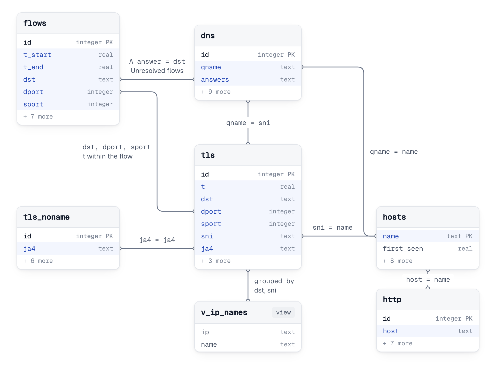
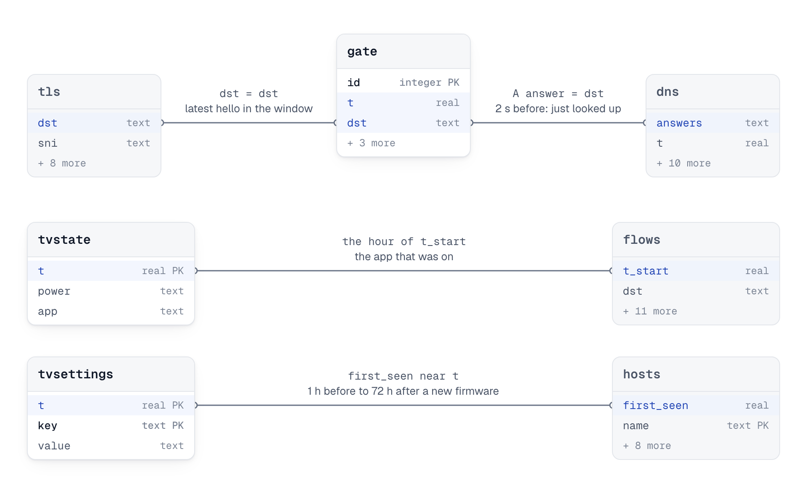
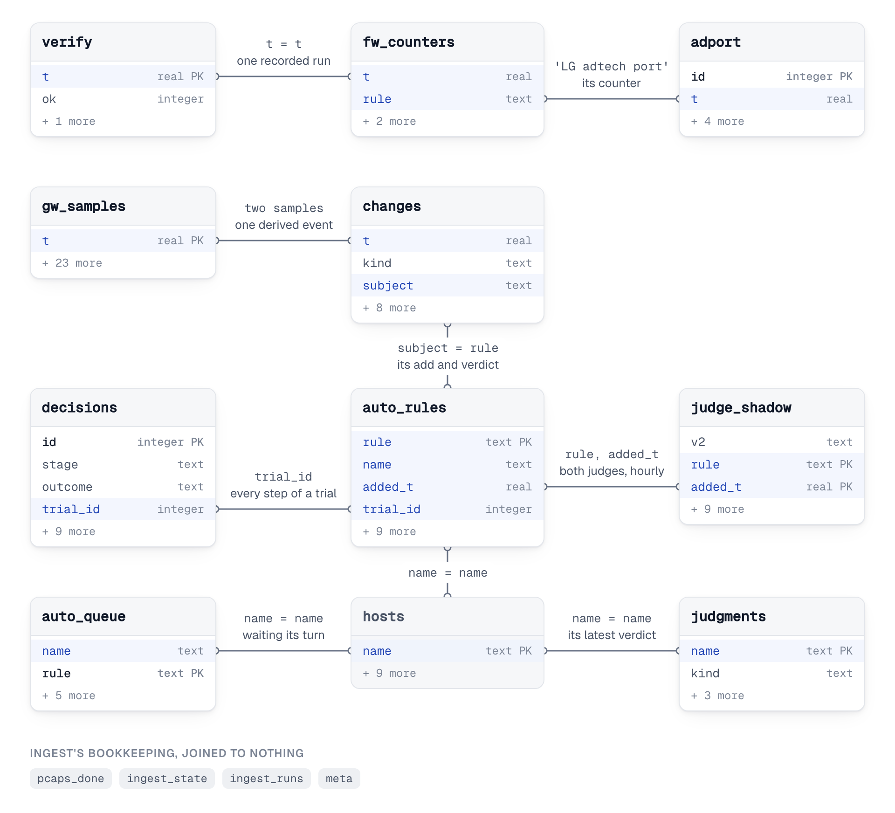
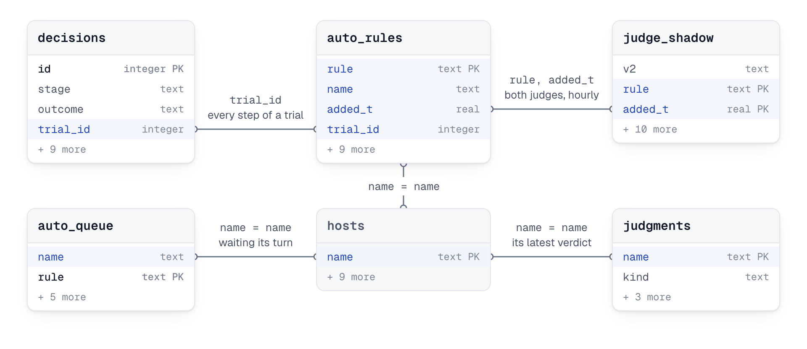

# The store: data model and ingest

This page owns the store as built: the file, the 29 tables and the view in [src/tvgw/db.py](../../src/tvgw/db.py), how rows arrive, how they are pruned, and the limits the code still shows. It is for anyone who writes a query against the store, changes ingest or the schema, or checks what a line of the brief counts.

## The file

The store is one SQLite file, `/var/lib/tvgw/tvgw.db` (`Settings.db_path` in `src/tvgw/config.py`). The `DB_PATH` setting moves it; its default is in [the settings file](settings.md). Its owner, its mode and who may read it are in [where it lives and who can read it](../how-it-works/privacy-and-retention.md#where-it-lives-and-who-can-read-it).

`db.connect` in `src/tvgw/db.py` opens the store for every command except `tvgw backup`, which copies it with `sqlite3.connect` itself; (reliability) the analyst's writer connections go through `db.connect` too.

- **A rollback journal, not WAL.** A writer sets `journal_mode=DELETE`. WAL needs `-wal` and `-shm` side files that every reader can write, and the read commands run without root ([design decision 10](../design-decisions.md#10-a-rollback-journal-not-wal)).
- **`synchronous=EXTRA` on every writer** (`SYNCHRONOUS`). With a rollback journal, `NORMAL` leaves a window for corruption on power loss, and `FULL` one for an acknowledged commit to roll back after a power cut, since it does not sync the directory after the journal's unlink. `EXTRA` does, one fsync more per commit ([design decision 73](../design-decisions.md#73-the-store-refuses-a-newer-version-and-commits-durably-the-gateway-samples-its-own-health-the-quic-refusal-is-watched-an-encrypted-copy-leaves-the-box)).
- **Readers open `mode=ro`.** `db.connect(path, readonly=True)` opens a `file:` URI with `mode=ro`, so a reader needs read access to the one file and nothing else. `tvgw sql` also sets `PRAGMA query_only=1`.
- **A 60-second lock wait.** A connection from `db.connect` waits up to 60 seconds for a lock (`timeout=60`). Writers commit per batch and per pcap, so a reader waits for one batch, never for a whole backlog. The analyst's writer waits up to 30 seconds.
- **The schema on every writer open.** A writer runs `SCHEMA`, where every statement is `CREATE ... IF NOT EXISTS`, then `_migrate`, then stores `SCHEMA_VERSION` (in `src/tvgw/db.py`) in `meta` under `schema` when the stored version is lower, (reliability) and refuses a store whose version is higher before it writes anything ([schema changes](#schema-changes)). It then commits before it returns. It has done so since 2026-10-28: before, the open transaction held the write lock until the caller's first commit, and every other writer waited.
- **A new file gets its mode at once.** When `db.connect` creates the file, it sets the restricted mode itself, because the file holds the TV's whole DNS history.

The writers are `tvgw ingest`, `tvgw verify --record`, `tvgw analyst`, `tvgw autoblock` and `tvgw undo`. Every other command only reads. `tvgw backup` copies the store with `VACUUM INTO` from a read-only connection; backups are described in [privacy and retention](../how-it-works/privacy-and-retention.md).

## Tables

This is the only column reference for the store. The tables are listed in the order `SCHEMA` creates them. "Pruned" means rows older than `DB_DAYS` are deleted by every ingest run ([pruning and size](#pruning-and-size)).

| Table | One row is | Written by | Pruned |
|---|---|---|---|
| `meta` | One bookkeeping value, by key | `db.connect`, `tvgw ingest`, `tvgw verify --record` | No |
| `ingest_state` | One source's read cursor | `tvgw ingest` | No |
| `ingest_runs` | One ingest run | `tvgw ingest` | Yes |
| `pcaps_done` | One finished pcap, read or given up on | `tvgw ingest` | Own rule |
| `flows` | One finished TV connection | `tvgw ingest` | Yes |
| `dns` | One DNS query from the TV | `tvgw ingest` | Yes |
| `tls` | One TLS ClientHello from the TV with a server name | `tvgw ingest` | Yes |
| `answer_ip` | One public address one DNS answer to the TV named (namebound) | `tvgw ingest` | Own rule |
| `tls_noname` | One TLS ClientHello from the TV without a server name | `tvgw ingest` | Yes |
| `http` | One plain-HTTP request from the TV | `tvgw ingest` | Yes |
| `lanprobe` | One TCP connection attempt to a local address | `tvgw ingest` | Yes |
| `tvstate` | One hourly power reading | `tvgw ingest` | By `DB_DAYS` |
| `tv_events` | One event of the live reading: an app or power change, the session to the TV up or down | `tvgw ingest` | By `TV_EVENTS_DAYS` |
| `tvsettings` | One TV setting value, stored when it changes | `tvgw ingest` | No |
| `oddport` | One kernel log line of the unexpected-port rule | `tvgw ingest` | Yes |
| `gate` | One kernel log line of the DNS gate | `tvgw ingest` | Yes |
| `adport` | One kernel log line of the adtech port wall (acr) | `tvgw ingest` | Yes |
| `gate_inpath` | One kernel log line of the DNS gate's second count (inpath) | `tvgw ingest` | Yes |
| `auto_rules` | One block rule the gateway applied on its own | `tvgw analyst`, `tvgw autoblock check`, `tvgw undo` | No |
| `judgments` | The latest verdict on one proposed name | `tvgw analyst` | No |
| `decisions` | One step of the autonomy: a gate decision, a queue event, a second-model answer, an apply, a canary outcome, a judge verdict or an owner revert; never updated | `tvgw analyst`, `tvgw autoblock check`, `tvgw undo` | Own rule (`DECISIONS_DAYS`) |
| `auto_queue` | One vetted block waiting for the trial in progress | `tvgw analyst` | No |
| `hosts` | One public name seen in `dns`, `tls` or `http` | `tvgw ingest` | No |
| `rules` | One policy rule, with when it appeared and left | `tvgw ingest` | No |
| `verify` | One `tvgw verify --record` run | `tvgw verify --record` | Yes |
| `fw_counters` | One firewall counter in one snapshot | `tvgw verify --record` | Yes |
| `changes` | One change on the gateway: a deploy, an apply, a link or VPN event, an AdGuard restart, a machine rule (schema 9) | `tvgw ingest` | Yes |
| `gw_samples` | One 10-minute sample of the gateway's own counters (schema 9) | `tvgw verify --record` | Yes |
| `judge_shadow` | Both judges' verdicts on one machine rule in one hour (schema 9) | `tvgw autoblock check` | Yes |
| `v_ip_names` | One address and TLS name pair (a view) | Derived from `tls` | Not stored |

Times are epoch seconds (`real`) throughout. The natural key given for an evidence table is the set of columns the hardware suite's `test_ingest_twice_duplicates_nothing` treats as one event (`NATURAL_KEYS` in `tests/hardware/test_gateway.py`).

### `meta`

Two columns: `key` (`text`, primary key) and `value` (`text`). The keys, in the order the code writes them:

| Key | Value | Written by | Read by |
|---|---|---|---|
| `schema` | The `SCHEMA_VERSION` of the last writer that opened the file | `db.connect` | The hardware suite only |
| `hosts_wm` | JSON: for `dns`, `tls` and `http`, the row id and `t` of the last row counted into `hosts` | `ingest.refresh_hosts` | `ingest.refresh_hosts` |
| `hosts_profile` | SHA-256 of the profile's `rules` and `strip_prefixes`, the inputs of `categorize()` | `ingest.refresh_hosts` | `ingest.refresh_hosts` |
| `last_vacuum` | When the last vacuum check ran | `ingest.prune` | `ingest.prune` |
| `sources_read` | JSON: each source and the start time of the last run that read it | `ingest.run` | `queries.coverage` |
| `last_warnings` | JSON list of the last run's warnings | `ingest.run` | The hardware suite |
| `last_run` | The start time of the last ingest run | `ingest.run` | `queries.coverage`, `verify` (`ingest_fresh`), the hardware suite |
| `upload_budget` | (budget) JSON: the upload budget's state, with the `rule`, `measure`, `profile` and `tv` (the TV's model, or null) it is for. `pending`, with `due` (when the step sets the ceiling, or null), `since` (the first whole day of the history it waits for), `after` (a change of profile or TV it waits from) and `why`: `db_days` when `DB_DAYS` keeps 14 days or fewer, `coverage` with `uncovered` (days without flows or with under 90% of their TCP 443 connections named), `profile`, `tv`, `rule` or `owner`; or `fixed`, with `ceiling`, `largest` (the net of the largest clean destination-hour) and its `key` and `hour` (nulled once older than `DB_DAYS`), `at_cap`, `since`, `until`, `days`, `times`, `floor`, `cap`, `acr_days`, `set_t`, and `previous` after `tvgw budget --rederive`. Once fixed for this rule, profile and TV it is never computed again; a row of another is pending; `tvgw forget` removes it ([design decision 66](../design-decisions.md#66-an-upload-budget-with-a-ceiling-set-once-count-only-and-the-names-of-a-tv-that-goes-online-while-off)) | `budget.fix`, the ingest's `budget` step; `budget.rederive`, `tvgw budget --rederive` | `budget.report`, the brief's Upload budget, `tvgw budget` |
| `adguard_version` | AdGuard Home's version as `tvgw verify` read it | `verify.record` | `queries.coverage` |
| `list_guard` | (listguard) JSON: the last scan of the subscribed lists ([design decision 68](../design-decisions.md#68-a-lists-plain-exception-no-longer-lifts-the-profiles-red-line-blocks-the-lists-are-scanned-for-lines-that-act-on-the-tvs-rules-each-update-is-previewed-against-the-tvs-lookups-and-a-doh-list-refresh-that-drops-more-than-a-set-share-is-held-back)): `t`, `rules_sha` (SHA-256 of the TV's rules as the plan groups them), `lists` (each enabled list of AdGuard's YAML: `id`, `name`, `url`, `state` `ok` or `missing`, the file's `size`, `mtime` and `sha256`, `since` this version, `copy` the SHA-256 of the version kept in `/var/lib/tvgw/lists/`, `exceptions` and `unread`), `findings` (each list line that acts on one of the TV's rules: `kind` `exposes`, `lifts` or `held`, `list`, `url`, `line`, `target` the TV's rule, `source` `profile` or `local`, `first` and `last` seen) and `gone` (findings no list carries any more, with `gone`, kept 90 days). No name the TV looked up; `tvgw forget` keeps it | `listguard.run`, the ingest's `lists` step and `tvgw lists --scan` | `listguard.brief_view`, the brief's List guard and its red lines, `tvgw lists` |
| `list_preview` | (listguard) JSON list: each list update's preview, `t`, `id`, `list`, `url`, `names` (the names judged), `newly_blocked` and `newly_allowed` (each `name`, `lookups`, `rule`, `by`, at most 50) and `more_blocked`, `more_allowed`. It names what the TV looked up: kept 14 days, and `tvgw forget` removes it | `listguard.run` | `listguard.brief_view`, the brief's List update preview, `tvgw lists` |
| `doh_hold` | (listguard) JSON: the DoH list refresh `tvgw-doh-update` held back, as `/var/lib/tvgw/doh4.held` says (`since`, `t`, `accepted` the time of the last refresh taken, `in_force` its entries, `fetched`, `dropped`, `max`), with `cleared` the first `verify --record` run that found the file gone, or null | `verify.record` | `queries.doh_hold`, the brief's DoH list line |
| `minimized_raw`, `minimized_uri`, `minimized_names` | What `minimize.rewrite_stored` applied once to the rows stored before: `1`, the `URI_VALUES` mode, the JSON list of title zones | `ingest.run` | `ingest.run` |
| `vpn_boundary` | (events) JSON `{vpn_if, device, pia, t}`: `VPN_IF`, the tunnel it resolved to, and PIA's state, one of piactl's nine connection states or null | `verify.record` | `queries.vpn_boundary`, the brief's Coverage line |
| `vpn_seen_t` | (events) The time of the last `verify --record` run that saw a tunnel or a PIA state; it keeps the leak red line on while the PIA daemon is down ([design decision 44](../design-decisions.md#44-the-tunnel-is-a-setting-and-the-pis-own-leaks-are-counted)) | `verify.record` | `queries.vpn_boundary` (as `seen_t`), `queries.red_lines` |
| `counting` | (counting) JSON `{<key>: {since, last[, broken]}}`: for each count-only mechanism `tvgw verify --record` has seen counting (`ntp`, `budget`, `inpath`, `probe`, `live`), when its current run began and when it was last seen, both times of the gateway's own runs; `broken` once the live reading stood down. A run not seen for `RUN_GAP` (12 hours), or broken, begins again at the next sight, and a mechanism with no entry yet takes its start from its own record, the live reading never from `tv_events`. Never pruned; `tvgw forget` removes it with the rows its two weeks are judged by, and the next run begins each again from what its own record still holds ([design decision 72](../design-decisions.md#72-did-it-work-a-failed-app-start-is-read-from-the-tvs-own-account-and-joined-with-what-was-refused-in-its-minutes-a-wall-on-probation-asks-one-question-what-is-counting-since-when-and-when-its-two-weeks-end)) | `counting.observe`, from `verify.keep_counting` | `counting.status`, the brief's Counting section and the plain brief's Counting line; `counting.txt` for `tvgw status` |
| `backup_ok_t` | (depth) The time of the last copy `tvgw backup` made and checked | `backup.record` | `verify` (`store_backup`) |
| `backup_error` | (depth) JSON `{t, why}`: the time of the last failed run and why, one of `backup.FAILURES`; removed by the next good copy | `backup.record` | `verify` (`store_backup`) |
| `forget_before` | The time of the last `tvgw forget`; every ingest of the 7 days after it deletes rows older than it, then removes it | `forget.run` | `forget.drop_late` |

### `ingest_state`

| Column | Type | What it holds |
|---|---|---|
| `source` | `text`, primary key | `flows`, `adguard`, `gfts`, `tvstate`, `oddport`, `gate`, `adport` (acr), `gate_inpath` (inpath), `flowlog`, `flowlog_drops` (events) or `changes` (ledger: the spool's cursor) |
| `inode` | `integer` | The inode of the file last read; `0` for `oddport`, `gate` and `flowlog` |
| `offset` | `integer` | The byte offset after the last complete line read; `0` for `oddport`, `gate` and `flowlog` |
| `last_t` | `real` | For a log file, when it was read. For `oddport` and `gate`, the time of the newest event stored. For `flowlog`, when `tvgw-flowlog`'s journal was last checked for lost events |
| `head` | `blob` | The file's first 64 bytes (`HEAD = 64` in `src/tvgw/logtail.py`), its fingerprint |
| `rotated` | `integer` | The inode of the log's `<path>.1` at the last read, `0` when there was none; NULL in a cursor from before schema 7. It is how a `copytruncate` after a read that found the log empty is seen |

(events) The `flowlog_drops` row is not a file cursor either: its `offset` is the `fw_counters` rowid of the last `flowlog: event socket drops` snapshot `ingest._event_drops` checked, and `last_t` that snapshot's time. The `flowlog` row is not a file cursor: `ingest._lost_events` keeps there the time of the last good read of `tvgw-flowlog`'s journal, and moves it only when the journal could be read ([log files](#log-files-flows-dns-gfts-and-tvstate)). The `dns` source's cursor is keyed `adguard`, a name older than the source's: renaming it would make every gateway read its whole query log again. `test_tail_state_keys_are_stable` in `tests/unit/test_ingest.py` pins the keys. Only `src/tvgw/ingest.py` reads or writes this table.

### `ingest_runs`

| Column | Type | What it holds |
|---|---|---|
| `t` | `real`, primary key | The start time of the run |
| `seconds` | `real` | How long the run took |
| `stats` | `text` | JSON of the run's counters: rows per source, pcaps read, hosts touched, rows pruned |
| `warnings` | `text` | JSON list of the run's warnings |

`queries.coverage` reads it. A report's Coverage lists the warnings of the runs that started inside its window or within `STALE = 7200` seconds (2 hours, in `src/tvgw/queries.py`) after it, so yesterday's brief does not carry this morning's problems.

### `pcaps_done`

| Column | Type | What it holds |
|---|---|---|
| `name` | `text`, primary key | The pcap's file name |
| `done_at` | `real` | When ingest last tried it |
| `tls_rows` | `integer` | The `tls` rows stored from it |
| `http_rows` | `integer` | The `http` rows stored from it |
| `syn443_rows` | `integer` | The TV's connection attempts to port 443 in it, each counted once |
| `error` | `text` | NULL when the file was read; otherwise the first 200 characters of the failure |
| `attempts` | `integer` | Failed reads so far |

A file is settled when `error` is NULL or `attempts` has reached `PCAP_MAX_ATTEMPTS = 24` (in `src/tvgw/ingest.py`). Ingest skips settled files, and `tvgw prune-pcaps` deletes only settled files (`ingest.deletable_pcaps`). A read that succeeds after failures keeps its attempt count. No column ties a `tls`, `http` or `lanprobe` row to the file it came from; this table keeps the counts only. `queries.coverage` counts the rows with `error` NULL by `done_at`.

### `flows`

| Column | Type | What it holds |
|---|---|---|
| `id` | `integer`, primary key | Row id |
| `t_start` | `real` | `t_end` less conntrack's `delta-time` |
| `t_end` | `real`, not null | When the kernel expired or destroyed the entry: the timestamp of the `DESTROY` line |
| `proto` | `text` | `tcp`, `udp` or `icmp` |
| `dst` | `text`, not null | The destination address |
| `dport` | `integer` | The destination port; NULL for ICMP |
| `sport` | `integer` | The TV's source port; NULL for ICMP |
| `pkts_up` | `integer` | Packets the TV sent |
| `bytes_up` | `integer` | Bytes the TV sent, IP and TCP headers included |
| `pkts_down` | `integer` | Packets the TV received |
| `bytes_down` | `integer` | Bytes the TV received |
| `state` | `text` | The TCP state at expiry, such as `TIME_WAIT` or `ESTABLISHED`; NULL for UDP and ICMP |
| `timeout_left` | `integer` | The seconds left on the entry's timer when the kernel destroyed it before the timer ran out (a reused tuple, a flush: `tcp 6 7417 ESTABLISHED src=...`); NULL when it expired (`src/tvgw/conntrack.py`) |

Indexes: `flows_t` on `t_end`, `flows_start` on `t_start`, `flows_conn` on `(dst, sport, t_end)`. Natural key: `(t_end, dst, dport, sport)`.

`ingest_flows` writes one row per `conntrack -E -e DESTROY` line in `flows.log` whose original source is `TV_IP`. The first address tuple of a line is the TV's direction (upload) and the second the reply (download). How late `t_end` runs is in [cadences](../how-it-works/architecture.md#cadences). `queries.py` reads the table for Top upload, Periodic connections, By category, Unresolved flows, DNS sent to other resolvers, While off/asleep, By day, `tvgw host` and Coverage; `autoblock.py` reads it for traffic shapes and streaming volume; (budget) `budget.py` reads it for the Upload budget, by `t_start`. A flow's name is computed from `tls` when a report runs ([naming a connection](../how-it-works/architecture.md#naming-a-connection)).

### `dns`

| Column | Type | What it holds |
|---|---|---|
| `id` | `integer`, primary key | Row id |
| `t` | `real`, not null | AdGuard's time for the query |
| `qname` | `text`, not null | The name asked, lowercased, with no trailing dot |
| `qtype` | `text` | The record type, such as `A`, `HTTPS` or `PTR` |
| `answers` | `text` | The answer records as `A:203.0.113.4,CNAME:cdn.example`; NULL when the record carries none |
| `blocked` | `integer`, not null | `1` for AdGuard reasons 3 to 8 (the `Filtered` reasons); `0` otherwise, rewrites included |
| `reason` | `text` | AdGuard's reason name, such as `FilteredBlockList` or `RewrittenRule` |
| `rule` | `text` | The text of the first matching rule, cut at 2,000 characters |
| `filter_id` | `integer` | The list id of that rule: a positive id is one of AdGuard's lists, 0 its custom rules (since 2026-11-07 also for a line the log file writes without an id, as it writes every custom rule; NULL before), a negative id one of its own features; NULL with no rule (`adguard.list_id()`) |
| `upstream` | `text` | The upstream that answered |
| `cached` | `integer` | `1` when AdGuard answered from its cache |
| `elapsed_ms` | `real` | AdGuard's time for the query, in milliseconds |

Indexes: `dns_t` on `t`, `dns_q_t` on `(qname, t)`. Natural key: `(t, qname, qtype)`.

`ingest_dns` writes one row per record in AdGuard's query log (`querylog.json`, one JSON record per line) whose client is `TV_IP`. A line that is not a record is counted as malformed; other fields of an oddly typed record are converted to their column's type, so one record cannot roll back the hour. Most brief sections read this table, and `autoblock.shapes` reads it for the number of days a name was looked up.

### `tls`

| Column | Type | What it holds |
|---|---|---|
| `id` | `integer`, primary key | Row id |
| `t` | `real`, not null | The capture time of the hello |
| `dst` | `text` | The destination address |
| `dport` | `integer` | The destination port |
| `sport` | `integer` | The TV's source port |
| `sni` | `text`, not null | The server name, lowercased, at most 255 characters (`NAME_MAX = 255` in `src/tvgw/tshark.py`) |
| `ech` | `integer` | `1` when the hello carried the `encrypted_client_hello` extension (`0xfe0d`), `0` when it did not; NULL in rows stored before schema 4. With real ECH, `sni` is the outer (public) name |
| `ja4` | `text` | The hello's JA4 fingerprint ([the extractor](../how-it-works/extractor.md#ja4)); `''` when the hello could not be read whole; NULL before schema 8 |
| `transport` | `text` | `tcp`, or `quic` for a hello inside a QUIC Initial packet; NULL before schema 8 |
| `partial` | `integer` | `1` when the hello was read from the first TCP segment of a split hello alone, the rest not captured; `0` otherwise; NULL before schema 8 |

Indexes: `tls_t` on `t`, `tls_sni` on `sni`, `tls_conn` on `(dst, sport, t)`, `tls_ja4` on `(ja4, t)`. Natural key: `(t, dst, sport)`.

`ingest_pcaps` writes one row per hello from `TV_IP` that the extractor returns with a server name, after dropping repeats of the same connection's hello ([the extractor](../how-it-works/extractor.md#how-a-hello-is-read)). The ports are the TCP ports, or the UDP ports for a QUIC hello. Every flow name (`queries.FLOW_NAME`), Blocked names still reached over TLS, the ECH red line, the DNS-gate samples, Unresolved flows, `tvgw host`, `v_ip_names` and the stack names of `tls_noname` read it.

### `answer_ip`

(namebound) Schema 15, provisional ([design decision 70](../design-decisions.md#70-each-tls-connection-is-checked-against-the-names-the-filter-answered-with-its-address-a-report-from-the-store-a-live-count-from-copies-and-nothing-refused)).

| Column | Type | What it holds |
|---|---|---|
| `dns_id` | `integer`, not null | The `dns` row of the answer; its `qname` and the CNAME targets in its `answers` are the names the address was answered for |
| `t` | `real`, not null | The answer's time, the `dns` row's `t` |
| `ip` | `text`, not null | One public IPv4 address of the answer's A records, each once per answer: not `0.0.0.0`, the gateway, a private, shared, link-local, loopback, multicast or reserved address (`names.is_public_address`) |
| `ttl` | `integer` | The smallest lifetime of the answer's A records, in seconds; NULL for a row the backfill made from a stored answer, which kept none |

Indexes: `answer_ip_ip_t` on `(ip, t)`, `answer_ip_t` on `t`. Natural key: `(dns_id, ip)`.

`ingest_dns` writes the rows of each answer with its `dns` row (`namebound.record`). The names stay in `dns` alone, so the name keys of `NAME_HMAC` and `tvgw forget` reach them there. The `answer_ip` step turns the answers stored before the table existed into rows once, newest first, at most `BACKFILL_ROWS = 50_000` lookups an hour, back `ANSWER_IP_DAYS = 35` days (`src/tvgw/namebound.py`). The table covers every answer from `meta.answer_ip_since` on: the backfill moves it back and the prune moves it up, and a connection whose day before reaches past it is not assessed. The brief's server names section, the naming of flows a hello did not name, the DoH-shaped connections and `tvgw host` read it. The stored answer keeps no lifetime, so a row the backfill made has none.

### `tls_noname`

| Column | Type | What it holds |
|---|---|---|
| `id` | `integer`, primary key | Row id |
| `t` | `real`, not null | The capture time of the hello |
| `dst` | `text` | The destination address |
| `dport` | `integer` | The destination port |
| `sport` | `integer` | The TV's source port |
| `ja4` | `text` | The hello's JA4 fingerprint; `''` for a partial hello |
| `transport` | `text` | `tcp` or `quic` |
| `partial` | `integer` | `1` when the hello's name, if it had one, lay in a TCP segment the capture did not keep |

Index: `tls_noname_t` on `t`. Natural key: `(t, dst, sport)`. Added in schema 8.

`ingest_pcaps` writes one row per hello from `TV_IP` without a server name: an app connecting to an address it did not look up, or a stack that leaves the extension out, or (`partial = 1`) a split hello whose name was not captured. It is a table of its own because every reader of `tls` takes `sni` for the connection's name ([design decision 34](../design-decisions.md#34-a-hello-without-a-name-gets-its-own-table)). `queries.tls_noname` reads it, for the `tls_noname` list of the window report.

### `http`

| Column | Type | What it holds |
|---|---|---|
| `id` | `integer`, primary key | Row id |
| `t` | `real`, not null | The request's time |
| `host` | `text` | The Host header, lowercased |
| `method` | `text` | The request method; NULL in `gfts` rows from before 2026-10-27, when nginx's log format gained it |
| `uri` | `text` | The request URI with its query string, cut at 2,000 characters |
| `ua` | `text` | The user agent, cut at 300 characters |
| `status` | `integer` | The status nginx logged; NULL in `pcap` rows |
| `bytes` | `integer` | The body bytes nginx sent; NULL in `pcap` rows |
| `src` | `text`, not null | `pcap` or `gfts` |

Indexes: `http_t` on `t`, `http_host` on `host`. Natural key: `(t, host, uri, src)`.

`ingest_gfts` writes the `gfts` rows from nginx's URL-filter log (`gfts.log`) for requests whose client is `TV_IP`. `ingest_pcaps` writes the `pcap` rows for the TV's requests to any address but the gateway: a request to the gateway is already in nginx's log with its status and bytes, and storing the capture's copy too would count it twice. The GFTS URL filter and Plain HTTP sections and `tvgw host` read it.

### `lanprobe`

| Column | Type | What it holds |
|---|---|---|
| `id` | `integer`, primary key | Row id |
| `t` | `real`, not null | The time of the SYN |
| `dst` | `text`, not null | A private, loopback, multicast or broadcast address other than the gateway |
| `proto` | `text` | Always `tcp` |
| `dport` | `integer` | The port the TV tried |

Index: `lanprobe_t` on `t`. Natural key: `(t, dst, dport)`.

`ingest_pcaps` writes one row per TCP SYN without ACK from the TV to such an address (`names.is_local_address`). A retransmitted SYN, with the same source port, address and port in the same pcap, is the same attempt and one row. The LAN probes section reads it; the analyst's pack carries only the count.

### `tvstate`

| Column | Type | What it holds |
|---|---|---|
| `t` | `real`, primary key | The reading's time |
| `power` | `text` | The webOS power state (`Active`, `Active Standby`, `Screen Off`), or (samsung) a Samsung's `on` and `standby` as `Active` and `Active Standby`; `unreachable` when the TV did not answer; `unknown` when it answered and the power read failed |
| `app` | `text` | The foreground app id; NULL when there is none |

`ingest_tvstate` writes one row per line of `tvcheck-history.log`, which `tvgw-analyze` appends every hour for the `lg-webos` and (samsung) `samsung-tizen` profiles. A line read again replaces its reading. The fields are tab-separated because webOS states contain spaces; older space-separated lines still read. The brief counts anything but `Active`, `Screen Off` (on with the panel dark) and `Screen Saver` (the TV on and idle, its app still in front) as off (`AWAKE` in `src/tvgw/queries.py`), so `unreachable` counts as off; (tripwire) `unknown` and an empty power (`NO_POWER`) are no reading, neither on nor off, since 2026-11-05. `autoblock.shapes`, `autoblock.streaming_rate`, the hourly judge's demand hours, the canary and the analyst's `readings_on` read the same set, `Active`, `Screen Off` and `Screen Saver`. While off/asleep, the TV section, Coverage, the analyst's pack, `autoblock.shapes` (the app on in each hour) and `autoblock.streaming_rate` (TV hours) read it.

### `tv_events`

| Column | Type | What it holds |
|---|---|---|
| `id` | `integer`, primary key | The row, in the order the lines were read |
| `t` | `real` | The gateway's time when the event was written |
| `kind` | `text` | `app`, `power`, `conn` (the session to the TV), `link`, `alive` (the session answered a ping), `clock` (the gateway's clock jumped) or `watch` (the service started, stopped or was refused) |
| `value` | `text` | The app id (empty for none, `invalid` for a string that is not an id); the power state; `up` or `down`; the seconds a clock step jumped; `start`, `stop` or `refused` |
| `detail` | `text` | A power event's `processing` (`Request Power Off`); the first word of why a session went down |

(app in front) `ingest_tvlive` tails `tvlive-events.log`, which `tvgw-tvlive.service` appends while `LIVE_READING=on`, and stores each line `appfront.parse_event` reads, once; the service's other notes are skipped. The `prune` step deletes rows older than `TV_EVENTS_DAYS`, whether or not the log is still there. Before it reads the log, the `tvlive` step deletes the log's rotated copies last written before that span, so they go even when the log itself is gone. The rows sit beside `tvstate` and never in it, so everything that counts readings counts what it did. `appfront.timeline()` reads both ([the app in front](../how-it-works/app-in-front.md#sessions-gaps-and-none)). The index `tv_events_t` is on `t`.

### `tvsettings`

| Column | Type | What it holds |
|---|---|---|
| `t` | `real`, primary key with `key` | The time of the reading that saw the value |
| `key` | `text`, primary key with `t` | The setting, such as `option.livePlus`, `network.deviceName`, `network.wifi.state`, `network.bleAdvertisingOnOff`, `eula.acrAllowed` (one key per flag of the TV's consent record), `firmware` or `model`; (W12) `webos.release`, `webos.os` and `webos.generation` from the TV's `hello` reply, `eula.doc.<id>`, `agreement.<id>.updated` and `agreement.<id>.version` from its per-document consent record, the standby switches `general.alwaysOn` and `option.quickStartMode`, and `lan_api.pairing` (`ok` or `refused`, copied from the key store by `ingest_pairing`); (depth) and `onscreen.<setting>`, the owner's answer from `onscreen.log` |
| `value` | `text` | Its value |

`ingest_tvstate` reads `tvcheck.txt`, the last LAN-API reading, and stores a value only when it differs from the last value stored for its key. (depth) `ingest_onscreen` tails `onscreen.log` and stores every answer once, the same answer again included, under `onscreen.<setting>` at the time it was given; the brief's "Not checked" line reads `onscreen.wifi-forgotten`. A read error (a value that starts `ERR `) and the `power`, `app` and `info` lines are not settings and are not stored. The TV settings and Firmware sections, the Live Plus red line, `tvgw profile` (the stored model) and the analyst's pack read it.

(samsung) A Samsung read without pairing (`tizen.device_values` in src/tvgw/tizen.py) stores `rest.reply` (`ok`, `not a Samsung TV`, or `refused (<reason>)` in the module's own words), `model` (the retail model), `platform` (the model code, such as `20_NIKEL_UHD`), `model.year`, `tizen` (`9 (model code _T09)` after an upgrade in place, else the version its year shipped with, such as `5.5 (model year 2020)`), `firmware` (`unknown` on every published sample), `network.wired.state` and `network.wifi.state` (both or neither, so the "Not checked" line never ends on half an answer), `smarthub.agreement`, `frame` and `country`. A value shaped like a MAC address, or holding one of the reply's identifiers, is stored as `invalid`. Never stored: the reply's `ssid` (the access point's BSSID, which locates a home), `wifiMac`, `duid`, `id` and `udn` (a UUID some sets make anew at every boot), `name`, `ip` and `developerIP` (`tizen.NEVER_STORE`).

### `oddport`

| Column | Type | What it holds |
|---|---|---|
| `id` | `integer`, primary key | Row id |
| `t` | `real`, not null | The kernel's time for the line |
| `proto` | `text` | `PROTO=` from the line |
| `dst` | `text` | `DST=` from the line |
| `dport` | `integer` | `DPT=` from the line |
| `raw` | `text` | The line's last 400 characters, without the gateway's host name and with `MAC=` emptied (`minimize.scrub_kernel_line`) |

Index: `oddport_t` on `t`. Natural key: `(t, raw)`.

`ingest_oddport` writes one row per journal line carrying the `tvgw-oddport` prefix, which the unexpected-port rule in `tv_out` logs at most 6 times a minute. The Unexpected ports section and Coverage read it.

### `gate`

The same six columns as `oddport`, with index `gate_t` on `t` and natural key `(t, raw)`. `ingest_gate` writes one row per journal line carrying the `tvgw-gate` prefix: the DNS gate's sample, at most 6 a minute, of a new TV connection to an address no lookup returned ([design decision 18](../design-decisions.md#18-dns-gated-egress-starts-as-a-count-in-its-own-table)). The DNS-gated egress section and Coverage read it.

### `adport`

(acr) The same six columns as `oddport`, with index `adport_t` on `t` and natural key `(t, raw)`. `ingest_adport` writes one row per journal line carrying the `tvgw-adport` prefix: the adtech port wall's sample, at most 6 a minute, of a TV connection to TCP 4001, 4431, 4445, 4447, 8180 or 8883, which the wall resets ([design decision 45](../design-decisions.md#45-the-acr-red-line-is-an-upload-test-and-a-port-wall)). A reset SYN never confirms its conntrack entry, so these rows and the `LG adtech port` counter are the only record of the attempt. The ACR red line's second form reads it; Coverage does not list it, since the counter is the evidence and the samples only name its addresses.

### `gate_inpath`

(inpath) The same six columns as `oddport`, with index `gate_inpath_t` on `t` and natural key `(t, raw)`. `ingest_gate_inpath` writes one row per journal line carrying the `tvgw-inpath` prefix: the sample, at most 6 a minute, of a new TV connection to an address the DNS gate's in-path set (`resolved4_inpath`) did not hold ([design decision 64](../design-decisions.md#64-the-gates-second-set-is-filled-in-the-path-of-the-answer-beside-the-passive-feeder-and-still-only-counts)). Nothing logs such a line unless `DNSGATE_FILL=inpath`, so on any other gateway the table stays empty. The prefix shares no word with `tvgw-gate`, so neither step can take the other's lines. The brief's DNS-gated egress section sets its count beside `gate`'s.

### `auto_rules`

| Column | Type | What it holds |
|---|---|---|
| `rule` | `text`, primary key | The AdGuard rule, as written in the machine's rules file |
| `name` | `text` | The name it blocks |
| `added_t` | `real`, not null | When the rule was applied |
| `source` | `text` | The stem of the proposals file it came from: a day, an ISO week or an hours window |
| `proposer` | `text` | The model that proposed it |
| `verifier` | `text` | The model that cleared it |
| `verifier_reason` | `text` | The verifier's reason, cut at 1,000 characters |
| `trial_until` | `real` | `added_t` plus `TRIAL`; a NODATA verdict moves it a `TRIAL` later, up to `TRIAL_CEILING` after `added_t` |
| `verdict` | `text` | NULL while on trial; then `passed`, `reverted`, or `untested` (in place, still watched for harm, holding no trial slot) |
| `decided_t` | `real` | When the verdict was reached |
| `reason` | `text` | Why, cut at 500 characters |
| `canary` | `text` | The live canary: `passed`, `reverted`, `armed` (waiting for the TV to be watched) or `unobserved` (the trial ended unwatched); NULL on rows from before schema 9 |
| `trial_id` | `integer` | The `decisions` row of this trial's apply, so the trial's history can be read there |

`autoblock.record` inserts or replaces the row once AdGuard has taken the rule; `autoblock.decide` sets the verdict, `autoblock.extend` the new end of a NODATA trial, `autoblock.set_canary` the canary state. `tvgw autoblock list`, the brief's "Rules the gateway added on its own" section, the hourly judge and the daily cap read it. What the gateway does with these rows is in [the analyst and autonomous blocking](../how-it-works/analyst-and-autonomy.md).

### `judgments`

| Column | Type | What it holds |
|---|---|---|
| `name` | `text`, primary key | The name a proposal was about |
| `kind` | `text`, not null | The proposal's kind: `block`, `allow`, `unblock`, `watch` or `question`; or `quiet`, a pass that looked at the name and proposed nothing (`autoblock.QUIET`); or `held`, the same for an instruction-shaped name, whose reason records its evidence (`autoblock.HELD`) |
| `t` | `real`, not null | When the verdict was recorded |
| `source` | `text` | The stem of the proposals file |
| `reason` | `text` | The proposal's reason, cut at 300 characters |

`autoblock.remember` writes one row per proposal after each analyst run that made a request, replacing the name's earlier row. A block the gates refused for too little evidence, no observed connections, the daily cap or a transient failure is not written, so the name is asked about again; a block waiting in `auto_queue` is. `autoblock.remember_quiet` then writes a `quiet` row for each name that bought the request and drew no proposal (`analyst.asked_about`), with the reason `nothing proposed by the <stem> pass`; its upsert leaves a row of another kind alone while it is younger than 7 days. For an instruction-shaped name (`autoblock.instruction_shaped`) it writes `held` instead, with the reason `held for another look, the name reads like an instruction; evidence: <analyst.evidence>`; the daily novelty check counts that row only while the pack gives the same evidence, and the weekly review never counts it. `autoblock.judged_recently` reads the verdicts of the last 7 days for the analyst's pack and its novelty check ([design decision 22](../design-decisions.md#22-a-pass-that-proposes-nothing-is-remembered)).

### `decisions`

| Column | Type | What it holds |
|---|---|---|
| `id` | `integer`, primary key | The order rows were written in; a trial's `apply` row id is its trial id |
| `t` | `real`, not null | When |
| `stage` | `text`, not null | `gate`, `queue`, `verifier`, `apply`, `canary`, `judge` or `owner` (`autoblock.STAGES`) |
| `outcome` | `text`, not null | The stage's outcome: `ok` or `refused`; `queued`, `requeued` or `expired`; `agreed`, `vetoed` or `error`; `applied`, `failed` or `reapply_failed`; `armed`, `passed`, `reverted` or `unobserved`; `passed`, `reverted`, `nodata` or `untested`; `reverted` |
| `rule`, `name` | `text` | The rule and the name it blocks |
| `source` | `text` | The stem of the proposals file the block came from |
| `trial_id` | `integer` | The trial's `apply` row, on rows after the apply |
| `reason` | `text` | Why, cut at 1,000 characters |
| `margins` | `text` | On gate rows, JSON: `conns`, `median_down`, `total_down`, `days_seen`, `answered` and `answers_used`, and the `limits` the gate held them to. On judge rows (`autoblock.judge_margins`): `before`, `n_before`, `after`, `n_after`, `after_share`, `low_run` (each hour with its share), `trial_until` and the `thresholds` |
| `model`, `effort` | `text` | On verifier rows, the second model and its effort |
| `usage` | `text` | On verifier rows, JSON: its input, output and cache-read tokens |

Indexes `decisions_t` on `t` and `decisions_name` on `(name, t)`. `autoblock.log_decision` appends the rows; the trigger `decisions_append_only` refuses any `UPDATE`, so a later outcome is always a new row and a rule tried twice keeps both histories. `autoblock.decisions` reads them. Rows go only with `DECISIONS_DAYS` set to a number of days ([design decision 41](../design-decisions.md#41-the-autonomy-refuses-what-it-cannot-see-and-keeps-what-it-decided)). <!-- (fin-release) --> The prune and `tvgw forget` keep the `apply` row of a re-apply AdGuard is still owed (`autoblock.owed_push_id`); forget keeps it without its rule and name.

### `auto_queue`

| Column | Type | What it holds |
|---|---|---|
| `rule` | `text`, primary key | The rule waiting its turn |
| `name` | `text`, not null | The name it blocks |
| `queued_t` | `real`, not null | When it joined the queue |
| `source`, `proposer`, `risk` | `text` | The proposals file it came from, the model that proposed it, its risk |
| `since` | `real`, not null | The start of the window it was judged on: at its turn the gates read the evidence from there |

`autoblock.enqueue` adds a row, `autoblock.queued` lists them oldest first, `autoblock.dequeue` deletes one when its turn comes.

### `hosts`

| Column | Type | What it holds |
|---|---|---|
| `name` | `text`, primary key | A public DNS name, lowercased, with no trailing dot or port |
| `first_seen` | `real` | The earliest row time counted for it |
| `last_seen` | `real` | The latest row time counted for it |
| `category` | `text` | The profile's category for it (`profile.categorize`) |
| `dns_n` | `integer` | `dns` rows counted |
| `tls_n` | `integer` | `tls` rows counted |
| `http_n` | `integer` | `http` rows counted |
| `last_blocked` | `integer` | `blocked` of the newest `dns` row for the name at the last refresh |
| `last_rule` | `text` | `rule` of that row |
| `notes` | `text` | Free text; no command writes it, and a rebuild keeps the rows that have it |

`ingest.refresh_hosts` writes it at the end of each ingest run ([how rows arrive](#how-rows-arrive)). New hosts, Firmware, `tvgw host`, Periodic connections (the category) and `autoblock.streaming_rate` (the category of each named flow) read it.

### `rules`

| Column | Type | What it holds |
|---|---|---|
| `id` | `integer`, primary key | Row id |
| `kind` | `text`, not null | `adguard`, `gfts-block` or `block4` |
| `text` | `text`, not null | The rule's text |
| `first_seen` | `real`, not null | The first ingest run that saw it |
| `last_seen` | `real`, not null | The latest ingest run that saw it |
| `removed_at` | `real` | The first run that no longer saw it; NULL while it is in place |

`ingest_rules` reads three policy files on every run: the `user_rules` of `AdGuardHome.yaml` (`adguard`: the profile's rules and the machine's together), each `$request_uri ~*` pattern in the installed nginx URL-filter file (`gfts-block`), and each address or range in `block4.txt` (`block4`), read with `tvgw-apply`'s own pattern (a dotted quad at the start of a line, an optional prefix length), so only what the firewall loads. A rule that comes back after it was removed gets a new row. `tvgw rules` and the Rule changes section read it.

### `verify`

| Column | Type | What it holds |
|---|---|---|
| `t` | `real`, primary key | The time of the run |
| `ok` | `integer`, not null | `1` when every check passed |
| `failures` | `text` | JSON list of the failures |

`verify.record` writes one row per `tvgw verify --record` run. The Firewall held line, the verify red lines and Coverage, which treats the watchdog as a source, read it. What the checks are: [what tvgw verify checks](verify-checks.md).

### `fw_counters`

| Column | Type | What it holds |
|---|---|---|
| `t` | `real`, not null | The snapshot's time: the `verify` row's, or the time of an apply listing |
| `rule` | `text`, not null | The rule's nftables comment |
| `packets` | `integer` | Its packet counter |
| `bytes` | `integer` | Its byte counter |

Indexes: `fw_counters_rule_t` on `(rule, t)`, `fw_counters_t` on `t`. The table has no primary key. `verify.record` writes one row per commented counter in the tables `inet tvgw`, `netdev tvgw_l2`, `inet tvgw_gate`, `inet tvgw_capture` (with `CAPTURE_MODE=headers`) and (guard) `inet tvgw_guard`, and (events) one more series, `flowlog: event socket drops`: `packets` is the drops on `tvgw-flowlog`'s event socket since it opened and `bytes` is 0. `queries.flowlog_drops` reads that series alone, and `ingest._event_drops` warns when it grew. (ntp) It stores `inet tvgw_ntp`'s rule, `NTP from the TV, by server`, as any counted rule, and, from the same listing, rows that are not counters of a rule: `ntp: ~set`, whose `packets` is how many addresses the table's set holds and `bytes` the set's size, the mark that verify listed the set at that snapshot; and one row per address for the `NTP_STORED = 32` (in src/tvgw/queries.py) requested most recently, the latest expiries, `ntp: <address>`, whose `packets` is the element's own count of requests, which a re-apply keeps, and `bytes` its seconds to expiry, or -1 when nft gave none. A full set stored whole would be about 148,000 rows a day, so a snapshot keeps those 32. `queries.ntp_servers` reads these rows, and the brief keeps all of them out of the firewall's activity. Before its own snapshot it stores the two listings `tvgw-apply` wrote either side of its last reload (`/run/tvgw/counters.before-apply` and `counters.after-apply`, `verify.RELOADS`), each under its file's time, once only and only when they are newer than every snapshot stored, so the brief sees each reset between the snapshots around it. Two rules that share a comment give two rows per snapshot (the two DNS redirects in `pre_nat` do), and `queries.fw_activity` sums them per snapshot. The Firewall held line reads it ([design decision 13](../design-decisions.md#13-counters-not-logs-prove-the-firewall-held)).

### `changes`

(ledger) The change ledger ([design decision 48](../design-decisions.md#48-one-ledger-of-changes-one-hour-classifier-and-a-second-judge-that-only-watches)): append-only, one row per change, never updated.

| Column | Type | What it holds |
|---|---|---|
| `id` | `integer`, primary key | Row id |
| `t` | `real`, not null | When it took effect, or the sample that first saw it |
| `t_end` | `real` | The end of an interval (a PIA outage); NULL for a point event |
| `t_precision` | `real`, not null | Seconds of uncertainty before `t`: 0 for a machine rule, 1 for a spool line, 600 (or the gap between samples) for an event derived from two samples |
| `source` | `text`, not null | `autoblock`, `deploy`, `apply`, `dispatcher` or `sampler` |
| `kind` | `text`, not null | What changed, from `ledger.KINDS`: `machine_rule_add`, `machine_rule_reverted`, `machine_rule_passed`, `code_deploy`, `apply`, `adguard_restart`, `reboot`, `tv_flap`, `wan_flap`, `vpn_flap`, `vpn_gone`, `vpn_back`, `pia_down`, `ct_drop`, `ct_pressure`, `list_refresh`, `list_removed`, `tv_link_up` and `_down`, `wan_link_up` and `_down`, `vpn_up` and `_down`, `dhcp_change`, `dispatcher_event`, (plain) `wan_addr_change` and `wan_gw_change` |
| `subject` | `text`, not null, default `''` | The machine rule, the version, the calling process, the interface, the filter list's id, or the first PIA state of an outage |
| `detail` | `text` | JSON: counter deltas, the trigger, fingerprints, states. Never an address, a MAC or a host name |
| `controllable` | `integer`, not null | 1 when tvgw could have scheduled it |
| `effect_class` | `text`, not null | `A` when it can move what the judge measures (a confounder), `B` when it cannot |
| `metric_affecting` | `text` | `naming` for a deploy that changed the modules that name and count flows; NULL otherwise |

Indexes: `changes_t` on `t`; `changes_event`, unique, on `(t, source, kind, subject)`, the natural key, so a row derived twice is stored once.

`ledger.ingest()`, the ingest's `changes` step, writes it from three places: the spool `/var/lib/tvgw/changes.spool` that `tvgw-apply`, the NetworkManager dispatcher and `install.sh` (through `tvgw changes --note-deploy`) append to, read through the same exactly-once cursor as the logs (`changes` in `ingest_state`); the events derived from consecutive `gw_samples` rows since `meta.ledger_samples_t`, with an open PIA outage kept in `meta.ledger_pia_open` until it ends; and the machine rules' adds and verdicts copied from `auto_rules`. `tvgw changes`, the hour classifier, the brief's "Changes in effect" and judge v2 read it.

### `gw_samples`

(ledger) One row per `tvgw verify --record` run with `LEDGER=on`, every 10 minutes. Every column but `t` is NULL when its source is missing.

| Column | Type | What it holds |
|---|---|---|
| `t` | `real`, primary key | The sample's time |
| `boot_id` | `text` | `/proc/sys/kernel/random/boot_id` |
| `tv_cc`, `wan_cc` | `integer` | `carrier_changes` of `TV_IF` and `WAN_IF` (cumulative since boot) |
| `vpn_if`, `vpn_present`, `vpn_cc` | `text`, `integer`, `integer` | The VPN interface found (the one `VPN_IF` names, when it names one, else `tun0` or `wgpia0`; `tun0` when none exists), whether it exists, its `carrier_changes` |
| `pia_state` | `text` | `piactl get connectionstate`, one word |
| `wlan_signal`, `wlan_rx_mbps`, `wlan_tx_mbps`, `wlan_tx_failed` | `real`, `real`, `real`, `integer` | From `iw dev <WAN_IF> station dump` when the uplink is wireless; the station's address is never read |
| `wan_rx_bytes`, `wan_tx_bytes`, `tv_rx_bytes`, `tv_tx_bytes` | `integer` | Interface byte counters |
| `ct_count`, `ct_max` | `integer` | `nf_conntrack_count` and `nf_conntrack_max` |
| `ct_drop`, `ct_early_drop`, `ct_insert_failed` | `integer` | Summed over the CPUs of `conntrack -S` |
| `agh_invocation`, `agh_nrestarts` | `text`, `integer` | AdGuard Home's `InvocationID` and `NRestarts` from `systemctl show` |
| `filter_mtimes` | `text` | JSON: each list file under AdGuard's `data/filters`, by id, with its modification time and size |
| `tv_probe` | `text` | (probe) Schema 13. The probe's verdict in the same run, as `probe.Verdict.compact()` writes it: `{"v": "pass", "why": "", "ms": 900, "s": {"port": "pass", ...}}`. NULL when `TV_PROBE` is off. |
| `wan_addr_tag` | `text` | (plain) Schema 10. `<key id>.<address tag>.<router tag>`: keyed tags of `WAN_IF`'s IPv4 address and its router, never the addresses ([the uplink's tag](../how-it-works/analyst-and-autonomy.md#the-change-ledger)); NULL without an address or the key |

| `soc_temp` | `real` | (reliability) Schema 14, provisional. The hottest of the kernel's thermal zones (`/sys/class/thermal/thermal_zone*/temp`), in degrees Celsius; a zone reading 0 or 150 or more is left out |
| `throttled` | `integer` | (reliability) The Raspberry Pi firmware's flags from `vcgencmd get_throttled`: bits 0 to 3 hold now (under-voltage, frequency capped, throttled, soft temperature limit), bits 16 to 19 have happened since boot. NULL on a computer without `vcgencmd` |
| `mem_avail_pct`, `mem_psi_some` | `real`, `integer` | (reliability) `MemAvailable` as a share of `MemTotal` in `/proc/meminfo`; the cumulative microseconds some task waited for memory, the `some` line's `total` in `/proc/pressure/memory` |
| `disk_dev`, `disk_sectors_written` | `text`, `integer` | (reliability) The disk under `STATE_DIR`, the record's home, as `/sys/block` names it (`mmcblk0`), and its 512-byte sectors written since boot, the seventh field of `/sys/block/<dev>/stat` |
| `io_errors`, `io_errors_store`, `usb_resets` | `integer` | (reliability) The kernel's lines between the previous sample and this one, across boots (`journalctl _TRANSPORT=kernel`, so the minutes before a crash count) reporting a read or write error on any disk, on `disk_dev`, and a USB device reset. NULL for the first sample after the store had none, or when `journalctl` could not say |

`ledger.record_sample()` writes it; `health.read()` fills the health columns in the same run ([design decision 73](../design-decisions.md#73-the-store-refuses-a-newer-version-and-commits-durably-the-gateway-samples-its-own-health-the-quic-refusal-is-watched-an-encrypted-copy-leaves-the-box)); the ledger's ingest step and the hour classifier read it, and (reliability) `tvgw verify`'s `gateway_health` and the brief's Gateway health line read the health columns.

### `judge_shadow`

(ledger) Judge v2's verdicts beside the shipped judge's, written by `judge2.shadow()` at the end of every `tvgw autoblock check` with `LEDGER=on`, after the shipped judge has decided (`cli._shadow`, within a 120 s budget). Nothing reads it to decide.

| Column | Type | What it holds |
|---|---|---|
| `t` | `real`, not null | When the shadow ran |
| `rule`, `added_t` | `text`, `real`, primary key with `hour` | The machine rule and its trial's start |
| `hour` | `real`, primary key with `rule` and `added_t` | The last full clock hour at that run |
| `hour_class` | `text` | That hour's class for this rule: `off`, `no_demand`, `confounded` or `clean` |
| `v1`, `v1_reason` | `text` | The shipped judge: its recorded verdict, or what `autoblock.judge` says that hour (`watching` for none) |
| `v2`, `v2_reason` | `text` | Judge v2: `watching`, `reverted`, `suspended`, `passed` or `nodata` |
| `clean_hours`, `k` | `integer` | Clean demand hours so far, and the `JUDGE2_CLEAN_HOURS` they were counted against |
| `final` | `integer`, not null | 1 once no later hour can change v2's verdict |

Index: `judge_shadow_t` on `t`. A second run in the same hour replaces its row.

### `v_ip_names`

A view: `SELECT dst AS ip, sni AS name, COUNT(*) AS n, MAX(t) AS last_t FROM tls GROUP BY dst, sni`. It lists which TLS names were seen on which address. No module reads it; it is there for `tvgw sql`.

## Entity relationships

No table in the store declares a foreign key, so SQLite enforces none. Every relationship below is a join the code makes:

- **`flows` and `tls`.** A flow takes the server name of the hello with the same `dst`, `dport` and `sport` whose `t` lies between the flow's `t_start` less `FLOW_SLACK` and its `t_end`; the latest such hello wins (`FLOW_NAME` in `src/tvgw/queries.py`, explained in [naming a connection](../how-it-works/architecture.md#naming-a-connection)). A continuation, a flow with no hello of its own that starts within `FLOW_SLACK` of the end of an earlier flow on the same tuple, looks back to that flow's start for the hello (one hop, [design decision 21](../design-decisions.md#21-a-continuation-inherits-its-name)).
- **`dns`, `tls` and `http` into `hosts`.** `refresh_hosts` counts `dns.qname`, `tls.sni` and `http.host` into `hosts.name` after normalizing them, public names only.
- **`dns` and `tls`.** Blocked names still reached over TLS matches `tls.sni` to `dns.qname`.
- **`dns` and `flows`.** Unresolved flows looks for each `flows.dst` among the `A:` records of `dns.answers` in the window and the day before.
- **`gate` and `tls`.** Each DNS-gate sample takes the server name of the latest hello in the window to its `dst`.
- **`gate` and `dns`.** A sample is `just looked up` when an A answer naming its `dst` exactly came within `FEEDER_LATE = 2.0` seconds before it (`gate_examples` in `src/tvgw/queries.py`). It is `unexplained` when it is not late and no A answer of the `KNOWN_DAYS = 7` before it names its `dst` as a whole token (`gate_unexplained`: `answers LIKE '%A:<dst>,%' OR answers LIKE '%A:<dst>'`, read by the time index).
- **`tvstate` and `flows`.** `autoblock.shapes` gives each flow the app of the reading in the hour its `t_start` falls in; While off/asleep counts the flows that started between two off readings.
- **`tvsettings` and `hosts`.** The Firmware section lists the names whose `first_seen` lies from 1 hour before a new `firmware` value's reading to 72 hours after it.
- **`v_ip_names`** is `tls` grouped by `dst` and `sni`.
- **`tls_noname` and `tls`.** `queries.tls_noname` lists, for each JA4 of a nameless hello, the server names `tls` rows with the same `ja4` carried in the window and the week before.

<picture>
  <source media="(prefers-color-scheme: dark)" srcset="../diagrams/fig-8-store-naming.dark.png">
  
</picture>

*SQLite enforces no foreign keys here; every relationship is a join the queries make, and a flow takes its name from the hello on the same tuple.*

<picture>
  <source media="(prefers-color-scheme: dark)" srcset="../diagrams/fig-9-store-context.dark.png">
  
</picture>

*The context joins are by time as much as by value: the gate's samples, the TV's power readings and its firmware readings each meet the other tables in a window.*

The control and bookkeeping tables join less. `fw_counters` rows share their `t` with the `verify` row of the same run, except the two listings `tvgw-apply` takes either side of a reload, which `verify --record` stores once each under their own times ([`fw_counters`](#fw_counters)). `queries.FW_LINES`, a constant in the code and not a table, maps each comment prefix to the label the brief prints, so `fw_counters.rule` matches it by prefix; renaming a comment in `tvgw-apply` drops its line from the brief ([design decision 13](../design-decisions.md#13-counters-not-logs-prove-the-firewall-held)). `auto_rules.name`, `judgments.name`, `decisions.name` and `auto_queue.name` are names the analyst saw, the same names `hosts` holds; `auto_rules.trial_id` joins `decisions.id` and `decisions.trial_id`. <!-- (fin-figures) -->`judge_shadow` keys each trial by `rule` and `added_t` and joins `auto_rules` on both; a `changes` row of a `machine_rule_*` kind names its rule in `subject`, and its rows with `source` `sampler` come from pairs of `gw_samples` rows; `queries.acr_port` reads the `adport` samples of a window beside the increase of the `LG adtech port` counter in `fw_counters`. `pcaps_done`, `ingest_state`, `ingest_runs` and `meta` join nothing.

<picture>
  <source media="(prefers-color-scheme: dark)" srcset="../diagrams/fig-10-store-records.dark.png">
  
</picture>

*These tables record what the gateway did, what changed around it and how far ingest has read, and every relationship among them is a key the code writes or a join it makes.*

<picture>
  <source media="(prefers-color-scheme: dark)" srcset="../diagrams/fig-24-autonomy-records.dark.png">
  
</picture>

*The machine's rules key every step of a trial and both judges' verdicts, and the names they block are the names the store counts.*

## How rows arrive

`tvgw ingest` (`ingest.run` in `src/tvgw/ingest.py`) loads every source in one run. The hourly `tvgw-analyze` job runs it ([units](../../deploy/systemd/README.md#units)); a run by hand is safe, because every step reads only what the store does not have yet.

### The run

The run takes an exclusive `flock` on `.ingest.lock` in the state directory, so two runs never interleave, and opens the store as a writer. Then it runs twenty steps in a fixed order: `flows`, `dns`, `gfts`, `tvstate`, `onscreen` (depth: the owner's answers in `onscreen.log`), `tvlive` (app in front: the live reading's events, and their own retention), `pairing` (W12: the key store's word on the pairing), `oddport`, `gate`, `adport` (acr), `gate_inpath` (inpath), `answer_ip` (namebound: the answers stored before the table, a slice an hour), `rules`, `changes` (ledger: the change ledger's spool), `pcaps`, `minimize` (today's reductions applied once to the rows stored before them, and expired name keys deleted), `forgotten` (rows older than the last `tvgw forget` deleted), `hosts`, `budget` ((budget) the upload budget's ceiling, set once, `budget.fix()`) and `prune`. The cheap sources come first. tshark is the slow one, and running it within a budget means a backlog of pcaps cannot starve the steps after it before the unit's timeout (`test_the_cheap_sources_are_read_before_the_pcaps` in `tests/unit/test_ingest_gaps.py`).

Each step is its own transaction. A step that raises is rolled back and becomes a warning, and the other steps still land. A source whose input does not exist (a log file, the pcap directory) raises `SourceMissing`, which becomes the warning "`<source>`: `<path>` is missing". A step that has already warned and could read nothing (the pcaps, below) raises `SourceSkipped`, which adds no second warning. The `tvstate` history is the exception and is silent, since it exists only for a profile with a LAN-API reader, and so is the live reading's events file, which exists only once that service has run (`OPTIONAL_SOURCES` in `src/tvgw/ingest.py`). A step that fails or has no input is not stamped as read. After `STALE` seconds, Coverage therefore calls that source `NOT ASSESSED` instead of reporting an empty hour ([design decision 14](../design-decisions.md#14-red-lines-are-the-alarm-model)).

At the end the run writes its `ingest_runs` row, the `sources_read`, `last_warnings` and `last_run` keys of `meta`, commits, and runs `PRAGMA optimize`. The exit status of `tvgw ingest` reflects the run's warnings ([commands](commands.md)).

### Log files: flows, dns, gfts and tvstate

These four sources read a growing file from a stored cursor (`logtail.read_new_lines`):

- **Cursor.** `ingest_state` keeps the file's inode, the byte offset after the last complete line, and the file's first 64 bytes. Everything about the file comes from one open descriptor, so a rotation between two steps cannot pair one file's inode with another's offset.
- **Batches.** Lines are read `BATCH = 10_000` at a time (in `src/tvgw/ingest.py`), and each batch is committed together with the cursor that covers it. Rows and cursor land as one, a run that dies loses only the batch in flight, and a backlog, such as the 90-day query log after a lost store, neither fills memory nor holds the write lock for the whole run.
- **Rotation.** A new inode means the file was renamed to `<path>.1` (AdGuard's way); the same inode with a smaller size or a different beginning means `copytruncate` (logrotate's way, for the files in `/var/log/tvgw`). A log that was empty at the last read has no beginning to compare and no offset to shrink below, so a new `<path>.1` since that read (the `rotated` column) means a `copytruncate` too, and the copy is read from its start; a cursor from before schema 7 is not taken as evidence. Either way the rest of the old file is read from `<path>.1` first, when that file is still the one the cursor knew. A log renamed away whose successor does not exist yet (AdGuard creates the new `querylog.json` only at its next write to disk, hours later on a quiet night) is read from `<path>.1`, not reported missing. When lines are known to be lost, because the file was rotated twice or truncated with no copy, the run warns that the lines written before it could not be recovered.
- **Partial lines.** A last line without its newline waits for the next run.
- **Malformed lines.** The flow and URL-filter logs are written by machines in one format each, so a line that does not parse is counted and reported in one warning per source, like a malformed query-log record.
- **Filters.** Only the TV's rows are kept: flows whose source is `TV_IP`, queries whose client is `TV_IP`, nginx lines whose client is `TV_IP`. A `TV_IP` that is not an address is refused when the settings load, because a typo would record nothing while every source counted as read.

The `tvstate` step also reads `tvcheck.txt`, whose first line is `read <time>`, and stores each setting that changed (see [tvsettings](#tvsettings)).

The `flows` step also reads `tvgw-flowlog`'s journal (`journalctl -u tvgw-flowlog -g ENOBUFS`, through the `flowlog_lines=` seam). When conntrack's netlink socket overflows it drops events, says `We have hit ENOBUFS! We are losing events.` on stderr, which reaches only that journal, and carries on, so the connections that ended then are missing from a log that reads as whole. Every such line since the last check is counted into one warning, `flows: conntrack lost events N time(s) since the last run (ENOBUFS, first at ...)`. The check's cursor is the `flowlog` row of `ingest_state`; it moves only when the journal could be read, so a failure leaves the flows step unstamped and the same stretch is checked again at the next run. The first check only starts the cursor.

### Kernel log: oddport, gate, adport and gate_inpath

The four steps ask the journal for kernel lines carrying their prefix. On the gateway, each step runs:

```sh
journalctl -q --no-pager -o short-unix -g <prefix> --since @<last_t> _TRANSPORT=kernel
```

`_TRANSPORT=kernel` stands in for `-k`, which implies `-b` and so hides every line written before the last reboot. `--since` has 1-second granularity, so the step asks from the second of the newest stored event and skips lines at or before it. The first run asks for the last 30 days. A `journalctl` that exits non-zero with an error message raises, because a silent empty answer would look like a quiet log; a non-zero exit with nothing on stderr is a quiet journal.

### Rule history

The `rules` step reads the three policy files listed under [rules](#rules). A kind whose file cannot be read, or whose `AdGuardHome.yaml` has no `user_rules` list, is unknown, not empty: the run warns, and that kind's rules stay open rather than all being marked removed.

### Pcaps

The `pcaps` step reads each finished hourly file once:

1. **Finished files.** The step lists the directory first and then asks which file a capture process (`pcaps.WRITERS`: `dumpcap`, and `tcpdump` before capture v2) holds open, which `pcaps.live_files` reads from `/proc`; in the other order a file the capture opened in between would be listed, not held, and read as an empty hour. A file is finished when it was listed and is not held. With the capture down, every file is finished. When the answer cannot be had (no `/proc`, or not root), the step reads nothing, warns and raises `SourceSkipped`, so the pcaps are not stamped as read and Coverage says `NOT ASSESSED`: reading a file the capture is still writing would record part of an hour as the whole hour.
2. **Order and budget.** Unsettled files are read in name order until `PCAP_BUDGET = 20 * 60` seconds (20 minutes, in `src/tvgw/ingest.py`) of wall time have passed; the rest wait for the next run with a warning.
3. **Short files.** A file under `PCAP_HEADER = 24` bytes, the size of a pcap header, is marked "not a capture file" without running tshark.
4. **One tshark pass.** tshark reads the file inside a sandbox ([trust boundaries](../how-it-works/architecture.md#trust-boundaries)) and returns hellos, HTTP requests and SYNs. Exit status 2 counts as success only when tshark's message says the file was cut short, which is normal for a capture; a file it cannot open also exits 2.
5. **Rows.** The step writes the TV's hellos with a server name to `tls` and those without to `tls_noname`, its HTTP requests to anywhere but the gateway to `http`, and its SYNs to local addresses to `lanprobe`. It counts the TV's distinct connection attempts to port 443, and warns when a file holds `SYN_CHECK = 20` or more of them and not one hello: an extraction fault looks exactly like a quiet hour otherwise (the 2026-10-27 incident in [the incident log](../incidents.md)).
6. **Mark and commit.** The file's `pcaps_done` row and its rows commit together, file by file.
7. **Failures.** A failed read records the error and raises the file's `attempts`, at most once per clock hour: a second failure in the same hour is the same attempt. The file is retried on every run until `PCAP_MAX_ATTEMPTS = 24` attempts, a day however often ingest runs (a deploy runs it two or three times), then recorded as unreadable with a warning. One warning per run covers every file that failed in it. A run in which every pending file failed raises `SourceSkipped` after its warning, so those hours are `NOT ASSESSED`, not quiet.

### Hosts

The `hosts` step (`refresh_hosts`) counts each new `dns`, `tls` and `http` row once, by row id ([design decision 11](../design-decisions.md#11-row-id-watermarks-for-the-hosts-counters)):

- **Watermark.** `meta.hosts_wm` holds, per table, the id and time of the last row counted. The step counts the rows above it up to the newest, keeps public names only (`names.is_public_name`), and upserts each name's first and last seen, counters, category, and the verdict and rule of its newest `dns` row. A row is counted once however late it arrives.
- **Rebuild.** With no usable watermark, or when the watermark's row is gone or carries another time, the step rebuilds the table. The tables have no `AUTOINCREMENT`, so SQLite reuses row ids once a table empties, and ids below the watermark may be new rows. A rebuild deletes every `hosts` row without `notes`, resets the counters of the rest, and counts the base tables again; the counters then mean the rows the store still holds. A watermark in the bare-id form of earlier versions is trusted once and rewritten.
- **Categories.** When the SHA-256 of the profile's `rules` and `strip_prefixes` differs from `meta.hosts_profile`, every name's category is computed again, so a profile change shows without waiting for each name to be seen again.

## Pruning and size

The `prune` step deletes, from these tables, the rows older than `DB_DAYS` days, judged by the column shown:

| Table | Column |
|---|---|
| `flows` | `t_end` |
| `dns` | `t` |
| `tls` | `t` |
| `tls_noname` | `t` |
| `http` | `t` |
| `lanprobe` | `t` |
| `tvstate` | `t` |
| `oddport` | `t` |
| `gate` | `t` |
| `adport` | `t` |
| `gate_inpath` | `t` |
| `verify` | `t` |
| `fw_counters` | `t` |
| `ingest_runs` | `t` |
| `changes` | `t` |
| `gw_samples` | `t` |
| `judge_shadow` | `t` |

`tvsettings`, `hosts`, `rules`, `auto_rules`, `judgments`, `auto_queue`, `meta` and `ingest_state` are never pruned; they grow slowly. (namebound) `answer_ip` is pruned by `t` at `ANSWER_IP_DAYS`, 35 days, or at `DB_DAYS` when that is shorter: it is derived from `dns`, which keeps the names, and no section reads it further back than a 28-day window and the day before it. (app in front) `tv_events` is pruned by its own `TV_EVENTS_DAYS`. `decisions` is pruned by its own `DECISIONS_DAYS` when that is a number of days, and kept whole with `keep`, the default. A `pcaps_done` mark goes once its `done_at` is more than 7 days old and its file is gone from the pcap directory, because a mark deleted while its file remains would have the file ingested twice. No mark goes while the pcap directory itself is missing: a directory moved away for a while says nothing about the files in it. How long the pcap files themselves, and every other copy of the data, are kept is in [privacy and retention](../how-it-works/privacy-and-retention.md).

Every 30 days, judged by `meta.last_vacuum`, the step checks the file's free pages. It records the attempt and commits first, so a `VACUUM` that fails on a full card is not retried every hour. It then runs `VACUUM` only when at least a quarter of the file's pages are free (`freelist_count * 4 >= page_count`). Steady-state churn reuses freed pages; only a lowered `DB_DAYS` or a deletion by hand leaves a file worth rewriting under an exclusive lock.

`tvgw size` prints the row count of each table in `db.TABLES` (`src/tvgw/db.py`), the time of the oldest `dns` row, and the file's size. `db.TABLES` is every table but the bookkeeping, `meta` and `ingest_state`. The size is the byte count divided by `1e6`, so its "MB" is 1,000,000 bytes, not 1,048,576; `tvgw ingest` prints the store's size the same way.

On the gateway:

```sh
tvgw size
tvgw sql "SELECT COUNT(*) FROM gate"
```

## Schema changes

`SCHEMA` in `src/tvgw/db.py` is applied on every writer open, so the change you make takes effect at the first ingest after a deploy:

1. To add a table or an index, add its `CREATE ... IF NOT EXISTS` statement to `SCHEMA`.
2. To add a column to a table that has shipped, add it to the `CREATE TABLE` statement and add `(table, column, type)` to `ADDED_COLUMNS`. `CREATE TABLE IF NOT EXISTS` leaves an existing table alone; `_migrate` runs `ALTER TABLE ... ADD COLUMN` for each listed column a table lacks.
3. To drop an index, add its name to `DROPPED_INDEXES`; `_migrate` drops it on every open.
   An index on a column that `ADDED_COLUMNS` adds goes in `LATE_INDEXES`, not `SCHEMA`: `SCHEMA` runs before `_migrate`, and on an old store the column is not there yet, so the open would fail. `_migrate` creates these after the columns.
4. Raise `SCHEMA_VERSION`. The hardware suite's `test_store_is_fresh_sound_and_at_the_current_schema` fails until the live store carries the new number.
5. Add the version and what it changed to the comment above `SCHEMA_VERSION`.
6. Add a test that opens a store in the old shape and checks the new one, as `test_pcaps_done_gains_its_newer_columns_on_an_old_store` and `test_ingest_state_gains_the_head_column_on_an_old_store` in `tests/unit/test_ingest.py` and `test_schema_3_drops_the_superseded_indexes_and_adds_the_time_indexes` in `tests/unit/test_parsers_gaps.py` and `test_a_schema_7_store_gains_the_new_columns_table_and_index` in `tests/unit/test_extractor_store.py` do.

Changing a column's type or meaning has no mechanism: `_migrate` only adds columns and drops indexes. Old files are then yours to handle.

(reliability) The version only goes up. A writer reads `meta.schema` before it writes anything, and a store whose version is higher than `SCHEMA_VERSION`, or is not a whole number, is refused with `db.StoreTooNew`, untouched: an older tvgw installed over a newer one, as a rollback does, no longer relabels the store with its lower number and leaves the newer tables behind. Every command that writes the store then prints `tvgw: the store <path> was written by a newer tvgw (schema <N>); this one knows schema <M> at most, so it does not write to it. ...` and exits 1, and `tvgw verify --record` cannot record its run. A reader still opens such a store, since reading changes nothing. The way back is the newer tvgw, or a copy of the store made before it, which `tvgw restore --check` tests first ([commands](commands.md)). The version row is written only when it rises, so a writer's open of an up-to-date store writes nothing ([design decision 73](../design-decisions.md#73-the-store-refuses-a-newer-version-and-commits-durably-the-gateway-samples-its-own-health-the-quic-refusal-is-watched-an-encrypted-copy-leaves-the-box)).

| Version | What changed | Source |
|---|---|---|
| 2 | `dns(qname, t)` and `tls(dst, sport, t)` indexes; `lanprobe`, `verify`, `fw_counters`; the `hosts` watermarks | The comment above `SCHEMA_VERSION` |
| 3 | Time indexes on `oddport` and `fw_counters`; `flows(t_start)` and `flows(dst, sport, t_end)`; `ingest_runs`; `tls_dst` and `flows_dst` dropped | The comment above `SCHEMA_VERSION`, CHANGELOG (Ingest and store) |
| 4 | `tls.ech`, for the ECH canary | The comment above `SCHEMA_VERSION`, `ADDED_COLUMNS`, CHANGELOG (DNS hardening) |
| 5 | `gate` | The comment above `SCHEMA_VERSION`, CHANGELOG (DNS-gated egress) |
| 6 | `auto_rules` and `judgments` | The comment above `SCHEMA_VERSION`, CHANGELOG (Autonomous blocking) |
| 7 | `flows.timeout_left`, `ingest_state.rotated` | The comment above `SCHEMA_VERSION`, `ADDED_COLUMNS`, CHANGELOG (Review fixes: capture-ingest) |
| 8 | `tls.ja4`, `tls.transport`, `tls.partial`, the `tls_ja4` index, `tls_noname` | The comment above `SCHEMA_VERSION`, `ADDED_COLUMNS`, `LATE_INDEXES`, CHANGELOG (Extractor), [the extractor](../how-it-works/extractor.md) |
| 10 | (plain) `gw_samples.wan_addr_tag`, the sampler's keyed tag of the uplink's address and router; a read-only reader of a schema 9 store reads it as NULL (`ledger._columns()`) | The comment above `SCHEMA_VERSION`, `ADDED_COLUMNS`, CHANGELOG (The plain brief and calibration), `test_a_schema_9_store_gains_the_tag_column_and_keeps_its_samples` and `test_a_reader_of_a_schema_9_store_reads_its_samples` in `tests/unit/test_calibration.py` |
| 11 | (inpath) `gate_inpath` and its `gate_inpath_t` index, the sampled connections to addresses the DNS gate's in-path set did not hold; a read-only reader of a schema 10 store shows the gate's section without its in-path samples (`queries.gate_inpath()`) | The comment above `SCHEMA_VERSION`, CHANGELOG (The gate's set filled in the path of the answer), [design decision 64](../design-decisions.md#64-the-gates-second-set-is-filled-in-the-path-of-the-answer-beside-the-passive-feeder-and-still-only-counts) |
| 12 | (app in front) `tv_events` and its `tv_events_t` index, the live reading's events; a read-only reader of a schema 11 store finds no live record (`appfront.stored_events()`) | The comment above `SCHEMA_VERSION`, CHANGELOG (The app in front), [design decision 67](../design-decisions.md#67-the-tvs-own-account-of-itself-is-the-ground-sessions-a-receipt-and-a-replay-keyed-to-the-app-in-front-a-live-reading-that-never-knocks-blind-no-rule-yet), `test_a_schema_11_store_gains_the_table_at_the_next_writer_and_keeps_its_rows` in `tests/unit/test_tvlive.py` |
| 13 | (probe) `gw_samples.tv_probe`, the verdict of the test from the TV's position in the same run, as JSON: `v` (pass, fail or unknown), `why` (the step that decided it), `ms` and `s` (each step's outcome). No name, no address. NULL when the run made no probe. 11 is another change's number | The comment above `SCHEMA_VERSION`, `ADDED_COLUMNS`, CHANGELOG (A probe from the TV's position), [design decision 65](../design-decisions.md#65-a-test-client-stands-where-the-tv-stands-an-apply-is-probed-before-and-after-and-only-reports-what-it-would-undo) |
| 15 | (namebound) `answer_ip` and its `answer_ip_ip_t` and `answer_ip_t` indexes, the addresses each answer to the TV named, with the answer's lifetime; a store that gains it at a writer's open has its stored answers turned into rows by the next ingests; a read-only reader of an older store shows no server names section. Provisional: 14 is another change's number, and the landing order decides both | The comment above `SCHEMA_VERSION`, CHANGELOG (Server names against the filter's answers), [design decision 70](../design-decisions.md#70-each-tls-connection-is-checked-against-the-names-the-filter-answered-with-its-address-a-report-from-the-store-a-live-count-from-copies-and-nothing-refused), `test_a_schema_13_store_gains_the_table_and_its_answers_become_rows` in `tests/unit/test_namebound.py` |
| 14 | (reliability) Provisional until research pass 5 lands. `gw_samples.soc_temp`, `throttled`, `mem_avail_pct`, `mem_psi_some`, `disk_dev`, `disk_sectors_written`, `io_errors`, `io_errors_store`, `usb_resets`, the gateway's own health; a read-only reader of an older store reads them as NULL (`health.rows()`) | The comment above `SCHEMA_VERSION`, `ADDED_COLUMNS`, CHANGELOG (The reliability floor), [design decision 73](../design-decisions.md#73-the-store-refuses-a-newer-version-and-commits-durably-the-gateway-samples-its-own-health-the-quic-refusal-is-watched-an-encrypted-copy-leaves-the-box), `test_a_schema_13_store_gains_the_health_columns_and_keeps_its_samples` in `tests/unit/test_health.py` |
| 9 | (acr) `adport` and its `adport_t` index; (autonomy) `decisions` (with its append-only trigger), `auto_queue`, `auto_rules.canary`, `auto_rules.trial_id`; (ledger) `changes`, `gw_samples`, `judge_shadow` and their indexes ([the change ledger](../how-it-works/analyst-and-autonomy.md#the-change-ledger)) | The comment above `SCHEMA_VERSION`, `ADDED_COLUMNS`, CHANGELOG (Research pass 2), `test_a_schema_8_store_gains_the_adport_table_and_keeps_its_rows` in `tests/unit/test_acr.py`, `test_a_schema_8_store_migrates_to_9_and_keeps_its_rules` in `tests/unit/test_autoblock.py`, `test_a_schema_8_store_gains_the_ledger_tables` in `tests/unit/test_ledger_deploy.py`, and the whole path, `test_a_populated_schema_8_store_migrates_to_9_once` in `tests/unit/test_schema9.py` |

On the gateway, the live schema:

```sh
tvgw sql "SELECT value FROM meta WHERE key = 'schema'"
tvgw sql "SELECT name, sql FROM sqlite_master WHERE type IN ('table', 'view')"
```

## Known limits

The current code shows these limits. Each names the file where it lives.

- **Flows are counted in the hour they expired.** Every flow query that takes a window, except Periodic connections, While off/asleep and (budget) the Upload budget, filters on `t_end` (`src/tvgw/queries.py`, and `shapes` and `streaming_rate` in `src/tvgw/autoblock.py`). `t_end` is when the kernel expired the entry, which `src/tvgw/conntrack.py` documents as one idle timeout after the last packet: 120 seconds after a normal close, 7440 s (2 h 04 min) after an established connection went quiet. A connection the TV abandons at power-off therefore lands up to 2 hours later, and bytes from the end of a day move into the next.
- **The naming join's premise.** `FLOW_SLACK = 300` and the docstring of `src/tvgw/queries.py` answer a start time that "runs late by up to a minute". The late end that `src/tvgw/conntrack.py` documents is `t_end`, and the join's window runs to `t_end`. So a later connection on the same `dst`, `dport` and TV source port that begins inside the earlier flow's expiry tail lends its name to the earlier flow, because the latest hello wins. And the 300 seconds of slack before `t_start` let a flow with no hello of its own take the name of an earlier connection on the same ports.
- **Unresolved flows is generous and blind to plain HTTP.** `unresolved_flows` in `src/tvgw/queries.py` exempts an address when any hello at any time in the store went to it. `http` has no `dst` column (`src/tvgw/db.py`), so a plain-HTTP connection to a hardcoded address is listed as unresolved although its Host header is in the store.
- **Coverage counts pcaps by when they were read.** `coverage` in `src/tvgw/queries.py` counts `pcaps_done` rows by `done_at`, not by the hour each file covers.
- **A split hello's lost segment stays lost.** When the capture kept only the first segment of a ClientHello and its server name was in a later one, the hello is a `partial` row in `tls_noname` with no JA4 (`_segment_hello` in `src/tvgw/tshark.py`). Rows from before schema 8 have no `ja4`, `transport` or `partial`, and hellos without a name from before schema 8 were never stored.
- **UDP to local addresses is captured and never stored.** The capture keeps the TV's UDP (`deploy/systemd/tvgw-pcap.service`), but `lanprobe` rows come from TCP SYNs only (`ingest_pcaps` in `src/tvgw/ingest.py`), so SSDP and mDNS probes do not reach the store.
- **The URL filter's own 403 is not told from the real host's.** `src/tvgw/gfts.py` parses `$upstream_status`, which tells the two apart, but `ingest_gfts` stores no column for it, and the GFTS URL filter section groups by status alone.
- **A rebuild of `hosts` forgets names.** A rebuild deletes every row without `notes` and counts only the rows the store still holds (`refresh_hosts` in `src/tvgw/ingest.py`). A name whose rows were all pruned loses its first-seen time, and shows as first seen if it comes back.
- **Nothing reads the stored schema version.** `db.connect` writes its own `SCHEMA_VERSION` over whatever the file says (`src/tvgw/db.py`). An older build that opens a newer store stamps the older number, and only the hardware suite compares the two.
- **Two applies within one interval lose counts.** `tvgw-apply` lists every counter just before and just after its reload, and the next `verify --record` stores both listings, so `fw_activity` in `src/tvgw/queries.py` sees each reset ([design decision 13](../design-decisions.md#13-counters-not-logs-prove-the-firewall-held)). A second apply before that `verify --record` replaces the first apply's listings, and so does any apply whose listings never reach the store; then `fw_activity` sees only the snapshots either side, a re-apply whose new count already exceeds the old one reads as growth, and the interval undercounts by the old count (the docstring of `fw_activity`).
