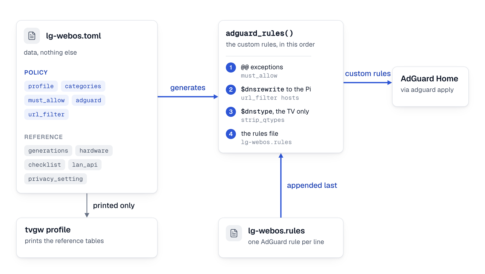

# The profile format

This page is the reference for a TV profile: every table and key that `src/tvgw/profile.py` reads, the evidence grades, the rules file and the lint. It is for a developer writing or reviewing a profile; how to capture a new TV and turn what it does into a profile is in [adding a profile](../project/adding-a-profile.md).

The TOML is data: `from_dict` builds a `Profile` from it, and `Profile.adguard_rules()` generates the rules AdGuard receives.

- The top-level tables allowed are `TABLES` in src/tvgw/profile.py: `profile`, `categories`, `must_allow`, `adguard`, `url_filter`, `generations`, `hardware`, `checklist`, `lan_api`, `privacy_setting`, `category_labels`, `clock` and `support`. Any other table fails the load with `<table>: unknown table`, because a misspelt `[must_alow]` would otherwise read as a profile with no must-allow hosts and a clean lint.
- Every table is optional. A table that is absent gives the defaults below.
- Keys inside a known table are not checked against a list, except in `[clock]`, `[support]` and the `[[lan_api]]` and `[[privacy_setting]]` records. A misspelt key such as `clock_host` is ignored and its default applies. Those four refuse a key they do not know, because a misspelt `source` would read as a record with no citation, and a misspelt `[clock]` key as a table that keeps the clock red line.
- Data that TOML accepts but the profile would misread fails the load with a `ValueError` that names the key. Most often that is a bare string where a list was meant: `Streaming = "netflix.com"` would iterate as 11 one-character patterns.
- Category patterns, strip prefixes, clock hosts, apex zones, must-allow hosts and URL-filter hosts are lower-cased at load.

<picture>
  <source media="(prefers-color-scheme: dark)" srcset="../diagrams/fig-15-profile.dark.png">
  
</picture>

*The anatomy of a profile: the TOML is data, the rules AdGuard receives are generated from it plus the rules file, and the reference records feed only tvgw profile.*

## `[profile]`

| Key | Type | Default | Meaning | Refused at load when |
|---|---|---|---|---|
| `name` | string | `"unnamed"` | Printed by `tvgw profile` and sent in the analyst's pack. Nothing checks it against the file name. | never |
| `vendor` | string | `""` | Printed by `tvgw profile` and sent in the analyst's pack. | never |
| `description` | string | `""` | Printed by `tvgw profile`. | never |
| `expected_categories` | list of strings | `["Streaming", "Infra"]` | The categories that are the TV doing its job. | it is not a list of non-empty strings, or an entry is not a category in `[categories]` |
| `clock_hosts` | list of strings | `[]` | Patterns for the lookups the TV makes to set its clock. | it is not a list of non-empty strings |
| `never_block_apex` | list of strings | `[]` | Zones where a block at the apex breaks the TV, because one zone carries delivery and telemetry. The lint refuses a block or rewrite rule at the apex and a regex that matches across the zone ([lint](#lint)). | it is not a list of non-empty strings |

The default `expected_categories` is not checked against `[categories]`.

A `clock_hosts` pattern matches the whole query name, case-insensitively. `*` matches any run of characters and `?` exactly one (`clock_sync` in src/tvgw/queries.py turns them into SQL `LIKE` patterns). A subdomain is not matched by itself: `??.example.com` matches `us.example.com` and not `rdx2.example.com`, which is why `lg-webos` lists the country hosts only. With patterns listed, the brief raises a red line when a clock lookup is blocked, or when a report of a whole day has the TV on and no clock lookup ([red lines](../use/daily-brief.md#red-lines)). An empty list turns both checks off, and so does [`[clock]`](#clock) with `model = "none"`.

## `[categories]`

Each key is a category, and its value is a list of host patterns. One key is not a category: `strip_prefixes`, a list of regional prefixes (`aic.`, `eic-`) that is removed from the front of a name before matching. Only the first prefix that matches is removed.

A name is categorized like this (`Profile.categorize` in src/tvgw/profile.py):

1. The name is lower-cased, its trailing dot is dropped, and a strip prefix is removed.
2. Patterns use shell wildcards: `*`, `?` and `[...]`. `*` also matches dots.
3. A pattern matches the host itself or any subdomain of it, so `example.com` matches `example.com` and `a.b.example.com`.
4. The longest pattern wins. Its score is its length without the `*` characters. On a tie, the pattern earlier in the file wins.
5. A name that no pattern matches is `Other`.

So `peacocktv.com` can be `Streaming` while `ingest.webcol.sdp.peacocktv.com` is a more specific `3rd-party ads` entry.

| Refused at load when | Why |
|---|---|
| a category is named `Other` | `Other` is reserved for names no pattern matches. |
| a value is not a list of non-empty strings | A bare string would iterate as one-character patterns. |
| `strip_prefixes` is not a list of non-empty strings | Same reason. |

The categories keep their file order, and the brief's "By category" table lists them in that order. Name a category `ACR` if the vendor has automatic content recognition: the hardware suite checks that no `ACR` name was answered in the last day, and with no such category that test checks nothing.

## `[must_allow]`

A table of `host = "reason"`: the names that break the TV when blocked. The reason is for the next reader, and it must be a string, or the load fails naming `must_allow.<host>`.

Each host becomes the exception `@@||host^$important` in AdGuard's custom rules, which also covers its subdomains. The `$important` modifier is what makes the exception hold against any list, whatever the order ([design decision 7](../design-decisions.md#7-must-allow-exceptions-are-generated-from-the-toml)). Never write these in the `.rules` file; an exact copy there is dropped as a duplicate.

The must-allow hosts are also read by the lint, by `tvgw verify`, by the brief's red line, by the hardware suite and by the analyst. After an apply, `tvgw adguard apply` waits for the resolver to resolve the first must-allow host, or `example.com` when the list is empty.

(W12) A host may carry `{cc}`, the TV's country as two lower-case letters, and `{rg}`, the vendor's regional prefix for it (`COUNTRY_PLACEHOLDER` and `REGION_PLACEHOLDER` in src/tvgw/profile.py). At load they are filled with `[profile] default_country` (`us` when absent) and the region `[regions]` gives it (`aic` when none does), so a profile read with no country plans the hosts it always did; `Profile.for_country(cc)` fills them again for another country, which `cli._load_profile` does when the settings name `TV_COUNTRY`. The hosts as written are kept as `must_allow_templates`.

## `[regions]`

(W12) Optional: `prefix = ["de", "fr", ...]`, the vendor's regional prefix for `{rg}` by country. A prefix is 2 to 8 lower-case letters, a country two lower-case letters named under one prefix only, or the load fails naming `regions.<prefix>`. A country no prefix lists gets `aic`.

## `[adguard]`

| Key | Type | Default | Meaning | Refused at load when |
|---|---|---|---|---|
| `filters` | list of `{ name = "...", url = "...", sentinel = "...", role = "..." }` | `[]` | Blocklists that `tvgw adguard apply` makes sure exist and are enabled, matched by URL, with the name set. `sentinel` is optional: a name the list blocks and that answers `0.0.0.0` once the list is in force. (pause) `role` is `tracking`, the default, for a list of trackers, which `tvgw pause` switches off for its minutes, or `bypass` for a list that closes a way around the filter (the list of encrypted-DNS servers), which no pause touches ([design decision 79](../design-decisions.md#79-a-pause-lifts-only-the-shared-tracker-lists-for-at-most-an-hour-through-the-plan-ends-on-its-own-two-ways-and-then-names-what-the-lists-were-stopping)). Every bundled profile marks its DoH list `bypass`. | an entry lacks a string `name` or `url`, its `sentinel` is not a lower-case DNS name of two labels or more, its `role` is neither `tracking` nor `bypass`, or it has a key other than these four |
| `strip_qtypes` | list of strings | `[]` | Record types withheld from the TV. | an entry is not in `STRIPPABLE_QTYPES = ("HTTPS", "SVCB")` in src/tvgw/profile.py |

`tvgw adguard apply` leaves lists the profile does not name as they are, and removing a list from `filters` does not disable it in AdGuard.

`tvgw verify`'s `list_sentinels` check looks up one sentinel per list and expects `0.0.0.0` ([what tvgw verify checks](verify-checks.md)). It takes the entry's own `sentinel` first, else the one `SENTINELS` in src/tvgw/verify.py knows for a piece of the URL; a list with neither is not checked.

`strip_qtypes = ["HTTPS", "SVCB"]` generates one rule, `||*^$dnstype=HTTPS|SVCB,client=<TV_IP>`. It is scoped to those types and to the TV's address, so the TV's A lookups and every other client are untouched. HTTPS and SVCB records carry Encrypted ClientHello keys, which would hide every server name from the capture ([design decision 6](../design-decisions.md#6-adguard-home-is-configured-as-code)). The lint treats a `$dnstype` rule as a typed rule, not as a block.

## `[url_filter]`

Optional. Leave it out when the vendor has no plain-HTTP file service that DNS cannot split.

| Key | Type | Default | Meaning | Refused at load when |
|---|---|---|---|---|
| `hosts` | list of strings | none; required with the table | Names AdGuard answers with the gateway's address. | it is missing or not a list of non-empty strings |
| `block_regex` | string | none; required with the table | The regex of request URIs the filter refuses. | it is missing or does not compile |

For each host, `tvgw adguard apply` generates `||host^$dnsrewrite=<GW_IP>`; do not write these in the `.rules` file. `UrlFilter.blocks()` matches `block_regex` against a URI case-insensitively; the unit tests use it. `tvgw verify` checks that each host resolves to the gateway.

The nginx files are not generated from the profile. `deploy/nginx/tvgw-gfts.conf` and `deploy/nginx/stream.conf` carry their own copies of the regex, the host list and the passthrough pattern, written for LG ([the URL filter](../../deploy/nginx/README.md)). For another vendor, copy and edit them by hand, keep the `$request_uri ~* "..."` shape that the rule-history ingest reads, and copy `test_nginx_conf_matches_the_profile` in tests/unit/test_profile.py so the unit suite ties your files to your profile.

## `[[generations]]`

Optional reference rows for the OS releases. They do not change what is blocked.

| Key | Type | Default | Meaning |
|---|---|---|---|
| `webos` | string | none; required | The OS release (the key name is LG's). |
| `years` | list of integers | `[]` | Model years. |
| `codename` | string | `""` | The release's code name. |
| `models` | list of strings | `[]` | Model lines. |
| `firmware_major` | string | `""` | The firmware major version that identifies the release. |
| `verified` | boolean | `false` | Seen on a set this project ran. |
| `clock_hosts` | list of strings | `[]` | The clock hosts reported for the release. |
| `lan_api` | string | `""` | What the LAN API allows. |
| `dns_bypass` | list of strings | `[]` | DNS bypasses reported. |
| `hardcoded` | list of strings | `[]` | Hardcoded addresses reported. |
| `notes` | list of strings | `[]` | Anything else. |
| `confidence` | string | `"low"` | The [evidence grade](#evidence-grades). |
| `os_major` | string | `""` | (W12) The major of the release the TV reports (`deviceOSReleaseVersion` in its SSAP `hello` reply): `7` is webOS 22, `11` webOS 26. No two rows may share one. |
| `release_range` | string | `""` | (W12) The release range in words, with examples seen (`7.x (a 2022 LCD: 7.5.7 at firmware 04.54.40)`). |
| `firmware_majors` | list of strings | `[]` | (W12) Every firmware major seen on this line, shared ones included; informational, never a lookup key. |
| `menu` | table | `{}` | (W12) `topic = "path"` for the topics `MENU_TOPICS` (`wifi`, `agreements`, `live_plus`, `advertising`, `standby`), the paths on the TV from Settings > All Settings. |
| `manifest` | string | `""` | (W12) The pairing manifest that works on this line: `signed` (the library's) or `unsigned` (tvgw's read-only one). |
| `readable` | list of strings | `[]` | (W12) The `getSystemSettings` keys of privacy interest in the public read list of a dump from a real set; the reader asks a standby key only where the TV's row lists it. |
| `consent_flags` | list of strings | `[]` | (W12) The `eulaStatus` flags the dumps show for this line. |
| `support` | string | `""` | (W12) `tested`, `reported` or `not-yet-tested` for this line alone. |
| `sources` | list of URLs | `[]` | (W12) Where the row's facts come from. |

`tvgw profile --release RELEASE` picks the row whose `os_major` equals the part of `RELEASE` before the first dot (what the hourly reading does with the TV's `hello` reply); `--webos WEBOS` the row whose `webos` equals the part of `WEBOS` before the first dot; `--firmware FIRMWARE` the row whose `firmware_major` equals the part of `FIRMWARE` before the first dot. They are tried in that order.

(W12) Every key of a row is checked: an unknown key, a `menu` topic outside `MENU_TOPICS`, a `manifest` or `support` outside its words, an `os_major` two rows share, or a row without `webos` stops the load with a one-line error naming `generations[<i>].<key>`.

## `[[hardware]]`

Optional reference rows for model lines. They do not change what is blocked.

| Key | Type | Default | Meaning |
|---|---|---|---|
| `models` | list of strings | none; required | Shell patterns on the model number, compared in upper case with spaces removed. |
| `year` | integer | `0` | The model year. |
| `far_field_mic` | boolean | `false` | A microphone in the TV itself, not only in the remote. |
| `assistants` | list of strings | `[]` | The voice assistants. |
| `notes` | string | `""` | Anything else; a string here, not a list. |
| `confidence` | string | `"low"` | The [evidence grade](#evidence-grades). |

The first row that matches wins, so put specific rows before general ones. `tvgw profile --model MODEL` prints the row for `MODEL`. Without `--model`, it uses the model the TV last reported over its LAN API, when the store has one. A model that no row matches is printed as one to treat as having a microphone until checked. A row without `models` stops the load with a traceback, like a generation without `webos`.

## `[checklist]`

Optional. `topic = ["step", ...]`, printed as numbered steps whenever `tvgw profile` has a model to describe. A topic that is not a list of non-empty strings fails the load.

Two keys are not topics:

| Key | Type | Default | Meaning | Refused at load when |
|---|---|---|---|---|
| `wifi_off` | string | `""` | The steps, in plain words, that make the cable the TV's only path: forget every saved Wi-Fi network and switch Wi-Fi off. `tvgw profile` prints it. | it is not a string |
| `wifi_off_confirmed` | boolean | `false` | Whether the `wifi_off` steps were checked on a set of this profile. | it is not a boolean, or it is `true` with no `wifi_off` steps |

`tvgw profile` prints "webOS" in its generation lines and calls a microphone in the remote push-to-talk, whatever the vendor. That wording is in `cmd_profile` in src/tvgw/cli.py, not in your data.

## `[clock]`

Optional. How the TV sets its clock, which decides whether the brief's clock red line applies.

| Key | Type | Default | Meaning | Refused at load when |
|---|---|---|---|---|
| `model` | string | none; required with the table | `vendor-https` (from the vendor's own HTTPS reply, as webOS reads LG's SDP reply), `ntp`, `mixed` (both), or `none` (not known). | it is missing or not one of the four (`CLOCK_MODELS` in src/tvgw/profile.py) |

With `model = "none"` the brief raises no clock red line, whatever `clock_hosts` says ([design decision 62](../design-decisions.md#62-a-tv-gets-a-vendor-profile-only-on-evidence-or-its-owners-answer-otherwise-the-general-profile-which-isolates-records-briefs-and-blocks-only-shared-lists)). The other three models, and a profile without the table, keep the red line `clock_hosts` gives.

## `[support]`

Optional. How far the profile is tested, which `tvgw profile` prints.

| Key | Type | Default | Meaning | Refused at load when |
|---|---|---|---|---|
| `status` | string | none; required with the table | `tested`, `reported` or `not-yet-tested`, printed as Tested, Reported and Not yet tested (`SUPPORT` in src/tvgw/profile.py). | it is missing or not one of the three |
| `tested_on` | list of strings | `[]` | The sets the profile was tested on. | it is not a list of non-empty strings, or the status is `tested` and it is empty |
| `you_check` | string | `""` | What the TV's owner checks in the TV's own menus, in plain words. | it is not a string |
| `does` | string | `""` | (samsung) What tvgw does for this TV, in plain words, for a profile whose TV is read without pairing: the support tables' "What tvgw does". | it is not a string |
| `can_check` | list of strings | `[]` | (samsung) What the hourly reading reads on this TV, one plain-words item each: the vendor page's "What tvgw can check". | it is not a list of non-empty strings |
| `cannot_check` | list of strings | `[]` | (samsung) What it cannot read, which the owner checks on the TV. | same |

A profile without the table declares no status. `tvgw profile` prints `does`, `can_check` and `cannot_check` where the profile has them; `samsung-tizen` is the profile that does.

## `[[lan_api]]`

Optional reference rows, one per LAN API endpoint the TV listens on: how a gateway on the TV's segment could read the TV's state, and what it cannot change ([the R&D survey](../research/state-of-the-art-2026-10.md#61-lan-apis-by-vendor-2025-26), sections 6.1 and 6.4). They do not change what is blocked or what the firewall opens.

| Key | Type | Default | Meaning | Refused at load when |
|---|---|---|---|---|
| `name` | string | none; required | The API's name. | it is missing or empty |
| `port` | integer | none; required | The TCP port. | it is not an integer from 1 to 65535 |
| `protocol` | string | none; required | One of `LAN_PROTOCOLS` in src/tvgw/profile.py: `ws`, `wss`, `http`, `https`, `mqtt`, `mqtts`, `adb`, `tls`. | it is not one of them |
| `tls` | string | `""` | What the client must accept, such as `self-signed`. | it is not a string |
| `pairing` | string | `""` | How a client is let in. | it is not a string |
| `discovery` | string | `""` | The SSDP search target or mDNS service type. | it is not a string |
| `generations` | list of strings | `[]` | The OS releases the row describes. | it is not a list of non-empty strings |
| `reads` | list of strings | `[]` | The readable fields, with a setting's key path where one is known. | same |
| `write` | string | `"unknown"` | One of `WRITE_MODES`: `ok`, `refused`, `root`, `unknown`. | it is not one of them |
| `read_only` | string | `""` | What can be read and not changed, and why. | it is not a string |
| `gate` | string | `""` | The TV setting that switches the API on or off. | it is not a string |
| `notes` | list of strings | `[]` | Anything else. | it is not a list of non-empty strings |

Every row also carries the [provenance keys](#provenance).

## `[[privacy_setting]]`

Optional reference rows, one per privacy setting on the TV: what it controls, the value this project recommends, and where it sits in the menus. Vendors move settings between releases, so `menu` is keyed by generation or menu family.

| Key | Type | Default | Meaning | Refused at load when |
|---|---|---|---|---|
| `name` | string | none; required | The setting as the TV labels it. | it is missing or empty |
| `controls` | string | none; required | What the setting controls. | same |
| `recommended` | string | none; required | The value to set. | same |
| `menu` | table of strings | none; required | `"<generation>" = "<menu path>"`, printed in file order. | it is not a non-empty table of non-empty strings |
| `key` | string | `""` | The key the LAN API reads the setting by. | it is not a string |
| `opt_out_effective` | string | `""` | What measurement says the opt-out achieves; its source goes in `sources`. | it is not a string |
| `notes` | list of strings | `[]` | Anything else. | it is not a list of non-empty strings |

`tvgw profile` prints every `[[lan_api]]` and `[[privacy_setting]]` row with its provenance after the generations, whatever the options. In `lg-webos`, the Live Plus row's `key` is the key `lgwebos.py` reads (`ACR_KEY`), and `test_lg_records_are_verified_exactly_where_the_cx_showed_them` in tests/unit/test_profile_records.py keeps the two equal.

(plain) The plain brief takes the menu path of its Live Plus and ACR actions from these rows: the row whose `key` is `ACR_KEY`, else the first whose `controls` says `ACR` or "content recognition", a `verified` row first, and that row's first `menu` entry with its `recommended` value ([the three tiers](brief-sections.md#the-three-tiers)). Put the reference generation's row first.

## `[category_labels]`

(plain) Optional: a category in plain words for the plain brief, where the shared names and the vendor suffixes in `CATEGORY_PLAIN` and `SUFFIX_PLAIN` (src/tvgw/plain.py) would name it wrongly, as `"<category>" = "<plain words>"`. `LG telemetry` reads as `LG usage reporting` without a table; a category such as `ACR suspected (shared AWS)` needs one to read otherwise. Each key must be one of the profile's `[categories]` or `Other`, and each value a non-empty string, or the load fails naming the key.

```toml
[category_labels]
"ACR suspected (shared AWS)" = "possible viewing trackers"
```

## Provenance

Every `[[lan_api]]` and `[[privacy_setting]]` row carries these keys, and `from_dict` checks them ([design decision 31](../design-decisions.md#31-reference-records-name-their-evidence-or-their-source)):

| Key | Type | Default | Meaning |
|---|---|---|---|
| `provenance` | string | `"unverified"` | `verified` or `unverified` (`PROVENANCE` in src/tvgw/profile.py). |
| `evidence` | string | none | Required when verified, refused otherwise: one of `EVIDENCE_KINDS`, `capture`, `lan-api`, `on-screen` or `breakage` ([grading evidence](#grading-evidence)). |
| `grade` | string | `observed` when verified, `low` otherwise | When verified, only `observed`; otherwise `peer-reviewed`, `community`, `spec` or `low`. |
| `sources` | list of strings | `[]` | `http://` or `https://` URLs. Required, at least one, when unverified. |

A load fails, naming the key, for a verified row without evidence, an unverified row without a source, a grade the status does not allow, a source that is not a URL, and an unknown key. A row whose facts were seen on one generation and only reported for another is two rows, one verified and one unverified, so a grade never covers more than its evidence.

## Evidence grades

Every `[[generations]]` and `[[hardware]]` row carries a `confidence` grade ([design decision 15](../design-decisions.md#15-blocklist-entries-come-from-evidence-with-grades)), and every `[[lan_api]]` and `[[privacy_setting]]` row a `grade`. The grades are `GRADES` in src/tvgw/profile.py, strongest first:

| Grade | Meaning |
|---|---|
| `observed` | Seen on a set you ran: packets captured, firmware read, a LAN-API reading. Only an observed generation gets `verified = true`, and only an observed record is `verified`. |
| `peer-reviewed` | A measurement study at a peer-reviewed venue (IMC, PoPETs, CCS, USENIX Security and the like) shows it, in its text or its published data. |
| `community` | Independent reports agree: forum posts, issue trackers, teardown notes, a maintained blocklist's entry or comment, a press guide. |
| `spec` | The vendor's own product pages or documentation say so. |
| `low` | One report, an unclear source, or a guess; say why in `notes`. |

For `[[generations]]` and `[[hardware]]` the code does not validate the grade, and a missing one is `low`; `test_every_bundled_record_is_cited_or_observed` in tests/unit/test_profile_records.py checks that every bundled row carries one of the five. In `[categories]`, `[must_allow]` reasons and the `.rules` file, mark an entry you have not seen on your own set with the word `unverified`.

## Grading evidence

A profile tells the gateway what it may never block and what it must block. A wrong entry either breaks the TV or leaks what the owner meant to stop, so every entry says how it is known. This section is the rubric the bundled profiles are held to ([design decision 31](../design-decisions.md#31-reference-records-name-their-evidence-or-their-source)).

### What verified means

An entry is verified when it was seen on a set this project ran, behind this gateway, and the evidence is named and dated. The evidence kinds are the values of `EVIDENCE_KINDS` in src/tvgw/profile.py:

| Kind | What it is | Example |
|---|---|---|
| `capture` | The query log or a pcap shows the TV contacting the name, or shows it sending nothing. | A declined Voice Information agreement: a mic press, a consent prompt, no packet (lg-webos). |
| `lan-api` | A reading from the TV's own LAN API. | `option.livePlus`, read hourly by `tvgw tvcheck` (lg-webos). |
| `on-screen` | The TV's menu or screen, seen by the owner. | A menu path walked on the set. |
| `breakage` | Blocking the name broke a named feature, and lifting the block restored it. | The Prime Video update that failed with the file service blocked (lg-webos, 2026-10-25). |

What each kind of entry needs before it is verified:

- **A block rule** needs a `capture`: the TV looked the name up, on a dated day, on a named model and firmware. Its comment in the `.rules` file also says what blocking it cost after the affected features were used, "nothing" included.
- **A must-allow host** needs `breakage` on the set: the block broke the feature its reason names. A host the TV only contacts is not yet a must-allow host; it is a candidate.
- **A `[[lan_api]]` row** needs a `lan-api` reading of each field in `reads` and a tried write for `write`.
- **A `[[privacy_setting]]` row** needs the setting seen on the TV (`on-screen`), and its effect seen on the wire (`capture`) or read back (`lan-api`) for `opt_out_effective`.
- **A `[[generations]]` row** gets `verified = true` and `confidence = "observed"` only for the generation the set runs.

### What unverified means

Everything else is unverified, and an unverified entry must cite where it came from:

- a `[[lan_api]]` or `[[privacy_setting]]` row carries `sources`, at least one URL, and a `grade` below `observed`; the loader refuses it otherwise;
- a `[must_allow]` reason contains the word `unverified` and names its report;
- a `.rules` group's comment block contains the word `unverified` and at least one URL. `profile.uncited_rules()` lists the rules no URL stands over; the comment block that opens a group cites every rule in it, and a blank line ends the group. For the DNS-only profiles `test_every_vendor_rule_is_cited_and_marked_unverified` in tests/unit/test_vendor_profiles.py requires the list to be empty.

Cite the primary source: the paper, the list's file, the issue. A blocklist with a restrictive licence is cited and subscribed to, never copied into the repository: HaGeZi's lists are GPL-3.0 and the PoPETs 2027 list is CC BY-NC-ND 4.0, while tvgw is MIT ([design decision 32](../design-decisions.md#32-a-vendor-profile-without-hardware-is-dns-only-cited-and-subscribed)).

### How a profile graduates

A DNS-only profile becomes a verified one entry by entry, never all at once:

1. Put a set of that vendor behind the gateway and run [phase 1](../project/adding-a-profile.md#phase-1-capture-first) with the profile's blocks in place.
2. For each must-allow host, read the store. A host the TV never looks up stays unverified. Test the clock, firmware and store hosts by the procedure in [find the clock hosts](../project/adding-a-profile.md#find-the-clock-hosts), and rewrite the reason of each one that broke something with the date, the model and what broke.
3. For each pinned block, check the query log for the name. Add the date, the model, the firmware and the cost to the group's comment, and drop `unverified` from it for the rules seen. Rules never seen keep their citation and their mark.
4. Read the TV's menus and LAN API. Split each `[[lan_api]]` and `[[privacy_setting]]` row into a verified row for what you saw, with its `evidence`, and an unverified row for what you did not.
5. Add a `[[generations]]` row for the firmware the set runs, with `verified = true` and `confidence = "observed"`.
6. When the clock, firmware and store hosts and the ACR blocks are verified, change the description from "unverified" to "verified on" the model line, and record it in [the changelog](../../CHANGELOG.md).

## The rules file

`src/tvgw/profiles/<name>.rules` holds the profile's AdGuard rules: the blocks, and the regex rules. `profile.load` finds it by the name it was asked to load, never by `[profile].name`.

- The file must exist beside the TOML. An empty file is the capture-phase profile.
- A missing or unreadable file fails the load, because a profile loaded without its rules would lint clean and block nothing.
- One rule per line. Lines that start with `!` are comments. Blank lines and comments are dropped, each line is trimmed, and a repeated line is kept once (`parse_rules` in src/tvgw/profile.py).

`Profile.adguard_rules()` builds AdGuard's custom rules in this order:

1. `@@||host^$important` for each `[must_allow]` host, in file order.
2. `||host^$dnsrewrite=<GW_IP>` for each `[url_filter]` host.
3. `||*^$dnstype=<types>,client=<TV_IP>` when `strip_qtypes` is set.
4. The lines of the `.rules` file, less any line equal to a generated rule.

`tvgw adguard apply` then appends the rules the gateway added on its own, from the file `AUTO_RULES` names, after linting each beside the profile ([design decision 20](../design-decisions.md#20-the-gateway-blocks-on-its-own-under-three-watches)). The result replaces AdGuard's `user_rules` whole. Order decides nothing in AdGuard's precedence; the `$important` modifier does.

Write the file the way `lg-webos.rules` is written:

- Group rules under a comment with the date and the reason: what the host is, how you saw it, what blocking it cost.
- Keep rules you tried and rejected as comments, so nobody tries them again.
- Never add the must-allow exceptions or the URL-filter rewrites; both are generated.

One group from `lg-webos.rules`, a block with its evidence and a rejected try:

```text
! Peacock's first-party telemetry ingest (86K uploaded in a 45-min session). Verified
! 2026-10-25: playback, CDN switching, token refresh and pause/resume all fine with it blocked.
||ingest.webcol.sdp.peacocktv.com^
! Tried and rejected 2026-10-25: ||aiv-delivery.net^ (Prime Video's ad-pod service, ters-sgai1 /
! ters-draper1). Ads still played with it blocked: the ad video is stitched into the stream
! from the same CDNs as the show, so DNS cannot remove Prime ads. Don't bother again.
```

## Lint

On your workstation:

```sh
tvgw profile --profile src/tvgw/profiles/acme-tv.toml
```

Without `/etc/tvgw/tvgw.conf` the default settings apply. The command prints `rules lint: clean`, or the problems separated by `; `, and exits 1 when there are problems ([commands](commands.md)).

The lint is `Profile.lint()` in src/tvgw/profile.py. `rule_target()` first reads each rule as a block, an exception (`@@`), a rewrite (`$dnsrewrite`), a typed rule, a regex, a regex exception, or a form it cannot read. A `$dnstype` rule is typed, and judged as withholding record types rather than a name, only when it names nothing but HTTPS, SVCB or AAAA (`HARMLESS_QTYPES`), in any case and without `~`; any other `$dnstype` rule, such as `||*^$dnstype=A`, takes the addresses away and is judged as the block it is. A host pattern "covers" a name when the name equals it or is a subdomain of it, with `*` as a shell wildcard that also matches dots. The lint refuses:

| Problem | Message starts with |
|---|---|
| A block rule that covers a must-allow host, in `\|\|host^` form, hosts syntax such as `0.0.0.0 host`, or a `$dnstype` rule that withholds any type but HTTPS, SVCB or AAAA | `block rule` |
| A `$dnsrewrite` rule that covers a must-allow host | `rewrite rule` |
| A URL-filter host that is, or covers, a must-allow host | the host, then `is both must-allow and rewritten` |
| A `/regex/` rule that does not compile | `regex rule`, ending `does not compile` |
| A `/regex/` rule that matches a must-allow host, compiled case-insensitively as AdGuard compiles it | `regex rule`, then `matches must-allow` |
| A block or `$dnsrewrite` rule at the apex of a `never_block_apex` zone, or a wildcard-only chain above it such as `*.apex` | `block rule` or `rewrite rule`, then `at the apex of` |
| A `/regex/` rule that matches the apex of such a zone or names across it, which no rule aimed at particular hosts would (`zz.<apex>`, `zz-zz-zz.<apex>`, `zz.zz.<apex>`; `APEX_PROBES`) | `regex rule`, then `matches across` |
| An exception that sits above a blocked name or equals it | `exception`, then `sits above blocked` |
| Any rule carrying `$badfilter`: AdGuard deletes the rule it names before it matches anything, the generated exceptions and the strip rule included | `rule`, then `carries $badfilter` |
| An exception carrying `$dnsrewrite` that covers, or sits under, a URL-filter host or a rewrite rule: it cancels the rewrite | `exception`, then `cancels the rewrite of` |
| A regex exception (`@@/regex/`): which blocked names it lifts cannot be checked | `regex exception`, ending `write @@\|\|host^` |
| A rule in any form but `\|\|host^`, a hosts line with one name, or a `/regex/`: AdGuard matches a pattern without `\|\|` inside any name (`tvsdp.com^` takes `us.lgtvsdp.com`) and one without `^` as a prefix, which the lint cannot check | `rule`, then `is not one the lint can read` |

An exception above a blocked name unblocks it, and one equal to it leaves the block dead. For a regex rule, the lint compiles the text between the first and the last slash, so `$modifiers` after the closing slash do not count.

The lint does not see one thing: AdGuard matches rules against CNAME targets as well as the queried name, so a clean lint can still block a must-allow host through its CNAME; the brief's red line catches that ([red lines](../use/daily-brief.md#red-lines)).

The same lint runs in four places:

- `tvgw profile`.
- `tvgw adguard diff` and `tvgw adguard apply`, which refuse a profile that does not lint before they read AdGuard's file. A profile loaded from a path is never applied unlinted.
- The unit tests, so `make gate` and CI fail on a profile that does not lint.
- Each rule the gateway adds on its own, linted beside the profile before it reaches AdGuard.
