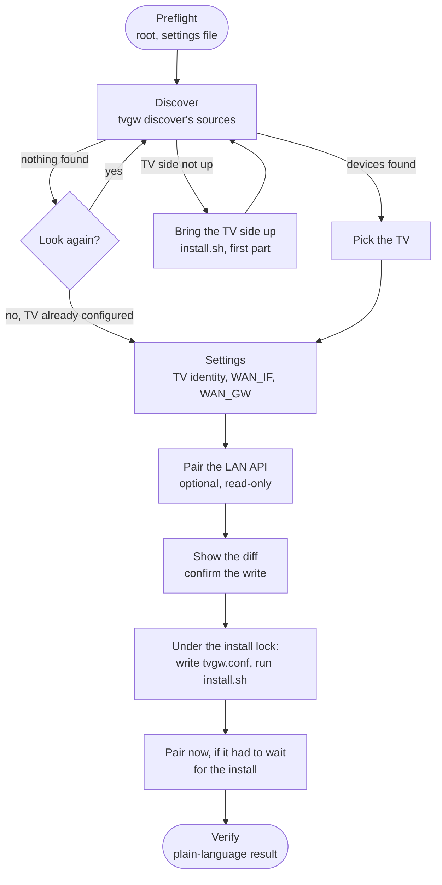

# tvgw setup: the guided installer

`tvgw setup` takes a Pi with the prerequisites installed to a working gateway. It finds the TV, asks which device it is, pairs the TV's LAN API if you want that, writes the settings file, runs the installer and checks the result. This page is for the owner setting up a gateway, by hand or unattended. It covers what to have ready, the guided path, the unattended path with an answers file, the dry run, running it again, and what each stop means. The installer it runs is described in [what install.sh does](../deploy/README.md#what-installsh-does), and the settings it writes in [the settings file](../deploy/README.md#the-settings-file).

## Before you start

You need what the [quick start](../README.md#quick-start) lists up to its step 5:

- the packages `install.sh` names in its header, plus `python3-yaml` when you run setup from a checkout;
- AdGuard Home installed, with its first-run wizard finished;
- the repository cloned to `/opt/tvgw/src`;
- the TV cabled to the Pi's TV port (`eth0`) and switched on, with its Wi-Fi networks forgotten.

You do not need to copy or edit the settings file first. Setup creates `/etc/tvgw/tvgw.conf` from `deploy/tvgw.conf.example` when it is missing, and reads `WAN_IF` and `WAN_GW` from the Pi's default route.

## Running it

On a Pi where tvgw is not installed yet, run it from the checkout:

```sh
cd /opt/tvgw/src
sudo PYTHONPATH=src python3 -m tvgw setup
```

Once tvgw is installed, the command is on the path:

```sh
sudo tvgw setup
```

Setup changes the system, so it needs root. Without root it stops at once and says so; `tvgw setup --dry-run` runs without root and shows what it would do.

## The guided path

Setup asks a handful of plain questions. Every question shows its default in brackets, and Enter takes it. Nothing uses colour or moves the cursor, so it reads the same over a bare SSH session.



*The steps in order. Each one does one thing; a stop prints one line and nothing after it is done.*

1. **Discover.** Setup looks for devices on the TV side with the same sources as `tvgw discover`: the DHCP lease, the neighbour table, the vendor LAN-API ports and an SSDP search ([design decision 23 (setup)](design-decisions.md#23-setup-tvgw-setup-drives-the-existing-steps-it-does-not-replace-them)).
   - On a first install the TV side has no address yet, so the TV has had nowhere to get a lease. Setup says so and offers to run the installer first. With no TV known, the installer brings the TV side up and then stops with `TV not identified`; that stop is expected here, and setup then looks again.
   - When nothing answers, setup asks whether to look again. Switch the TV on, check the cable, wait a few seconds and answer `y`.
2. **Pick the TV.** Setup prints a numbered list, one device per entry with its evidence. The default is the TV already in the settings file, else the only device, else the only device a bundled profile recognises. A device with no MAC address yet cannot be written; wait a minute and look again.
3. **Settings.** Setup asks three things:

   | Question | Default |
   |---|---|
   | Name for the TV (`TV_NAME`) | The name already set for this TV, else the name the TV announced over DHCP (`LGwebOSTV` becomes `lgwebostv`), else `tv`. |
   | Interface toward the home router (`WAN_IF`) | A value you set before, else the interface of the Pi's default route (never a VPN tunnel and never the TV side). |
   | Home router's address (`WAN_GW`) | A value you set before, else the next hop of that default route. |

   When the Pi has no default route, the offered value is the template's example and setup says it is a guess. `TV_MAC`, `TV_IP` and `PROFILE` come from the device you picked. The same TV keeps the address it is pinned to; a new TV keeps the address its lease gave it.
4. **Pair the LAN API.** Only for a TV the `lg-webos` profile matches. See [pairing](#pairing).
5. **Show the diff.** Setup prints a unified diff of the settings file and asks before writing it. Only the lines that change move: comments, blank lines, the order, keys tvgw does not know and the quoting of each line stay as they were.
6. **Apply.** Setup asks whether to run the installer now. The default is yes when the settings changed or the gateway was never installed, and no when nothing changed. It takes the install lock, writes the settings file and runs `install.sh` under the same lock, so a `make deploy` or a CI deploy cannot read a half-written decision. The installer's own output scrolls past; a first install takes a few minutes.
7. **Verify.** Setup runs the checks of `tvgw verify`, prints one line per check and ends with a result in plain words:
   - `Result: the gateway holds.` Every check passed: the TV's only way out is through the gateway, its DNS goes through the filter and the services run. Read the first brief the next day with `tvgw brief`.
   - `Result: NOT done.` The `FAIL` lines above name what is wrong, and [what tvgw verify checks](troubleshooting.md#what-tvgw-verify-checks) explains each one. Fix it and run setup again.

### Pairing

Pairing lets the gateway read the TV's privacy settings over its LAN API every hour, Live Plus first. It is read-only: on the CX's firmware the LAN API refuses writes, and tvgw only reads ([design decision 4](design-decisions.md#4-no-rooting-of-the-tv)). It is optional; answer `n` to skip it, or set `SETUP_PAIR=no` in an answers file.

When you say yes, the TV shows a prompt asking whether to allow a connection from the gateway. Accept that prompt with the remote within a minute. It is not one of the TV's user agreements. Leave Viewing Information, Voice Information and the advertising agreements declined: the gateway needs none of them, and blocks the voice back-ends so a declined agreement stays a wall.

The key that pairing creates, `/var/lib/tvgw/lgtv-keys.sqlite`, controls the TV, so setup makes it readable by root only. Setup then reports what the TV said about Live Plus. When Live Plus is on, turn it off on the TV under General > Additional Settings > Live Plus.

On a first install from a checkout, the LAN-API library is not installed yet. Setup then pairs right after the installer has run, before the checks.

## The unattended path

For an install with nobody at the keyboard, give the answers in a file and pass `--yes`:

```sh
sudo tvgw setup --answers /root/tvgw-answers.conf --yes
```

The answers file uses the settings file's own format: `KEY=VALUE` lines, `#` comments, and quotes around a value with a space. A copy of a working `tvgw.conf` is a valid answers file. Every key in it is checked before anything runs, so a typo stops the install at the start instead of leaving a gateway half set up.

- Any key the settings file takes is written to it. That is every key in [the settings file](../deploy/README.md#the-settings-file) that Settings reads, plus `WAN_GW`, `URL_FILTER_RESOLVER` and `DOH_LIST_URL`.
- The `SETUP_` keys steer the run and are never written:

  | Key | Values | Default | What it does |
  |---|---|---|---|
  | `SETUP_TV` | `auto`, `configured`, an IP address or a MAC address | `auto` | Which device is the TV. `auto` takes the configured TV, the only device, or the only device a profile recognises, and stops when that is still ambiguous. `configured` skips discovery and uses the `TV_MAC` and `TV_IP` the answers or the settings already give. |
  | `SETUP_PAIR` | `auto`, `yes`, `no` | `auto` | Whether to pair an LG TV's LAN API. Unattended, `auto` pairs, and the TV's prompt then needs someone to accept it within a minute; set `no` when nobody is at the TV. |
  | `SETUP_APPLY` | `auto`, `yes`, `no` | `auto` | Whether to run the installer. `auto` runs it when the settings changed or the gateway was never installed. |
  | `SETUP_SSDP` | `yes`, `no` | `yes` | Whether discovery runs the SSDP search, which opens a firewall exemption for the length of the search. |
  | `SETUP_WAIT` | seconds, 0 to 3600 | `120` | How long to keep looking for the TV, every 10 seconds, before stopping. |
  | `SETUP_INSTALLER` | a path | found | The `install.sh` to run. By default, the one in the checkout setup runs from, else `/opt/tvgw/src/deploy/install.sh`. |

An example for a gateway whose TV is known in advance:

```sh
# /root/tvgw-answers.conf
SETUP_TV=02:00:00:00:00:01
SETUP_PAIR=no
WAN_IF=wlan0
WAN_GW=192.0.2.1
UPLINK=direct
```

`--yes` without `--answers` takes every default. An unattended run never installs a guess ([design decision 25 (setup)](design-decisions.md#25-setup-an-unattended-setup-takes-the-answers-file-in-the-settings-format-and-never-guesses)): it stops when several devices could be the TV, and when the Pi has no default route to read `WAN_IF` and `WAN_GW` from and the answers do not give them. Run without a terminal and without `--yes`, setup stops and says how to run it unattended.

Exit status: 0 when the gateway holds; 1 on a stop, a failed install or any `FAIL`; 130 when interrupted.

## The dry run

```sh
tvgw setup --dry-run
```

The dry run goes through the same questions and prints every change: the settings-file diff, whether it would pair, and whether it would run the installer. It writes nothing, pairs nothing, takes no lock and runs no installer. It also skips the SSDP search, because that opens a firewall exemption for a few seconds. It runs without root; discovery then reads only what that user can.

## Running it again

Setup is safe to repeat. A second run finds the same TV, offers the values already set as its defaults, and shows `already holds these settings; nothing to write` when nothing differs. The installer then defaults to not running. With a pairing key already there, it reads the TV once to report Live Plus, without a new prompt on the TV. Run it again after a fix, after replacing the TV, or to pair a TV you skipped the first time.

To change one setting by hand, `sudoedit /etc/tvgw/tvgw.conf` remains the direct way. Setup keeps every comment and key you add there.

## What it does not do

- It adds no install logic. The installer is still `install.sh`, which `sync-install.sh` and CI also run, and setup only decides when to call it ([design decision 23 (setup)](design-decisions.md#23-setup-tvgw-setup-drives-the-existing-steps-it-does-not-replace-them)).
- It does not install AdGuard Home or run its wizard.
- It does not change any setting on the TV, and never asks you to accept a TV agreement.
- It never writes a value the shell scripts would read as a command, or one `config.load()` would refuse ([design decision 24 (setup)](design-decisions.md#24-setup-the-settings-file-is-edited-in-place-and-refused-whole)).

## When it stops

| Message | What it means | What to do |
|---|---|---|
| `setup changes the system and needs root` | Run as an ordinary user. | `sudo tvgw setup`, or `--dry-run`. |
| `no terminal to ask on` | No terminal and no `--yes`. | Add `--answers FILE --yes`. |
| `answers file ...: ...` | A key or value in the answers file is not usable. | Fix the named line. |
| `no TV found and none configured` | Nothing answered on the TV side within `SETUP_WAIT`, or you declined to look again. | Check the cable and that the TV is on; run again. |
| `the installer ran but eth0 still does not carry 10.10.10.1` | The installer could not bring the TV side up. | Read its output above; see [the TV interface](../deploy/networkmanager/README.md). |
| `several devices could be the TV` | An unattended run with more than one candidate. | Set `SETUP_TV` to the TV's MAC or address. |
| `... has no MAC address in the lease or neighbour table yet` | The TV answered but has not finished DHCP. | Wait a minute and run again. |
| `refused, nothing written: ...` | A value the settings file cannot take. | Fix the named key. |
| `install.sh not found` | Setup runs neither from a checkout nor next to `/opt/tvgw/src`. | Pass `--installer PATH`. |
| `another install is running` | A deploy held the install lock for ten minutes. | Wait for it and run again. |
| `the installer stopped (exit N)` | `install.sh` stopped; its output says why. | Fix the cause and run again. |
| `the TV did not answer over its LAN API` | The TV was off, or the prompt was not accepted in time. Setup goes on. | Run setup again to pair. |
