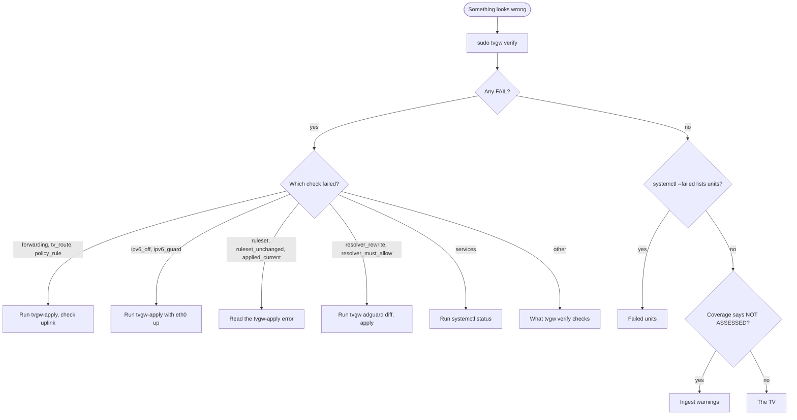

# Troubleshooting

This page takes a symptom to its cause and its fix: the TV misbehaves, a unit failed, `tvgw verify` fails, or the brief looks wrong. It owns what each verify check proves and every warning that ingest and pcap retention print; red-line actions and longer procedures are in the [operations runbook](operations.md).

## Start here

`tvgw verify` says within seconds whether the firewall, routing, resolver and services hold, so start there. Then look for failed units, then at the brief's Coverage line.



*Triage from symptom to section: `tvgw verify` answers "is the gateway holding" in seconds, so start there.*

On the Pi:

1. Run `sudo tvgw verify`. Each line starts with `OK` or `FAIL`, then the check's name and a detail. Look each FAIL up in [what tvgw verify checks](#what-tvgw-verify-checks).
2. If every line is `OK`, run `systemctl --failed`. Look a listed unit up in [failed units](#failed-units).
3. If no unit failed, run `tvgw brief` and read Coverage. A source marked `NOT ASSESSED`, or an `ingest warning:` line, leads to [ingest warnings](#ingest-warnings).
4. If all of that is clean, start from the symptom in [the TV](#the-tv).

```sh
sudo tvgw verify      # one OK or FAIL line per check
systemctl --failed    # must list nothing
tvgw brief            # read Coverage first
```

A `RED LINE:` in the brief has its action in [red lines](operations.md#red-lines). Each unit's journal is in [reading the journals](../deploy/systemd/README.md#reading-the-journals).

## What tvgw verify checks

`sudo tvgw verify` runs the checks below in this order and prints one line for each: `OK` or `FAIL`, the check's name, and a detail (`check` in `src/tvgw/verify.py`). A FAIL fails the command ([exit codes](../src/tvgw/README.md#commands)). Each command a check runs has a 30-second timeout, and a command that fails or times out reads as empty.

`tvgw-verify.timer` runs it with `--record`, which also stores the verdict and a snapshot of every firewall counter for the brief ([design decision 13](design-decisions.md#13-counters-not-logs-prove-the-firewall-held)). A run that cannot be stored prints `tvgw verify: could not record the run: <error>` to stderr and fails as well.

| Check | Runs when | What it proves | What a FAIL means | What to do |
|---|---|---|---|---|
| `ruleset` | Always | Table `inet tvgw` is loaded and holds the key rules in `KEY_RULES`: the DNS DNAT to the gateway, the DoT/DoQ reject, the DoH set, the home-LAN set, masquerade and the invalid-state drop. With `BLOCK_QUIC=yes` it must also hold the QUIC reject (`QUIC_RULE`). | `table inet tvgw is not loaded`: either the service is stopped (the TV is dark) or the table was deleted by hand (the TV may be forwarded with no filter; `forwarding` says which). `missing: <rules>`: a key rule is gone. | If `tvgw.service` is inactive, run `sudo systemctl start tvgw`; otherwise run `sudo tvgw-apply` and read its error. A rule still missing after a clean apply means `tvgw-apply` and `KEY_RULES` disagree, which `tests/unit/test_deploy_lint.py` exists to catch. |
| `ruleset_unchanged` | The table is loaded | The live ruleset, without counters, equals what `tvgw-apply` last wrote to `/run/tvgw/ruleset.applied`. | `differs from the last apply`: someone changed the rules by hand, or something else rewrote them. `no baseline: ... missing (run tvgw-apply)`: the table is loaded but its listing is gone, so nothing vouches for the rules. | Run `sudo tvgw-apply`. |
| `applied_current` | The table is loaded and the baseline exists | No input of `tvgw-apply` (`/etc/tvgw/tvgw.conf`, `/etc/tvgw/block4.txt`, `/var/lib/tvgw/doh4.txt`) changed after the last successful apply, unless the change is under `APPLY_GRACE = 120` seconds old. The grace covers `tvgw-doh-update`'s write-then-apply and an edit in progress. For the settings file only the keys `tvgw-apply` reads count (`APPLY_KEYS`: `UPLINK`, `WAN_IF`, `WAN_GW`, `BLOCK_QUIC`, `STRICT_PORTS`, `DNSGATE`), with defaults filled in, compared with what the last apply recorded in `/run/tvgw/settings.applied`: an edit to the TV's identity, retention or the analyst needs no apply. Without that record (an apply from before it was kept) any edit counts. | `changed after the last apply: <files>`: an input changed and no apply has succeeded since. A `block4.txt` line nft rejects leaves the old set loaded and the baseline unchanged, so this is the only check that sees it. So is a firewall setting changed in the conf and never applied. | Run `sudo tvgw-apply` and read its error. |
| `forwarding` | Always | `net.ipv4.ip_forward` is 1, and so is the `forwarding` switch of the TV interface and of the uplink (`WAN_IF`, or `tun0` with `UPLINK=vpn`). | Forwarding is off and the TV is offline: the service is stopped, was never applied, or was restarted the way that once left the TV dark ([incidents](incidents.md)). The detail names each switch that is off. | If `tvgw.service` is inactive, run `sudo systemctl start tvgw`; otherwise run `sudo tvgw-apply`, which writes all three switches. |
| `ipv6_off` | Always | `disable_ipv6` is 1 on the TV interface. | IPv6 could reach the TV. | Run `sudo tvgw-apply`. |
| `ipv6_guard` | Always | Table `netdev tvgw_l2` is loaded and holds the rule commented `no IPv6 from the TV`, which drops every IPv6 frame on the TV interface at the wire. | `netdev tvgw_l2 is not dropping IPv6 on eth0`: the table was deleted by hand, or `tvgw-apply` could not load it and only warned, which it does while `eth0` is down. `disable_ipv6` still drops IPv6, so this is the second wall, and the source of the brief's IPv6 line in Firewall held. | Check that `eth0` is up (`ip link show eth0`), then run `sudo tvgw-apply` and read its warning. |
| `tv_route` | Always | A packet from `TV_IP` entering on the TV interface routes out the chosen uplink (`ip route get 1.1.1.1 from <TV_IP> iif eth0`). | `via nothing`: no route, and the TV is dark. `via <device>`: the TV's traffic would leave the wrong way. | Check that the uplink is up, then run `sudo tvgw-apply`. The NetworkManager dispatcher runs it again when the uplink comes back. |
| `policy_rule` | `UPLINK=direct` | `ip rule` priority 60 sends the TV subnet to table 100. | The TV may take the VPN's routes. | Check that the uplink is up, then run `sudo tvgw-apply`. |
| `vpn_dnat_idle` | Always | No packet reached the VPN client's split-DNS DNAT chain, a chain with `fwdsplitdns` in its name. With no such chain the check passes with `no VPN DNAT chain present`. | `<N> TV DNS packets reached the VPN's DNAT`: TV DNS met the VPN client's redirect before tvgw's, a bypass of AdGuard. The counter is the VPN client's, so the FAIL stays until that chain is reloaded. | Run `sudo tvgw-apply` so that the `pre_nat` chain is in place ([the firewall](../deploy/nftables/README.md)). The FAIL clears once the VPN client reloads its chain and the counter starts from zero. |
| `doh4_loaded` | Always | The DoH block set covers at least `MIN_DOH_ADDRESSES = 50` addresses, counted through the prefixes and ranges nft merges them into. | The set is empty or short, so the firewall's DoH block is thin. | Run `sudo systemctl start tvgw-doh-update` and read `journalctl -u tvgw-doh-update`. |
| `doh4_fresh` | Always | `/var/lib/tvgw/doh4.txt` was written less than `DOH_MAX_AGE` (8 days) ago. | The daily update has not replaced the list for over a week, or the file is missing (`doh4.txt missing`). | `journalctl -u tvgw-doh-update` says why: the download failed, the list had under 50 entries, or `doh-exclude.txt` is missing. `systemctl list-timers tvgw-doh-update.timer` shows whether the timer runs. |
| `resolver_rewrite` | Always | Each URL-filter host resolves through AdGuard to exactly `GW_IP`. | `<host>-><answer>`: the `$dnsrewrite` rules are missing or AdGuard is down, so the URL filter is bypassed or the file service is unreachable. | Run `sudo tvgw adguard diff`, then `sudo tvgw adguard apply`. |
| `resolver_must_allow` | Always | Each must-allow host resolves to at least one address other than `0.0.0.0`. | `<host>->no answer`: the resolver did not reply. `blocked`: it answered `0.0.0.0`. `empty answer`: NXDOMAIN, REFUSED, SERVFAIL or no A record, which another blocking mode or an upstream outage gives. | For `blocked`, act as the must-allow red line says ([red lines](operations.md#red-lines)). For `no answer`, run `systemctl status AdGuardHome`. For `empty answer`, check that the Pi reaches the DoH upstreams, then run `sudo tvgw adguard diff`. |
| `services` | Always | These units are active (`SERVICES`): `AdGuardHome`, `dnsmasq`, `nginx`, `tvgw`, `tvgw-pcap`, `tvgw-flowlog`, the eight timers `tvgw-analyze`, `tvgw-prune`, `tvgw-doh-update`, `tvgw-verify`, `tvgw-backup`, `tvgw-analyst`, `tvgw-analyst-weekly` and `tvgw-autoblock`, and `tvgw-dnsgate` unless `DNSGATE=off`. | `down: <units>`. A timer that is not active never fires. | Run `systemctl status <unit>` and `journalctl -u <unit>`, and see [failed units](#failed-units). Start a stopped timer with `sudo systemctl enable --now <timer>`. |
| `adguard_version` | Always | `AdGuardHome --version`, run beside `AdGuardHome.yaml`, reports at least `ADGUARD_MIN`, v0.107.73, the release that fixed an authentication bypass over h2c. With `--record` the version goes to the store, and the brief shows it in Coverage. | `<version> is below v0.107.73`: the resolver on the TV segment has a known hole. `could not read it from <path> --version`: the binary is not beside the config. | Update AdGuard Home with its own update procedure, then run `sudo tvgw verify` again. |
| `dnsgate` | `DNSGATE` is not `off` | Table `inet tvgw_gate` holds the set `resolved4` and the rule commented `TV to an address DNS never returned`. The detail gives the set's size; an empty set is not a FAIL, because verify cannot tell a feeder that hears nothing from a TV that is off. | `missing: set` or `missing: counting rule`: the gate table is gone or partial. | Run `sudo tvgw-apply`, which builds the gate table with `DNSGATE=count` and prints `tvgw: DNS gate table not loaded` when it cannot. |

## The TV

Start from the symptom. Rows are in alphabetical order.

| Symptom | Likely cause | Check | Fix |
|---|---|---|---|
| An app does not install or update | The install needs a `biz_code` the URL filter refuses, or nginx is down. | `tvgw gfts 1d`. Only the codes in the profile's `block_regex` get 403 (`PREMIUM`, `CDP`, `LGSHOPPING`, `MAS`, `IBS`); a 403 that lines up with the failed install is the cause. `systemctl status nginx`. | To allow a code, change `block_regex` and `deploy/nginx/tvgw-gfts.conf` together and deploy ([the URL filter and nginx](operations.md#the-url-filter-and-nginx)). If nginx is down, run `sudo systemctl restart nginx`. |
| Clock wrong or reset; apps show certificate or TLS errors | A clock host is blocked. webOS takes its time from LG's SDP reply, and without it TLS fails everywhere. | The red line `clock host lookups blocked`. `tvgw host us.lgtvsdp.com`. | Fix the rule in the profile, deploy, and restart the TV. |
| Content Store blank or failing (error 202) | `us.lgrecommends.lgappstv.com`, the store's landing feed, is blocked, or the file-service names are unreachable. | `tvgw host us.lgrecommends.lgappstv.com` must show `state=allowed`. `tvgw gfts 1d` for 403s. `systemctl status nginx`. | Act as the must-allow red line says; restart nginx if it is down. |
| No network at all | Forwarding is off, there is no route, the firewall is not applied, or the uplink is down. | `sudo tvgw verify`: `forwarding`, `tv_route`, `policy_rule`, `ruleset`. `cat /proc/sys/net/ipv4/conf/eth0/forwarding` must print `1`. `ip route get 1.1.1.1 from <TV_IP> iif eth0` must name the uplink. | If `tvgw.service` is inactive, run `sudo systemctl start tvgw`; otherwise run `sudo tvgw-apply`. Confirm the uplink is connected. If the TV has no address, run `systemctl status dnsmasq`. |
| One app broke after a policy change | A new block, or a list that changed. | `tvgw rules` and the brief's Rule changes. `tvgw host <name>` for the names the app uses. | Revert the rule in the profile and deploy ([changing policy](operations.md#changing-policy)). Then wait out the blocked answer's TTL ([after unblocking something](operations.md#after-unblocking-something)). |
| Streaming broke after an autonomous block | A rule the gateway added on its own took out something the stream needs. | `sudo tvgw autoblock list` and the brief's Rules the gateway added on its own. | Run `sudo tvgw undo`, then see [taking a rule out](analyst-and-autonomy.md#taking-a-rule-out). |
| The TV says it has no internet | `lgtvonline.lge.com`, the TV's connectivity check, is blocked, or the resolver is down. | `sudo tvgw verify`: `resolver_must_allow`, `services`. `tvgw host lgtvonline.lge.com`. | Act as the must-allow red line says. |

## Failed units

`systemctl --failed` lists a unit whose last run failed. Read its journal first ([reading the journals](../deploy/systemd/README.md#reading-the-journals)); each unit's schedule and start timeout are in [units](../deploy/systemd/README.md#units). Rows are in alphabetical order.

| Unit | Fails when | What it means | What to do |
|---|---|---|---|
| `tvgw.service` | `tvgw-apply` exits non-zero on a start: `BLOCK_QUIC` or `STRICT_PORTS` not exactly `yes` or `no`, `UPLINK` or `DNSGATE` out of range, `WAN_GW` unset with `UPLINK=direct`, nft rejecting the ruleset, or its start timeout running out. | Forwarding is switched on last, so after a failed start the TV is dark: it fails closed ([design decision 5](design-decisions.md#5-fail-closed)). | `journalctl -u tvgw -n 20` shows the `tvgw:` error. Fix `/etc/tvgw/tvgw.conf` or `/etc/tvgw/block4.txt`, then run `sudo systemctl start tvgw`. |
| `tvgw-analyst.service`, `tvgw-analyst-weekly.service` | A request failed (the key refused, the API unavailable, the answer cut off at `MAX_TOKENS`, another client error), the key file is readable by others, or its start timeout runs out. | No proposals for that window. A failed window is not asked again: the next scheduled run reads its own window. | Read the message in [the analyst and autonomous blocks](#the-analyst-and-autonomous-blocks). Ask again for the missed window by hand ([running it by hand](analyst-and-autonomy.md#running-it-by-hand)). |
| `tvgw-analyze.service` | Its start timeout runs out, or a step outside ingest and the report writes fails under `set -e`. Ingest warnings and a failed report print `tvgw-analyze: WARNING: ...` and do not fail it. | The hourly ingest and reports may be behind. Coverage shows `NOT ASSESSED` once a source goes unread. | Read `journalctl -u tvgw-analyze -n 50`. Run `sudo tvgw ingest` to see its warnings. |
| `tvgw-autoblock.service` | A revert could not re-apply AdGuard, or another error. | A reverted machine rule is out of `auto.rules` but still in AdGuard. | Run `sudo tvgw adguard apply`, then `sudo tvgw autoblock check`. |
| `tvgw-backup.service` | `tvgw backup: FAILED: <reason>`: the copy failed `quick_check`, the disk is full, or the store stayed locked. | No copy today; older copies remain. The hardware suite fails once the newest copy is more than 36 hours old. | Free space, or check the store with `sudo tvgw sql "PRAGMA quick_check"`, then run `sudo systemctl start tvgw-backup`. A store that fails its own check needs [restoring a backup](operations.md#restoring-a-backup). |
| `tvgw-dnsgate.service` | tcpdump ends. The unit restarts on failure with a growing delay, so it shows as restarting more often than as failed. | The gate set stops filling, so the gate's count overstates. `services` in `tvgw verify` reports it down. | `journalctl -u tvgw-dnsgate` carries tcpdump's own error and `tvgw dnsgate: tcpdump ended (rc=<N>)`. |
| `tvgw-doh-update.service` | The download failed, the list had under 50 entries (`tvgw: only <N> DoH IPs fetched; keeping old list`), `/etc/tvgw/doh-exclude.txt` is missing or empty, the final `tvgw-apply` failed, or its start timeout ran out. With `DOH_LIST_URL` unset it prints `tvgw: DOH_LIST_URL not set` and succeeds. | The old list stays loaded; `doh4_fresh` fails once it is 8 days old. | Read `journalctl -u tvgw-doh-update -n 20`, fix the cause, and run `sudo systemctl start tvgw-doh-update`. `doh-exclude.txt` comes from the repository: run the installer again. |
| `tvgw-flowlog.service`, `tvgw-pcap.service` | They restart whenever they exit (`Restart=always`), so a fault shows as repeated restarts. They start after `tvgw.service` (`After=`, `Wants=`) but are not bound to it: a stopped or failed apply does not stop the capture. | A gap in the flow log or in the captures. The brief's red line `TV was on but no connections were recorded` names a dead flow log. | Read `journalctl -u tvgw-pcap -u tvgw-flowlog`. |
| `tvgw-prune.service` | `tvgw prune-pcaps` printed a warning. | Retention kept a file it should have deleted, deleted an unread one, or could not tell which file tcpdump is writing. | Look the warning up in [retention warnings](#retention-warnings). |
| `tvgw-verify.service` | A check failed, the run could not be stored, or its start timeout ran out. | The last check found a FAIL. | Run `sudo tvgw verify` and see [what tvgw verify checks](#what-tvgw-verify-checks). |

`AdGuardHome`, `dnsmasq` and `nginx` are not tvgw's units, but `services` checks them. Read `systemctl status` for each.

## Ingest warnings

`tvgw ingest` prints each warning to stderr as `tvgw ingest: WARNING <text>` and stores it with the run in `ingest_runs`. The brief lists the warnings of the runs that fed its window as `ingest warning: <text>`, and the red line `ingest warnings: <N>` counts them ([red lines](operations.md#red-lines)). Any warning fails the command. A source whose step failed, or whose input is missing, is not stamped as read, so Coverage calls it `NOT ASSESSED`.

Rows follow the order in which ingest reads the sources: flows, dns, gfts, tvstate, oddport, gate, rules, then the pcaps (`run` in `src/tvgw/ingest.py`).

| Warning | What it means | What to do |
|---|---|---|
| `<source>: <path> is missing` | The source's input does not exist: the unit that writes it is down, or a path is wrong. The TV-state history is exempt, since only profiles with a LAN-API reader write it. | For `flows`, run `systemctl status tvgw-flowlog`. For `dns`, check AdGuard's query log (`sudo tvgw adguard diff` shows whether `querylog.file_enabled` drifted). For `gfts`, check nginx. For `pcaps`, the installer creates `/var/lib/tvgw/pcap`. |
| `<source>: log rotated or truncated since the last run and the lines written before it could not be recovered` | Lines were lost between two reads of a log: it rotated more than once between reads, or was truncated. | A one-off costs that gap. If it repeats, check that the hourly ingest runs. |
| `flows: <N> malformed line(s) skipped` | conntrack lines that do not parse, or hold a value SQLite cannot store. | A one-off needs nothing. Every hour means conntrack's output changed. |
| `flows: conntrack lost events <N> time(s) since the last run (ENOBUFS, first at <time>): connections that ended then are not in the store` | conntrack's netlink buffer overflowed: it dropped events, said `We have hit ENOBUFS! We are losing events.` in `tvgw-flowlog`'s journal, and carried on. The flow sections undercount around that time, and nothing else shows it, since `flows.log` reads as whole. | `journalctl -u tvgw-flowlog -g ENOBUFS` shows when. A card or CPU saturated at that moment (a backup, an upgrade) is the usual cause; repeated losses under ordinary use are a fault to report. If the journal itself cannot be read, the flows step fails with a `flows:` error instead and is checked again next run. |
| `dns: <N> malformed query-log record(s) skipped` | Torn or NUL-filled lines in AdGuard's query log; counted, never fatal to the hour. | A one-off needs nothing. Every hour means the query log's format changed. |
| `gfts: <N> malformed line(s) skipped` | URL-filter log lines not in the `tvgw_gfts` format. | Check that the installed nginx config carries `log_format tvgw_gfts` from `deploy/nginx/tvgw-gfts.conf`; a unit test ties the parser to it. |
| `rules: <kind>: <error>` | A policy file could not be read: `gfts-block` (the nginx config), `block4` or `adguard` (`AdGuardHome.yaml`). That kind's rules stay in the history unretired. | Fix the path or the permissions. |
| `rules: <kind>: not in a form we can read` | The file holds no rules in the shape ingest parses, such as an `AdGuardHome.yaml` without a `user_rules` list. | Check the file. |
| `pcaps: cannot tell which file tcpdump is writing (needs /proc and root); skipped this run` | Ingest ran without root or without `/proc`, so no pcap was read. The pcaps are not stamped as read (`SourceSkipped`), so Coverage says `NOT ASSESSED` for them rather than an hour with no rows. | Run ingest as root; the unit does. |
| `pcaps: <N> file(s) deferred to the next run (time budget)` | A backlog: tshark gets `PCAP_BUDGET = 20 * 60` seconds per run. | Nothing; it clears by itself. |
| `<pcap>: not a capture file (<size> bytes)` | A finished file shorter than a pcap header (`PCAP_HEADER = 24` bytes), recorded as unreadable without running tshark. | Nothing; retention deletes it. |
| `<pcap>: <error>; recorded as unreadable after 24 attempts` | tshark failed on the file in `PCAP_MAX_ATTEMPTS = 24` attempts, counted at most once per clock hour, so a day of failures however often ingest ran; the store gave up on it. It is never retried, and retention may delete it. | After fixing the cause, delete its mark so the next run retries it (below). |
| `<pcap>: <N> connection attempts to :443 but no TLS hello: check the capture filter and tshark` | At least `SYN_CHECK = 20` connection attempts to port 443 and no hello: an extraction fault, which otherwise looks like a quiet hour. | Check that the installed `tvgw-pcap.service` matches the repository (`tests/unit/test_capture_filter.py` guards its filter) and that tshark reads the file. |
| `<N> pcap(s) could not be read (<pcap>: <error>); will retry next run` | tshark failed on these files: `tshark rc=<N>: <stderr>`, `refusing to run tshark as root: systemd-run not found`, or a timeout. Each is retried on every run, its failures counted at most once per clock hour, up to 24 attempts. When no pending file could be read in the run, the pcaps are not stamped as read and Coverage says `NOT ASSESSED`. | Fix the cause. In the 2026-10-27 incident the extractor, running as `nobody:nogroup`, could not read the files ([incidents](incidents.md)). |
| `<source>: <exception>: <message>` | Any other failure of a step, such as `oddport: RuntimeError: journalctl rc=<N>: ...` when the journal cannot be read. The step rolled back. | Run `sudo tvgw ingest` to see it again, and read the message. |

To have ingest retry a pcap recorded as unreadable, delete its mark from `pcaps_done` while the file is still in place. On the Pi:

```sh
sudo /opt/tvgw-venv/bin/python -c 'import sqlite3; c = sqlite3.connect("/var/lib/tvgw/tvgw.db", timeout=60); c.execute("DELETE FROM pcaps_done WHERE name = ?", ("<pcap>",)); c.commit()'
```

### Retention warnings

`tvgw prune-pcaps` prints these as `tvgw prune-pcaps: WARNING <text>` and fails, so `tvgw-prune.service` shows in `systemctl --failed`. They are not in the brief. What retention keeps and why is in [raw pcaps](privacy-and-retention.md#raw-pcaps). Rows follow the order of `prune` in `src/tvgw/pcaps.py`.

| Warning | What it means | What to do |
|---|---|---|
| `cannot tell which file tcpdump is writing; nothing deleted` | Prune could not read tcpdump's open files: not root, or no `/proc`. | Run it as root; the unit does. |
| `<pcap>: never ingested, deleted at twice PCAP_DAYS` | Evidence was lost: the file was never read into the store. | Fix ingest; the hour in that file is gone. |
| `<N> finished pcap(s) older than PCAP_DAYS kept: not ingested yet` | Files due to go have not been read yet. | Find why ingest is not reading pcaps in the table above. |
| `pcaps over PCAP_MAX_GB by <N> MB with nothing ingested left to delete` | Every read file is gone and the unread ones still exceed the budget. | Fix ingest, or raise `PCAP_MAX_GB`. |
| `under 1 GB free where the pcaps live, with nothing ingested left to delete` | The filesystem is nearly full and only unread files remain. | Free space on that filesystem and fix ingest. |

## The analyst and autonomous blocks

`tvgw analyst`, `tvgw autoblock` and `tvgw undo` print one line per outcome, to the terminal or to their unit's journal (`run` in `src/tvgw/analyst.py`; `cmd_autoblock` and `cmd_undo` in `src/tvgw/cli.py`). How the analyst and its watches work is in [the analyst and autonomy](analyst-and-autonomy.md).

| Message | What it means | What to do |
|---|---|---|
| `tvgw analyst: no key at /etc/tvgw/claude.key; nothing sent (use --dry-run to see the pack)` | There is no key file. The run succeeds and sends nothing. | Expected without a key. |
| `PermissionError: /etc/tvgw/claude.key is readable by others (mode <mode>); chmod 600 it` | The key file has a group or other bit set. The run stops with a traceback and the unit fails. | Run `sudo chmod 600 /etc/tvgw/claude.key`. |
| `tvgw analyst: the key at /etc/tvgw/claude.key was refused (AuthenticationError)` | The API rejected the key. | Replace the key in the file. |
| `tvgw analyst: the API was unavailable (<error>); the next run will try again` | A rate limit, a connection failure, a timeout or a server error (`RateLimitError`, `APIConnectionError`, `APITimeoutError`, `InternalServerError`). The next scheduled run reads its own window, not this one. | Ask again for this window by hand ([running it by hand](analyst-and-autonomy.md#running-it-by-hand)). |
| `tvgw analyst: the answer was cut off at max_tokens; its cost is in <base>.json` | The answer reached `MAX_TOKENS` (64000, thinking included) before it was complete. It was billed: the `.json` record keeps the usage, the cost and `cut_off: true`, and the `.md` says nothing was proposed. The run exits 1, so the unit fails. | Ask again by hand; a lower `--effort` leaves more of the budget for the answer. |
| `tvgw analyst: <error>: <message>` | Any other failure. | Read the message, then ask again by hand. |
| `tvgw analyst: the model declined (<category>); see <file>.md` | The model's safety layer refused the window. The day's file says so, its `.json` records `refused` with the usage and the cost, nothing is proposed, and the run succeeds. | Read the file. |
| `tvgw analyst: <window>: nothing new, no request sent (use --force to ask anyway)` | `novelty` found nothing the store does not already know. A one-line file is written and nothing is spent. | Nothing; `--force` asks anyway. |
| `tvgw analyst: the weekly pass is off (ANALYST_WEEKLY_MODEL=off)` | The weekly pass is switched off in the settings. | Set `ANALYST_WEEKLY_MODEL` to a model to turn it on. |
| `tvgw analyst: no proposals yet` | `--show` found no proposals file. | Wait for the first run, or run one by hand. |
| `tvgw report: error: <reason>` from `tvgw analyst` | A usage error in the analyst's flags, such as `--day, --since, --week and --weekly exclude each other`. The prefix names `tvgw report` although the command was `tvgw analyst`. | Fix the flags ([commands](../src/tvgw/README.md#commands)). |
| `tvgw autoblock: <verdict> <rule> (<reason>)` | The hourly check decided on a machine rule: `passed`, or `reverted` with the reason. | For `reverted`, the rule is already out of the file and AdGuard; read the reason. |
| `` tvgw autoblock: WARNING: a reverted rule is still in AdGuard; run `tvgw adguard apply` `` | A revert took the rule out of the file, but AdGuard's re-apply failed. The decision's reason in the store says so, and the unit fails. | Run `sudo tvgw adguard apply`; if that fails, see [AdGuard apply failures](#adguard-apply-failures). |
| `tvgw autoblock: <N> rule(s) on probation, nothing to decide` | Nothing was due this hour. | Nothing. |
| `tvgw undo: <rules> removed and AdGuard re-applied` | `tvgw undo` took the rules out. | Wait out the blocked answer's TTL before you test ([after unblocking something](operations.md#after-unblocking-something)). |
| `tvgw undo: no machine rule to remove` | The record holds no active machine rule. | A line in `/var/lib/tvgw/auto.rules` with no record is not removed by `tvgw undo`: delete it by hand and run `sudo tvgw adguard apply`. |
| `tvgw undo: the rules file was changed but AdGuard was not re-applied (<error>)` | The rule is out of the file, but AdGuard still has it. | Run `sudo tvgw adguard apply`. |
| `tvgw adguard: machine rule dropped: <rule>: <problem>` | A line in `auto.rules` fails the profile's lint beside the profile's rules, for example because it covers a must-allow host, so it never reaches AdGuard. Any apply prints this to stderr. | Delete the line from `/var/lib/tvgw/auto.rules`. The hardware test `test_autoblock_file_record_and_resolver_tell_one_story` fails while it is there. |

## AdGuard apply failures

`tvgw adguard apply` runs by hand and from the installer. It lints the profile, validates the candidate config with `AdGuardHome --check-config`, copies the live file to a `.bak-*` backup, stops AdGuard Home, moves the candidate into place, starts it, and waits up to 30 seconds for the resolver to resolve the profile's first must-allow name with NOERROR or NXDOMAIN (`apply` and `dns_ready` in `src/tvgw/adguardcfg.py`). The analyst after an autonomous block or a canary revert, the hourly check after a revert, and `tvgw undo` run the same apply without the profile lint (`adguardcfg.apply()` through `analyst.adguardcfg_apply`; the machine's rules are still linted one by one), and their readiness probe asks for `example.com`; their failures are the rows of [the analyst and autonomous blocks](#the-analyst-and-autonomous-blocks) (`no: AdGuard did not take it (<error>)` on a proposal, the hourly check's warning, `tvgw undo`'s message). A failure from the stop onwards puts the backup back and restarts AdGuard. In the installer, a failed apply stops the install at that step. Rows follow the order in which the command can fail.

| Message | What it means | What to do |
|---|---|---|
| `tvgw adguard: the profile does not lint: <problems>` | The profile fails its lint, so nothing was planned. | Fix the profile; `tvgw profile` lists the problems. |
| `tvgw adguard: DNS_UPSTREAMS is empty` | The setting names no upstream. | Set `DNS_UPSTREAMS` ([the settings file](../deploy/README.md#the-settings-file)). |
| `cannot read /opt/AdGuardHome/AdGuardHome.yaml: <error> (is AdGuard Home installed and set up?)` | There is no config to merge into. | Install AdGuard Home and finish its first-run wizard ([quick start](../README.md#quick-start)). |
| `tvgw adguard: another tvgw adguard apply is running` | The lock beside the config, `.tvgw-adguard.lock`, is held by a deploy, the analyst, the hourly check, `tvgw undo` or another hand run. Nothing changed. | Wait for the other apply to finish, then run it again. |
| `tvgw adguard: <path> has no schema_version (empty or truncated); restore a .bak-* file or rerun AdGuard's wizard; nothing changed` | The live config is damaged; apply refuses to complete it from a template. | Restore the newest good copy ([rolling back AdGuard alone](operations.md#rolling-back-adguard-alone)) or rerun AdGuard's wizard. |
| `tvgw adguard: not validated: <binary> not found; the planned config was not validated before writing` | Not a failure: there is no `AdGuardHome` binary beside the config, so the check was skipped. | Check where AdGuard Home is installed. |
| `tvgw adguard: AdGuard Home rejected the planned <path>; nothing changed`, then AdGuard's own reason | `AdGuardHome --check-config` refused the candidate before the service was touched, or did not finish in 120 seconds. | Fix what AdGuard's reason names, in the profile or the settings. |
| `tvgw adguard: <error>; the previous config (<backup>) was put back` | A step from the stop onwards failed and the rollback worked. `AdGuardHome did not answer DNS after the change` means the resolver did not resolve the must-allow name within 30 seconds; SERVFAIL counts as not ready, so a deploy while the DoH upstreams are unreachable ends here. | Check that the Pi reaches the upstreams, then apply again. |
| `tvgw adguard: <error>; restoring <backup> also failed: <error>` | The rollback failed too. AdGuard may be stopped, or running the planned file. | Restore the named backup by hand ([rolling back AdGuard alone](operations.md#rolling-back-adguard-alone)) and run `sudo tvgw verify`. |
