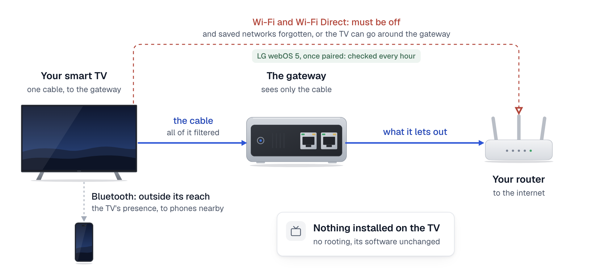

# What it stops, and what it cannot

tvgw controls only the traffic that passes through the gateway. It may not stop everything: how much it stops depends on the TV. This page says what the gateway assumes, what it is known to stop, what it is known not to stop, and what you can do about each.

<picture>
  <source media="(prefers-color-scheme: dark)" srcset="diagrams/fig-19-what-it-stops.dark.png">
  
</picture>

*Only the cable is filtered: Wi-Fi must be off, and Bluetooth stays outside the gateway's reach.*

## What it assumes

One cable is the TV's only connection to anything:

- the TV's Wi-Fi is off, and every saved Wi-Fi network is forgotten, so the TV cannot rejoin one by itself;
- Wi-Fi Direct and screen sharing are off;
- nothing else is plugged into the TV's network port, and its cable runs to the gateway, not to your router.

The install guide asks you to do this before you run setup. Your TV's page says what is known about each switch on that brand.

## What it stops

Measured on the LG CX the project was built on, over one day ([the measurements](tv/lg-cx-measured.md)):

- **Known tracking names are refused.** The TV asked for known advertising, tracking and fingerprinting services 3,983 times. Every one was refused. A refused name gets no address, so none of them led to a connection.
- **The TV cannot reach your other devices.** That day the TV tried five addresses on the home network, 266 times each. The gateway dropped every attempt, so your phones, laptops and other devices stay out of its sight.
- **The known ways around the filter are closed.** A lookup the TV sends to another DNS server is answered by the filter instead. Encrypted lookups are refused: on their own port always, and over the web's port to the known public servers. Apps that try the newer UDP web transport are refused too, and fall back to an ordinary connection the gateway can name.
- **The record stays at home.** What the TV did is written to a database on the gateway, and `sudo tvgw forget` deletes it. Only the optional analyst sends anything out: a scrubbed daily summary.

What got through that day: the streaming itself, LG's own services, and 28 names the profile does not classify, which carried 2.7 GB.

## What it cannot stop

Each limit has one of three statuses. *Known, mitigated by the assumption* means tvgw handles it only while the cable is the TV's only connection. *Known, partly checked* means the gateway notices some of it and lists it in the brief. *Known, not addressed* means tvgw does nothing about it, and the table says what you can do, if anything.

| Limit | Status | What you can do | Source |
|---|---|---|---|
| The TV's Wi-Fi left on, or a saved network it can rejoin | Known, mitigated by the assumption. Checked every hour on LG webOS 5 once the TV is paired: the TV reports its wired, Wi-Fi and Wi-Fi Direct states. On newer LG sets only where the TV answers the same request, which is unverified past webOS 5. On a Samsung, checked every hour without pairing: the TV reports whether it is on its cable or joined to a Wi-Fi network. Not checked on Roku, Vizio or other TVs | Forget the networks and switch Wi-Fi off. Where the TV reports its Wi-Fi, the brief raises a red line if it comes back on | [Wi-Fi disconnected is not Wi-Fi off](tv/lg-cx-measured.md#wi-fi-disconnected-is-not-wi-fi-off) |
| The TV joining an open Wi-Fi network nearby by itself | Known, mitigated by the assumption. Not shown on webOS, and unverified | Keep Wi-Fi off | [Radios and side channels, section 2](research/deep-dive-2026-11/01-radios-and-side-channels.md#2-wi-fi-off-in-the-menu-does-not-show-the-radio-is-off) |
| The Wi-Fi radio scanning nearby networks while "disconnected": LG says its TVs survey nearby access points when the relevant agreements are accepted | Known, not addressed: the gateway cannot see a radio | Leave the TV's data agreements declined | [The November report, section 1](research/state-of-the-art-2026-11.md#1-radios-and-side-channels) |
| Bluetooth advertising: the LG CX has no switch for it on webOS 5 | Known, not addressed. It announces the TV's presence to phones nearby, but carries no internet path by itself | None on webOS 5 | [Bluetooth advertises with no switch](tv/lg-cx-measured.md#bluetooth-advertises-with-no-switch) |
| Ads stitched into the video stream | Known, not addressed: the gateway decrypts nothing | None | [What gets through](tv/lg-cx-measured.md#what-gets-through-by-design) |
| What your internet provider and the services see: your home's address, and which services the TV uses | Known, not addressed | Run a VPN client on the gateway and send the TV's traffic through it ([the settings](reference/settings.md)); the VPN provider then sees what your internet provider saw | [What leaves the gateway](how-it-works/privacy-and-retention.md#what-leaves-the-gateway) |
| A privacy setting that does not do what the menu says: Samsung's viewing-data opt-out failed in most lab scenarios of a study in the proceedings of the 2027 Privacy Enhancing Technologies Symposium | Known, mitigated by the assumption: with the cable as the TV's only way out, the blocks refuse the names the service is known to use, whatever the setting says | Keep the profile's blocks | [Watching the Watchers, Privacy Enhancing Technologies Symposium 2027](https://watchingthewatchers.github.io/watchingthewatchers/paper.html) |
| A tracking name the profile does not know | Known, partly checked: shared blocklists catch some, the brief lists every new name, and the optional analyst can propose blocks | Read the brief's New hosts every day; an engineer can block a name ([block or unblock something](use/blocking.md)) | [The brief, section by section](reference/brief-sections.md#new-hosts) |
| A large upload to a service nobody has classified, such as screen fingerprints under a new name | Known, partly checked: the brief holds each hour's upload to such a service to a budget the gateway set once from two weeks of its own record, and lists every hour over it. Nothing is stopped yet. Uploads to a service the TV's profile expects, such as a streaming app's own servers, are not counted. An upload split into pieces that each stay under the budget is not seen: over several hours, over several services, over names that keep changing, or, when the gateway cannot name it, over several groups of addresses | Read the brief's `Uploads:` line; an engineer can block a name you do not use | [The brief, section by section](reference/brief-sections.md#upload-budget) |
| The TV going online while it is switched off | Known, partly checked: the brief names what the TV reached between two hourly checks that found it off. The LG CX the project was built on has stayed silent then | If nobody used the TV, check that its standby options that keep it online are off | [The brief, section by section](reference/brief-sections.md#while-off-or-asleep) |
| The TV connecting to an address it never looked up, such as a server written into its software | Known, partly checked: each such connection is counted and listed in the brief, but not blocked until someone adds the address | Read the brief's Unresolved flows; an engineer can block the address | [The brief, section by section](reference/brief-sections.md#dns-gated-egress) |
| A TV software version the project has not tested | Known, partly checked: the blocks apply, but the TV's own reports may not be readable | Help test it: your TV's page says how | [Which TVs work](tv/README.md) |
| Device identity sent from HDMI equipment by Universal Electronics' QuickSet service | Known, mitigated by the assumption: with the cable as the TV's only way out, LG's profile blocks it by name | None needed on LG | [A day in numbers](tv/lg-cx-measured.md#a-day-in-numbers) |
| The TV noticing that it is behind a filter | Known, not addressed: a refused name gets no address, which the TV can tell | None needed | [AdGuard Home](how-it-works/adguard.md) |
| The contents of encrypted traffic | Known, not addressed: the gateway sees names and volumes, never contents | None | [What gets through](tv/lg-cx-measured.md#what-gets-through-by-design) |

## What it does not need

Nothing is installed on the TV, and nothing on the TV is changed. There is no rooting and no modified software, so none of the warranty risk that rooting carries.

Everything happens at the network. That is why the same approach should apply to newer sets and other brands, though how much it stops still depends on the TV.

## Check your TV

- **LG webOS 5 (tested):** once paired, the gateway reads the TV's privacy settings and its Wi-Fi state every hour. You check nothing yourself after setup ([LG TVs](tv/lg-webos.md)).
- **LG webOS 6 and later:** the same readings, where the TV answers them. Until the brief shows it can read your TV, check on the TV's menus that Wi-Fi is off.
- **Samsung:** every hour the gateway reads whether the TV is on its cable or on Wi-Fi, without pairing. Check the privacy settings on the TV's own menus ([Samsung TVs](tv/samsung-tizen.md)).
- **Roku:** the gateway reads nothing on the TV. Check Wi-Fi and the privacy settings yourself ([Roku TVs](tv/roku.md)).
- **Vizio:** the gateway reads nothing on the TV. Check Wi-Fi and the privacy settings yourself ([Vizio TVs](tv/vizio-smartcast.md)).
- **Any other TV:** tvgw has no profile for it yet. It still keeps the TV away from your other devices and reports every day ([other TVs](tv/README.md#other-tvs)).
