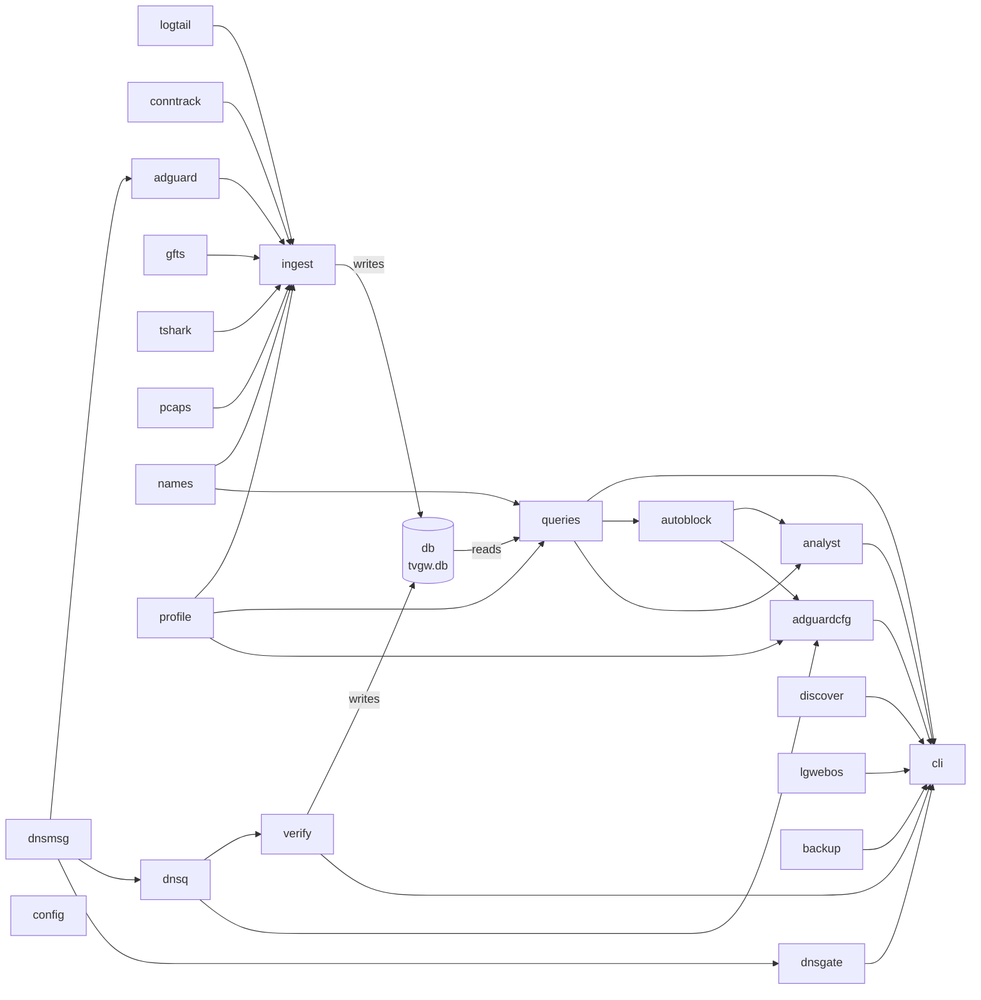

# The tvgw package

The Python side of the gateway: parsers for every log and capture the Pi writes, the store, the hourly ingest, the queries behind the brief, `tvgw verify`, AdGuard Home as configuration, the analyst and the CLI. This page owns the module map, the rules the code follows, the only command reference and the ways to extend the code, for developers changing the Python code and for operators looking up a command. The firewall, the capture and the units are shell and systemd, described in [deploy/README.md](../../deploy/README.md).

## Module map

Every module in `src/tvgw`, alphabetically, with the modules that import it.

| Module | What it is | Used by |
|---|---|---|
| `__init__.py` | The package docstring and `__version__`, which `tvgw --version` prints. | `cli` |
| `adguard.py` | Parses AdGuard Home's `querylog.json` records into `DnsRecord` (question, decoded answers, the rule that matched, upstream, elapsed time) and reads `user_rules` from its YAML. `parse_time` reads RFC 3339 times. | `ingest`, `gfts` |
| `adguardcfg.py` | AdGuard Home as configuration. `desired()` builds the lists, rules, upstreams, the TV's client entry and the owned settings from the profile, the settings and the machine's rules file; `plan()`, `changes()` and `apply()` merge, describe and write them under a lock, with a backup and a rollback. | `cli`, `analyst` |
| `analyst.py` | The analyst: the minimized evidence pack, the request to Claude, the vetting of each proposal, the files in `reports/proposals/`, and the code side of [design decision 20](../../docs/design-decisions.md#20-the-gateway-blocks-on-its-own-under-three-watches) (`autonomous()`, `check()`, `undo()`). | `cli` |
| `autoblock.py` | Autonomous blocking's evidence and records: traffic shapes, the code's gate, the machine's rules file, the `auto_rules` and `judgments` rows, the hourly judge and the live canary. | `analyst`, `adguardcfg`, `queries`, `cli` |
| `backup.py` | `VACUUM INTO` a copy of the store, `PRAGMA quick_check` on the copy, keep the newest copies. | `cli` |
| `cli.py` | The `argparse` wiring (`build_parser()`), one `cmd_*` function per command, `table()`, `render_brief()`, and `clean()` for text from the TV. | the `tvgw` entry point in pyproject.toml |
| `config.py` | `Settings`, every path and switch the code uses. `load()` reads the keys in `CONF_KEYS` from the settings file and refuses a value it cannot use. | every command, through `cli.main()` |
| `conntrack.py` | Parses `conntrack -E -e DESTROY -o timestamp,extended` lines into `Flow`. | `ingest` |
| `db.py` | The store: `SCHEMA` (`SCHEMA_VERSION = 6`, 19 tables and one view), `connect()`, the `meta` helpers and `counts()`. | `ingest`, `verify`, `cli` |
| `discover.py` | Finds the TV on the TV-side network from the DHCP lease, the neighbour table, the vendor LAN-API ports and SSDP. `write_identity()` records it in the settings file. | `cli` |
| `dnsgate.py` | The DNS gate's feeder: reads the resolver's answers to the TV from a tcpdump stream and adds their IPv4 addresses to `inet tvgw_gate resolved4`. | `cli` |
| `dnsmsg.py` | Decodes A, AAAA and CNAME answers and the response code from a raw DNS message. `answers_text()` writes the `A:1.2.3.4,CNAME:x` form the store keeps. | `adguard`, `adguardcfg`, `dnsgate`, `dnsq` |
| `dnsq.py` | Sends one plain UDP DNS question and decodes the answer. | `verify`, `adguardcfg`, the hardware tests |
| `gfts.py` | Parses the nginx URL-filter log and extracts `biz_code`. | `ingest`, `queries` |
| `ingest.py` | Every source into the store, each in its own transaction, then the `hosts` refresh and pruning, under one lock. | `cli` |
| `lgwebos.py` | Reads the LG TV's settings over its LAN API, read-only, with the optional `bscpylgtv`. | `cli`, `queries`, `analyst` |
| `logtail.py` | Reads new complete lines from a growing log and survives `copytruncate` and rename rotation. | `ingest` |
| `names.py` | Which names are public internet names, which addresses are the home LAN (`LAN_NETS`, the firewall's `lan4` set), registrable domains, and Shannon entropy for random-looking labels. | `ingest`, `queries` |
| `pcaps.py` | The pcap directory: which file tcpdump holds open (`live_files()`, read from `/proc`), which files are finished, and `prune()`. | `ingest`, `cli` |
| `profile.py` | Loads a profile (a TOML file and its `.rules` file), categorizes names, generates AdGuard rules, lints them, and looks up generations and hardware. | every command; `ingest`, `queries`, `adguardcfg`, `analyst`, `autoblock`, `verify` |
| `queries.py` | The read side: `window_report()` and its three shapes `brief()`, `weekly()` and `latest()`, `red_lines()`, and the queries behind the read commands. | `cli`, `analyst`, `autoblock` |
| `tshark.py` | The one tshark pass per pcap (TLS hellos, plain-HTTP requests, SYNs), run as `nobody` in a sandbox when the caller is root. | `ingest` |
| `verify.py` | The checks behind `tvgw verify`, and `record()` for the verdict, the firewall counters and the recorded versions. | `cli` |
| `profiles/` | The bundled profiles, shipped as package data: [profiles/README.md](profiles/README.md). | `profile` |

## How the modules fit

Each arrow points from a module to the module that consumes what it produces. `config` supplies `Settings` to every command through `cli.main()` and is shown once, without edges.



*The package's modules by what each feeds: data moves one way, from the parsers through ingest into the store and out through queries to the CLI.*

- **The parsers** turn lines into dataclasses. `logtail` reads new lines from the growing logs; `conntrack`, `adguard` and `gfts` parse them; `dnsmsg` decodes the DNS answers inside AdGuard's records; `pcaps` says which captures are finished and `tshark` reads them. `names` and `profile` judge the names those records carry.
- **The store.** `ingest` writes all of it into the SQLite file `db` defines. `verify` writes its verdicts and the firewall counters there too.
- **The read side.** `queries` reads the store through a connection the CLI opens and returns plain data. `cli` renders it, and `autoblock` and `analyst` build on the same `window_report()`.
- **AdGuard and the resolver.** `adguardcfg` builds AdGuard Home's configuration from the profile and the machine's rules file, which it reads through `autoblock`, and waits for the resolver with `dnsq`. `verify` asks the resolver through `dnsq` as well. `dnsq` and `dnsgate` decode answers with `dnsmsg`.
- **The standalone modules.** `dnsgate`, `discover`, `lgwebos` and `backup` are called from `cli`. `lgwebos` also gives `queries` the Live Plus key (`ACR_KEY`) and `analyst` the canary's readings of the TV.

Data comes back in one place. `autoblock` writes the `auto_rules` and `judgments` rows, and `queries.window_report()` reads them back through `autoblock.summary()` for the brief. `autoblock` imports `queries` at module level, so `queries` and `adguardcfg` import `autoblock` inside the function that needs it; a module-level import there would be circular.

## Rules of the code

- **Parsers are pure.** A parser takes a line or bytes and returns a dataclass, a list or `None`, and reads no file and no clock: `conntrack.parse_flow()`, `adguard.parse_querylog_line()`, `gfts.parse_line()`, `tshark.parse_row()`, `dnsmsg.decode_answers()`, `dnsgate.addresses()`, `discover.parse_leases()`. The tests feed them lines captured on the Pi.
- **`ingest.py` is the only writer of the base tables.** The tables loaded from the Pi's logs and captures, and the ingest bookkeeping, are written by `ingest` alone. Three other writers own their own rows: `verify.record()` writes `verify`, `fw_counters` and the `*_version` keys of `meta`; `autoblock` writes `auto_rules` and `judgments`; `db.connect()` writes the schema version. Each ingest source is one transaction (`step()` in `ingest.run()`), so a failing source becomes a warning and never rolls back the others. The columns are in [the tables](../../docs/data-model.md#tables).
- **Queries return plain data, and `cli` renders it.** A function in `queries.py` takes a connection and a window and returns tuples or dicts. `cli.py` prints them with `table()`, which passes every cell through `clean()`, and `--json` prints the same dicts. Text from the TV or from the servers it talks to reaches the terminal only through `clean()`, or `lgwebos.clean()` for the TV's own setting values.
- **Everything that touches the Pi is a parameter.** tshark is the `extract` argument of `ingest.run()`, `/proc` is `live`, and the kernel log is `oddport_lines` and `gate_lines`. `verify.check()` takes `run`, `read`, `mtime` and `resolve`; `adguardcfg.apply()` takes `control`, `ready` and `check`; `analyst.run()` takes `make_client` and `hooks`; `discover.discover()` takes the lease, neighbour and journal text and its probes; `dnsgate.feed()` takes `read` and `nft`. The default is the live system, and the unit tests pass fakes: [how the code is tested without a gateway](../../tests/README.md#how-the-code-is-tested-without-a-gateway).
- **Settings are fields.** Every path and switch is a field of `config.Settings`, so a test points the tools at a temporary tree. Only the keys in `CONF_KEYS` come from the settings file, and `config.load()` refuses a near miss such as `BLOCK_QUIC=Yes` instead of falling back. The keys and their defaults are in [the settings file](../../deploy/README.md#the-settings-file).
- **Vendor knowledge is profile data.** Which names are the TV doing its job, which must never be blocked and which hosts the URL filter takes come from the profile, never from a list in the code.
- **Optional dependencies load late.** The one required dependency is `pyyaml>=6`. The `lgwebos` extra (`bscpylgtv>=0.5`) and the `analyst` extra (`anthropic>=2.0,<3`) are imported inside the functions that need them. `cli` imports `analyst`, `verify`, `adguardcfg` and the other command modules inside their `cmd_*` functions, so a read command loads none of them. The `dev` extra is `pytest>=8`, `ruff>=0.5` and `mutmut>=3.2`, and pyproject.toml sets `requires-python = ">=3.11"`.
- **Style.** ruff checks the rule sets `E`, `F`, `I`, `B`, `UP`, `SIM` and `RUF` with `line-length = 110` (pyproject.toml). `make gate` runs ruff and the unit tests as CI does: [how a change reaches the gateway](../../deploy/README.md#how-a-change-reaches-the-gateway).

## Commands

`tvgw` is the one command (`tvgw = "tvgw.cli:main"` in pyproject.toml). The table lists every subcommand of `cli.build_parser()`, in the parser's order; the row limits are the `limit` defaults of the functions in queries.py. tvgw checks no privilege itself, so a command needs whatever the files it opens need. "adm" means any member of the `adm` group, which can read the settings file and the store, so the commands that only read the store run without `sudo`. "root" means the command writes the store, reads a root-only file or changes the system. The modes are in [where it lives and who can read it](../../docs/privacy-and-retention.md#where-it-lives-and-who-can-read-it), and the units that run these commands on a schedule are in [the units](../../deploy/systemd/README.md#units).

| Command | Arguments | What it does | Needs | Exit codes |
|---|---|---|---|---|
| `ingest` | none | Loads new log lines and finished pcaps into the store, refreshes `hosts`, prunes rows older than `DB_DAYS`, and prints a one-line summary. Each warning goes to stderr. | root | 0; 1 on any warning |
| `prune-pcaps` | none | Deletes the pcaps ingest has read once they are older than `PCAP_DAYS`, then the oldest read ones while the directory is over `PCAP_MAX_GB` or the filesystem has less than `FREE_FLOOR = 1 << 30` (1 GB, in src/tvgw/pcaps.py) free. It never deletes the file tcpdump holds open, and a finished file ingest has not read goes only at twice `PCAP_DAYS`. | root | 0; 1 on any warning |
| `brief` | `[DAY] [--json]` | The report for one local calendar day, yesterday by default: [the brief's sections](../../docs/reading-the-brief.md#sections). | adm | 0 |
| `new-hosts` | `[SINCE]` | Names first seen since SINCE, with category, first seen, the `hosts` counters, state and last rule. | adm | 0 |
| `retries` | `[SINCE]` | The 40 blocked names looked up most since SINCE, with the first and last lookup and the rule. | adm | 0 |
| `allowed` | `[SINCE]` | Up to 60 allowed public names outside the profile's `expected_categories`, most looked up first, with the last allow rule. | adm | 0 |
| `top-upload` | `[SINCE]` | The 30 destinations the TV sent most bytes to, per TLS name, or per address when no hello named the flow. `+N` counts the further addresses under one name. | adm | 0 |
| `gfts` | `[SINCE]` | URL-filter requests by HTTP status and `biz_code`, with bytes. | adm | 0 |
| `tvstate` | `[SINCE]` | The TV's power readings with the foreground app, then its settings changes. | adm | 0 |
| `host` | `NAME` | One name: first and last seen, category, counters, state, the rules seen in its answers, the addresses its hellos went to, its connections and bytes, its plain-HTTP requests, and lookups per day. | adm | 0; 1 when the store never saw the name |
| `rules` | none | Policy history: every AdGuard rule, URL-filter regex and `block4.txt` entry, with when it appeared and when it was removed. | adm | 0 |
| `size` | none | Rows per table in `db.TABLES`, the oldest DNS row and the file size. | adm | 0 |
| `analyst` | `[--day DAY \| --since SINCE \| --week WEEK \| --weekly] [--model MODEL] [--effort EFFORT] [--dry-run] [--show] [--force]` | Sends one window's minimized evidence pack to Claude and writes the vetted proposals to `reports/proposals/`. With `ANALYST_APPLY=auto` it applies the blocks that pass [design decision 20](../../docs/design-decisions.md#20-the-gateway-blocks-on-its-own-under-three-watches). `--dry-run` writes the pack and the prompt and sends nothing; `--show` prints the newest proposals. The details are in [the analyst and autonomy](../../docs/analyst-and-autonomy.md). | root; adm for `--show` | 0, also without a key file or on a day with nothing new; 1 when the request fails or `--show` finds nothing; 2 on a usage error |
| `undo` | `[--all]` | Takes the newest rule the gateway added on its own out of `AUTO_RULES` and AdGuard, recorded as reverted by the owner. `--all` takes every one. | root | 0, also with nothing to remove; 1 when the file changed but the AdGuard re-apply failed |
| `autoblock` | `check \| list` | `check` re-judges every machine rule on probation against the store and reverts the ones that fail. `list` prints every machine rule with when it was added, its verdict and why. | root | `check`: 0, or 1 when a reverted rule could not be taken out of AdGuard; `list`: 0 |
| `dnsgate-feed` | none | Runs tcpdump on the resolver's answers to the TV and adds every IPv4 address to `inet tvgw_gate resolved4`. It is the long-running process of `tvgw-dnsgate.service`. | root | 0 with `DNSGATE=off`; 1 when tcpdump ends |
| `backup` | `[--keep KEEP]` | Writes a copy of the store to `<STATE_DIR>/backup` with `VACUUM INTO`, checks it with `quick_check`, and keeps the newest KEEP copies (default 7). | root | 0; 1 on any failure |
| `sql` | `QUERY...` | Runs one statement that starts with `select`, `with`, `explain`, `pragma` or `values`, on a connection opened `mode=ro` with `query_only`, and prints a table. | adm | 0; 1 for any other statement or an SQLite error |
| `report` | `[--day DAY \| --week WEEK \| --since SINCE [--until UNTIL]] [--json]` | The brief's data over a window, by default the last 24 hours up to now. `--week` adds a by-day table. | adm | 0; 2 on a usage error |
| `discover` | `[--iface IFACE] [--write] [--yes] [--name NAME] [--no-ssdp] [--json]` | Lists the devices on the TV-side network with their evidence and the bundled profile that matches. `--write` records `TV_MAC`, `TV_IP`, `TV_NAME` and, when a profile matches, `PROFILE` in the settings file, and asks which device when there are several (`--yes` takes the first). | root | 0; 1 when nothing is found, no device can be chosen, or the chosen device has no MAC address yet |
| `profile` | `[--profile PROFILE] [--model MODEL] [--webos WEBOS] [--firmware FIRMWARE]` | Prints the profile's description, expected categories, clock hosts, the rules lint, the must-allow hosts and the generations. For a model, given or the one the TV reported, it adds the hardware facts and the checklist. | adm | 0; 1 when the lint finds problems or the `--profile` file cannot be loaded |
| `verify` | `[--record] [--json]` | Checks that the firewall, routing, resolver and services still hold, one line per check: [what tvgw verify checks](../../docs/troubleshooting.md#what-tvgw-verify-checks). `--record` also stores the verdict and a snapshot of every firewall counter. | root | 0; 1 on any FAIL or when the run could not be recorded |
| `tvcheck` | `[--key-file KEY_FILE]` | Reads the LG TV's settings over its LAN API with the pairing key (default `/var/lib/tvgw/lgtv-keys.sqlite`) and prints `key = value` lines. | root | 0; 1 when the TV is unreachable; 2 when Live Plus is not off |
| `adguard` | `diff \| apply [--dry-run]` | Lints the profile, then compares AdGuard Home's YAML with the configuration the profile, the settings and the machine's rules call for. `diff` prints the drift. `apply` validates the candidate, backs up the live file, swaps the candidate in, and rolls back unless the resolver answers for the first must-allow name within 30 seconds (`timeout=30.0` in `adguardcfg.dns_ready()`). `--dry-run` prints the changes and makes none. | root | 0, also for `--dry-run` and for an `apply` with nothing to do; 1 on drift from `diff`, a profile that does not lint, a YAML that cannot be read, or an `apply` refused or rolled back |

On the Pi:

```sh
tvgw brief                        # yesterday
tvgw report --week 2026-W43
tvgw new-hosts 7d
tvgw host <name>
tvgw sql "select count(*) from dns"
sudo tvgw verify
```

### Global options

- `--conf CONF` is the settings file, `/etc/tvgw/tvgw.conf` by default. A missing file gives every setting its default. A file that exists and cannot be read stops the command with a traceback, on purpose: `config.load()` never turns an unreadable file into the defaults.
- `--db DB` is the store's path, in place of `DB_PATH`.
- `--version` prints `tvgw` and the version, then exits 0.

Before any subcommand runs, `cli.main()` loads the settings and the profile `PROFILE` names. A setting value `config.load()` refuses prints `tvgw: <reason>` and exits 1. A profile that cannot be loaded whole prints `tvgw: profile <name>: <reason>` and exits 1.

### Argument grammar

| Argument | Form | Read as | Used by |
|---|---|---|---|
| DAY | `YYYY-MM-DD` | One local calendar day, midnight to midnight (`queries.day_bounds()`). | `brief`, `report --day` |
| SINCE | A number and a unit: `s`, `m`, `h`, `d` or `w` (`90m`, `2h`, `1.5d`, `7d`). | That long before now (`queries.since_epoch()`). | the six window commands, `report --since` |
| SINCE | An ISO date, or date and time (`2026-10-26`, `2026-10-26T08:00`). | The Pi's local time, unless the value carries an offset. | the six window commands, `report --since` |
| WEEK | `YYYY-Www` (`2026-W43`). | Monday 00:00 to the next Monday 00:00, local (`queries.week_bounds()`). | `report --week` |
| UNTIL | The forms of SINCE. | The window's end; only with `--since`; now by default. | `report --until` |

The six window commands are `new-hosts`, `retries`, `allowed`, `top-upload`, `gfts` and `tvstate`, and their SINCE defaults to `1d`. A malformed DAY, SINCE, WEEK or UNTIL is a usage error: argparse prints the usage and exits 2. `report` also exits 2 when `--until` comes with `--day` or `--week`, or when `--since` is not before `--until`.

`tvgw analyst` reads its window options itself. Its `--since` takes hours only (`6h`, at most `168h`), its `--week` must match `\d{4}-W\d{2}`, and its `--day` is passed on unchecked.

### Exit codes

- 0 means the command did its work and found nothing it reports as a finding.
- 1 means a finding (`host` never saw the name, `verify` failed a check, `adguard diff` found drift, `profile` found lint problems, `ingest` warned) or a failure the command names in one line. Every command that reads the store exits 1 with `cannot open <path>` when it cannot open it.
- 2 means a usage error for every command. `tvcheck` also exits 2 when Live Plus is not off, which `tvgw-analyze` reads as a warning.

## How to change or extend it

### Add a query

1. Write a function in `queries.py` that takes `conn`, `since` and `until` and returns tuples or dicts. Pass `_until(until)` to SQL, so `None` means open-ended.
2. Name flows with `FLOW_NAME` when the query reports per TLS name, so it agrees with Top upload and the category table: [naming a connection](../../docs/architecture.md#naming-a-connection).
3. Test it on hand-seeded rows in tests/unit/test_queries_gaps.py.
4. Show it through a command or a brief section, below.

### Add a brief section

1. Compute it in `window_report()` into a new key of `o`. The JSON output carries the key as it is.
2. Render it in `cli.render_brief()` where it belongs in the reading order. Pass every string from the TV through `table()` or `clean()`, and print the section only when it has something to show, unless an empty value is itself news.
3. Put a line that must never be true in `red_lines()`, in the order to act on it, and give it an entry in [the red lines](../../docs/operations.md#red-lines).
4. Regenerate the golden brief and review the file it writes. On your workstation:

   ```sh
   TVGW_GOLDEN_OUT=<file> python3 -m pytest -k brief_text
   ```

5. Paste the reviewed text into `BRIEF` in tests/unit/test_cli_golden.py. A section the fixture day does not reach goes into `EVERY_SECTION` in tests/unit/test_cli_rich.py.
6. Describe the section in [the brief's sections](../../docs/reading-the-brief.md#sections).

### Add a verify check

1. Append a `Check(name, ok, detail)` in `verify.check()`, reading the system only through the injected `run`, `read`, `mtime` and `resolve`.
2. Put a rule the check finds by its text in `verify.KEY_RULES`. tests/unit/test_deploy_lint.py checks each entry against `tvgw-apply`.
3. Script the command output in tests/unit/test_verify.py, for a pass and for a fail.
4. Describe the check in [what tvgw verify checks](../../docs/troubleshooting.md#what-tvgw-verify-checks).

### Add a CLI command

1. Write `cmd_x(a, s, prof) -> int` in `cli.py`: `a` is the parsed arguments, `s` the `Settings`, `prof` the loaded profile, and the return value the exit code.
2. Add a subparser in `build_parser()` with `set_defaults(fn=cmd_x)`.
3. Open the store with `_ro(s)` in a read-only command, print rows with `table()`, and import a heavy or optional module inside the function.
4. Return `_usage(message)` for a usage error found after parsing, which exits 2.
5. Add a case to `GOLDEN` in tests/unit/test_cli_golden.py for a read command, and a row to [Commands](#commands).
6. Give a command that runs on a schedule its unit: [the units](../../deploy/systemd/README.md#units).

### Show a new firewall counter in the brief

1. Give the rule in deploy/nftables/tvgw-apply both a `counter` and a `comment`: [the firewall](../../deploy/nftables/README.md).
2. Add `(comment prefix, label)` to `queries.FW_LINES`, in the order the brief shows it. The first matching prefix wins.
3. Run `make gate`. tests/unit/test_fw_lines.py reads the script and fails until every counted drop or reject has a line and every line matches a counted rule. A counted accept that is not evidence goes in that test's `ACCEPT_COUNTERS`.
4. Add the label to [Firewall held](../../docs/reading-the-brief.md#firewall-held).

### Add an ingest source

1. Write a pure parser for one line, and test it with lines captured on the Pi.
2. Write `ingest_x(conn, s, warn)` with an `insert(lines)` closure that turns a batch of lines into rows, and feed it with `_tail(conn, "x", path, insert, warn)`. `_tail` reads `BATCH = 10_000` lines at a time (src/tvgw/ingest.py), commits each batch together with its cursor, and raises `SourceMissing` when the input does not exist. A kernel-log source uses `_ingest_kernel_log()` with an injected `lines_since`.
3. Add `step("x", ...)` in `run()`, before the pcaps step, which runs within `PCAP_BUDGET`.
4. Add the name to `SOURCES`, so the run records when it read the source, and a row count to the `rows` map in `queries.coverage()`, so Coverage can call the source `NOT ASSESSED`.
5. Add the table to `db.SCHEMA`, to `db.TABLES` for `tvgw size`, and to the list in `ingest.prune()` when its rows should age out with `DB_DAYS`.
6. Document the table in [the tables](../../docs/data-model.md#tables).

### Add a schema column

1. Add the column to its `CREATE TABLE` in `db.SCHEMA`, for new stores.
2. Add `(table, column, type)` to `db.ADDED_COLUMNS`. `_migrate()` adds the column to an existing store at the next writer's open.
3. Raise `SCHEMA_VERSION`. The hardware suite checks the version a store records.
4. Test the migration on an old store, as `test_pcaps_done_gains_its_newer_columns_on_an_old_store` in tests/unit/test_ingest.py does.
5. Document the column in [the tables](../../docs/data-model.md#tables).

A superseded index goes in `db.DROPPED_INDEXES`. A change to a column's type or meaning has no migration path; the schema only ever adds.

## Gotchas

- **The schema only adds.** `CREATE ... IF NOT EXISTS` runs at every writer's open, so a new table or index is safe. The version history in the comment above `SCHEMA_VERSION` stops at 3; the code is at 6.
- **The AdGuard cursor key is `adguard`.** The source is `dns` everywhere else. Renaming the key would re-read the whole query log.
- **tshark exits 2 for two things.** It means "cut short in the middle of a packet", which is normal for a capture, only when stderr says so (`CUT_SHORT_TEXT` in src/tvgw/tshark.py). A file tshark could not open also exits 2, and `extract()` raises. Ingest retries such a pcap on each run up to `PCAP_MAX_ATTEMPTS = 24` (src/tvgw/ingest.py), then records it as unreadable in `pcaps_done.error`.
- **Rule comments are an interface.** `queries.FW_LINES` and `verify.KEY_RULES` match nftables comments and rule text, and a renamed comment drops its line from the brief ([design decision 13](../../docs/design-decisions.md#13-counters-not-logs-prove-the-firewall-held)). tests/unit/test_fw_lines.py and tests/unit/test_deploy_lint.py read `tvgw-apply` and fail when either stops matching.
- **Categories follow the profile.** `hosts.category` is recomputed for every name when the profile's rules change (`meta.hosts_profile` fingerprints them), and the brief categorizes at query time, so a profile change applies to old rows too.
- **Time.** Days are local calendar days. The unit tests pin `time.time` and the time zone in tests/unit/conftest.py; code that reads the clock through `datetime.now()` escapes the pin.
- **`hosts.notes`** survives a rebuild of `hosts`, and no command writes it.
- **Settings the two sides do not share.** `WAN_GW`, `URL_FILTER_RESOLVER` and `DOH_LIST_URL` are read only by the shell scripts. `GW_IP`, `STATE_DIR`, `DB_PATH` and `REPORTS_DIR` change the Python side only: the shell side hardcodes `10.10.10.1` and `/var/lib/tvgw`, and `tvgw-analyze` writes its reports to `/var/lib/tvgw/reports` whatever `REPORTS_DIR` says. `Settings` fields outside `CONF_KEYS`, such as `tv_if` and the log, pcap and AdGuard paths, keep their defaults on the Pi.
- **`tvgw autoblock list` opens the store for writing.** `cmd_autoblock()` calls `db.connect()` without `readonly` for both actions, so even the listing needs root.
- **`tvgw top-upload` counts the gateway.** It lists DNS and URL-filter traffic to `GW_IP`; the brief's Top upload leaves the gateway out.
- **`tvgw size` lists `db.TABLES` only.** `gate`, `auto_rules`, `judgments`, `meta` and `ingest_state` are not counted.
- **Two kinds of megabyte.** `size`, `ingest` and `backup` divide by 1,000,000; `prune-pcaps` and `cli.hb()`, which prints every size in the brief, divide by powers of 1024.
- **The `hosts` counters are not the window's.** `new-hosts` and the brief's New hosts show `dns_n`, `tls_n` and `http_n`, which count every row the store holds for the name.
- **`tvgw analyst` checks less than `report`.** A malformed `--day` ends in a traceback and exit 1, not a usage error, and its usage errors begin `tvgw report: error:` because it shares `_usage()`.
- **`tvcheck` exits 0 without a Live Plus value.** Only a reading other than `off` gives 2.
- **`tvgw profile` prints the checklist only for a model,** given with `--model` or the one the TV reported.
- **Readers wait for the writer.** The store uses a rollback journal ([design decision 10](../../docs/design-decisions.md#10-a-rollback-journal-not-wal)), and `db.connect()` waits up to 60 seconds for a lock.
