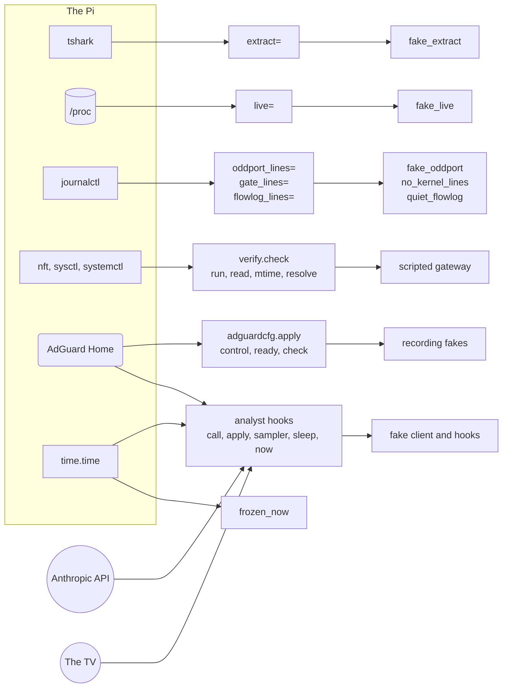

# Tests

This page owns the three kinds of tests, the question each answers, where each runs, and how the code is tested without a gateway. It is for developers changing the code, the deploy tree or the profile. How CI runs them is in [how a change reaches the gateway](../deploy/README.md#how-a-change-reaches-the-gateway).

## Kinds of tests

| Kind | Question it answers | Command | Where it runs |
|---|---|---|---|
| Unit, in [`unit/`](unit/README.md) | Does the code do the right thing with real input? | `make test`, or `make gate` for ruff and the tests together | Anywhere, with no gateway; in CI's `test` job on Python 3.11 and 3.13 |
| Mutation, over `unit/` | Would the unit tests notice if the code were wrong? | `make mutmut` | On demand, and in CI's weekly `mutation` job; it never blocks a push |
| Hardware, in [`hardware/`](hardware/README.md) | Does the live gateway hold right now? | `make hardware PI=<ssh-host>` | On the Pi, as root, under the install lock; in CI's `hardware` job right after each deploy, inside the same lock (`deploy/sync-install.sh`) |

- **Unit tests** are built from lines captured on the Pi, with site identifiers replaced. They include the profile lint, so a policy change that breaks the lint fails `make gate`.
- **Mutation testing** changes the code in small ways, such as `<` to `<=`, a constant or a dropped call, and runs the unit tests again. A mutant that survives is a behavior no test pins. `pyproject.toml` mutates `src/tvgw/` with `tests/unit/` and leaves out `src/tvgw/lgwebos.py`, which needs a TV.
- **Hardware tests** read the real firewall, resolver, URL filter, services and store, and state one operational guarantee each.

`make gate` is `ruff check src tests`, `ruff format --check src tests` and `python3 -m pytest -q`, which is what CI's `test` job runs. `pyproject.toml` sets `testpaths = ["tests/unit"]`, so a bare `pytest` never runs the hardware suite, and ruff checks 110-column lines, except that long lines are allowed under `tests/` for verbatim log lines. `make dev` installs the package editable with the `dev` extras (pytest, ruff, mutmut).

## How the code is tested without a gateway

Everything that touches the Pi is a parameter, and the unit tests pass fakes; [the package's rules](../src/tvgw/README.md#rules-of-the-code) state the rule. The seams and their fakes:

| Dependency on the Pi | Seam | Fake in the unit tests |
|---|---|---|
| `/proc`, for the pcap tcpdump holds open | `ingest.run(live=)` and `pcaps.live_files` | the autouse fixture `fake_live` |
| journalctl's kernel lines | `ingest.run(oddport_lines=, gate_lines=)` | `fake_oddport` in `unit/conftest.py`, and `no_kernel_lines` in the test files |
| `tvgw-flowlog`'s journal, for conntrack's lost events | `ingest.run(flowlog_lines=)` and `ingest.journal_flowlog_lines` | the autouse fixture `quiet_flowlog` |
| `nft`, `sysctl`, `systemctl`, files and DNS | `verify.check(run, read, mtime, resolve)` | the scripted gateway in `unit/test_verify.py` |
| tcpdump and `nft`, for the DNS gate feeder | `dnsgate.feed(read, nft, log, clock)` | fakes in `unit/test_dnsgate.py` |
| The AdGuard Home service and binary | `adguardcfg.apply(control, ready, check)` | functions that record the calls in `unit/test_adguardcfg.py` |
| The Anthropic API | `analyst.run(make_client=, key_path=)` | `FakeClient` in `unit/test_analyst.py` and `unit/test_autoblock.py` |
| The disk and the clock, for pcap retention | `pcaps.prune(now=, disk_free=)` | fakes in `unit/test_pcaps.py` |
| The local time zone | `TZ`, set for every test | the autouse fixture `chicago_time` |
| The second model, AdGuard, the TV and the clock during an autonomous block | `analyst.run(hooks=)` with `call`, `apply`, `sampler`, `sleep` and `now` | fakes in `unit/test_autoblock.py` |
| The TV network, for discovery | `discover.discover(probe=, ssdp=, describe=)` | captured text and fake probes in `unit/test_discover.py` |
| `time.time` | patched for every test | the autouse fixture `frozen_now` |
| tshark on a pcap | `ingest.run(extract=)` | `fake_extract` in `unit/conftest.py` |

The deploy tree is tested as text: `unit/test_deploy_lint.py`, `unit/test_deploy_units.py`, `unit/test_deploy_files.py` and `unit/test_fw_lines.py` read the scripts, units and workflow without running them. `unit/test_capture_filter.py` is the one test that runs a deployed artifact, the capture filter, through tcpdump, and it skips where tcpdump is not installed.



*From each dependency on the Pi to its seam to its fake: every place the code touches the Pi is a parameter, so the unit suite runs anywhere.*

## Which tests guard what

| You changed | Run at least | What guards it |
|---|---|---|
| `install.sh`, a shell job or the dispatcher | `make gate`, then `make deploy` and `make hardware` | `unit/test_deploy_lint.py` (shell syntax), `unit/test_deploy_files.py`; the hardware suite's installed-file and generated-config tests |
| A parser, the store, ingest, a query or the CLI | `make gate` | the parser tests from captured lines, `unit/test_ingest.py`, `unit/test_queries_cli.py`, and the goldens in `unit/test_cli_golden.py` |
| A setting in src/tvgw/config.py | `make gate` | `unit/test_config.py`, and `unit/test_deploy_lint.py` for the defaults `tvgw-apply` shares |
| A systemd unit or timer | `make gate`, then `make deploy` and `make hardware` | `unit/test_deploy_units.py`, `unit/test_deploy_lint.py` (start timeouts); the hardware suite's enabled-unit and installed-file tests |
| An nginx file | `make gate`, then `make deploy` and `make hardware` | `test_nginx_conf_matches_the_profile` in `unit/test_profile.py`; the hardware suite's URL-filter tests |
| Anything, before a release | `make mutmut` | the surviving mutants it lists |
| The analyst or autonomy | `make gate`, then `make hardware` after a deploy | `unit/test_analyst.py`, `unit/test_autoblock.py`; the hardware suite's analyst and autoblock tests |
| The brief's output | `make gate`, then regenerate the golden brief | `unit/test_cli_golden.py` ([golden tests](unit/README.md#golden-tests)) |
| The capture filter in `tvgw-pcap.service` | `make gate` on a machine with tcpdump | `unit/test_capture_filter.py` |
| The profile or its `.rules` file | `make gate`, then `sudo tvgw adguard diff` after a deploy | `unit/test_profile.py` (the lint and the categorizer), `unit/test_brief_sections.py`; the hardware suite's AdGuard drift test |
| `tvgw-apply`, a rule or its comment | `make gate`, then `make deploy` and `make hardware` | `unit/test_fw_lines.py`, `unit/test_deploy_lint.py` (key rules, defaults); the hardware suite's firewall tests |
| The workflow or `deploy/rsync.exclude` | `make gate` | `unit/test_deploy_lint.py` (the workflow's shape, pinned actions, one rsync list) |

Only the live system can show that the firewall, routing and services hold, so a change to anything under `deploy/` ends with the hardware suite.

## Before you push

On your workstation:

```sh
make gate                     # what CI's test job runs
make deploy PI=<ssh-host>     # optional: try the change on the Pi first
make hardware PI=<ssh-host>   # the hardware suite against the live gateway
```

A push to `main` that changes more than Markdown deploys to the Pi and runs the hardware suite there; a pull request runs only the unit tests.
